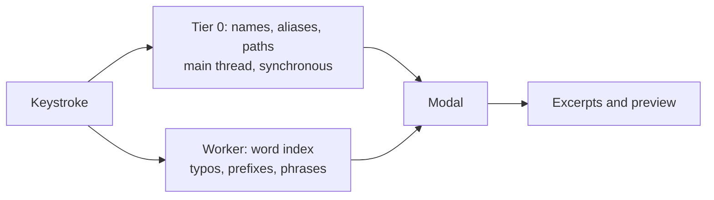

# Architecture

How Jet Search is put together, and the rules that shaped it. Read this before changing the search path.

## The rules

These hold everywhere in the code. A change that breaks one needs a very good reason.

1. **Nothing runs at Obsidian start.** The first index build begins a few seconds after the workspace is ready, in small batches, newest notes first.
2. **The main thread only draws.** The index lives in a Web Worker. The page sends a query and paints the answer.
3. **Results are never stale.** Every query carries a sequence number. The worker skips a query that a newer one has replaced, and the page ignores an answer that is not the latest.
4. **The index stays outside the vault.** It is kept in IndexedDB, one database per vault, so it is never synced, never shows up in a file list and never ends up in a backup of your notes.
5. **No network.** The one exception is the optional meaning model, downloaded only after you confirm, from a pinned revision, and checked against a pinned SHA-256.
6. **Pure where possible.** Analysis, ranking, filters, scopes and the double-tap detector take plain values and return plain values. They run in tests with no Obsidian.

## The path of a keystroke

**Tier 0** (`src/tier0/names.ts`) answers in the same frame as the key. It matches note names, aliases and folder paths on the main thread, with exact, prefix, substring, initials and typo matches, and splits or joins compound names. Everything that depends only on the notes is folded once, when a note is added, so a keystroke allocates almost nothing. While the first build runs, `src/tier0/meta.ts` also finds notes by heading, tag and property from Obsidian's metadata cache, which needs no index.

**The worker** (`src/worker/`) holds the full-text index and answers a few milliseconds later. `jet-worker.ts` handles one request at a time; `router.ts` is the handler without the Worker itself, so tests drive it directly; `protocol.ts` lists every message. The worker stops after ten minutes without a search and reloads on the next one.

**The modal** (`src/modal/jet-modal.ts`, `src/host.ts`) merges both answers into one list, so names appear first and the full-text rows fill in below without moving the row you are on.

## The index

The engine (`src/engine/`) is a word index with BM25 ranking over separate fields.

- **Fields.** A note has a name, folders, headings (H1 to H3), tags and a body, weighted 10, 7, 6, 5, 4, 2 and 1. Short fields are scored at build time, the body at query time.
- **Analysis.** One set of rules (`analyzer.ts`) turns text into terms, for notes and queries alike: accents and case folded, joiners removed, scripts written without spaces (Chinese, Japanese) handled as runs, and stemmers for nine languages (English, French, German, Spanish, Portuguese, Italian, Dutch, Swedish, Arabic).
- **Typos.** `typos.ts` walks the sorted term list with a bounded edit distance (none under 4 letters, one for 4 to 8, two above), sharing work between neighbouring terms and skipping every term under a prefix that is already too far.
- **Format.** A saved index (`segment.ts`) is one `ArrayBuffer` of aligned sections: terms, postings, per-field scores, documents and averages. Loading creates typed-array views; nothing is parsed, so a 50,000-note index loads in about ten milliseconds.
- **Changes.** Edits land in a small delta segment that is searched with the base and merged after two quiet seconds. A changed analyzer or layout bumps the index version, and an older index is rebuilt.
- **Storage.** `store.ts` keeps each vault's index in IndexedDB. A registry database remembers when each was last used and drops indexes of vaults not opened for 90 days.

## Getting notes in

`src/index/gather.ts` reads what Obsidian already knows: the text, and from the metadata cache the headings, tags, aliases and resolved links. It parses no Markdown itself. `feeder.ts` sends batches to the worker, follows renames and deletes, sends the note you are typing in 300 ms after you pause, and coalesces everything else over 100 ms.

## Search by meaning

Opt in. The model is potion-base-8M (Model2Vec, MIT licence): one 256-number vector per word piece. Jet downloads the two files, verifies them, and packs them into one int8 file of 7.7 MB. A note's vector is the normalized mean of its pieces' rows, so there is no neural network to run and no WASM. Vectors are stored as int8, one per note, beside the index, and the nearest notes come from a flat scan that takes well under a millisecond for a few thousand notes. `src/meaning/` holds the model, the install flow, the vectors and the test for whether a search reads like a question.

## Answers

For a question, `src/answers/answers.ts` re-ranks the notes that words and meaning already found by the single line that best answers it, and shows that line. It looks at how rare the question's words are in the index, the line's heading, the kind of answer asked for (a share wants a percentage, a delay wants a time) and the model's closeness for each note's best few lines. Nothing is stored.

## Results on screen

- **Excerpts** (`src/excerpt/`): one regular expression for all of a query's terms runs over the raw note, so there is no normalized copy of the note and no expression per term. Matching ignores case and accents like the index does.
- **Preview** (`src/preview/`): Obsidian renders the section around the hit, off the page, and the result is swapped in once. Rendering on the page would make Obsidian lay the page out again for every style it reads. Each render has its own child component that is unloaded when the selection changes.
- **In-note search** (`src/innote.ts`): the matching lines of the open note, from the editor's text, unsaved edits included.

## Scopes and filters

- **Scopes** (`src/scopes/`): named sets of notes defined by rules (folder, tag, property, link). The generator proposes them from the shape of a vault; it is pure and deterministic, so the same vault gives the same proposals. `keeper.ts` holds every scope's members, rechecks one note at a time as it changes, and sends only the difference to the worker.
- **Filters** (`src/filters/`): typed syntax and the filters bar share one model. A piece like `status:draft`, `#tag` or `edited:7d` becomes a chip once it is finished, and `key:value` is a filter only for a key your notes actually use, so `10:30` stays text.

## Keys and settings

`src/keys/keymap.ts` is the one place that knows every key in the window, so every hint follows what you set. `src/shift.ts` is the double-tap detector. Settings live in `src/settings-tab.ts` and `src/settings/`; saved data and its migrations are in `src/data.ts`.

## Tests

Unit tests (`test/`, Vitest) cover the engine, the analyzer, filters, scopes, excerpts, answers and meaning without Obsidian. UI tests run the modal and the settings pages against a mock of Obsidian's API. The fixture vaults in `test/fixtures` hold small invented notes in several languages. `npm run check` runs formatting, lint, type checks and every test.

## Benchmarks

`bench/` has the engine benchmarks (`bench/run.ts`, `bench/mem.ts`) and the in-Obsidian comparison against other tools (`bench/compare/`). The method and the results are in [docs/benchmarks.md](docs/benchmarks.md).
