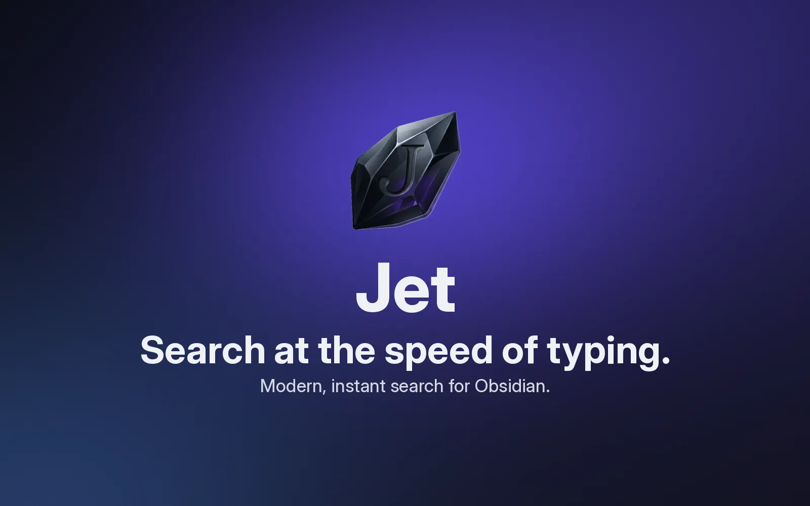
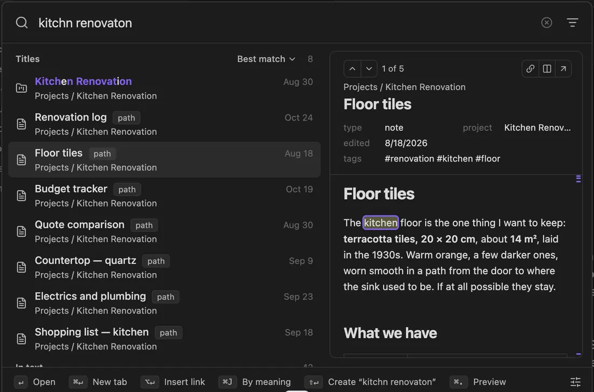
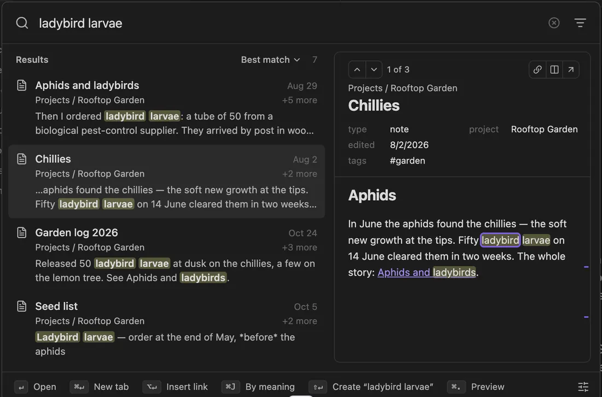
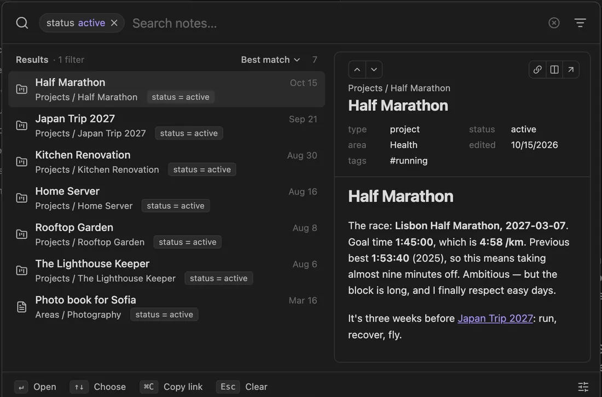
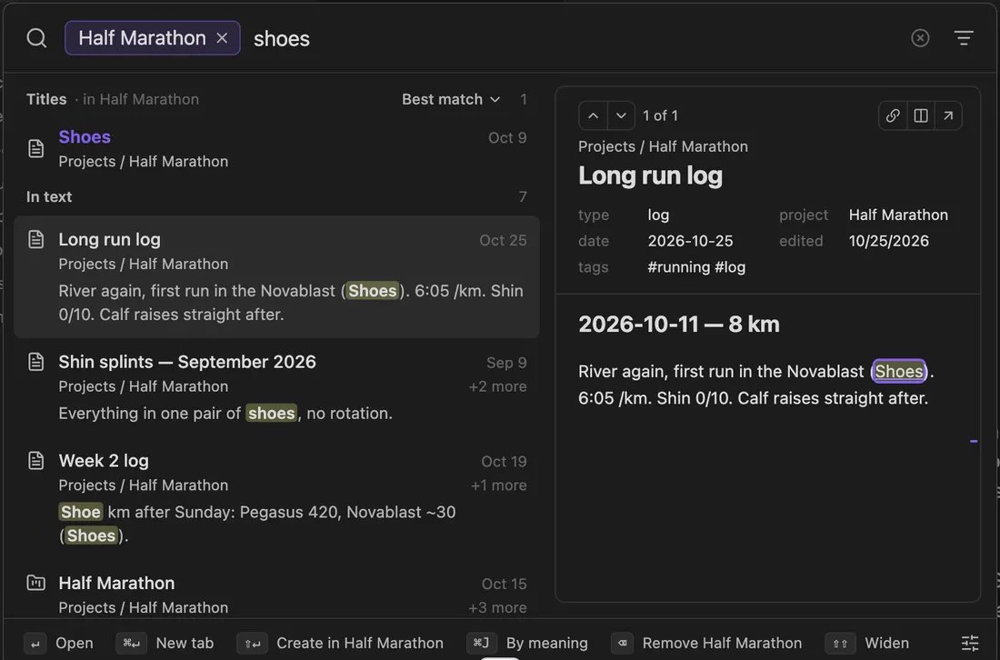
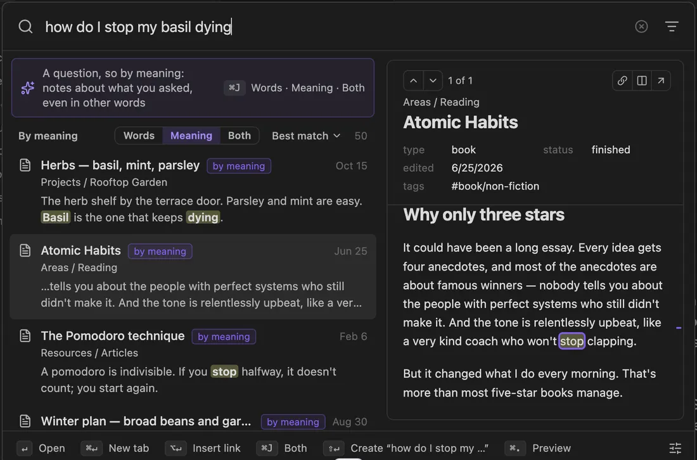
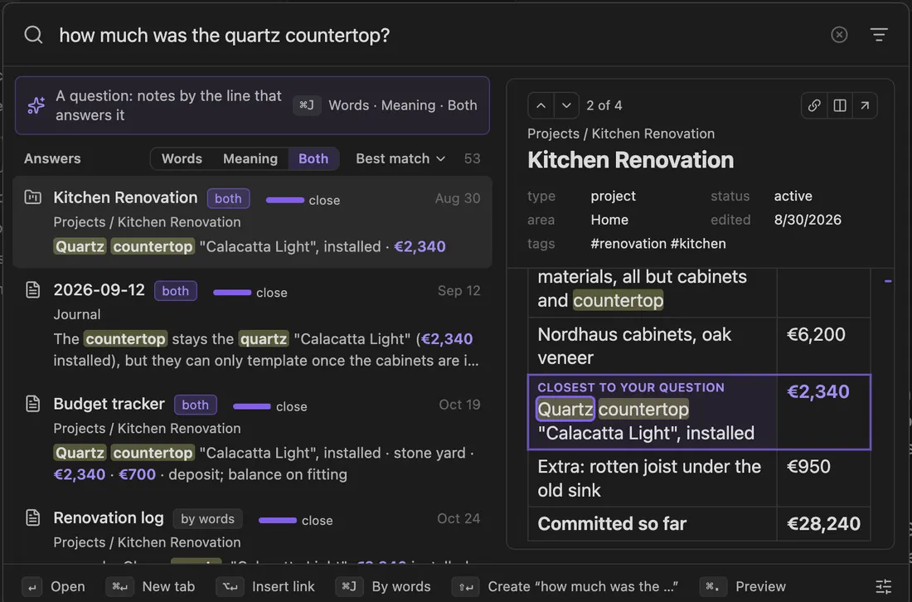
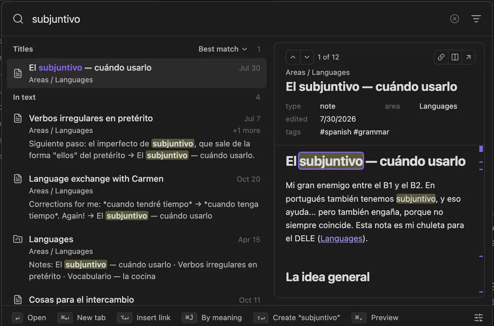
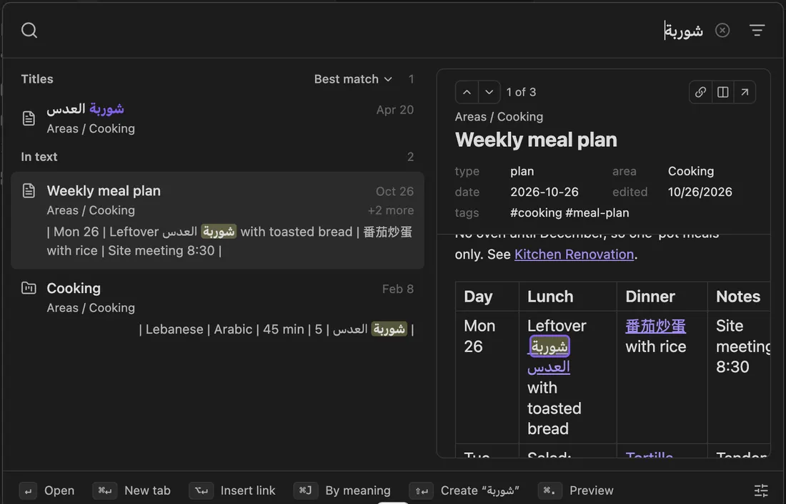
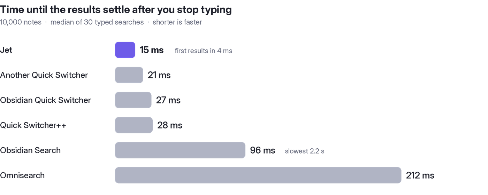

<div align="center">

<picture>
  <source media="(prefers-color-scheme: dark)" srcset="docs/assets/jet-header-dark.png">
  
</picture>

### Find it before you finish typing.

**Modern, instant search for Obsidian.** Names match in the same keystroke, every word of every note is searched in the background, and a question gets the line that answers it. Tap Shift twice and start typing.

[](https://github.com/eknowledger/jet-search/releases)
[](https://github.com/eknowledger/jet-search/actions)
[](LICENSE)
[](https://github.com/eknowledger/jet-search/releases)
[](https://github.com/eknowledger/jet-search/stargazers)
[](https://github.com/eknowledger/jet-search/issues)
[](https://github.com/eknowledger/jet-search/commits/main)


[](CONTRIBUTING.md)

[Install](#install) · [Tour](#a-quick-tour) · [Speed](#how-fast) · [Demo vault](#try-it-on-the-demo-vault) · [Privacy](#privacy-network-use-and-storage) · [FAQ](#faq) · [Docs](#documentation)

</div>

<br>



## Why Jet

Search is the thing you do a hundred times a day, so a hundred small waits add up. Jet is built so there is no wait.

| Measured | What it means |
|---|---|
| **15 ms** | median time until the results settle in a 10,000-note vault, with the first results on screen in **4 ms**. Omnisearch: 212 ms. Obsidian's own search: 96 ms, and up to 2.2 s. |
| **98%** | of 175 test searches had the right note in the top 3: exact and misspelled names, name starts, single words, words with a typo, two words and phrases. Omnisearch: 93%. Smart Connections: 62%. Obsidian's search: 53%. |
| **3×** | quicker to index than Omnisearch: about 6 s for 10,000 notes against about 19 s. A saved 50,000-note index loads in **10 ms**. |
| **0.16 ms** | the engine's typical keystroke at 10,000 notes, **0.8 ms** at 50,000. The slowest of 1,122 keystrokes at 50,000 notes took 13 ms. |
| **0 bytes** | sent anywhere. No telemetry, no accounts, works offline. The plugin itself is 318 KB. |

Every number comes from public data, a fixed seed and a runner you can run yourself. The [benchmark notes](docs/benchmarks.md) give the method, the versions tested and the caveats.

And it finds what you meant, not only what you typed:

- **Forgiving.** Typos, word forms (`planted` finds *planting*), initials (`jtrip` finds *Japan Trip 2027*), aliases, accents and case.
- **Any language.** Word forms in English, French, Spanish, German, Portuguese, Italian, Dutch, Swedish and Arabic. Chinese and Japanese without spaces. Arabic and Hebrew right to left.
- **Focused.** Scopes limit a search to a project, an area, a folder, a tag or a property. Filters become chips you can see and remove.
- **Understands questions.** An optional model that runs on your device finds notes that say the same thing in other words, and points at the line that answers "how much was...?" or "when is...?".
- **Tested.** 731 automated tests, run on every change.

## A quick tour

Each clip below is recorded in the [demo vault](demo-vault). The [guide](docs/guide.md) shows every feature in motion.

### Names as you type, typos forgiven

Names, aliases and paths match in the same keystroke, before the full text arrives.



### Every word of every note

Results are ranked, each with the line that matched, and the preview shows the note around the hit with every hit marked and ticked on the scroll bar.



### Filters become chips

Type `#recipe/french`, `type:book`, `edited:7d`, `path:Journal` or `links:[[Note]]` and a space. Jet suggests keys and values as you type, and offers a fix when a key is misspelt.



### Scopes

Type a scope's name with other words and press Tab to search inside it. Jet can generate scopes from your folders, links and tags.



### Search by meaning (optional)

A question goes by meaning: `how do I stop my basil dying` finds the note about watering and cold nights.



### The line that answers

Ask for a price, a name, a date or a reason, and Jet lists the notes by the line that answers, with the figures coloured and the line outlined in the preview.



### Every language, left to right and right to left





## Install

Jet is not in the Community plugins list yet. Until it is, install it by hand or with BRAT.

**By hand**

1. Download `main.js`, `manifest.json` and `styles.css` from the [latest release](https://github.com/eknowledger/jet-search/releases/latest).
2. Put them in `<your vault>/.obsidian/plugins/jet-search/`.
3. In Obsidian, open **Settings > Community plugins**, reload the list and turn on **Jet Search**.

**With [BRAT](https://github.com/TfTHacker/obsidian42-brat)**: add the repository `eknowledger/jet-search`.

**From source**: `npm ci && npm run build`, then copy the three files as above.

Requires Obsidian 1.8.0 or newer, on desktop.

## Use it

Tap **Shift** twice, or run **Jet Search: Search notes** and give it any hotkey in Obsidian's Hotkeys. **Jet Search: Search in this note** lists every hit in the open note. The double-tap key (Shift, Control, Option, Command, or off) is a setting.

The first time, Jet builds its index in the background (seconds for a few hundred notes). It is useful before it finishes, because names match straight away.

| Key | Does |
|---|---|
| Enter | open the note |
| Ctrl/Cmd + Enter | open in a new tab |
| Ctrl/Cmd + Alt + Enter | open to the right |
| Alt + Enter | insert a link where you are writing |
| Ctrl/Cmd + F | filters bar, title-only search |
| Ctrl/Cmd + J | words, meaning or both |
| Ctrl/Cmd + G | next hit in the preview |
| Tab | accept a suggested scope |
| Esc | clear the text, then the scope and filters, then close |

Every key inside Jet's window can be changed in the settings. The [guide](docs/guide.md#keys-and-actions) has the full list.

## How fast

Jet was timed against Obsidian's own search and quick switcher, and the most-installed search plugins: Omnisearch, Quick Switcher++, Another Quick Switcher and Smart Connections. Each ran alone in a fresh Obsidian, on the same notes and the same typed searches, with real key events. The clock runs from the last key to the last change of the result list on screen, so it includes drawing.

<picture>
  <source media="(prefers-color-scheme: dark)" srcset="docs/assets/compare-speed-dark.png">
  
</picture>

| 10,000 notes | First results | Settled, median | Settled, slowest | Index build | First search after launch |
|---|---:|---:|---:|---:|---:|
| **Jet** | **4 ms** | **15 ms** | **21 ms** | 6 s | 34 ms |
| Another Quick Switcher | 21 ms | 21 ms | 28 ms | none | 10 ms |
| Obsidian Quick Switcher | 27 ms | 27 ms | 37 ms | none | 13 ms |
| Quick Switcher++ | 28 ms | 28 ms | 33 ms | none | 14 ms |
| Obsidian Search | 14 ms | 96 ms | 2.2 s | none | 4.1 s |
| Omnisearch | 208 ms | 212 ms | 334 ms | 19 s | 328 ms |

Two things to keep in mind. The three quick switchers match note names only, so they do less work than Jet, which searches every word. And in a small vault everything is fast: at 1,000 notes the switchers settle in 8 to 11 ms, Jet in 13 ms, and Omnisearch still takes 203 ms. Both runs, 1,000 notes and the method are in [docs/benchmarks.md](docs/benchmarks.md).

Speed means little if the right note is not there, so the same tools were also given 175 searches on the demo vault, generated from its notes with a fixed seed. A search counts as found when the right note is in the top 3.

| Found in the top 3 | Exact name | Name with a typo | Start of a name | One word | Word with a typo | Two words | A phrase | All 175 |
|---|---:|---:|---:|---:|---:|---:|---:|---:|
| **Jet** | 25 | **25** | 25 | 25 | 22 | 25 | 25 | **172 (98%)** |
| Omnisearch | 25 | 14 | 25 | 25 | 23 | 25 | 25 | 162 (93%) |
| Smart Connections | 24 | 20 | 25 | 10 | 7 | 14 | 9 | 109 (62%) |
| Obsidian Search | 9 | 0 | 10 | 24 | 0 | 25 | 25 | 93 (53%) |
| Obsidian Quick Switcher | 25 | 25 | 25 | n/a | n/a | n/a | n/a | names only |
| Quick Switcher++ | 25 | 25 | 25 | n/a | n/a | n/a | n/a | names only |
| Another Quick Switcher | 25 | 23 | 25 | n/a | n/a | n/a | n/a | names only |

Jet is the only tool at 97% or better on both names and the words inside notes. The switchers are perfect on names, but they cannot see inside a note. Omnisearch is level with Jet on the words inside notes and loses on misspelled names (14 of 25, against 25). Jet missed 3 searches, all a word with a typo. Questions asked in other words are what the optional search by meaning is for: on a separate set of 3 questions, Jet with the model on found 3, Smart Connections 3, Jet without it 2, Omnisearch 1 and Obsidian's search 0.

The searches are generated, not hand-picked, but they run on a small, invented vault and they favour tools that forgive typos, so read this as a demonstration, not a ranking of every vault. Every search and every result is listed in [docs/benchmarks.md](docs/benchmarks.md). Omnisearch also reads PDFs and images, which Jet does not.

Jet's engine on its own, on public data with a fixed seed (per keystroke, every prefix of the typed queries):

| Notes | Typical | 95th percentile | Slowest | Index time | Saved index | Load |
|---:|---:|---:|---:|---:|---:|---:|
| 1,000 | 0.056 ms | 0.30 ms | 1.7 ms | 0.4 s | 1.6 MB | 0.3 ms |
| 10,000 | 0.16 ms | 1.3 ms | 2.0 ms | 3.6 s | 14 MB | 2.3 ms |
| 50,000 | 0.77 ms | 7.3 ms | 13 ms | 21 s | 69 MB | 9.9 ms |

Names match on a separate, smaller index: 0.03 ms at 1,000 notes, 0.26 ms at 10,000, 1.8 ms at 50,000.

## Try it on the demo vault

[`demo-vault/`](demo-vault) holds 239 notes written for a fictional person: projects, areas, recipes in several languages and a journal. Open it as a vault in Obsidian, turn on Jet, and try:

- `kitchn renovaton` (typos in a name)
- `ladybird larva` (full text with a preview)
- `#recipe/french` (a tag as a chip)
- `japan hotel`, then Tab (a scope suggested)
- `شوربة` (Arabic, right to left)
- `how much was the quartz countertop?` (a question, once Search by meaning is on)

## Privacy, network use and storage

- **No telemetry, no ads, no accounts, no payments.** Jet is free and open source.
- **Network.** Jet works fully offline. It makes one kind of network request, and only when you ask for it: turning on **Search by meaning** asks first, then downloads its model (about 31 MB, once) from Hugging Face (`minishlab/potion-base-8M`, a pinned revision, each file checked against a SHA-256 in Jet's code). To avoid the network completely, choose **Use files...** in the settings and give Jet the two model files yourself. Your notes are never sent anywhere.
- **Files outside your vault.** Jet reads none. **Use files...** reads only the two model files you pick.
- **Storage.** The index and the note vectors live in your browser's IndexedDB on your device, one database per vault, outside the vault. The packed model (about 8 MB) is kept in Jet's plugin folder. You can clear the index or remove the model from Jet's settings.

## Platforms

- **Desktop:** developed and tested on macOS. Windows and Linux run the same code; reports are welcome.
- **Mobile:** not supported yet. Jet is built to work there, and mobile testing is under way.

## FAQ

**Does it replace Obsidian's search?** No. It sits beside it. Obsidian's own operators (`line:`, `section:`, `block:`, `task:` and `/regex/`) are handed off to Obsidian's search with one key.

**Does it change my notes?** Only when you ask. `Shift + Enter` creates a note named after your text, and `Alt + Enter` inserts a link where you are writing. Searching never writes to a note.

**Does it send my notes anywhere?** No. See [Privacy](#privacy-network-use-and-storage).

**Is it AI?** The optional meaning search uses a small embedding model (8 MB) that runs on your device. It does not generate text and never calls a service.

**How big a vault can it handle?** The benchmarks above go to 50,000 notes. Index time grows with the vault, but the index is built once, in the background, and then kept up to date a note at a time.

**Where does the index live?** In your browser's IndexedDB, outside the vault, so it is never synced or committed. Remove it from Jet's settings at any time.

## Documentation

| Read | For |
|---|---|
| [Guide](docs/guide.md) | Every feature in motion, recorded in the demo vault |
| [Reference](docs/reference.md) | Every part of the window and every setting, numbered and explained |
| [Benchmarks](docs/benchmarks.md) | The method behind the numbers, and how to run it |
| [Architecture](docs/architecture.md) | How Jet is built, in a 30 minute read |
| [Architecture reference](docs/architecture-reference.md) | The long version: every part, message, number and failure path |
| [Contributing](CONTRIBUTING.md) | Set up, test, and send a change |
| [Security](SECURITY.md) | Reporting a vulnerability |
| [Changelog](CHANGELOG.md) | What changed in each version |

## Contributing

Bug reports, ideas and pull requests are welcome. Start with [CONTRIBUTING.md](CONTRIBUTING.md). To work on Jet:

```
npm ci
npm run check   # format, lint, types and all tests
npm run build   # main.js, manifest.json and styles.css
```

## Status

Jet Search is at version 0.6.0 and under active development, by one maintainer. Please open an [issue](https://github.com/eknowledger/jet-search/issues) for bugs, ideas and questions.

## Licence

Jet Search is released under the [MIT licence](LICENSE). The meaning model, potion-base-8M by Minish Lab, is MIT-licensed.
