# Architecture

How Jet Search is put together, why the boundaries sit where they do, and what you need to know to change it.

**Audience.** Anyone working on the plugin, reviewing a change, or deciding whether to trust it. It assumes you can read TypeScript and have seen an Obsidian plugin. It does not assume you know how an inverted index, BM25 or a Web Worker works; section 2 covers the vocabulary and section 6 explains the parts as they come up.

**How to read it.** Sections 1 to 5 are the map. Section 6 is the reference for each part. Section 7 follows the important events through those parts. Sections 8 to 10 are what to check, and how to change things safely. Sections 11 to 13 cover the build, the tests and the speed. Sections 14 and 15 are the honest record: what went wrong, and what is not solved.

**Contents**

1. [Scope](#1-scope)
2. [Terminology](#2-terminology)
3. [System overview](#3-system-overview)
4. [Repository layout](#4-repository-layout)
5. [The contracts between the parts](#5-the-contracts-between-the-parts)
6. [Components](#6-components)
7. [Control flow](#7-control-flow)
8. [Invariants, and where they are enforced](#8-invariants-and-where-they-are-enforced)
9. [Lifecycle and teardown](#9-lifecycle-and-teardown)
10. [How to change it](#10-how-to-change-it)
11. [Build pipeline](#11-build-pipeline)
12. [Testing strategy](#12-testing-strategy)
13. [Performance budget](#13-performance-budget)
14. [Defect register](#14-defect-register)
15. [Limitations](#15-limitations)
16. [Contributing](#16-contributing)
17. [Appendix](#17-appendix)

---

## 1. Scope

Jet Search does four things:

1. **Finds a note by its name, alias or path in the same frame as the key press.** This is the names tier. It runs on the main thread over a small, pre-folded index.
2. **Finds a note by any word in it, a few milliseconds later.** This is the full-text index. It lives in a Web Worker, forgives typos, matches other forms of a word, and ranks by where a word sits (a name beats a heading beats the body).
3. **Narrows a search** to a scope (a named set of notes defined by rules) or by filters (a tag, a property, a date).
4. **Optionally understands a question.** A small on-device model finds notes that say the same thing in other words, and an answer step shows the line that answers.

Everything else is out of scope on purpose. Jet does not edit notes, sync anything, read PDFs or images, call a server (apart from one opt-in model download), or run on a phone yet. Section 15 lists what that costs.

## 2. Terminology

Skip this if the words are familiar.

| Term | What it means here |
|---|---|
| **Vault, note** | Obsidian's words. A vault is a folder; a note is a Markdown file in it. Jet indexes Markdown notes only. |
| **Metadata cache** | Obsidian's own parsed view of every note: headings, tags, links, frontmatter. Jet reads it instead of parsing Markdown itself. |
| **Main thread** | The one thread that runs Obsidian's interface. If it is busy for more than a few milliseconds, typing stutters. |
| **Web Worker** | A second thread with no access to the page or to Obsidian. It talks to the main thread only by messages. Jet's index lives in one. |
| **Names tier ("Tier 0")** | The part that matches note names, aliases and paths on the main thread, inside the keystroke. |
| **Field** | A part of a note that is scored on its own: name, aliases, headings (three levels), tags, folder, links, and the body. |
| **Term** | One normalized word as stored in the index: lower case, accents removed, with the other rules in 6.1. |
| **Posting** | The record that a term occurs in a note, and how often. A term's postings are the list of notes that hold it. |
| **Inverted index** | A map from each term to its postings. A search looks terms up instead of reading notes. |
| **BM25, idf** | The standard ranking formula. A word counts for more when few notes have it (idf), and repeating it in one note helps less and less (saturation). |
| **Segment** | One immutable block of index, stored as a single `ArrayBuffer`. The index is a few frozen segments plus a small, rebuilt "delta". |
| **Delta, tombstone** | The delta holds notes changed since the last freeze. A tombstone marks a note in a frozen segment as replaced or deleted. |
| **Merge** | Writing the live notes of several segments into one new segment. |
| **Expansion** | One way a typed word may match a term: the word itself, a prefix, another form, a compound, or a spelling within a typo. Each has a weight. |
| **Word form (stem)** | `meetings` and `meeting` have one stem. Jet finds other forms of a word at query time, in the languages you choose. |
| **Typo budget** | How many letters a word may be off: none under 4 letters, one for 4 to 8, two above. |
| **Hit** | One result from the engine: a note path, a score, how many query words it matched. |
| **Titles block, In text block** | The two parts of a result list. Titles are name matches (from the names tier); In text are the worker's hits. |
| **Excerpt** | The line of a note around the match, with the words marked. |
| **Scope** | A named set of notes defined by rules (a folder, a tag, a property). Typing its name searches inside it. |
| **Filter, chip** | A typed piece such as `#tag` or `edited:7d`. When it is finished it becomes a chip in the box. |
| **Frecency** | How often and how recently you opened a note. A small boost for text hits. |
| **Search by meaning** | Opt-in. A static model turns a note and a question into vectors, and the nearest notes are the answer. |
| **Sequence number (`seq`)** | A counter on every query. An answer for an older number is dropped, so a slow reply never replaces a newer list. |
| **Catch-up** | At start, comparing every note's modified time with the saved index and sending only the difference. |
| **Coalesce** | Collapsing several events for one note into one update. |

## 3. System overview

Three places, and the boundary between them is the thing to hold onto: **Obsidian owns the files and the page; the main thread decides and draws; the worker holds the index.** Nothing crosses from the worker to the page except a reply to a request, and nothing in the worker can see Obsidian.

<picture>
  <source media="(prefers-color-scheme: dark)" srcset="assets/arch-system-dark.png">
  
</picture>

The picture shows the parts and what crosses between them.

Reading the picture:

* The **modal** asks **Search** for a list. Search asks the **names tier** (synchronously) and the **worker** (asynchronously) and merges the two answers in one function (6.6). The names always paint first.
* The **feeder** is the only part that reads notes. It turns Obsidian's events and the metadata cache into batches of plain data and sends them to the worker. The worker tokenizes; the main thread never does.
* The **router** is the worker's logic without the Worker itself, so tests drive it directly (6.3). It owns the engine, the saved index and the note vectors.
* **Meaning** and **scopes** live on the main thread but act through the worker: the model goes in once, vectors are scanned in the worker, and a scope reaches the worker as a list of allowed paths.
* **Storage** is outside the vault. The index and vectors are in IndexedDB, one database per vault. Settings and the optional model file are in the plugin's own folder.

### 3.1 The six rules

These hold everywhere in the code. A change that breaks one needs a very good reason. Section 8 lists each with where it is enforced.

| # | Rule | Why |
|---|---|---|
| 1 | **Nothing runs at Obsidian start.** | Every user pays for plugin load time on every launch. The first index build begins a few seconds after the workspace is ready, in small batches, newest notes first. |
| 2 | **The main thread only draws.** | A search over thousands of notes on the page would stutter typing. The index lives in the worker; the page sends a query and paints the answer. |
| 3 | **Results are never stale.** | A slow answer for text you have already changed would replace the right list. Every query carries a sequence number, and an answer that is not the latest is ignored. |
| 4 | **The index stays outside the vault.** | It is kept in IndexedDB, so it is never synced, never shows in a file list, and never ends up in a backup of your notes. |
| 5 | **No network.** | Notes stay on the device. The one exception is the optional meaning model, downloaded only after you confirm, from a pinned revision, and checked against a pinned SHA-256. |
| 6 | **Pure where possible.** | Analysis, ranking, filters, scopes and the double-tap detector take plain values and return plain values. They run in tests with no Obsidian. |

### 3.2 Where the time goes in one keystroke

| Stage | Where | Typical cost (10,000 notes) |
|---|---|---|
| Names matched, first paint | main thread | about 0.3 ms matching; first change on screen about 4 ms after the key |
| Query to the worker and back | worker | about 0.16 ms in the engine; the round trip adds a few ms |
| Text hits and excerpts painted | main thread | the list has settled by a median 15 ms |

These come from `docs/benchmarks.md`, measured on one machine. Section 13 has the full table.

## 4. Repository layout

```
jet-search/
├── manifest.json, versions.json    what Obsidian reads; the version and the minimum Obsidian
├── main.js                         the build output (not tracked); styles.css is hand written
├── src/
│   ├── main.ts                     the plugin: onload, commands, events, the worker's sleep timer
│   ├── host.ts                     what the modal asks the plugin for (lists, hints, open, create)
│   ├── search.ts                   Search: asks both tiers, composeHits merges them
│   ├── rank.ts                     phrase confirmation (and an unwired sequence boost, see 15)
│   ├── data.ts                     saved data: shape, defaults, normalizeData, frecency
│   ├── internals.ts                every private Obsidian API Jet touches, each guarded
│   ├── innote.ts                   "search in this note", a second host for the same window
│   ├── shift.ts                    the double-tap detector (pure)
│   ├── settings-tab.ts             the settings tab; settings/ holds the pages it opens
│   ├── index-status.ts             the index's state in words, for the modal and the settings
│   ├── build-id.ts                 the build id shown in the Advanced tab
│   ├── migrate.ts                  one-time import of settings from another plugin
│   ├── engine/                     the index and the ranking (pure, no Obsidian)
│   │   ├── jet-engine.ts           segments, the query, scoring, boosts, merge
│   │   ├── segment.ts              the byte layout of a segment
│   │   ├── analyzer.ts             text to terms, one set of rules for notes and queries
│   │   ├── fields.ts               a note's fields and their weights
│   │   ├── typos.ts                the typo walk over the sorted terms
│   │   ├── query.ts, varint.ts     query parsing, number coding
│   │   ├── stem/                   one stemmer per language (nine)
│   │   └── search-index.ts, text.ts  an older, simpler engine kept only as a baseline
│   ├── worker/                     the thread boundary
│   │   ├── jet-worker.ts           the Worker's own side: queue, latest wins
│   │   ├── router.ts               the logic: engine, store, idle save, scopes, vectors
│   │   ├── protocol.ts             every message and reply
│   │   ├── jet-client.ts           the main thread's end of it
│   │   └── store.ts                IndexedDB: one database per vault
│   ├── index/                      getting notes in
│   │   ├── gather.ts               a note's data from Obsidian's cache
│   │   ├── feeder.ts               batches, events, catch-up, renames
│   │   └── slice.ts                work in slices of 8 ms
│   ├── tier0/                      the names tier
│   │   ├── names.ts, fold.ts       NameIndex and the one-time folding
│   │   └── meta.ts                 headings, tags, properties while the first build runs
│   ├── modal/                      the window
│   │   ├── jet-modal.ts            the view, the keys, the state
│   │   ├── both.ts, format.ts      the "both" layouts, row text
│   │   └── theme-mark.ts           the highlight colours measured from the theme
│   ├── types/worker.d.ts           the type of the inlined worker import
│   ├── excerpt/, preview/          the line under a hit, and the preview pane
│   ├── keys/keymap.ts              every key binding, in one place
│   ├── filters/                    typed pieces, chips, completion
│   ├── scopes/                     rules, the generator, the keeper, the watcher
│   ├── meaning/                    the model, its install, vectors, the question rule
│   ├── answers/                    the best line for a question
│   └── settings/                   settings sub-pages and their parts
├── test/                           unit, router-driven, mock-Obsidian UI and regression tests
├── bench/                          engine benchmarks, fixture vaults, and compare/ (the in-Obsidian harness)
├── scripts/bench.mjs               bundles and runs the engine benchmarks
├── demo-vault/                     a small invented vault to try Jet on
├── docs/                           this file, the guide, the reference, the benchmarks, diagrams/
├── esbuild.config.mjs              the build, including the inline worker
└── .github/workflows/              ci.yml and release.yml
```

The rule that decides where code goes: **anything that can be pure is under `engine/`, `scopes/generate.ts`, `filters/`, `keys/`, `excerpt/` or similar and imports nothing from Obsidian; anything that touches Obsidian is in a small file next to it** (`snapshot-obsidian.ts`, `gather.ts`, `host.ts`). That is what lets the tests run without Obsidian.

## 5. The contracts between the parts

Four shapes carry the whole design. Each one is a boundary: on one side the code knows Obsidian, on the other it does not.

### 5.1 A note, on its way in

```ts
// src/engine/fields.ts
export type RawNote = {
  path: string; mtime: number;
  text: string;
  bodyStart: number;                              // where the body starts, after the frontmatter
  aliases: string[];
  headings: Array<{ level: number; text: string }>;
  tags: string[];                                 // without "#", nested ones whole
  links: string[];                                // names of notes this one links to
  inLinks: number;                                // how many notes link here
};
```

`RawNote` is what the main thread builds from Obsidian's cache (`gather`). It is plain data: a string and a few arrays, cheap to copy to the worker. The worker turns it into a `NoteInput` (`fieldsFromRaw`: the terms of each field) and hands that to the engine. Splitting the two is why tokenizing never runs on the main thread, and why a phone-sized machine can gather 15,000 notes without a frozen window.

### 5.2 A query, and its answer

```ts
// src/engine/query.ts and jet-engine.ts
type Query  = { words: string[]; excluded: string[]; groups?: string[][]; phrases: string[]; lastIsPrefix: boolean };
type Hit    = { path: string; score: number; matched: number; edits: number };
type QueryResult = { hits: Hit[]; terms: string[]; rare?: boolean };
```

`lastIsPrefix` is true until the text ends in a space or a closing quote: while you are typing, the last word is a prefix. `matched` is how many of the query's words the note has. `edits` is the total typo distance. `terms` are the index terms that matched, for marking excerpts. `rare` says every word of the query is spelled exactly in only one or two notes; the caller uses it to decide what goes first (6.6).

The engine never checks a quoted phrase. It scores the words, and the caller keeps the notes whose text holds the phrase.

### 5.3 A name hit

```ts
// src/tier0/names.ts
type NameHit = {
  id: number; score: number;
  field: "name" | "alias" | "path";
  text: string;                       // the text that matched
  ranges: Array<[number, number]>;    // into `text` as written, for highlighting
  exact: boolean;                     // the typed text equals the name or an alias
};
```

Ranges are always into the text as the user wrote it, not into the folded form, because folding removes accents and separators. `exact` is what lets the merge keep a name that equals the typed text first (6.6).

### 5.4 The worker's messages

Every message is a request from the main thread, answered by a reply with the same id. The worker never speaks first. There are 23 requests; 6.3 lists them with their fields and the moment each is sent.

### 5.5 The window's host

`JetModal` knows nothing about the vault, the metadata cache or the worker. It talks to its surroundings through one type, `ModalHost`, and turns a feature off when the matching member is absent. `JetHost` is the real implementation; `InNoteHost` (search in this note) is a second one; tests use a small fake. That one boundary is why a 2,300-line view can be tested with no Obsidian (6.7).

### 5.6 What is stored where

| What | Where | Written by | Lost if |
|---|---|---|---|
| The index (`base`, `sidecar`, `meta`) | IndexedDB `jet-search/<vault id>` | the worker, after 2 quiet seconds and at the end of a build | the user clears site data, or no save reaches a vault for 90 days and another vault's save removes it |
| Note vectors | the same database, key `vectors` | the worker, with the index | the model changes |
| Settings, scopes, frecency, recent searches | `data.json` in the plugin folder | `main.ts`, debounced 1 s (the model switch saves at once) | never (it syncs with the vault) |
| The packed meaning model | `meaning-potion-base-8M.bin` in the plugin folder | the install flow | the user removes it |

`data.json` syncs between devices; the index and model do not, so each device builds its own.

## 6. Components

The parts, in the order a keystroke meets them, then the optional features. Each one says what it owns, what it deliberately does not, and why the boundary is there.

| Part | Files | One line |
|---|---|---|
| 6.1 The engine | `src/engine/` | Notes to terms, queries to a ranked list. Pure. |
| 6.2 The index file | `src/engine/segment.ts` | One `ArrayBuffer` per segment, read in place. |
| 6.3 The worker | `src/worker/` | The thread boundary, the messages, the sleep. |
| 6.4 Getting notes in | `src/index/`, `src/worker/store.ts` | Batches, events, catch-up, IndexedDB. |
| 6.5 The names tier | `src/tier0/` | Names, aliases and paths inside the keystroke. |
| 6.6 Merging the two answers | `src/search.ts` | One function puts both answers in one list. |
| 6.7 The modal and the host | `src/modal/`, `src/host.ts` | The view, and the one type it talks through. |
| 6.8 Excerpts, preview, in-note | `src/excerpt/`, `src/preview/`, `src/innote.ts` | The words on your own text. |
| 6.9 Keys and the double tap | `src/keys/`, `src/shift.ts` | One source for every binding. |
| 6.10 Search by meaning | `src/meaning/` | An on-device model, opt in. |
| 6.11 Answers | `src/answers/` | The line that answers a question. |
| 6.12 Scopes | `src/scopes/` | Named sets of notes, generated from the vault. |
| 6.13 Query syntax and filters | `src/filters/`, `src/engine/query.ts` | Typed pieces, chips. |
| 6.14 Settings and saved data | `src/data.ts`, `src/settings*` | What is saved and how it is read back. |

### 6.1 The engine: how a note becomes terms, and how a query is scored

The engine is `JetEngine` in `src/engine/jet-engine.ts`. It is pure: it takes plain values and returns plain values, with no Obsidian and no DOM, and it reads the clock only as the `now` option (default `Date.now()`). The worker owns one instance; tests build their own.

Two older files stay in the folder: `src/engine/search-index.ts` and `src/engine/text.ts`. They are a simpler first engine (a JSON header and float postings) that the plugin does not import. `test/engine.test.ts` and one benchmark adapter keep it as a baseline to compare against. Do not tune them, and do not read their weights as Jet's (`text.ts` has its own `WEIGHTS`).

<picture>
  <source media="(prefers-color-scheme: dark)" srcset="assets/arch-engine-dark.png">
  
</picture>

#### Note to terms

The worker receives a `RawNote` (text plus what Obsidian's cache knew) and turns it into a `NoteInput` with `fieldsFromRaw` in `src/engine/fields.ts`. Tokenizing never runs on the main thread.

| Field | Source | Weight (`WEIGHTS`) | Notes |
|---|---|---:|---|
| `name` | file name without `.md` | 10 | Also stored whole, tokenized without compound parts, in the docs table for the name boosts. |
| `aliases` | frontmatter aliases | 9 | Through `parseFrontMatterAliases`. |
| `h1` | level 1 headings | 6 | A heading is cut at `MAX_HEADING_CHARS` (2,000). |
| `h2` | level 2 headings | 5 | |
| `h3` | level 3 to 6 headings | 4 | Levels 4, 5 and 6 share this field. |
| `tags` | frontmatter and inline tags | 4 | A nested tag (`project/alpha`) gives both words. |
| `folder` | the folders of the path | 3 | |
| `links` | names of notes this one links to | 1.5 | Embeds count; resolved to the target's name where Obsidian can. |
| body | the text after the frontmatter | 1 (BM25 at query time) | At most `MAX_BODY_CHARS` (2,000,000) characters. Markdown link targets, the `](url)` part, are replaced by `]`. |

Other frontmatter properties (`status: draft`) are not indexed as words. Headings are in the body too, so a heading word scores in its heading field and in the body.

##### The analyzer

`src/engine/analyzer.ts` has one function, `tokenize`, used for notes and queries alike. A word typed must match the word stored, so there is exactly one set of rules. The only difference is the `parts` option: notes ask for extra forms, queries do not.

| Step | What it does | Why |
|---|---|---|
| `normalize` | Lower case. For text that is not plain ASCII: NFKD, remove marks (Latin, Greek and Cyrillic accents, Hebrew points, Arabic short vowels, emoji variation selectors), NFC; fold Arabic letter variants and Persian yeh and kaf; `ß` to `ss`; `œ æ ø ł đ ı ð þ ħ` to plain letters; Greek final sigma. | `resume` finds `résumé`. Plain ASCII skips all of it (a fast path). |
| Joiners | Soft hyphen, zero-width joiners and the BOM are removed; the zero-width space stays a break. | An invisible character inside a word must not split it. Thai and Khmer use the zero-width space as a break. |
| Runs | A run is letters, marks and digits in any script (`RUN`). One-letter terms are dropped unless they are digits or CJK. | One letter matches half the vault and says nothing. |
| Glued runs | Pieces joined by one hyphen, dot, apostrophe or underscore (`e-mail`, `Node.js`, `COVID-19`) also give the joined form in notes. A query joins them when a piece would be dropped. | `email` finds `e-mail`, and `e-mail` finds both spellings. |
| Compound parts (`parts`) | `NebulaSDK` gives `nebulasdk`, `nebula`, `sdk`; letter and digit boundaries split too. | A name written in camel case is found by its words. Notes only, so a query stays small. |
| Arabic | Notes also get the word without its article or prefix (`المكتبة` gives `مكتبة`). The engine adds the bare form to a query word too (`arabicBare`, weight 0.95). | A word typed with or without the article finds both. |
| Chinese, Japanese, Korean | Overlapping two-character pairs (`pairs`); a lone character stands alone. | Pairs of the query always occur in a note that holds it. A word segmenter on both sides could cut them differently and miss. |
| Thai, Lao, Khmer, Burmese | `Intl.Segmenter` in word mode, only on those stretches. | No spaces, so no other way to find words. An English word run into Thai text stays a word. |

##### The nine stemmers

`src/engine/stem/` has one stemmer per language, each a pure function from a normalized word to a stem.

| Language | Code | Algorithm | File |
|---|---|---|---|
| English | `en` | Snowball English (Porter2) | `english.ts` |
| French, German, Spanish, Italian, Portuguese, Swedish | `fr de es it pt sv` | Snowball, written from the published description and adapted to unaccented input | one file each |
| Dutch | `nl` | Snowball `dutch_porter` | `dutch.ts` |
| Arabic | `ar` | A light stemmer: one prefix, then suffixes in order, never below two letters (three after `و`) | `arabic.ts` |

Three rules about them:

1. Words reach a stemmer already normalized, so the rules were adapted to accent-free input. Only the equality of two stems matters, never how a stem is spelled.
2. Nothing is stemmed when an index is built. A stem is found at query time as a root group (see below). Changing the languages in settings sends `configure` and needs no rebuild.
3. `stemmable(lang, word)` limits where a stemmer runs: Latin-letter words for the Latin languages, Arabic-script words for Arabic, never a word with a digit, a CJK pair or a word under 3 characters.

A root group is every term of a segment whose stem equals the typed word's stem, most frequent first (`rootGroup`). A stem is nearly always a prefix of its words, so only the terms starting with the stem's first letters are stemmed (two letters for a stem of three or fewer, since `try` becomes `trying`). A scan stops at 5,000 terms. The result is cached per segment in a `WeakMap`, so no table is built ahead and start-up and memory do not move. Arabic groups are also looked up under the article and the common prefixes (`AR_PREFIXES`).

Compounds work the other way round, and only when German, Dutch or Swedish is on (`COMPOUND_LANGS`). A typed word of 4 or more letters finds terms that start or end with it, when the rest is itself an index term of 3 or more letters, possibly after a linking letter (`LINKS`: none, `s`, `es`, `n`, `en`, `e`). `migration` finds `Datenbankmigration` with no dictionary. Terms that end with a word are found in a second list, the terms sorted by their reversed spelling (`reversedTerms`), built on first need or by `warm()` when the worker is idle after opening.

#### How a query is scored

The text arrives as a `Query` from `parseQuery` in `src/engine/query.ts`.

| Part of the typed text | Becomes |
|---|---|
| Plain words | `words`, tokenized, duplicates removed |
| `"a quoted phrase"` | its words go into `words` as ordinary words; the phrase text goes to `phrases` |
| `-word` | `excluded` when it is one term; `groups` (all of them must be present) when the analyzer cuts it into several, as `-covid-19` |
| `#tag`, `key:value` | the value is a word; `-key:value` excludes the value only |
| Trailing space or closing quote | `lastIsPrefix` is false. Otherwise the last word is still being typed. |

The engine never checks a phrase. Quoted words are scored as words and the caller keeps the notes whose text holds the phrase (`filterPhrases` in `src/rank.ts`: it checks at most `PHRASE_CHECK_LIMIT` = 500 hits and stops at `PHRASE_CONFIRM_LIMIT` = 50 confirmed, which is why the main thread asks for 500 hits when the text has a phrase).

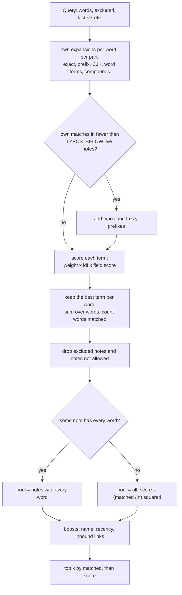

The flow is the order of the code in `query`. Everything per note is a lookup in typed arrays plus a few multiplications.

##### What a word expands into

`expand(seg, word, isLast, config, typos)` returns the index terms a typed word may mean, each with a weight and an edit count. A term reached several ways keeps its highest weight (`put`).

| Kind | When | Weight | Edits | Limit |
|---|---|---:|---:|---|
| EXACT | the term is the typed word | `EXACT` = 1 | 0 | one |
| Arabic bare | the word minus its article is a term | `EXACT * 0.95` | 0 | one |
| PREFIX | the word is the last one and still being typed, 2 letters or more | `PREFIX` (0.7) x sqrt(typed length / term length) | 0 | `PREFIX_LIMIT` = 64, most frequent first |
| CJK character | a lone CJK character, stored only inside pairs: the pairs that start with it (prefix range) and end with it (reversed list). Typos are never tried for CJK or segmented scripts (`noTypos`). | `EXACT` | 0 | `PREFIX_LIMIT` each side |
| STEM | another term in the word's root group | `STEM` = 0.8 | 0 | `STEM_LIMIT` = 32 per language |
| COMPOUND | German, Dutch or Swedish on, 4 letters or more | `COMPOUND` = 0.6 | 0 | `COMPOUND_LIMIT` = 32 (64 counting the ending side) |
| TYPO1 | a whole term one edit away (a swap counts as one), typos allowed | `TYPO1` = 0.55 | 1 | `limit: 500` in the walk |
| TYPO2 | a whole term two edits away, word of 9 letters or more | `TYPO2` = 0.35 | 2 | same |
| FUZZY_PREFIX | the last word, 4 letters or more, a longer term that starts within one edit of it, and no whole term was found by TYPO1 or TYPO2 | `FUZZY_PREFIX` = 0.4 | 1 | `FUZZY_LIMIT` = 200 |

The weights order the kinds: the word as typed, then its forms, then compounds, then a corrected spelling. The typo walk (`typoMatches` in `src/engine/typos.ts`) is a Damerau edit distance (optimal string alignment) computed down the sorted term list. Neighbouring terms share the table rows of their common prefix, a row whose smallest value is over budget skips every term with that prefix, and the first letter must match. It costs no memory and no extra index. The budget comes from `typoBudget`:

| Word length (code points) | Edits allowed |
|---|---:|
| under 4 | 0 |
| 4 to 8 | 1 |
| 9 or more | 2 |

Two consequences to remember: a typo in the first letter is never corrected in the full-text index (`kitchen` typed `bitchen` finds nothing by typo), and a word of three letters is only ever exact, prefix or a word form.

##### The typo gate: TYPOS_BELOW

Typos and fuzzy prefixes are added for a word only when the word's own matches (exact, prefix, word forms, compounds) are in fewer than `TYPOS_BELOW` = 3 live notes (`liveNotes`). A vault that has the word does not need it corrected. Without the gate, `world` in a small scope listed notes that only had `would`, `words` or `workday`.

`liveNotes` counts notes, not postings, and only live ones: a note replaced but not yet merged has a dead copy in the base and a live one in the delta, and three word forms in one note count once. It stops counting at 3.

##### The score of one note

For each part (a frozen segment or the delta), each query word `i`, and each expansion `x` (term `t`, weight `w`, edits `e`):

```
N      = live notes in the index (at least 1)
df     = df of t in this segment + df of the same spelling in the other parts
idf    = ln(1 + (N - df + 0.5) / (df + 0.5))
s      = metaScore[t, d] + body(t, d)           // either may be absent
body   = tf * (K1 + 1) / (tf + K1 * (1 - B_BODY + B_BODY * bodyLen[d] / avgBody))
if rare[i] and w >= 0.9:          s = max(s, RARE_FLOOR)
weight = (rare[i] and w < 0.9 and e == 0) ? w * RARE_OTHERS : w
c      = weight * idf * s
best[i][d] = max over the expansions of word i      // not the sum
total[d]   = sum over words of best[i][d]
matched[d] = how many words have a best
```

`K1` = 1.2, `B_BODY` = 0.75 (`src/engine/segment.ts`). Three points that decide most ranking questions:

1. **Field scores are baked in at build time.** `metaScore` is, per term and note, the sum over the short fields of `WEIGHTS[field] * sat(count, fieldLength, averageLength, B_META)`, with `B_META` = 0.5. A note named just `Cobalt`, in a vault where names average three words, scores about 10 x 1.22 = 12 for `cobalt` from the name alone. The body adds at most about `K1 + 1` = 2.2 however often the word repeats, so a body mention is worth little next to a name or a heading. That is the intended shape: a note named for the words beats a note that mentions them often.
2. **The best expansion per word, not the sum.** Forty words that start with `exp` must not add up. Per word, one term wins per note.
3. **idf is across parts.** `otherDf` adds the exact spelling's df from the other segments and the delta, so a term is not rare in the delta just because the delta is small. `N` counts live notes, but `df` counts every note a segment was built with, dead ones included, until the next merge.

A word can match in the name through any expansion. The postings carry an `inName` flag (`metaInName`), set when the term is in the note's name, and the query counts how many of its words hit the name. This replaced splitting every candidate's name on every keystroke, which took 43 percent of a keystroke at 15,000 notes.

##### Rare words: RARE_FLOOR and RARE_OTHERS

A word spelled exactly in one or two notes (`rare[i]`: the exact term's df is above 0 and below `TYPOS_BELOW`) is what the user most likely means by typing it, even if it sits once in a body. Two rules apply to it:

| Rule | Effect |
|---|---|
| `RARE_FLOOR` = 6 | The exact word (and the bare Arabic form, and a CJK pair: anything with weight 0.9 or more) scores at least 6 before idf, about what an H1 gives. A single body mention (at most 2.2) counts as a heading. |
| `RARE_OTHERS` = 0.25 | Prefixes, word forms and compounds (weight under 0.9, no edit) count a quarter. |

Typo expansions are not scaled by `RARE_OTHERS`: the code tests `x.e === 0`, so TYPO1, TYPO2 and FUZZY_PREFIX keep their own weights. The comment above the constants says one-letter-off matches count for a quarter too; the code does not do that, and the test with `waist` against `wait` and `waste` is held by the exact word's idf (the highest in the vault) and the floor, not by a quarter. If you change this, run the group of tests named "a word the vault has in only a few notes".

`QueryResult.rare` is true when every word of the query is rare. The caller (`composeHits` in `src/search.ts`) uses it to list name matches that are not exact after the notes that hold the word.

##### Every word first, then any word

After scoring, a note has `matched` words. If at least one note has all `n` words, only those are ranked (the pool). If none does, all notes with any word are ranked and the score is multiplied by `(matched / n)^2`, so two words of three keep four ninths of their score. `opts.any` skips the first step, which the answers pool uses because a question's words are rarely all in the note that answers it. `matched` is a counter, not a bit per word, so a pasted paragraph of 33 words or more keeps its all-words rule.

##### Boosts, in order

| Boost | Condition | Factor |
|---|---|---:|
| Title equals | the note's name equals the typed words joined by spaces | x2 |
| Title starts with | else, the name starts with the typed words (any prefix while typing; followed by a space when not) | x1.5 |
| All words in the name | else, every query word hit the name through some expansion | x1.4 |
| Recency | `1 + 0.2 * exp(-days / 45)`, days since the note's mtime | up to x1.2, about x1.07 after 45 days |
| Inbound links | `1 + 0.08 * log2(1 + inLinks)` | 3 links x1.16, 15 links x1.32 |

The three title boosts are an if-else chain: only one applies. `inLinks` is stored per note at index time (from Obsidian's resolved links), so it is as old as the note's last re-index.

The final order is by `matched`, then `score` (`byScore`). `editsFirst: true` ranks fewer typo edits before score (`byKey`); no code in `src/` uses it, only the benchmark engine variant and tests. The top `limit` (default 50) are kept in a small binary heap (`TopK`) so a query over 100,000 candidates does not sort them.

##### What `query` returns

| Field | Meaning |
|---|---|
| `hits[]` | `path`, `score`, `matched` (words), `edits` (typo edits summed over the words, from each word's winning term) |
| `terms` | the index terms that matched at least one note, for highlighting excerpts. They are collected before exclusions and `allow`, so a term can appear for a note that was then dropped. |
| `rare` | see above |

Beside `query` the engine answers four small questions for other parts of the plugin: `suggest` (for a query with no result, each unknown word replaced by the closest term within two edits, most used first, and how many notes that finds), `docFreq` (in how many live notes each word and its forms occur, for the answers re-rank), `mentions` (notes with every word exactly, in any field or the body) and `mtimes` (every live note's path and mtime, for the catch-up).

Exclusions match the exact term only, in any field or the body, in every part (`-draft` does not drop `drafts`). A group drops a note only when it has all of its terms. `opts.allow` (a scope or a path list) is applied to candidates after scoring and before the all-words decision, so "every word" means every word within the allowed set.

##### Why each rule exists

| Rule | Failure it prevents | History |
|---|---|---|
| Typos gated by `TYPOS_BELOW` | `world` inside a small scope listed `would`, `words` and `workday`, which were most of what matched. | Added as a fix after the first executor; `wrold` still finds `world` because the vault has no `wrold`. |
| The gate counts live notes | Saving a note again left a dead copy in the base and a live one in the delta, which turned typos off for the next query. | Fixed with a rewrite of the count (`liveNotes`). |
| Rank by words matched, then score, not edits first | A note that contains a typo literally beat the note the user meant, one edit away, however strong its name match. | `editsFirst` stayed as an option; typos now weigh in through 0.55 and 0.35. |
| `RARE_FLOOR` and `RARE_OTHERS` | `trips`, held once in a body, was buried under every note named `Trip`; `waist` was outranked by `wait` and `waste`. | Fixed after version 0.6.0 (see the changelog's unreleased section). |
| FUZZY_PREFIX only when no whole term was corrected | While typing, `comand` matched `commands` in headings ahead of the word `command`. | Fixed so a longer word that merely starts like the corrected spelling is used only when no whole word is within a typo. |
| PREFIX weight shrinks with the length ratio, below `EXACT` | A short typed word brought every long word that starts with it ahead of the word itself. | Part of the original executor; `sqrt(len / termLen)`. |
| Best expansion per word, not the sum | Forty expansions of one word added up and swamped the other words. | Original design. |
| `inName` flag in postings | The all-words-in-name boost cost 43 percent of a keystroke at 15,000 notes. | Perf fix. |
| `matched` as a counter | A pasted paragraph of 33 words lost the all-words rule (a 32-bit mask overflowed). | Fixed with the same change as the exact-name boost for camel-case names. |
| Names for the boosts are tokenized without compound parts | `JavaScript` ranked below `JavaScript tips` for `javascript`. | Fixed in the docs table (`name` is stored from `tokenize(nameOf(path))`). |

##### Changing the ranking safely

1. Write the failing test first in `test/jet-engine.test.ts`: a small vault of invented notes and one query. Copy the shape of the nearby tests (`filler(40)` plus the notes that compete).
2. Change one constant or one rule. Every number is in the appendix with its file.
3. Run `npx vitest run test/jet-engine.test.ts test/qa-search.test.ts`. The groups that guard the ranking are "Jet engine ranking", "a word the vault has in only a few notes", "a word typed with a typo, still being typed" and "the typo gate".
4. Run the quality set (`bench/compare` with `--modes quality-auto`; see `docs/benchmarks.md`). The first seed was used to tune and the second to judge; do not tune on the one you judge with.
5. A weight change in `WEIGHTS`, or any change to how a field is scored, is baked into saved indexes: bump `INDEX_VERSION` (see 6.2), or old indexes keep scoring the old way until they happen to be rebuilt.

### 6.2 The index file

A saved index is one `ArrayBuffer` per segment (layout "v4", magic `JET4`, layout version `VERSION` = 1 in `src/engine/segment.ts`). The design goal is load time: the buffer is read into IndexedDB and back as is, and queries read typed-array views onto it. Benchmarks in `docs/benchmarks.md`: 2.3 ms to load 10,000 notes, 9.9 ms for 50,000.

#### Sections

The header is 32 `Uint32` words (128 bytes). Words 0 to 8 are the magic, the layout version, the counts of notes (D), terms (T) and meta postings (M), and the byte lengths of the body postings, the term strings, the paths and the names. Words 9 to 25 are the offsets of the 17 sections, each aligned to 8 bytes (a `Float64Array` needs it). Words 26 to 31 are unused.

| # | Section | Type | Holds | Why it is shaped this way |
|--:|---|---|---|---|
| 0 | term offsets | `Uint32[T+1]` | where each term starts in the term string, in UTF-16 code units | one string per segment instead of T small ones; a term is a `slice` |
| 1 | term bytes | `Uint8` | all terms joined, UTF-8 | compact on disk; decoded once on first use |
| 2 | `df` | `Uint32[T]` | notes holding the term, in the body or any field | idf without touching postings |
| 3 | body offsets | `Uint32[T+1]` | byte range of each term's body postings | a term's postings are one contiguous slice |
| 4 | body postings | `Uint8` | per term, pairs of varints: (doc id gap minus 1, count) | every term of every note has a body posting, so they must be about one byte each |
| 5 | meta offsets | `Uint32[T+1]` | range of each term's meta postings | |
| 6 | meta docs | `Uint32[M]` | note ids of the meta postings | sparse: only terms in a short field |
| 7 | meta scores | `Float32[M]` | the precomputed field score (the sum over short fields of weight x BM25 saturation) | the per-field math is done at build, not per query |
| 8 | mtime | `Float64[D]` | modified time in ms | recency boost; the catch-up compares it |
| 9 | body length | `Uint32[D]` | body terms per note | BM25 length normalization |
| 10 | inbound links | `Uint32[D]` | how many notes link here | link boost |
| 11, 12 | path offsets, bytes | `Uint32[D+1]`, `Uint8` | the paths | decoded on first use |
| 13, 14 | name offsets, bytes | `Uint32[D+1]`, `Uint8` | the names as terms joined by spaces | exact-name and starts-with boosts |
| 15 | averages | `Float32[9]` | average length of each field (`FIELDS.length` of them), then of the body | a delta or a later batch scores against its base's averages |
| 16 | meta in-name | `Uint8[M]` | 1 when the meta posting's term is in the note's name | the all-words-in-name boost in one comparison |

Body postings are varints because they are dense and mostly small (a gap of 0 and a count of 1 are one byte each). Meta postings are plain typed arrays because they are few, and a `Float32Array` view reads a score without decoding. Terms are sorted by UTF-16 code unit (`Array.sort` default), which is the order `lowerBound` and `prefixRange` compare in; the two must agree, or every lookup is wrong.

#### Why nothing is parsed on load

`new Segment(buffer)` checks the magic and version, then creates the views. No posting is decoded until a query reads it (inline in `query`, which decodes the varints in place). Three things are decoded lazily on first use: the term list (`terms`), the paths and the names, each by one `TextDecoder` pass and a slice per string. So the first query after a load pays to build the term array; the load itself does not. A buffer with the wrong magic or version throws `not a Jet index (or another version)`, which the router treats as an unreadable index.

#### Base, delta, tombstones

The engine holds: frozen segments (typed-array views, never edited), per frozen segment a tombstone `Uint8Array` and a `renamed` map (note id to new path), a `pending` map of path to `NoteInput` (terms already made) for the notes changed since, and a delta segment built from all pending notes and rebuilt on each change.

- `upsertMany` marks the old copy dead (`kill`, which also clears it from the `ids` map), puts the new one in `pending` and rebuilds the delta once for the whole call. The delta is scored with the first segment's averages and the frozen segments' inbound counts, so its notes compare fairly.
- Once `pending` reaches `FREEZE` = 256, the pending notes are frozen into a segment of their own and `pending` is emptied. Each change then costs its own notes only. This replaced rebuilding a delta of every pending note per note, which took the worker minutes when a fresh 15,000-note vault's metadata arrived as upserts.
- A first build adds one segment per batch (`addBatch`), newest notes first, each searchable at once. Later batches use the first batch's averages. With more than `MAX_SEGMENTS` = 24 segments, `upsertMany` merges at once.
- `delete` tombstones the note. `rename` moves the path in the `ids` map and the segment's `renamed` map, or in `pending`; it does not change the note's name terms, so the caller also sends the renamed note as an upsert.
- A query visits every frozen segment and the delta, skips tombstoned notes, and combines the parts by one `idf` (see 6.1).

#### Merge policy

| Trigger | Where | What happens |
|---|---|---|
| `pending` reaches `FREEZE` (256) | `upsertMany` | freeze into a segment |
| more than `MAX_SEGMENTS` (24) segments | `upsertMany` | `merge()` now |
| `IDLE_MS` = 2 s of quiet after a change | `Router.changed` | `merge()` if `wantsMerge`, then save |
| last batch of a first build | `Router` `batch` | `merge()`, `warm()`, save |
| 20 s (`BUILD_SAVE_MS`) since the last save during a first build | `Router` `batch` | `merge()` and save, so an interrupted build resumes |
| `save()` with other than one segment | `JetEngine.save` | `merge()` first |

`wantsMerge` is true when there is more than one frozen segment, or when `pending` holds more than the larger of 20 notes and 5 percent of the index. Tombstones alone do not trigger a merge, so a vault with many deletes and few new notes keeps its dead entries until something else does.

`mergeSegments` takes each part's live notes in order, decodes their postings and writes them again under new ids with the same writer a build uses. It keeps each note's field scores as they were computed (it does not rescore), recomputes `df` as the union of body and meta notes, applies renames, and sets the averages to the parts' averages weighted by their live notes. Merging a first build therefore keeps the first batch's averages: they are not recomputed over the whole vault. This is by reading `addBatch` and `mergeSegments`; no test asserts it.

#### Version bump and rebuild

Two numbers guard a saved index.

| Number | Where | Checked by | Bump when |
|---|---|---|---|
| `INDEX_VERSION` (2) | `src/worker/router.ts`, saved in the IndexedDB `meta` record | `Router` `open` | the analyzer, the fields, the weights or the layout change |
| `VERSION` (1) and `MAGIC` | `src/engine/segment.ts`, in the buffer header | `new Segment` | the byte layout changes |

At `open`, a saved index whose version differs is ignored (`loaded: false`), and the feeder runs a first build. An index that cannot be read (wrong magic, a sidecar that is not JSON, a throw while loading) is also not fatal: the router logs a warning, resets the engine to empty (`build([])`, so nothing half-loaded stays) and reports `loaded: false`. A query that throws on a damaged posting makes the router drop the index from the device and answer `broken: true`; the feeder's `recover()` builds again. There is no migration: an old index is rebuilt from the vault. Version 2 was set when hyphen joins, more folded letters and invisible joiners changed the terms.

#### Save and load

| Step | What happens |
|---|---|
| `engine.save()` | merges unless there is exactly one segment, then returns `base` (that segment's buffer) and `sidecar` |
| sidecar | UTF-8 JSON: `dead` (ids of tombstoned notes in the base), `renamed` (pairs of id and new path), `pending` (the full `NoteInput` of each note not yet in a segment, terms already made) |
| `Router.save` | if the base buffer is the same object as the last one saved (`savedBase`), only the sidecar and meta are written |
| `store.save` | one IndexedDB transaction writes `base` (if changed), `sidecar` and `meta` (`savedAt`, `version`), so a crash leaves the old index or the new one, never a mix |
| `engine.load(base, sidecar)` | a segment over the base buffer; tombstones, renames and pending notes restored; the delta rebuilt. A dead note is removed from the `ids` map so the catch-up sees it as missing and indexes it again if it still exists. |

The sidecar is small unless many notes are pending. It carries the engine's changes since the last merge, so a quiet edit rewrites kilobytes, not the whole index.

### 6.3 The worker and its protocol

#### Two files, one reason

| File | Owns | Does not touch |
|---|---|---|
| `src/worker/jet-worker.ts` | the `self` of the Worker, the request queue, the latest-wins skip, posting replies | the engine, storage, timers except the router's |
| `src/worker/router.ts` | the engine, the store, the idle merge and save, the scope sets, the meaning vectors; `handle(req)` returns the reply | the Worker, `self`, `postMessage` |
| `src/worker/jet-client.ts` | the main thread's end: starting, ids, sequence numbers, pending calls, stopping | the engine |

`Router` takes a store factory and a pair of timer functions, so `test/router.test.ts` runs the whole worker logic with `memoryStore()` and hand-fired timers, with no Worker, no IndexedDB and no waiting. Without the split, nothing but the worker's queue could be tested without a browser. The queue stays in `jet-worker.ts` because it is the one piece that needs to see all pending messages.

The worker code is bundled on its own by the `worker:` plugin in `esbuild.config.mjs` (an IIFE with no externals, since a worker has no Obsidian) and inlined into `main.js` as a string. `JetClient.start` makes a Blob URL from it and starts the Worker, so the plugin stays one file. In tests `test/worker-stub.ts` stands in for that import.

#### Request and response

Every call is `{ id, req }` from the client; the worker answers `{ id, result }` or `{ id, error }` (the error's stack). The worker never posts anything on its own: every message out answers a request. The client keeps a `pending` map from `id` to its promise; an answer for an unknown id is ignored; `error` rejects the promise. `meaning:load` transfers its `ArrayBuffer`; every other request is structured-cloned, which is why the feeder sends batches of 100 notes and not the vault at once.

`Reply<R>` in `protocol.ts` maps each request to its reply type. Requests without an entry there fall to the last branch, `{ notes: number }`, the size of the index.

#### Sequence numbers and stale queries

Three independent counters live in `JetClient`: `seq` for queries, `nearSeq` for questions to the meaning model and `answerSeq` for answer re-ranks. They are separate because one search can ask for words and meaning together, and a shared count made the question cancel the words.

Two layers drop a stale answer:

1. **The worker (`pump`)** takes requests one at a time from `queue`. Before running a query with `seq` other than 0, it looks for another such query behind it; if there is one, it answers `{ seq, hits: [], terms: [], ms: 0, stale: true }` without running it. `nearest` and `answers:rank` follow the same rule among their own kind. `seq: 0` is a side count (`JetClient.count`, for how many notes lie outside a scope): it is never stale and never makes another query stale.
2. **The client** returns `null` from `query()` when the answer says `stale` or its `seq` is not the latest asked (`r.seq !== this.seq`). The caller treats `null` as "paint nothing".

Layer 2 is the guarantee; layer 1 saves work. By the event loop, layer 1 only acts when a request waits on real I/O or a timer (a save to IndexedDB, an answers pause); for handlers that run to completion at once, each message arrives as its own task and is handled before the next is delivered, so nothing is queued behind it. That reading is not covered by a test: no test imports `jet-worker.ts`. The client rule is tested in `test/qa-search.test.ts` ("a newer question still drops the older one").

#### Idle shutdown and reload

The sleep is on the main thread, in `src/main.ts` (`SLEEP_AFTER_MS` = 10 minutes). `wake()` resets a timer each time a search opens, the first build starts, Rebuild runs or a scope's mentions are counted. When the timer fires:

1. If the worker is not running, nothing.
2. If the feeder is busy (a first build or catch-up), wake again: a build longer than ten minutes is not stopped halfway.
3. Else send `save`, then, if no `wake()` arrived while it ran and the plugin is not unloaded, `client.stop()` (terminate the Worker, revoke the Blob URL, reject pending calls) and `feeder.reset()` (bump the generation, so the next `ensure()` opens afresh).

The next search calls `feeder.ensure()`, which sends `open`, loads the saved index from IndexedDB, catches up by modified time, and the worker is back. A worker error does the same through `client.onCrash`, minus the save. Unloading the plugin stops the worker without a save; changes inside the last 2 seconds are found by the catch-up at the next start.

#### Memory notes

| What | Size or rule |
|---|---|
| Engine, loaded | `docs/benchmarks.md`: 10 MB for 1,000 notes, 23 MB for 10,000, about 89 MB for 50,000 in a fresh Node process (an upper bound, buffer included) |
| Typed views | no copy of the buffer; the same `ArrayBuffer` is the engine's base and `savedBase`, so a save does not duplicate it |
| Per-query scratch | `Scratch` allocates 12 typed arrays per segment, about 40 bytes per note, and reuses them; "stamps" mark which entries belong to this query, so nothing is cleared between queries |
| Decoded strings | the term list, paths and names are arrays of strings, built on first use |
| Root groups | cached per segment in a `WeakMap`, dropped with the segment on merge, cleared past 2,000 entries |
| Reversed terms | built only when a compounding language is on |
| Scope sets | `Set` of paths per scope, kept by path because note ids change at each merge |

The worker's heap could not be read from outside in the in-Obsidian measurements, so there is no whole-worker figure.

#### Messages

All messages are requests from the main thread; the reply goes back with the same `id`.

| `op` | Fields | Reply | Sent when |
|---|---|---|---|
| `open` | `vaultId`, `stemming` | `{ loaded, notes }` | `Feeder.open`, on every `ensure()` after a start, a sleep, a crash or a reset |
| `configure` | `stemming` | `{ notes }` | the word-form languages change in settings and the worker is running |
| `batch` | `notes: RawNote[]`, `last` | `{ notes }` | `Feeder.building_`, 100 notes at a time, newest first; `last` merges and saves |
| `upsert` | `notes` | `{ notes }` | `Feeder.flush` (coalesced changes), the catch-up, and the open note after typing pauses |
| `delete` | `paths` | `{ notes }` | `Feeder.flush`, the catch-up for notes gone, and before a rename onto a path with a delete waiting |
| `rename` | `from`, `to` | `{ notes }` | `Feeder.rename` for a markdown note moved while the index is live |
| `query` | `seq`, `text`, `limit`, `now`, `allow?`, `scope?` | `QueryReply` (`seq`, `hits`, `terms`, `rare?`, `ms`, `stale?`, `broken?`) | `JetClient.query` per keystroke; `count()` with `seq` 0 |
| `mtimes` | none | `[path, mtime][]` | the catch-up after loading a saved index |
| `suggest` | `text` | `{ text, notes }` | a query returned nothing (the "did you mean" recovery) |
| `save` | none | `{ notes }` | before the worker sleeps |
| `stats` | none | `Stats` (`notes`, `segments`, `pending`, `savedAt`, `bytes`) | the index card in settings and the modal's status |
| `scope:set` | `id`, `paths` | `{ notes }` | `ScopeKeeper` after the worker (re)opens |
| `scope:delta` | `id`, `add`, `remove` | `{ notes }` | a note enters or leaves a scope |
| `scope:clear` | `ids?` | `{ notes }` | scopes are resent from the start |
| `mentions` | `text`, `scope?` | `{ notes, inside }` | measuring how ambiguous a scope's name is |
| `clear` | `vaultId?` | `{ notes: 0 }` | Rebuild and Clear index; `vaultId` lets a worker that never opened still delete the saved index |
| `meaning:load` | `buf`, `model` | `{ notes, missing, vectors }` | the first question of a session, with meaning on |
| `meaning:off` | `forget?` | `{ notes }` | meaning turned off, or its saved vectors forgotten |
| `meaning:embed` | `notes` | `{ notes }` | vectors for notes the index has but lacks them |
| `meaning:missing` | none | `string[]` | which notes lack a current vector |
| `nearest` | `seq`, `text`, `k`, `allow?`, `scope?` | `NearReply` | a question, for search by meaning |
| `answers:pool` | `text`, `k`, `allow?`, `scope?` | `{ words, meaning }` | the first step of an answer |
| `answers:rank` | `seq`, `text`, `notes`, `meaning` | `AnswersReply` | the re-rank by best line; may return `stale` when a newer search waits |

The last seven rows belong to search by meaning and answers; they are listed because they share the queue and the stale rule. `scope` filters by the sets the worker holds; a scope id the worker does not know allows nothing (never everything).

### 6.4 Getting notes in

<picture>
  <source media="(prefers-color-scheme: dark)" srcset="assets/arch-indexing-dark.png">
  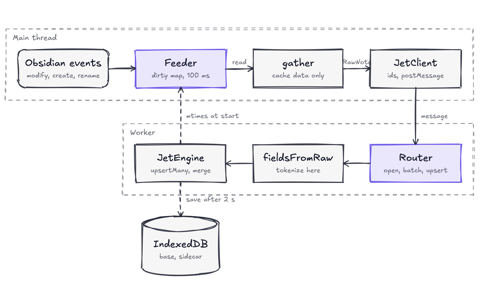
</picture>

#### gather.ts: what it reads, what it does not parse

`gather(app, file, text, inLinks)` builds a `RawNote` from what Obsidian already knows.

| Field | From |
|---|---|
| `text` | the file's text, given by the caller (`cachedRead`, or the editor's text for the open note) |
| `bodyStart` | the end of `frontmatterPosition` in the metadata cache, or 0 |
| `aliases` | `parseFrontMatterAliases` of the cached frontmatter |
| `headings` | the cache's headings, level and text |
| `tags` | `getAllTags` (frontmatter and inline), without the `#` |
| `links` | the cache's links and embeds, each resolved with `getFirstLinkpathDest` to its target's base name, else the last part of the typed link |
| `inLinks` | given: from `inboundCounts`, the inverted `resolvedLinks` |

It parses no Markdown. Headings, tags, aliases and links are Obsidian's; the body is the raw text after the frontmatter, and the worker tokenizes it. That keeps the main-thread cost to reading text and a few cache lookups, and it keeps Jet in step with Obsidian's own idea of a heading or a link. `excluder` builds the "left out" test from Jet's excluded folders (a path prefix) and Obsidian's `userIgnoreFilters` (a `/regex/flags` entry is a regular expression, anything else a prefix; an invalid pattern is ignored, as Obsidian does).

#### feeder.ts: keeping the index in step

The `Feeder` is the main thread's side of indexing. Reading text and gathering run in slices (`src/index/slice.ts`): at most 8 ms, then yield with `scheduler.yield` or a posted message, never a timer, because a hidden window slows timers to a second. A phone is several times slower than a desktop and the gather runs on its main thread.

| Event | What the feeder does |
|---|---|
| First `ensure()` | `open` the worker. If a saved index loaded, `catchUp`; else `build`. Then `live = true` and `onReady`. |
| `build` | list markdown files minus the excluded, **newest first** by mtime, compute `inboundCounts` once, then for each `BATCH` = 100: read the texts in parallel (`Promise.allSettled`, so a note deleted meanwhile is left out), gather in slices, send `batch`. The last batch carries `last: true`. Progress is reported after each. |
| `catchUp` | ask `mtimes`; delete what is in the index and no longer in the vault; upsert every file whose mtime differs (not "is newer": a restored older file counts). |
| Start delay | only the first time Jet is enabled (`data.indexedAt` is null): `FIRST_BUILD_DELAY_MS` = 3 s after the layout is ready, in `main.ts`, and cancelled if the plugin is turned off first. Every other start builds nothing; the index opens on the first search. |
| `touch(file, kind)` | records `upsert` or `delete` for a path in the `dirty` map (the last kind wins) and, if no flush is scheduled, schedules one in `COALESCE_MS` = 100. The window opens at the first change; it is not reset by later ones. |
| `flush` | before the index is live, or during a build: reschedule at 500 ms if busy, else drop (the catch-up will find the change). Otherwise: paths now excluded become deletes; send `delete` first, then `upsert` in batches of 100. After a read, a note that has since been marked `delete`, or whose file is gone, is not sent. Then `onChanged` re-runs an open search. |
| `typing()` | each editor change resets a `TYPING_PAUSE_MS` = 300 timer and does nothing else. When it fires, `sendOpenNote` gathers the open note from the **editor's** text (unsaved edits included), sets its mtime to now, and sends `upsert` directly. |
| `rename(file, from)` | see 7.4. |
| `reset()` | bumps the generation `gen`; a build or catch-up of an older run throws `Cancelled` at its next step. Called on sleep, crash, Rebuild and Clear. |
| `recover()` | after a `broken` reply: reset, then `ensure()` builds again. |

Why newest first: recent work is searchable after the first batch, and an interrupted build leaves the notes people use most. Why batches of 100: a search typed during a build is answered between batches, and a segment per batch is searchable at once. Why events are not sent directly: both the `modify` event and the metadata cache's `changed` event call `touch`, and a map keyed by path turns them into one upsert.

#### store.ts: where the index is kept

`idbStore(vaultId)` keeps one IndexedDB database per vault, named `jet-search/<vaultId>`, with one object store `index` and keys `base`, `sidecar`, `meta` (`savedAt`, `version`) and `vectors`. The vault id is Obsidian's app id, or the vault name when there is none (`vaultId` in `src/internals.ts`). The index is outside the vault, so no sync service and no backup of the notes ever sees it.

| Behaviour | Detail |
|---|---|
| Atomic save | `base`, `sidecar` and `meta` are written in one transaction. `base` is skipped when the router says it did not change. |
| Load | one read-only transaction for the three keys; `null` if `base` or `meta` is missing. |
| Version check | not in the store: the router compares `meta.version` with `INDEX_VERSION` and the segment checks its magic. |
| Registry | a small database `jet-search` with a store `vaults`: vault id to its last save time. `touch` runs after every successful save, in its own transaction, and a failure only warns. |
| 90-day drop | `touch` deletes the databases of every other vault whose stamp is older than `STALE_MS` = 90 days. The stamp is written by saves, not by loads, and deletion happens when some vault saves. |
| No IndexedDB | `jet-worker.ts` uses `memoryStore()`: search works, nothing is kept. |
| Clear | `clear()` empties the `index` store of the vault, even if the worker has never opened (the `clear` request carries the vault id). |

### 6.5 The names tier

Tier 0 answers on the main thread, inside the keystroke, before the worker has been asked anything. It is two classes and one folding module:

| File | Role |
|---|---|
| `src/tier0/names.ts` | `NameIndex`: matches note names, aliases and folder paths |
| `src/tier0/fold.ts` | `fold`, `foldWord`, `bitOf`: the one-time folding that makes a keystroke cheap |
| `src/tier0/meta.ts` | `MetaIndex`: headings, tags and properties, only while the first build runs |

`src/search.ts` owns both instances (`Search.nameIndex()`, `Search.metaIndex()`). The index is built lazily, from `vault.getMarkdownFiles()`, the first time a search runs, or one tick after the modal paints its recents (`Search.warm()`). Building it inside the first keystroke cost that keystroke about 29.5 ms in a first-build vault, and building it one tick after the recents paint brought the keystroke to 3.3 ms (the figures are from the commit that added `warm`, 6961405).

#### What is indexed

A `NameItem` has four fields: a numeric `id`, the note's `name`, its `aliases` and its `path`. `Search.nameItem` fills them from `file.basename`, `parseFrontMatterAliases` on the metadata cache's frontmatter, and `file.path`. The ids are small integers that `Search` hands out (`idOf`, `pathOf`) so that a rename keeps the id and only the path changes.

`NameIndex.build` turns one item into an `Entry` of several folded texts:

| Part | What it is | Notes |
|---|---|---|
| `name` | The basename, folded | Bias 0 |
| `aliases` | Each alias, folded | An alias that folds to the same letters as the name or another alias is dropped (`seen` set), so it cannot win a tie against itself. Bias `ALIAS_BIAS` (-5) |
| `dir` | The folder part of the path, folded once and shared by every note in that folder | Reference counted (`refs`), with a slot (`slot`) in the per-query folder score cache |
| `base` | The file name part of the path, without the extension | The very same object as `name` when the basename equals the note's name, so it is folded once |
| `pathful` | Whether the path can match where the name does not | True when the note has a folder, or its file name differs from its name |

A path match is a different field from a name match. Each query word must match inside the path, either in the folder or in the file name, and the whole match is scored with `PATH_BIAS` (-20) plus a small cost for a long path. The extension is left out (`pathEnd`).

While the first build runs, the content index cannot answer for every note yet. `MetaIndex` fills the gap from Obsidian's metadata cache, which needs no index (`Search.metaNote`):

| Field kind | Source | Weight in `KIND_WEIGHT` |
|---|---|---|
| `heading` | `cache.headings` | 3 |
| `tag` | `getAllTags(cache)`, as `#tag` | 2 |
| `property` | Frontmatter values as `key: value`, one per list item | 1 |

Properties named in `SKIP_PROPERTIES` (`aliases`, `tags`, `cssclasses`, `position` and their singular forms) are left out: aliases and tags are covered elsewhere or say nothing. `Search.metaHits` returns nothing and drops the `MetaIndex` once `indexNotReady()` is false (the feeder has no progress and `indexedAt` is set). Every typed word must start a word of the same field, in any order. All fields of all notes are joined into one string, so a keystroke is a native `indexOf` for the longest word, then a check of the few fields it lands in. The scan stops after `MAX_CANDIDATES` (400) matching fields or `MAX_VISITED` (4000) fields looked at, which keeps a word that is in nearly every note ("status" in frontmatter) cheap. That is a deliberate approximation, accepted because it only applies for the first build. A single letter returns nothing, except Chinese or Japanese characters, which are words on their own.

#### Folding, done once

`fold()` in `fold.ts` walks a string one code point at a time and produces four parallel arrays, one entry per folded UTF-16 unit:

| Array | Holds |
|---|---|
| `sq` | The folded letters and digits, separators removed: lower case, accents gone, `ß` as `ss`, Arabic variants unified. It uses the analyzer's own `normalize`, so Tier 0 and the worker agree on what a letter is |
| `flags` | `WORD` (a word starts here: string start, after a separator, a camelCase hump, a letter-digit boundary), `STRONG` (a token starts here: string start or after a space or punctuation), `PART_END` (a word ends here), `TOKEN_END` |
| `start`, `end` | The range of the original string this unit came from, past any accent that folded away |

`NameIndex.text()` then packs these into one `Uint16Array` per text (`data`: flags, then starts, then ends, then the vocabulary words of the text as four numbers each), plus two 32-bit masks: `mask` (which letters occur: one bit per a to z, one for digits, four buckets for everything else) and `starts` (which letters begin a word). The text is cut at `MAX_TEXT` (4096) characters because offsets are 16-bit.

Why this shape:

| Decision | What goes wrong without it |
|---|---|
| Fold when a note is added, never per keystroke | Every keystroke would re-lower-case, re-strip accents and re-split every name: tens of thousands of strings at 10,000 notes |
| Keep `start` and `end` per folded unit | A match found in folded letters could not be highlighted in the text as written (`Café` is four folded units but the `é` is one character with its own range) |
| Bit masks (`mask`, `starts`) | Most notes are ruled out by two integer compares before any `indexOf` or alignment runs |
| Share folders (`Dir`) and score each folder once per query (`dirStamp`, `serial`) | A folder with 2,000 notes would be matched 2,000 times for the same word |
| Word flags in the data, not recomputed | "Starts a word" and "ends a word" are the whole basis of the match tiers below |

#### Match kinds, best first

A query is split on whitespace and each word folded with `foldWord`. Every word must match the same field of a note (name, an alias, or the path). A word scores a tier base plus 0 to 99 inside it. The words are summed, plus the field bias and a cost of 0.1 per character of the text (up to 100), so shorter texts win ties.

| Kind | Base | A word matches when | Example (invented names) |
|---|---|---|---|
| Exact | `EXACT` 400 | It is contiguous and covers a whole word of the name: from a word start to a word end. A whole token scores more (+20) than a compound part (+15) | `nebula sdk` on *NebulaSDK*: each word is a whole compound part |
| Prefix | `PREFIX` 300 | Contiguous, from a word start, but the name's word goes on after the typed letters | `lant` on *Lantern festival* |
| Substring | `SUBSTRING` 200 | Contiguous, but inside a word (not at a word start) and not across a token boundary | `ern` in *Lantern* |
| Fuzzy | `FUZZY` 100 | The letters appear in order, the first at a word start (`fuzzy()`). Each later letter continues the run, starts a word, or skips at most `MAX_GAP` (3) letters. Word-start pieces earn a bonus, gaps cost `GAP_OPEN` 6 plus `GAP_EXT` 1 per letter, runs earn `RUN` 3 per letter | `jtrip` on *Japan Trip 2027* (initials) |
| Typo | `TYPO` 0 | Within `typoBudget` edits of a word of the text: none under 4 letters, 1 for 4 to 8, 2 for 9 or more. The first letter is fixed. A prefix is allowed one edit | `lanern` on *Lantern* |

Order inside the same tier comes from position: a match starting late in the text loses 0.5 per unit up to 40 units (`late`), a match that crosses a token boundary loses 4 per boundary. A final preference applies across notes (`worse`): exact beats everything, then score, then shorter text, then lower id.

Compound names work because folding removes separators and keeps the flags:

- **Split.** `nebula sdk` finds *NebulaSDK*. The camelCase hump gives `SDK` a `WORD` flag, so `sdk` is a whole part.
- **Join.** `nebulasdk` finds *Nebula SDK*. The folded string of the name is `nebulasdk`, and the query words joined (`joined`) equal it, so it counts as the exact kind (`name.sq === joined`). A query word that spans a boundary still matches contiguously, at the small cost per boundary above.
- **Short words.** A word of one or two letters (`short`) must start at a word start, and does not take part in fuzzy matching. Three letters may match inside a word and fuzzily. This is why one letter does not return every note.
- **Chinese, Japanese, Korean.** A word with these characters (`hasCjk`) matches as a plain substring and never as a typo or fuzzy match (`noTypos`).

A note is returned for the best of its fields. An exact name or alias wins over a better-scored non-exact one (`exact` is the first key of `worse`). When neither name nor alias matches, the path is tried (`pathScore`).

#### Why a keystroke allocates almost nothing

The work per keystroke is one pass over `entries`. What is allocated: the parsed `Word` objects and their strings, one `joined` string, the sort of the words (longest first, the likeliest to rule a field out), and the hits returned. What is not allocated, because it is reused:

| Reused structure | Used for |
|---|---|
| `dpPos`, `dpScore`, `dpBack`, `dpCount` (module level typed arrays, `MAX_Q` by `MAX_N` = 32 by 256) | The fuzzy alignment |
| `nameScores` (`Float64Array`) | The name's per-word scores, reused when the file name equals the name |
| `dirStamp`, `dirScore` | Folder scores, valid where the stamp equals the query's `serial`, so nothing is cleared between queries |
| `marks` (`Uint8Array` per query word) and `touched` | The vocabulary words within the typo budget; only the touched cells are reset, in `finally` |
| `hExact`, `hScore`, `hLen`, `hId`, `hEntry`, `hField` | The best `limit` hits as a heap of parallel typed arrays, worst on top (`offer`) |

Highlight ranges are the last step: `collect` re-scores only the kept hits in a recording mode and maps folded units back to the original string (`toRanges`, then `merged`). A note that did not make the top `limit` never pays for ranges.

#### What a hit says

```ts
type NameHit = {
  id: number;                       // the NameItem id
  score: number;                    // tier base plus 0..99 per word, plus biases
  field: "name" | "alias" | "path";
  text: string;                     // the text that matched: the alias, the path, or the name
  ranges: Array<[number, number]>;  // [start, end) into `text`, as written, sorted and merged
  exact: boolean;                   // the typed text equals the name or an alias, ignoring case, accents, punctuation
};
```

For a `path` hit, `text` is the path and the ranges span the folder part and the file name part. `composeHits` only uses ranges when `field === "name"` (it draws them on the title). `exact` is what the rare-word deferral in 6.6 tests.

#### Limits

| Constant | Value | Meaning |
|---|---|---|
| `DEFAULT_LIMIT` | 50 | Hits when the caller names no limit (`Search.list` passes 40) |
| `MAX_TEXT` | 4096 | Characters folded per text |
| `MAX_N`, `MAX_Q` | 256, 32 | Folded units searched and query letters for fuzzy alignment |
| `MAX_GAP` | 3 | Letters a fuzzy match may skip inside a word |
| `MAX_WORDS` | 16 | Query words whose folder scores are cached |
| `TYPO_LIMIT` | 2000 | Vocabulary words marked per query word |
| `MAX_META`, `MAX_CANDIDATES`, `MAX_VISITED` | 20, 400, 4000 | Metadata hits shown, and the scan caps in `MetaIndex` |

#### How it is kept current

`upsert(item)` builds the new entry, releases the old one and swaps it in. `remove(id)` releases the entry and moves the last entry into its slot. Releasing gives words back to a reference-counted vocabulary (`termRefs`); a word no note uses leaves the sorted list (`sorted`, kept sorted by UTF-16 code unit as `typoMatches` expects), and a folder with no notes left frees its slot and clears its cached scores. The constructor runs `upsert` in bulk mode (`bulk`) and sorts the vocabulary once.

`main.ts` listens to four events, all of which end in `Search`:

| Event | Call |
|---|---|
| vault `create` | `nameChanged(file)` |
| metadata cache `changed` | `nameChanged(file)` (picks up alias edits) |
| vault `rename` | `nameRenamed(file, from)`: the id moves to the new path, then `nameChanged` |
| vault `delete` | `nameDeleted(path)` |

`nameChanged` does nothing before the index exists, and ignores non-Markdown files. A new note is findable by name in the same frame it is created.

Measured cost, from `docs/benchmarks.md`: the names index alone takes a typical 0.03 ms per keystroke at 1,000 notes, 0.26 ms at 10,000 and 1.8 ms at 50,000. `test/names.test.ts` holds budgets of 1 ms (p95) for about 2,000 items and 8 ms (p95) for about 20,000.

### 6.6 Merging the two answers

Two things answer each keystroke: Tier 0 (synchronous, names) and the worker (asynchronous, full text). `Search.list()` in `src/search.ts` starts both, paints Tier 0 at once, and paints again when the worker replies. `composeHits()` is the one function that merges them. It is pure apart from reading `app.vault` and `data` (frecency), and it is called with whatever has arrived so far: `reply` is `null` for the first paint.

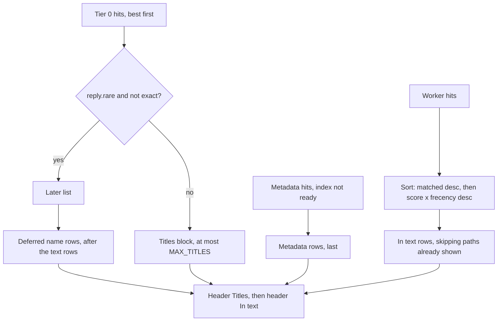

The flowchart shows the order rows are placed in, and that every row goes through one `shown` set of paths.

#### The pieces, in the order the code runs them

1. **Query for the names.** `namesQuery(text)` removes `-word` (kept in an `excluded` set), drops quote characters, turns `#tag` and `key:value` into their value, as the engine reads a query. The names are matched with `limit: 40`, and an `allow` function when a scope, a filter or an exclusion applies (`named`).
2. **Titles block.** `composeHits` walks the Tier 0 hits in order. Each becomes a title row (`this.item(...)`): the title ranges are the name hit's ranges when `field === "name"`, and the badge is the alias text for an alias hit, `path` for a path hit. A path already `shown` is skipped. The walk stops at `MAX_TITLES` (8). The block is headed `Titles`.
3. **Text hits.** The worker's `reply.hits` get `score * frecency(data, path, now)` and are sorted by `matched` (how many query words the note matched) descending, then boosted score descending. Rows already shown are skipped, so a note appears once, under its name when its name matched. Each row gets its excerpt from the `excerpts` map (empty on the first paint), and the preview offset from the excerpt. The block is headed `In text`.
4. **Deferred names.** Name hits that the rare-word rule held back (below) are appended after the text rows, with the same badge and title ranges they would have had.
5. **Metadata rows.** While the index is not ready, notes found by a heading, tag or property are appended last, with the matching field as the row's excerpt.
6. **Headers.** With no titles the list is one `Results` block. With titles it is `Titles`, then `In text` when there are text rows. With nothing at all it returns an empty list, and `list()` turns that into the recovery screen (6.7).

`compose()` puts one row in front of all this when the text uses an operator only Obsidian's Search understands (`line:`, `section:`, `block:`, `task:`, `match-case:`, `ignore-case:` or a `/regex/`; `wantsCoreSearch`). That row hands the query to the core Search with the chips written in its syntax (`coreRow`).

#### The rare-word deferral

The engine marks a reply `rare` when every query word is spelled exactly in only one or two notes (`TYPOS_BELOW` is 3 in `src/engine/jet-engine.ts`: a word exactly in at least one and in fewer than 3 notes). In that case `composeHits` holds back every name hit that is not `exact` and shows it after the text rows. A name equal to what was typed stays first.

Why: a word that is rare in this vault is almost certainly what the user means, and it is held by one or two notes. Without the rule, a query like `trips`, held once in the body of a gear guide, would be buried under every note whose name is *Trip ...* (another form of the word), every near spelling, and every note inside a folder called *Trips* (a path match). Two commits grew this rule: first folder-only matches (fa74b16), then any non-exact name (d70ecc4). Both are held by tests in `test/search.test.ts`, and both include the opposite case (a word that is not rare keeps names first).

Consequence worth knowing: the first paint of a keystroke has no reply, so it shows every name hit under Titles. When a `rare` reply arrives, the non-exact names move down. This is the one place where rows are moved on purpose after the first paint; everything else only appends.

#### Quoted phrases

When the text has quoted phrases (`quotedPhrases` in `src/rank.ts`), the query asks the worker for `PHRASE_CHECK_LIMIT` (500) candidates instead of 50. `filterPhrases` then reads each note in rank order through `Search.read` (the basename, a newline, then `vault.cachedRead`, so a phrase that equals the title counts) and keeps those where `hasPhrase` finds every phrase as consecutive whole words, ignoring case, accents and punctuation. It stops at `PHRASE_CONFIRM_LIMIT` (50) confirmed notes. It reads as far as the index reads a note (`MAX_BODY_CHARS` 2,000,000 plus 64,000 for the frontmatter), not only the 256 KB that excerpts scan. After the awaits, `list()` checks that the box still holds the same text before it goes on. The Tier 0 side sees the phrase's words as ordinary name words, since quotes are dropped.

#### The sequence boost

`src/rank.ts` also exports `applySequenceBoost` and `boostSequences` with `SEQUENCE_BOOST` (1.5): for an unquoted query of two or more words, a note that contains the words in order gets its score multiplied, without ever lifting it above a note that matched more words. These functions have tests (`test/rank.test.ts`) but no caller in `src/`: `Search.list()` never calls them, so the boost is not part of what the user sees today. The source comment calls it "a proposed boost". Treat it as unwired code, and see the limitations.

#### Frecency

`frecency(data, path, now)` in `src/data.ts` is `1 + 0.15 * log2(1 + decayed opens)`. Every note opened (the `file-open` event in `main.ts`, however it was opened) adds one to a score that halves every 30 days (`HALF_LIFE`), and only the 2000 most recently opened notes are kept (`MAX_OPENED`). It multiplies the score of text hits only. Titles are ordered by Tier 0 alone. Because the sort key is `matched` first, frecency only reorders notes that matched the same number of words. `now` is read once per `list()` call, so a note does not hop between two paints of the same keystroke.

#### Words, meaning, both

`list()` takes a `meaning` argument from the modal. It decides which lists are asked for:

| Mode | What `list()` does | Titles block? |
|---|---|---|
| Words | Tier 0, then the worker, as above. A question searched by words gets `offerMeaning`: the first header carries `mode: "words"`, which makes the header show the switch | Yes |
| Meaning | `byMeaning()` alone: a `By meaning` header with 0 while the model answers ("Searching by meaning..."), then up to 50 notes from `client.nearest`, each with the badge `by meaning` and `meaning: true`. The excerpt is the line with most of the question's words, else the note's first line | No |
| Both | The words list and the meaning list are painted together (`draw` paints `[...w, ...m]`), each as it arrives. The modal then regroups them with `layoutBoth` | Inside the words group, the Titles and In text headers are dropped by the regrouping |

`layoutBoth` (`src/modal/both.ts`) shows three layouts, chosen in settings: `groups` (By words, then By meaning for notes only meaning found; a note found both ways stays under words with the badge `also by meaning`), `first` (Found both ways, then words, then meaning), and `ranked` (one list, each list's best taking turns, a badge on every row). Each group shows `BOTH_SHOWN` (5) rows then a `more` row; one row more than the cap is shown rather than a "1 more" row. A path appears once.

Title only (the `title` filter) means names alone: no metadata rows, no worker, no meaning. An experimental answers re-rank (`Search.answers`) waits `ANSWER_PAUSE_MS` (250 ms), asks for a pool of `ANSWER_POOL` (50) notes by words and by meaning, and once its list is painted it stops the words list from painting over it. It is behind the `answers` setting and out of scope here.

#### How rows keep their place while results fill in

Three mechanisms keep a list from jumping under the user's hand:

| Mechanism | Where | Effect |
|---|---|---|
| Titles first, text appended | `composeHits` | The rows already on screen (the Titles block) are the same rows in the same order in the next paint. New rows go below. The first header is the only thing that can change |
| The selection is a key, not an index | `JetModal.paint`: `selectedKey` (for an item, `n:path`, plus `:line` for a line row) | After a paint, the same note is selected again if it is still listed, else the first selectable row |
| `moved` | `JetModal` | If the user moved the selection (keys or pointer), a later paint does not take it back to the first row. If they did not, the first row is selected. This replaced a bug where an answers list left the selection on the old first row |

Excerpts arrive as a second paint of the same rows (`excerpts` map): the row gains its second line. The row count does not change, so nothing moves.

#### How stale replies are dropped

Four guards, each at a different layer. None of them is the only one, so each guards a different timing:

| Layer | Guard | What it drops |
|---|---|---|
| Worker (`jet-worker.ts`) | If another `query` with a non-zero `seq` is queued, the older one is answered `stale: true` without running | Work for text that is already replaced |
| Client (`JetClient.query`) | Returns `null` when `r.stale` or `r.seq !== this.seq` | A reply for any query but the latest. `Search.list` returns on `null` |
| Search (`this.current?.text !== text`) | Checked after phrase reads, in `byMeaning`, `answers` and `recovery` | Slow side paths that finished after the user typed on |
| Modal (`listSeq`) | `refresh()` increments `listSeq` and passes `host.list` a paint that checks `seq === this.listSeq` | Any paint, from any path, belonging to an older call. Also `if (!this.shown) return` in `paint` for results arriving after close |

Two side effects of the design are kept out of the main sequence. `JetClient.count` (the "search everywhere" count shown on the recovery screen) sends `seq: 0`, which the worker never treats as stale and which never makes another query stale, because a shared counter once let a recovery count cancel the next keystroke's results. Questions for the meaning search count apart from queries (`nearSeq`) for the same reason: when both are asked for one search, a shared counter made the question cancel the words.

### 6.7 The modal and the host

Three objects sit between Obsidian and the pixels:

| Object | File | Owns |
|---|---|---|
| `JetModal` | `src/modal/jet-modal.ts` | The window: the DOM, the keyboard, every piece of view state |
| `JetHost` | `src/host.ts` | What the window asks the plugin for: lists, hints, opening, creating, actions, settings popover, persistence on close |
| `Search` | `src/search.ts` | The answers to a text (6.6) |

`JetModal` extends Obsidian's `Modal`, but draws its own list and does not use `SuggestModal`. The reason in the source: rows are reused across keystrokes, results are never stale, and the selection stays put, none of which a `SuggestModal` list gives. The modal talks to its surroundings only through the `ModalHost` type (declared in the same file). `JetHost` is the real implementation; `InNoteHost` (`src/innote.ts`) is a second one, for searching inside the open note. Tests drive the modal with a small fake host (`test/modal.test.ts`), which is why the boundary is a type and not a class.

The modal never touches the vault, the metadata cache or the worker. The host does not touch the DOM. `ModalHost` carries optional members (`scopes`, `filters`, `meaning`, `actions`, `act`, `create`, `insertLink`, `copyLink`, `renderSettings`, `restore`, `keys`, `sortable`), and the modal turns a feature off when its member is absent. `InNoteHost` leaves out `create`, `insertLink` and `copyLink`, and the matching keys do nothing and leave the window open.

#### A map of jet-modal.ts, by area

The file is about 2,300 lines. It is one class, plus the entry types and the row renderer. The areas, in file order:

| Area | What it holds | Main members |
|---|---|---|
| Entry types | The union of what a row can be | `Entry`: `header`, `item`, `more`, `search`, `scopes`, `notice`, `create`, `widen`, `core` |
| Host contract | Everything the modal may ask for | `ModalHost`, `Completion`, `NoteAction`, `FixView`, `HintState` |
| Sorting | Result order | `SORTS`, `sortEntries` (the first header keeps its place; "Titles" becomes "Results") |
| Constructor | The static DOM and its listeners | The input (role `combobox`), the chip and kept-chips spans, the filter chips, the `jet-list` (role `listbox`), the preview, the footer; `input`, click, mousemove and keydown handlers |
| Open and close | Lifecycle | `onOpen`, `onClose`, `ResizeObserver` for the narrow mode |
| Painting | Turn entries into rows | `paint` (adds the scope note, the three-way switch and the sort control to the first headers, applies `layoutBoth` or `sortEntries`, restores the selection), `render` (the row pool), `fillRow` (one row per entry type) |
| Refresh | The text changed | `refresh`: finished filters become chips, typed scope names are parsed (`host.scopes.typed`), meaning state is computed, `host.list` is called with a `listSeq` guarded paint |
| Autocomplete and fix-it | Values for `key:` pieces, `@scope`, dates; "did you mean" for a key two edits off | `updateAC`, `drawAC`, `acceptAC`, `applyFix`, `placeGhost` |
| Filters | Chips and the bar | `drawFilters`, `addFilter`, `toggleBar`, `drawBar` (Title only, In, Type, Tags, Edited, Filter, Clear) |
| Scopes | The chip, the kept chips, Auto, the banner, the hover card, widening | `applyChip`, `removeKept`, `removeChip`, `cycle`, `widen`, `drawScope`, `drawKept`, `drawBanner`, `showCard` |
| Meaning | Words, meaning, both | `meaningState`, `toggleMeaning`, `setMeaningMode` |
| Footer | The hint bar | `footer`, `hintState`, `lab` |
| Selection | Move, choose | `select`, `move`, `choose`, `selectable`, `keyOf` |
| Keys | Every key binding | `keys()`: Escape, then `reg(action, fn)` for each mapped action, then fixed keys (arrows, Backspace, PageUp/PageDown, Ctrl-N/P, Alt-arrows) |
| The action panel | Command-K panel | `openActions`, `closeActions`, `filterActions`, `runAction`, `drawActions` |

State is a set of fields and booleans, not a state machine: `entries`, `selected`, `selectedKey`, `moved`, `chip`, `kept`, `choices`, `chipSelected`, `autoUndo`, `autoPrev`, `autoName`, `widened`, `suppressAuto`, `filters`, `filterSel`, `pinnedKey`, `meaningPick`, `meaningNow`, `expanded`, `sort`, `ac`, `fix`, `actPanel`, `previewKey`. The transitions between them are spread across the handlers. This is the file's main cost to change (see limitations).

#### What the host does

`JetHost.list` is the only entry for text. With nothing typed and no filters it paints the recents (`recents()`: the scopes row, up to three recent searches, then groups of recently opened notes) or a scope's recents (`scopeRecents`), then calls `search().warm()`. Otherwise it calls `Search.list`. Every call to the `search` getter first calls the plugin's `wake()`, which keeps the worker awake and arms the ten-minute sleep (`SLEEP_AFTER_MS`).

Other host duties:

| Duty | Method |
|---|---|
| Hints for the footer, from the current state and the user's keys | `hints(text, state)`, built with `lab(action)` |
| Open a note, in the same tab, a new tab or a split, at the hit | `open(path, how, at)`: waits for `openFile`, then selects the match in the editor unless the view is in Reading mode |
| Create a note named after the text | `create(text, scope)`: strips characters a file name cannot hold, cuts at 120 characters without splitting a character, opens an existing note whose name differs only in case, uses the scope's folder, properties and tags |
| Copy a link, insert a link | `copyLink`, `insertLink` |
| The Command-K actions and their keys | `actions(path)`, `act(id, path)` (open, copy link, URL, path, reveal, move, bookmark, backlinks, search in this note) |
| Completion lists for filters and scopes | the `filters` getter, `complete()` |
| Remember on close | `closed(text, opened, scope, filters, also)`: bumps scope usage, stores the last scope and filters when Persist filters is on, remembers the search (with its scopes and filters in the form that applies them again), calls `Search.idle()`, saves |

#### Rows and the result list

`render()` keeps a pool of row elements (`pool`). A list of n entries uses the first n elements and detaches the rest. `fillRow` clears and refills each element, because rows are few and small, so reusing element identity is enough and a diffing step would cost more than it saves. Every row gets `id="jet-row-N"`; the selected one gets `is-selected`, `aria-selected`, and the input's `aria-activedescendant` points at it. Focus never leaves the input: `mousedown` on the list, chips and buttons calls `preventDefault`.

A result row has up to three lines: the title (ranges drawn with `highlight`, class `jet-th`), the badge, the age; the breadcrumb and the reasons (why a note matched beyond its text: a filter value, a scope rule, a property key); and the excerpt with `mark` elements (class `jet-mark`). Title rows (from Tier 0) have no excerpt line.

#### Opening and closing

`Plugin.open()` (called by the command, the double tap and the stand-in ids) does one of three things: if the window is open with a scope on, it widens the search (`widen()`); if it is open with typed text, it leaves it alone; otherwise it closes any old modal and makes a new `JetModal`, prefilled with a short single-line selection from the editor. The double tap is 6.9. On open, `onOpen` sets the theme mark colours, restores the last scope and filters if Persist filters is on (pinned chips), calls `refresh(true)`, focuses the input and starts a `ResizeObserver` on the modal's own window (a pop-out window counts). Below `NARROW_PX` (760) the modal gets `is-narrow` and the preview hides; when it is wide again the preview follows the selection. `onClose` is in the lifecycle fragment.

Escape is replaced, not added to: the modal removes Obsidian's own Escape handler from its scope and registers one that peels one layer per press: the Command-K panel, the autocomplete list, a selected filter chip, a selected scope chip, then the text, scope and filters together, then the window. A press during input method composition is left to the input method (`e.isComposing`).

#### Theming

The window uses Obsidian's variables (appendix) and defines two of its own, `--jet-mark-bg` and `--jet-mark-fg`. Themes style `mark` only inside rendered notes, and some pair an opaque highlight with dark text, so Jet's marks in the normal text colour were unreadable in one popular dark theme. `themeMark()` (`src/modal/theme-mark.ts`) builds a hidden `.markdown-rendered` host with a `mark` in it, reads its computed `background-color` and `color`, removes the host, and caches the answer. `onOpen` sets the two properties on the modal element (`setCssProps`). `main.ts` calls `forgetThemeMark` on the workspace `css-change` event, so the next open measures again. When nothing is measured (no styles yet) the CSS fallbacks apply: `var(--jet-mark-bg, var(--text-highlight-bg))` and `var(--jet-mark-fg, var(--text-normal))`. The preview's marks (`.jet-pmark`) use the same pair.

#### Accessibility, as far as it exists

The input is a `combobox` (`aria-controls="jet-list"`, `aria-autocomplete="list"`, `aria-expanded="true"`, `aria-activedescendant` set by `select`), the list a `listbox`, result rows `option`s with `aria-selected`, and headers, notices and the scopes row have `role` removed. Icon buttons carry `aria-label`s; the keys appear in the labels (`Sort (⌘⇧S)` on macOS, `Sort (Ctrl+Shift+S)` elsewhere). All navigation is by keyboard. There is no `aria-live` region, so a screen reader is not told when results arrive or how many there are. See the limitations.

### 6.8 Excerpts, preview and in-note search

All three put the typed words on the user's own text, and all three use the same matcher, `src/excerpt/excerpt.ts`.

#### One regular expression per query

`cutExcerpt(text, terms, opts)` finds the line with the most of the typed words and cuts about 160 characters (`WIDTH`) around the hit. The design is in the file header: one regular expression for all of a query's terms runs over the raw note. There is no normalized copy of the note and no expression per term.

| Decision | Reason |
|---|---|
| One expression for all terms (`termsSource` in `src/excerpt/fold.ts`) | One scan finds every hit of every word, in text order. Twenty rows is twenty scans, not twenty times the number of words |
| No normalized copy of the note | A normalized copy is an allocation the size of the note on every row, and it needs an offset map back to the raw text for highlighting. Case lives in the pattern's character classes, accents in a second pattern only when the note holds accented letters |
| Each letter of a term is a class of the raw characters that fold to it | The classes come from the analyzer's own `normalize`, so an excerpt finds what the index stored. `é` and `E` and `É` match `e`; `ß` matches `ss` |
| Classes list only variants the note actually contains | A class with every possible variant defeats V8's quick checks and scans 3 to 15 times slower. Most notes have none. One static scan (`LATIN_FOLDS`, or `MAY_FOLD` for other scripts) says which variants are present, and a pattern for that set is compiled once and cached |
| No `\p{...}` classes in the patterns | They take about 1 ms each to compile |
| Pattern cache | `CACHE_SIZE` (16) term sets, each with up to `VARIANT_PATTERNS` (8) variant patterns, least recently used dropped first. A query's rows share the compiled pattern |

The accent and case folding is shared with the index by construction: both call the same `normalize`. A hit must start a word (`startsWord`: the start, after a separator, a camelCase hump, a letter-digit boundary) and is marked to the end of that word part (`wordEnd`), which matches the index's idea of a word. Chinese, Japanese, Korean and the scripts without spaces match anywhere (`isFree`). Arabic matches with its article (`afterArticle`).

Steps in `cutExcerpt`:

1. If the note holds decomposed Hangul, half-width kana or ligatures (`NEEDS_COMPOSE`), it is composed to NFKC with a way back to raw offsets (`composed`, cached per note text, so the check runs once per note for every keystroke). Most notes cost one `test`.
2. The scan is limited to `SCAN_LIMIT` (256 KB) and starts after the frontmatter (`frontmatterEnd`).
3. Hits are collected up to `MORE_CAP` (99, plus one). The first `GROUPED` (64) hits are told apart by word: a word as typed counts fully, a form of it (`cat` for `category`) counts half unless it is the word still being typed.
4. The best anchor is chosen among the first `ANCHORS` (30) hits: the one whose line, within half a width of it, holds the most distinct words. Ties go to the first. (Comparing every pair of up to 100 hits was replaced by this, d0561df.)
5. A long line is only looked at `REACH` (4) widths either side of the hit, because a whole note can be one line.
6. `simplify` removes Markdown noise for display (list markers, `[[a|b]]` to `b`, emphasis marks) unless the hit sits inside the removed part. `cutWindow` picks the window without cutting a character cluster (`clusterStart`, `clusterEnd`). Marks are shifted to match.

The result is `{ text, marks, line, more, offset }`: `more` feeds the `+N more` label, and `offset` is where the hit is in the note, which the preview and the open action use.

`Search.excerpts()` calls this for at most `EXCERPT_ROWS` (24) rows that can show one, in parallel, from `vault.cachedRead`. It blanks a first heading that only repeats the note's name (`withoutTitleLine`), so the excerpt says something. It passes the engine's expanded terms as `terms` and the words as typed as `exact`; the last word counts as being typed unless the text ends with a space. If a note has no hit in its body, the note's property values are tried and the property's key becomes a reason on the row. The excerpts arrive as a second paint of the same rows.

`findHits` (same file) returns every hit offset, capped at 1000, for the preview and the in-note list. `hasPhrase` uses the same machinery for the phrase check.

#### The preview

`Preview` (`src/preview/preview.ts`) shows the selected note: breadcrumb, title, a few properties (`PROPS`: type, status, project, area, created, date, tags), and the section around the hit, rendered by Obsidian, with every hit marked and ticked on a rail.

How it is driven:

1. `JetModal.select` calls `schedulePreview()`. The selection must rest for `PREVIEW_REST_MS` (80) before anything renders, so holding an arrow key renders nothing until it stops.
2. The timer builds a key from the path, the terms, the offset and the answer line (`previewKey`). If the pane already shows that note with that key, nothing happens. Typing on with the same note selected changes the terms, so the key changes and the note is drawn again with the new marks.
3. `Preview.show` increments a `token`, reads the text with `cachedRead`, and asks `sectionAround` for the part to render.
4. `sectionAround` (`src/preview/section.ts`) returns from the heading the hit sits under to the next heading of the same or a higher level, capped at `PREVIEW_CAP` (8000 characters, ending at a line end). With no hit in the text (a note found by its title, a heading or a property) it renders from the top of the body, because the section would end at the first heading, often right after the properties, and show an empty pane. Headings inside fenced code are not headings; fences are found once per note.
5. The section is rendered with `MarkdownRenderer.render` into an element that is not on the page, then swapped in with `replaceWith`. After each `await`, `token` is compared and a stale render is dropped.
6. `mark()` walks the rendered text nodes, wraps hits (50 per text node, 300 in all) in `mark.jet-pmark`, reads every mark's `offsetTop` first, and only then draws the ticks. `step(1)` selects the first.

Why rendering is off the page. Obsidian reads styles while it renders a note. Each of those reads on the live page forces a layout. Stepping through results with the preview on dropped 4 to 8 frames per run (frames over 25 ms, in a test vault with 40 plugins). Rendering in a detached element and swapping it in brought that to 0 to 1 frames. The same commit fixed the second cause, in `mark()`: drawing a tick right after reading each mark's position made the page lay out once per hit (up to 300). Reading all positions first, then writing, took that step from 353 ms to 43 ms over eight notes (33b0d07). Both fixes are held by `test/preview-ticks.test.ts`.

Why a child component per render. `MarkdownRenderer.render` takes a `Component` that owns whatever the renderer attaches while it works (embeds, event handlers, post-processors): Obsidian's contract is that unloading the component releases them. `Preview` makes a fresh `Component` for every note, calls `load()`, and calls `unload()` when the selection changes, when the pane is cleared, and on destroy. A single long-lived component would collect the leftovers of every note the user had arrowed through. If rendering throws, the pane shows the section as plain text in a `pre` (`jet-plain`), with a console warning.

`clear()` also empties the title, path and properties, so nothing of the last note is left to act on after the selection moves to a row that is not a note (no results, a "Create" row).

#### Search in this note

`InNoteHost` (`src/innote.ts`) implements the same `ModalHost`, so it uses the same window. It is opened by the command "Search in this note" or from the Command-K actions.

| Behaviour | Detail |
|---|---|
| The text comes from `view.editor.getValue()`, not from the vault | A note's unsaved edits are searched. Obsidian saves after a pause, so a read from the vault (the cached read the other lists use) could miss what was typed a second ago |
| Per line | Each line is matched with `findHits(line, words, { limit: 1000 })`. A line is ranked by how many of the typed words it holds, then by position (`matched` desc, then line). 20 marks are shown per line, but words are counted over all hits |
| One letter or punctuation | `tokenize` gives no words, so the text is searched as typed, case aside, because one note is small enough |
| Cap | `MAX_LINES` (100) rows, with an info notice saying "The first N of M lines" |
| No text | The note's headings, from the metadata cache |
| Rows | Each row is a line cut to about `WIDTH` (140) characters around its first hit, never inside a character (`clusterStart`, `clusterEnd`); the row carries `at: { line, ch, len }` |
| Open | In the source editor: after the modal has closed and the editor has the focus back, select the match and scroll it into view. In Reading view: `setEphemeralState({ line })` |
| Differences | `sortable = false` (no sort control: one note has one order), `previewOn()` is false and the preview key does nothing, no create or insert-link |

### 6.9 Keys and the double-tap

#### One source for every key

`src/keys/keymap.ts` is pure (it only imports a type from Obsidian). `KEY_ACTIONS` is a list of `{ id, what, key }`: 17 actions, each with a default combination. `keyMap(custom)` overlays the user's saved combinations on the defaults, and returns a complete `KeyMap`. Three consumers read it and nothing else decides a key:

| Consumer | How it uses the map |
|---|---|
| `JetModal.keys()` | `reg(action, fn)` registers `this.k[action]` on the modal's `Scope`, so a rebound key runs there and the default no longer does |
| Every hint in the window | `lab(action)` writes the combination as the platform does (`comboLabel`): symbols joined to the key on macOS (`⌘⇧S`), words joined by `+` elsewhere (`Ctrl+Shift+S`). The footer, the banner, the preview buttons' tooltips, the Command-K panel, the suggestion cards and the header controls all call it, so they follow the user's keys |
| `JetHost.hints` | The same `lab`, from `keyMap(settings.keys)` |

The modal reads the map once per opening (`this.k`, from `host.keys()`), so the hints cannot differ from the bindings inside one window. Moving the list (arrows, Page Up/Down, Ctrl-N and Ctrl-P), Escape, Backspace, Left and the Alt-arrows (scroll the preview) are not in the map: `FIXED` lists them and `refusal` refuses them.

Platform handling: on macOS `Mod` is Command, and `Ctrl` is a separate key. Elsewhere Obsidian maps `Mod` to Ctrl, so `norm` folds `Ctrl` into `Mod` for comparison and display (the same key is shown once). `setMac` is called once by `main.ts` from Obsidian's `Platform`. The default for `copyPath` is a getter for this reason: `Mod+Ctrl+C` on macOS would be plain Ctrl+C elsewhere, so it is `Mod+Alt+C` there.

#### Remapping

The settings page records a key by listening to `keydown` in capture mode on the window and turning the event into a combination with `comboOf`. It reads letters and digits by their physical place (`event.code`), so Option-L is L and not the character the layout produces. Before saving, `refusal(map, action, combo)` returns a reason or `null`. A key is refused when:

| Reason | Check |
|---|---|
| Jet keeps it | It is in `FIXED` |
| It would type text | No Mod, Ctrl, Meta or Alt, and not Enter, Tab or a function key |
| macOS types a character for it | Option with a letter (Option-L is a symbol), where the window would never see the key |
| Enter or Tab alone belongs to another action | Only `open` may take Enter alone, only `accept` may take Tab alone: the lists in the window need them |
| Another action has it | Named in the message |

Only keys that differ from the default are saved (`sameCombo` deletes the entry). `validKeys` in `src/data.ts` drops saved entries for unknown actions or with unknown modifiers when the data is loaded, so a hand-edited `data.json` cannot break the window. `clashes(map)` reports two actions on one key (an old saved key meeting a newer default), and the settings page says so. One special case, `systemCopy`: when an action is on Mod+C, the registered handler lets the system copy through while text is selected in the box or the preview.

If `open` is moved off Enter, the modal also registers a plain Enter that only runs the Command-K panel action or takes a value from the list.

#### The double-tap detector

`DoubleTap` (`src/shift.ts`) is pure: the plugin feeds it key events with their `timeStamp`, and `keyup` returns `true` when a double tap completes. The key is `settings.tapKey` (Shift, Control, Alt, Meta, or off; default Shift) and the interval is `settings.shiftInterval` (default 350 ms, valid range 150 to 1000 in `normalizeData`).

| Rule | Code |
|---|---|
| A tap is the key down then up with nothing between | `downAt` is set on a non-repeat `keydown` of the tapped key |
| A held key is not a tap | `keyup` is clean only if `now - downAt < interval` |
| Key repeat is not a tap | A repeat `keydown` of the tapped key sets `dirty` |
| Any other key cancels the pair | A `keydown` of another key sets `dirty`, clears `downAt` and `lastTapAt`, so Shift with a letter never counts |
| The pair is measured between the two key-ups | The second clean tap fires if `now - lastTapAt <= interval` |
| A mouse press between taps cancels | `cancel()`, called from a capture `mousedown` listener: Shift-click to extend a selection is not a double tap |
| Losing the window's focus forgets a half tap | `reset()`, called on the window's `blur` |

`main.ts` (`listen()`) attaches `keydown`, `keyup`, `mousedown` listeners in capture mode on the main document and on every pop-out window that has a leaf (found with `iterateAllLeaves` and refreshed on `layout-change`), plus `blur` on the window. A closed pop-out is let go of at once. When the detector fires, Jet checks that the key is not off and that no other plugin already owns the same double tap (`tapOwnedElsewhere` in `src/internals.ts`; if one does, its binding opens Jet through the stand-in command ids instead), then calls `open()`.

A second double tap while the window is open does something else. With a scope on, it widens the search to the whole vault; again, it puts the scope back (`JetModal.widen`). With nothing to widen, the search you typed stays (a bug fixed in 91f4429).

### 6.10 Search by meaning

<picture>
  <source media="(prefers-color-scheme: dark)" srcset="assets/arch-meaning-dark.png">
  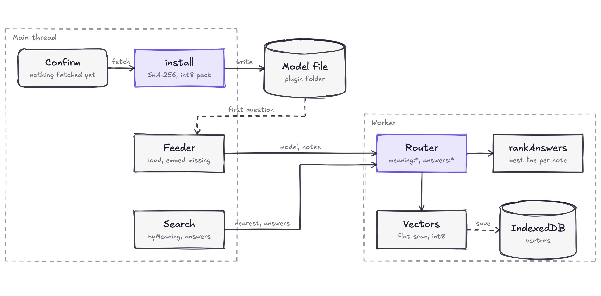
</picture>

Search by meaning is opt-in. It finds notes that say the same thing in other words ("how do I stop my basil dying" finds a note about watering and cold nights). It runs on the device, with no neural network and no WASM: the model is a table of vectors, and a text's vector is an average of table rows. `src/meaning/` holds the model, the install flow, the note vectors, the settings-side controller and the question rule.

#### The model

| Item | Value | Where |
|---|---|---|
| Id | `potion-base-8M` (Model2Vec, a static model) | `MODEL.id` in `model.ts` |
| Source | `minishlab/potion-base-8M` on Hugging Face, MIT licence | `MODEL.repo`, `MODEL.licence` |
| Revision | one pinned commit hash | `MODEL.revision` |
| Files | `model.safetensors` and `tokenizer.json`, each with a pinned SHA-256 | `MODEL.files` |
| Download | about 31 MB (`MODEL.downloadMB`), told to you before anything is fetched | `meaning-settings.ts` |
| Vector size | 256 numbers per word piece (`MODEL.dims`) | `model.ts` |
| Text read per note | 512 pieces at most (`MODEL.maxTokens`) | `embed` in `model.ts` |
| Tokenizer | BERT uncased WordPiece, 100 characters per word at most, written in `tokenizer.ts` to match Hugging Face's normalizer | `tokenizer.ts` |
| Kept as | one packed file `meaning-potion-base-8M.bin` in the plugin's own folder (`manifest.dir`) | `MODEL_FILE` in `install.ts` |

The packed file is Jet's, not Hugging Face's. `packModel` writes a 24-byte header (magic `JETM`, version 1, dims, rows, the unknown-piece id, the vocabulary's byte length), the vocabulary as newline-joined text padded to 4 bytes, one float32 scale per row, then the table as int8. Each row's scale is its largest absolute value divided by 127. `unpackModel` rejects a wrong magic or version and a truncated file ("the Jet meaning model file is incomplete") instead of throwing a raw `RangeError`. `packModel` reads F32 or F16 tables and refuses any other dtype. Measured while writing this document with `bench/meaning-memory.ts`: the packed file is 7.9 MB for 29,528 pieces, and the unpacked model holds 9.6 MB in memory. A test (`test/meaning.test.ts`) asserts it stays under 8.5 MB when the model is on the machine.

#### The install flow

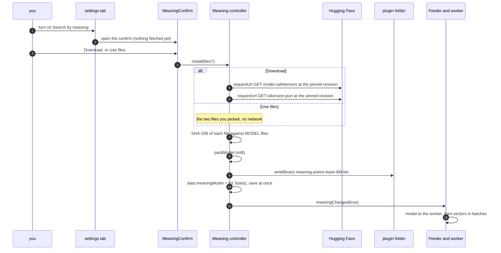

The sequence shows opt-in install, from the toggle to the first vectors. Three things are worth knowing:

- **Nothing is fetched before the confirm.** `setControlValue("meaning")` opens `MeaningConfirm` when the model is not installed. The confirm names the model, the size, the source and "Checked against its SHA-256, pinned in Jet's code".
- **The hash is checked before packing.** `install` in `install.ts` hashes each file with `crypto.subtle.digest` and throws "is not the expected file (its checksum differs); nothing was installed" on a mismatch. A page of HTML served by a proxy, or a changed upstream file, never reaches `packModel`. The pinned revision in the URL means a later commit upstream cannot change what Jet fetches.
- **"Use files" is the no-network path.** The same `install` runs on files read from a file picker, with the same hash check. This is the only way to get the model on a machine that must stay offline.

`Meaning.install` saves the record immediately (`save` in `main.ts` cancels the debounce and calls `saveData`). Removal does the same. A debounced save here once let "installed" survive a quit with no file behind it (see the defects list).

#### How a note's vector is made

`docText` in `doc.ts` builds the text, and `embed` in `model.ts` turns it into a vector. The text is the title (file name without `.md`), the aliases joined by commas, the `summary:` property if there is one, the headings joined by ". ", then the first 2,000 characters (`BODY`) of the body as plain text (code fences dropped, links reduced to their shown text, HTML tags and Markdown marks removed). A static model averages its pieces, so more text would only blur the average.

`embed` tokenizes to at most 512 pieces, skips unknown pieces, sums the int8 rows times their scales, and normalizes to unit length. It returns `null` when no piece is known. `Vectors.set` then stores the unit vector as int8 (each number times 127, rounded and clamped to ±127). A note whose text has no known piece is stored as "embedded, no vector" so it is not read again at every start, and it is never returned as near.

#### Storage beside the index

Vectors live in the worker (`Vectors` in `vectors.ts`, held by `Router`). They are saved with the index, in the same per-vault IndexedDB database (`jet-search/<vaultId>`), object store `index`, under the key `vectors`. The saved shape is `{model, dim, paths[], mtimes[], data}` where `data` is one Int8Array of `paths.length * dim` bytes. `Router.save` writes them only when `Vectors.dirty` is true. On `meaning:load` the worker reads them, ignores them if the model id or dimension differs, and drops vectors of notes the index no longer has. A vector that cannot be read is logged and made again. In memory the vectors take about 1.2 MB for 1,500 notes and 8.7 MB for 15,000 (`bench/meaning-memory.ts`).

#### The flat scan

`Vectors.nearest` loops over every note, takes the dot product of the question's unit vector with the stored int8 vector, divides by 127, sorts, and keeps the top `k` (50 from `Search`). `allow` is the scope or filter set. There is no approximate index. Measured while writing this document: median 0.37 ms and 95th percentile 0.84 ms at 1,500 notes; median 3.9 ms at 15,000. The question is embedded with a cap of 64 pieces (`nearest` in `router.ts`).

#### When the model loads, and when vectors are made

The model is not read at start, and not when the worker opens. The first question of a session calls `Feeder.ensureMeaning`: it reads the packed file, sends it to the worker (`meaning:load`, transferred, not copied), and starts `embedMissing` in the background. Two questions in quick succession share one load (`meaningLoading`). `embedMissing` asks the worker which notes lack a vector or hold an older one (`meaning:missing`, newest first), reads them in batches of 100, and sends `meaning:embed`. It waits while the document is hidden (`whenVisible`), and stops when `meaningGen` changes (meaning turned off or on again meanwhile). Word search never waits for vectors: a reopened index is ready before every note has one (`test/qa-meaning.test.ts`).

#### How "reads like a question" is decided

`isQuestion` in `question.ts` is pure. All of these must hold:

| Test | Detail |
|---|---|
| At least 3 words that contain a letter | `plainWords` splits on spaces and keeps tokens with a letter |
| No quote mark | A quoted phrase asks for words |
| No filter piece | `#x`, `@x`, or `key:value` with a key of letters. `10:30` and `https://...` are words, not filters |
| Ends with `?` or starts with a question word | `STARTS`: how, why, what, when, where, who, which, does, did, can, should, is, are, was, were, do. Only the leading letters of the first word count, so "what's" is "what" and "Will Smith" is a name |

`isLongSearch` is the opt-in rule: six words (`LONG_WORDS`) with letters, no quote, no filter piece. The word lists are English. A question in another language is searched by words unless it ends in `?` (see limitations).

#### How meaning results join word results

They do not share a score. Words and meaning are two lists, tied together by note path.

- **Mode.** `meaningState` in `jet-modal.ts` picks words, meaning or both for each search. A question follows the setting `questionShows` (default `both`). A long search, when `meaningLong` is on, is at least meaning. `⌘J` or the header switch overrides it for this search. A question searched by words is offered meaning in the header.
- **Both.** `Search.list` starts `byMeaning` beside the word search, and the modal paints the two together. `layoutBoth` in `modal/both.ts` shows them as `bothLayout` says: `groups` (words, then notes only meaning found, with "also by meaning" on notes in both), `first` (found both ways, then words, then meaning), or `ranked` (one list, the best of each taking turns, each note once). Groups show `BOTH_SHOWN` (5) rows before a "more" row.
- **Rank fusion exists in one place only**: `fuseOrders` in `answers.ts` (reciprocal rank fusion, k 60) mixes the answers re-rank with meaning's order for a topic question (section 6.11).
- **Meaning rows** carry `badge: "by meaning"` and, as their excerpt, the line with most of the question's content words, else the note's first line of prose (`firstLine`). No note is read by the worker.

#### What stays disabled until the model is installed

`Meaning.available()` is `settings.meaning && meaningModel !== null`. While it is false: the ⌘J switch and header switch are not drawn, `meaningState` returns words, a question is never offered meaning, the answers re-rank does not run (it needs `meaning.on`), and the settings card shows only the toggle. `getControlValue("meaning")` is also false when no model is installed, so a synced `settings.meaning: true` without a file reads as off.

#### Failure handling

| Failure | What happens | Test |
|---|---|---|
| Checksum differs | `install` throws before packing; the confirm shows the message; nothing is written | no test (`install.ts` has no unit test) |
| HTTP status other than 200 | "Downloading X failed (HTTP n)" in the confirm | none |
| Confirm closed (Esc) during a download | The install goes on; its real outcome is reported and turns meaning on | `qa-meaning.test.ts` |
| Model file gone (deleted, or `data.json` synced from another device) | `feeder.meaningModel` and `meaningCheck` set `meaningModel = null`, save, and the settings say so. Words carry on | `meaning.test.ts` ("a record whose file went..."), `qa-meaning.test.ts` |
| Model file unreadable (truncated, old format, sync conflict) | `loadMeaning` catches the worker's error, `onMeaningBroken` removes the file, sets `meaning` false, shows a Notice. The word index opens as usual | `qa-data.test.ts`, `qa-meaning.test.ts` |
| Worker stopped while loading | Not blamed on the model: the error is rethrown, nothing is deleted | no test |
| Off, then on, quickly | `meaningGen` makes a late load or embed batch drop itself | `qa-meaning.test.ts` |
| Remove while the worker sleeps | `forgetOnOpen` deletes the saved vectors when the worker next opens | `qa-meaning.test.ts` |
| Nothing near | The list shows "Nothing near ..." and a "Try instead" row that searches the same words | no test |

### 6.11 Answers

Answers re-rank the notes that words and meaning already found, by the single line that best answers a question, and show that line. Nothing is stored: no line cache, no extra model, no index. The setting is `answers` (default on, labelled "experiment" in the settings tab). The code is `src/answers/answers.ts` (pure scoring), `show.ts` (how a line is drawn), `Router.answers` and `Router.answerPool` (the worker side) and `Search.answers` (the main-thread side).

#### Step by step

1. **When it runs.** In `Search.list`: meaning is on for this search (meaning or both), the search is not "title only", `settings.answers` is on, and `isQuestion(text)` holds. A long non-question never gets answers.
2. **Wait for a pause.** `Search.answers` waits `ANSWER_PAUSE_MS` (250 ms). If the text changed meanwhile it stops. A question typed on is not re-ranked at every key.
3. **Make sure the index and model are there** (`feeder.ensure`, `feeder.ensureMeaning`).
4. **Pool** (`answers:pool`). The worker takes `ANSWER_POOL` (50) notes by the question's content words and 50 by meaning (`Vectors.nearest`). The word side joins the content words and queries with `any: true`, so a note with some of the words counts, not only notes with all. Scope or filter limits (`allow`) apply to both.
5. **Read the notes.** The main thread reads each pooled note with `cachedRead` and finds where the body starts (the end of the front matter), so properties are not lines. Each candidate is tagged `words`, `meaning` or `both`.
6. **Re-rank** (`answers:rank`, `rankAnswers`), in the worker:
   - `contentTerms` drops small words (`STOP`) and keeps the rest as the index reads them. No content words: candidates come back in their first order with score 0.
   - **Rarity.** The worker gives the index's document count and each word's document frequency (`engine.docFreq`, word forms included). A word's weight is `ln(1 + N / (1 + df))`: a word found in few notes counts for more.
   - **Lines.** `linesOf` reads list items, table rows and sentences (paragraphs over `LONG_LINE`, 400 characters, are cut at sentence ends), each with its heading and offset. Fenced code, table rule rows and lines under `MIN_LINE` (12) are skipped.
   - **Line score** (`scorer.line`). For each question word: found in the line, full weight; only in the line's heading, `TUNING.heading` (0.5) of it; only in the note's name or folders, `TUNING.context` (0.5). A line needs a word of its own or under its heading. The sum is multiplied by `0.5 + 0.5 * (found / terms)`, so lines that hold most of the question win. A line that is only links is multiplied by `TUNING.link` (0.5): it points at the answer, it is not one.
   - **Kind of answer asked.** `answerShapes` reads the question: a share or rate wants a `%`; "how long", latency or delay wants a time unit; size or memory wants bytes; "how often" wants "every" or "per"; "slower/cheaper" wants a factor or percentage; "how many" wants a number; cost, price, paid or budget wants money (`MONEY`: currency signs, euros, dollars); "won/chose/decided" wants a decision word; "who" wants an owner word or a capitalised two-word name; "when" or "deadline" wants a date. A line with the exact shape is multiplied by `TUNING.shape` (2). Otherwise `answerKind` (number, who, when, why) and a looser test multiply by `TUNING.kind` (1.15).
   - **Closeness.** The worker embeds the question (64 pieces) and each note's top `SIMILAR_LINES` (3) lines (96 pieces) in one call and takes the dot product. Each line's score is multiplied by `1 + TUNING.closeness * closeness` (closeness 0.6, floored at 0). Without a model, this step is skipped.
   - **Title as a line.** The note's title is scored as a line without shape, times `TUNING.title` (0.8). If no line beats it, the result has `line: null` and the title is the answer.
   - **Ties.** A small prior (`0.02 * (n - i) / n`) keeps the first order for ties.
   - **Slices.** After every `SLICE` (8) notes the worker pauses (`pause`), so a query typed meanwhile is answered between slices. A queued newer search ends the re-rank as stale.
7. **The order shown** (`answerOrder`). If the first result's `cover` is at least `SURE_COVER` (0.8) or the question asks for a fact (`answerKind` is not null), the order is the lines'. Otherwise it is the lines' order fused with meaning's order (`fuseOrders`), because meaning reads a topic well.
8. **Paint.** `Search.answers` builds an "Answers" list. Each row has the line as its excerpt (`answerExcerpt`: about 180 characters around the first figure, the question's counted word forms marked, the answer's figures coloured) and a meter. The meter is the line's score over the first row's: close at 0.95 or more, fair at 0.85 or more, loose below (`closeness` in `show.ts`). Once answers paint, the earlier lists stop painting.

#### What is stored

Nothing. `rankAnswers` keeps no cache between questions: a line cache held megabytes and bought no speed once lines were read by substring search. The pool, the lines and the scores live for one question. The only saved item is the setting `answers`.

### 6.12 Scopes

<picture>
  <source media="(prefers-color-scheme: dark)" srcset="assets/arch-scopes-dark.png">
  
</picture>

A scope is a named set of notes. It is defined by rules, stored in `data.json`, and held as a set of paths in memory (main thread and worker). Typing its name searches inside it.

#### Rule types and the model (`scopes/model.ts`)

| Rule | Shape | Matches (`matches` in `members.ts`) |
|---|---|---|
| `folder` | `{kind, path}` | The folder and its subfolders (`path` starts with `<path>/`) |
| `property` with `target` | `{kind, key, target}` | The frontmatter link under `key` resolves to the note `target`. `[[X]]`, `[[Folder/X]]` and `[[X\|alias]]` are the same member |
| `property` with `value` | `{kind, key, value}` | A value equal after `fold` (case, accents, emoji, `-` `_` `.` as spaces) |
| `tag` | `{kind, tag}` | The tag and its nested tags, case-insensitive |

A scope also has an id (`scopeId`, FNV-1a of the lower-cased name plus the first rule), aliases, a `kind` label, `combine` (`any` or `all`), a `mode` (`default`, `suggest`, `auto`, `in-only`) and `source` (`generated` or `manual`). Generated scopes keep `origins` (where they were found), `generated` (the rules generation gave them) and `offered` (the siblings offered beside them). Generating again uses those three to tell its own work from your edits. `normalizeScopes` drops unknown fields and bad rules, makes ids unique and fills defaults. `withModes` resolves `default` to the "every scope" setting and is not cached, because settings edit scopes in place.

#### The generator (`scopes/generate.ts`)

`generate(snapshot)` is pure and deterministic: the same snapshot gives the same proposals. The snapshot (`snapshot.ts`) is every file path, each note's facts (path, properties, resolved frontmatter links, tags) and the vault's settings that describe it. `snapshot-obsidian.ts` builds it from the metadata cache and the config folder without reading any note; `bench/vault-snapshot.ts` builds it from files on disk for tests. The steps follow the code:

1. **Masks.** Excluded paths, `.trash`, the templates folder, the attachments folder, then by shape: a folder with at least 3 files, at least 80% not notes and fewer than 5 notes is attachments; a folder where at least half of its notes (and at least 2) hold `{{date}}`-style placeholders is templates.
2. **Flags.** Folders to look through: *periods* (years, `YYYY-MM`, quarters, weeks, month names from `Intl` in the vault's locales) when at least 80% of the siblings are periods; *sequences* ("Week 1", "Week 2", "A", "B", small or nearly consecutive numbers; course codes like CS 110 are topics); *repeated subfolders* (the same name under 3 siblings, or half of at least 4); Johnny.Decimal ids.
3. **Johnny.Decimal.** At least 2 areas named `10-19 Name`, with at least 70% of their categories (`11 Name`) in range: areas and categories become proposals, both ticked.
4. **Containers.** A folder with at least 2 children that each hold at least 5 notes and together at least half of the folder's notes. Each child becomes a proposal (signal `container-folder`). Children whose notes are mostly date-named never count. The inbox and the daily-notes folder are not containers, and as children they start unticked, like archive-named folders.
5. **Properties.** Link keys (80% of values are links): one proposal per target with at least 3 notes (at least 10 and at most 20 when the values are spread thin, unticked). Plain keys: few, short, repeated values (at most 50 distinct values, at most one per two notes, on average at least 3 notes per value). Not sorting keys: system keys, typed number/date/checkbox, journal fields on date-named notes, keys with several values per note, URLs, yes/no.
6. **Tag hierarchies.** A root with at least 2 children used on at least `support(N)` notes. `support(N)` is `max(10, min(ceil(0.05 N), 100))`.
7. **Flat tags** join a group of the same name; alone they never make a scope.
8. **Facet test.** Values that partition notes and recur across many topics are kinds of notes (meetings, status), not topics. It judges within one set of sibling topics at a time (breadth at least 0.3, or a median of at least 5 values per topic). Two plain values that split the notes are offered unticked ("may be a state").
9. **Merge by agreement** (union-find). A folder, a link and a tag with the same name become one scope; two link keys to one note become one; a link joins a folder when it points to the folder's own note; groups sharing at least 80% of the smaller set and a Jaccard of 0.5 merge. Never two folders, never two of one origin.
10. **Levels.** Containers can nest (Projects, then Projects/Cobalt). A container whose children agree with another signal is primary; one with agreement below it defers to that level; otherwise the shallowest container on its branch is primary, and all below a primary one are not. Folders off the chosen level are proposed but unticked ("a level below or above the main one").
11. **Name, count, tick.** The name is the folder note's, else the head group's; a note named the way many folders name theirs (like `index` or `README`) names its folder instead. Numbering, emoji, stamps and Notion ids are stripped into aliases (`stripName`). A proposal starts ticked unless `untick` has a reason: fewer than `TICK` (5) notes, an archive, the inbox, a number-only name, a name over 60 characters, a wrong level.

Proposals carry `origins` as `{signal, at, key, v}` with signals `johnny-decimal`, `container-folder`, `link-property`, `category-property`, `tag-hierarchy`, `flat-tag`. The fixture check `test/scopes-generate.test.ts` runs the generator on eight generated vault shapes and compares the ticked proposals, their rules and their member counts with each vault's `expected.json`.

#### Members and the keeper (`keeper.ts`)

`ScopeKeeper` holds each scope's member paths on the main thread.

- **First pass.** `ensure()` runs once, when the modal opens (one tick after paint) or the scopes page draws counts. It calls `members()` over `getMarkdownFiles()` and the metadata cache. No note is read.
- **One-note recheck.** `changed(file)` recomputes `inScope` for that note in every scope, updates the set, and sends `scope:delta {add, remove}` to the worker only when something changed. `renamed` moves the path and rechecks (a folder rule may stop matching). `deleted` drops it.
- **Worker copy.** The worker keeps its own `Map<scopeId, Set<path>>` (`scope:set`, `scope:delta`), used as the `allow` set for queries and answers. It also follows `rename` and `delete` itself. A scope id the worker does not know matches nothing, never everything. The sets are not saved: when the worker (re)opens, `Feeder.onReady` calls `scopes.resend()`, which sends `scope:clear` and every set again.
- **Nothing while asleep.** `send` does nothing if the worker is not running. `ruleCount` counts every rule of every scope in one pass and caches it.

#### The review flow (`review.ts`, `settings/generate-page.ts`)

`review(proposals, scopes, notes)` compares a generation with your scopes by origin and returns items:

| State | Meaning | Ticked |
|---|---|---|
| `new` | A proposal with no scope of yours at its origin | As proposed, unless it was offered beside a scope you added and you did not keep it |
| `changed` | A generated scope gains a rule it did not have (or its folder was renamed: `dropRules` and `addRules`) | Yes |
| `gone` | A generated scope with no source and no note in it any more | No (removing is your call) |
| `unchanged` | Same rules | Counted only |
| `covered` | A scope of yours already has the name | No |

`applyReview` adds ticked new scopes, applies ticked changes (a rule you removed is never put back: `generated` remembers what generation gave), and removes ticked gone ones. Your edits to name, aliases, mode and rules are kept. A scope is "gone" only when no note is in it (`inScope` over the snapshot), not when it is no longer proposed. A gone and a new scope from the same pattern, each with a folder rule, are one renamed folder (`renames`).

The page is a settings page on Obsidian 1.13 and later and a dialog before (section 6.14). Nothing is saved until you press Add.

#### Noticing new scopes (`watcher.ts`)

`ScopeWatcher.changed()` is called on vault create, rename, delete, and on a metadata change only when a note's frontmatter or tags changed (main.ts compares a JSON shape per path). It does nothing if `scopesWhenNew` is `nothing` or no generated scope exists. It waits `max(QUIET_MS, last + GAP_MS - now)`: 5 seconds of quiet and at most one run a minute. `run()` takes a fresh snapshot, generates, reviews, and counts `new` items that are ticked. In `tell` mode it only sets `fresh` (the settings show "N new"). In `add` mode it also adds new members of a pattern you accepted (the main origin of one of your scopes, never a flat tag) and moved folders; a brand-new pattern always waits for review. The timers are `window.setTimeout`, cleared by `stop()` at unload. A test asserts it never runs before anything was generated (`test/scopes-watcher.test.ts`).

#### Ambiguity (`auto.ts`, `mentions`)

Auto applies a scope when its name is typed and followed by a space. That is wrong if the name is an everyday word. The worker op `mentions` returns how many notes hold all the name's words exactly (`engine.mentions`) and how many of them are in the scope. `ambiguity = (notes - inside) / max(1, members)`. Above `RISKY` (1) the scope's page warns "Careful with Auto: ... is written in N notes outside it". The choice stays yours. `JetSearchPlugin.measure` runs it on demand (waking the worker and loading the index if asleep), keeps the result per scope while its name is unchanged, and redraws the settings once when all requested scopes are measured.

#### Typing a scope (`parse.ts`)

`parseScope` is pure. Names match folded, longest first (up to `MAX_NAME_WORDS`, 8), never inside quotes. Modes: Suggest (the name anywhere with other words: a suggestion, Tab applies), Auto (applies after a space), `in: only` (only `in:name` or `@name`). `in:` and `@` forms apply whatever the mode, quoted or as the longest run naming a scope, or the start of exactly one name (`@cob`). A number-only alias ("2" from "2.Projects") works only after `@` or `in:`. Scopes sharing a name give all of them, and the host picks the biggest.

### 6.13 Query syntax and filters

A typed string is read in three passes, each by a different file.

1. **Filters first, in the UI** (`filters/filter.ts`, called from `JetModal.refresh`). `findFilters` scans for pieces at a word start: `[key:value]`, `#tag`, `date>2026-01-01` or `date<...`, and `key:value` (value quoted, or `[[link]]`, or bare). A piece is a filter only if `filterOf` accepts it. A finished piece (a space after it, a closing bracket or quote) becomes a chip at once, and `cutPieces` removes it from the box keeping the caret. An unfinished piece is left out of the search text (`withoutPieces`) until it is finished.
2. **Scopes** (`scopes/parse.ts`, section 6.12) take `@name`, `in:name` and typed names.
3. **What is left goes to the search.** `Search.list` sends it to Tier 0 (`namesQuery` in `search.ts`) and to the worker (`parseQuery` in `engine/query.ts`).

| Piece | Becomes | Notes |
|---|---|---|
| `word` | a word; the last word is also a prefix while typing | `lastIsPrefix` is false after a space or a closing quote |
| `"two words"` | a phrase | the worker over-fetches (`PHRASE_CHECK_LIMIT`) and `filterPhrases` keeps notes whose text holds it |
| `-word` | excluded word | `-status:draft` excludes the value `draft`, not the word "status" |
| `-北京大学` | a group | an excluded piece the analyzer cuts into several terms removes a note only when it has all of them |
| `#tag`, `tag:x`, `tags:x` | tag filter | nested tags count; inline ones too |
| `key:value` | property filter | only for a key your notes use (see below) |
| `path:Folder` | folder filter | the folder and what is inside, not a sibling that starts the same |
| `edited:7d`, `created:2w` | time window | units d, w, m (30 days), y (365). `edited:0d` stays text |
| `date>YYYY-MM-DD`, `date<...` | date filter | the `date` property, else creation day |
| `links:[[X]]`, `has:link` | link filters | resolved to the note `X` opens |
| `title:only` | "Title only" | searches names alone: no worker, no headings, no meaning |
| `line:`, `section:`, `block:`, `task:`, `/regex/` | Obsidian Search's own operators | Jet offers a row that hands the search to core Search |

**`key:value` is a filter only for a key the vault uses.** `FilterSets.known` looks up the keys found in every note's front matter (`propertyKeys`, lower-cased, computed once and invalidated on any vault change). `10:30` and `https://...` are therefore text. The built-in keys (`tag`, `tags`, `path`, `edited`, `created`, `links`, `has`, `title`) are always filters. Without this rule, a time or a URL would turn into a chip that matches nothing.

**`query.ts` against `filters/`.** `parseQuery` is the engine's, simple, and runs in the worker. It still reads `#tag` and `key:value` as their value word, which is what the search sees if a piece was not turned into a chip. `filters/` is the UI model: chips, completion, labels, round-trip back to text (`filterText`), and the test `passes` for each kind. The two are kept apart so the index format does not need a field per property.

**How filters reach the worker.** They do not. The main thread works them out. `FilterSets.notes(filter)` makes one pass over `getMarkdownFiles()` with `passes` and caches the set by the filter's JSON (time windows by the hour too). `Search.list` intersects every filter's set with the scope's members into `narrowed`, and sends it as the query's `allow` paths (without `scope`). Tier 0 gets the same set. The worker applies `allow` as a predicate while collecting hits. Filters with no text list the 50 newest matches (`FILTERED_LIST`), sorted before the cut so "oldest first" shows the oldest. A saved filter from a newer version, or one missing fields, is dropped by `validFilter` at load.

**Completion and the fix-it** (`filters/complete.ts`). `pieceAt` finds the piece at the caret; `wantOf` says what to list (tags, a key's values, keys, time windows, folders, scopes). `findFix` offers the nearest real key for an unknown one within two edits (`editDistance`), only for keys of 4 letters or more, never for `-key:`, never for Jet's own or Obsidian Search's keys, and only when `fixKeys` is on.

### 6.14 Settings and saved data

`src/data.ts` defines what `data.json` holds, and `normalizeData` is the only door into memory: every value is read field by field, so a wrong type, a missing field, or a hand edit falls back to the default. Unknown fields are dropped.

#### Saved fields

| Field | Type | Default | Meaning |
|---|---|---|---|
| `settings.tapKey` | `Shift`, `Control`, `Alt`, `Meta`, `off` | `Shift` | Key whose double tap opens Jet. Migrates `doubleShift` (false is `off`) |
| `settings.shiftInterval` | number 150 to 1000 | 350 | Most ms between two taps |
| `settings.keys` | map action id to `{mods, key}` | `{}` | Keys you changed. Unknown actions and bad mods are dropped |
| `settings.newTab` | boolean | false | Open in a new tab by default |
| `settings.preview` | boolean | true | Show the preview pane |
| `settings.excerpts` | boolean | true | Excerpt under text hits |
| `settings.exclude` | string[] | `[]` | Folders left out, as path prefixes |
| `settings.stemming` | string[] | `["en"]` | Word-form languages |
| `settings.scopesWhenNew` | `tell`, `add`, `nothing` | `tell` | What the watcher does |
| `settings.scopeMode` | `suggest`, `auto`, `in-only` | `suggest` | Mode every scope follows by default |
| `settings.scopeAnother` | `add`, `switch` | `add` | A second scope joins or replaces |
| `settings.meaning` | boolean | false | Search by meaning on |
| `settings.questionShows` | `both`, `meaning`, `words` | `both` | What a question shows. Migrates `meaningQuestions` (false is `words`) |
| `settings.bothLayout` | `groups`, `first`, `ranked` | `groups` | How both lists show |
| `settings.meaningLong` | boolean | false | Long searches go by meaning |
| `settings.answers` | boolean | true | Answers re-rank |
| `settings.persistFilters` | boolean | false | Reopen with the last scope and filters |
| `settings.fixKeys` | boolean | true | Offer the key a misspelt one is close to |
| `opened` | path to `[score, at]` | `{}` | Frecency: score decays with a 30-day half-life; at most `MAX_OPENED` (2000) paths kept |
| `searches` | string[] | `[]` | Recent searches, newest first, `MAX_SEARCHES` (10) |
| `indexedAt` | number or null | null | When this vault's index was first built. Null makes the first build start on its own |
| `scopes` | `Scope[]` | `[]` | See section 6.12 |
| `scopeUses` | id to count | `{}` | How often each scope was used (empty-state order) |
| `last` | `{scope?, also?, filters}` or null | null | Kept when `persistFilters` is on |
| `imported` | string[] | `[]` | Ids of setting imports already done, once each |
| `meaningModel` | `{id, bytes}` or null | null | The installed model's record |

#### Migrations

There is no version number in the file. Each migration is a rule inside `normalizeData` that reads an old field when the new one is absent, and the new field wins once saved:

- `doubleShift` (boolean) to `tapKey`. Tested in `test/keys.test.ts`.
- `meaningQuestions` (boolean) to `questionShows` (true is `both`, the new default; false is `words`). Tested in `test/keys-scopes-settings.test.ts`.
- Scope modes. Before "every scope" existed (`scopeMode` absent), Suggest was the default, so a scope on `suggest` is moved to `default` (`migrateModes`). If `scopeMode` is present, a scope on `suggest` was chosen and stays. Tested in `test/scopes-every-mode.test.ts`.

Because everything goes through `normalizeData`, a hand-edited or synced file cannot crash the plugin. The price is that a field this version does not know is dropped at the next save (see limitations).

Saves: `main.ts` has `save`, a debounce of one second that restarts on each call, flushed by `save.run()` at unload. The model install, removal and meaning switch save at once instead (`Meaning`'s `save` callback).

#### The settings tab (`settings-tab.ts`, `settings/`)

`JetSettingTab` draws its own interface on every Obsidian version: a header with live numbers, a search box over Jet's own settings, six tabs, one card per feature. All values go through `getControlValue(key)` and `setControlValue(key, value)`, one place per setting, so the tests and the search box use the same path.

| Tab | Contents |
|---|---|
| Open & keys | Double-tap key and interval, new tab, the keys in the window (click a key, press another; refused keys say why), link to Obsidian's Hotkeys |
| Results | Excerpts, preview, persist filters, the key fix |
| Scopes | "every scope" mode, "when new ones appear", Generate, the list with Edit |
| Search by meaning | Toggle, question shows, both layout, long searches, answers, Notes (Rebuild), Model (Remove) |
| Index | State, notes, size, Rebuild, Clear |
| Advanced | Word-form languages, folders to leave out, version and build id |

The search box filters cards by name first, then rows, and by description only if no name matches anywhere. The Index card is drawn from what is known now (`statusNow`) and never changes afterwards: a late text change made Obsidian 1.13 and later redraw a tab forever.

#### Pages on 1.13 and later, a dialog before

Editing a scope and the Generate review are settings sub-pages on Obsidian 1.13 and later, and dialogs before. One renderer draws each (`drawScopeEditor`, `GenerateView`). `openScopeEditor` and `openGenerate` do three checks before using a page: `obsidian.SettingPage` exists (read from the module object at call time, because extending a class that is absent on older versions would break Jet at load), the host says `canOpenPages()` (the private `app.setting.openPage` exists), and `openSettingPage` returns true. Any failure falls back to the dialog (`ScopeEditModal`, `GenerateModal`). The page saves each change as you edit; the dialog edits a copy with Save, Cancel and Delete. The test app has no `setting.openPage`, so most tests use the dialog; `test/scopes-page.test.ts` fakes `openPage` to cover the page path.

#### `internals.ts`: the private Obsidian APIs

Every access goes through one typed object with optional fields and `?.`, so a missing member returns a neutral value and never throws.

| API | Used for | Why guarded |
|---|---|---|
| `app.commands.commands`, `addCommand`, `removeCommand` | Take over another plugin's command ids while that plugin is off, so its hotkeys open Jet | Not in the public typings; absent means no stand-in |
| `app.plugins.plugins`, `enabledPlugins` | Tell whether a plugin is on (the one whose ids are stood in for, and one that owns double Shift) | Same |
| `app.appId` | The vault's id, the key of its index database | Falls back to the vault name |
| `app.setting.openPage`, `closePage` | Settings sub-pages (1.13+) | Missing before 1.13; the caller falls back to a dialog |
| `app.setting.open`, `openTabById`, `modalEl`, `activeTab` | Open Jet's tab at a page, walk navigable rows to a scope, filter Obsidian's Hotkeys tab | A missing member stops the walk where it is |
| `app.hotkeyManager.printHotkeyForCommand` | Show the key Obsidian gave a command | Wrapped in `try`; returns null |

## 7. Control flow

The important events, followed through the parts of section 6. The failure paths are in 7.6.

### 7.1 Plugin start and the first index

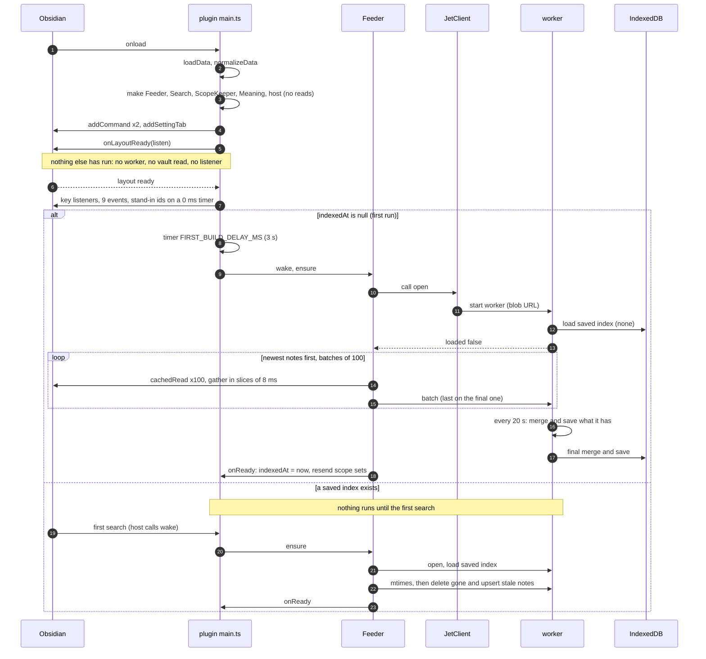

The sequence shows start-up from `onload` to "ready" in both cases. What the user sees:

| Step | What is visible |
|---|---|
| `onload` finished | Two commands in the palette (Search notes, Search in this note) and Jet's settings tab. Nothing else. `test/main.test.ts` asserts zero note reads, zero vault listeners, zero workers |
| Layout ready | Shift-Shift works. Opening Jet shows recents and names at once (Tier 0 is built one tick after the modal paints, from Obsidian's file list) |
| First run, during the 3 s wait | Names, aliases and paths already match |
| Build running | The modal's status line says "Indexing 300 of 1500...". Names match as you type; headings, tags and properties match too (`MetaIndex`, while `indexNotReady`); the worker answers over the batches it already holds, so recent notes are searchable first. The settings Index card says "Building: x of y notes" |
| Build finished | `indexedAt` saved; the status line clears; headings/tags matching from the cache stops (the index covers them) |
| Later starts | Index card says "Saved; loads on the first search". The first search loads the saved index (views over one buffer, a few ms), then catches up by modified time: only changed notes are read |
| 10 minutes without a search | `wake`'s timer saves the index, stops the worker, resets the feeder. The next search starts it again |

Rules behind the sequence:

- **Nothing at start** (`FIRST_BUILD_DELAY_MS` and the lazy worker). The first build starts a few seconds after the layout is ready, and only the first time. After that the index loads on the first search.
- **Newest first** (`building_` sorts by `mtime` descending): recent work is searchable soonest.
- **Slices.** `read` gathers each note inside `sliced`, yielding every 8 ms, so Obsidian stays smooth. A hidden window does not slow it, because the yield is `scheduler.yield` or a `MessageChannel`, never a timer.
- **A cleared or rebuilt index stops an old run** (`gen`, `Cancelled`), so a second worker cannot start.
- **A long first build saves what it has** every `BUILD_SAVE_MS` (20 s), so an interrupted build resumes by modified time.

### 7.2 A keystroke

<picture>
  <source media="(prefers-color-scheme: dark)" srcset="assets/arch-keystroke-dark.png">
  
</picture>

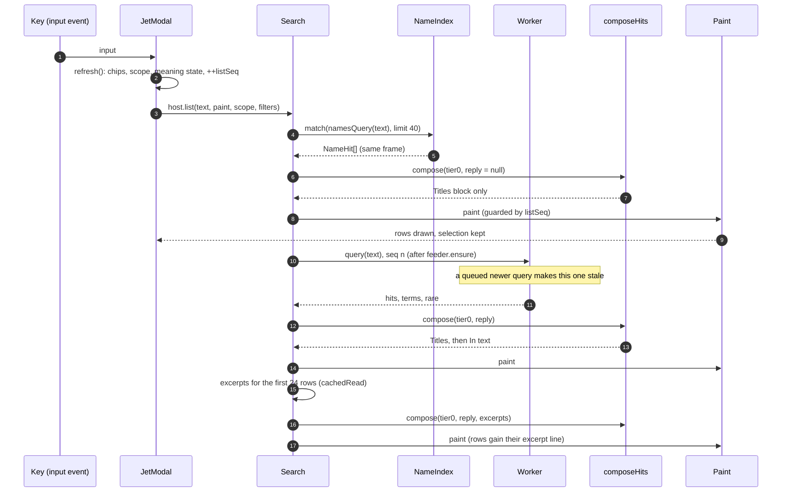

The sequence shows one keystroke with no stale cases: a synchronous paint from Tier 0, then the worker's reply, then the excerpts.

1. **The key.** The input's `input` event calls `JetModal.refresh()` directly. There is no debounce: the worker's latest-wins rule does that job. `refresh` finishes any filter pieces into chips, parses the typed scope name, works out the meaning mode, increments `listSeq`, and calls `host.list`.
2. **The host.** `JetHost.list` wakes the worker (resetting the ten-minute sleep timer) and calls `Search.list`.
3. **Names, in the same call.** `Search.list` works out the allowed set (scope and filters), strips the operators for names (`namesQuery`), and calls `NameIndex.match` with `limit: 40`. If the index is still building, `MetaIndex.match` runs too. Typical cost of the names index alone is 0.26 ms at 10,000 notes (1.8 ms at 50,000), measured in Node.
4. **First paint, synchronous.** `compose(tier0, null, ...)` builds the Titles block. `paint` runs inside the same event handler: the pooled rows are refilled and the previously selected note stays selected. In the in-Obsidian comparison (real key events, a result list watched until it settles), the first change of the list lands a median 4.0 ms after the last key at 10,000 notes (3.4 ms at 1,000), including the wait for the next painted frame. If Tier 0 has nothing yet, the status reads "Searching...".
5. **The worker.** The same call awaits `feeder.ensure()` (instant once the index is open; the first search after launch also opens it from IndexedDB, 34 ms at 10,000 notes) and sends the query with a new `seq`. If another query is already queued behind it, the worker answers it as stale without running it. The engine alone takes a typical 0.16 ms per keystroke at 10,000 notes (1.3 ms at the 95th percentile).
6. **The reply.** `JetClient.query` returns `null` unless this is the latest `seq`. `rare` and `terms` come with the hits. With quoted phrases, `filterPhrases` runs first. `compose(tier0, reply, ...)` runs again: the Titles block is rebuilt from the same Tier 0 hits (except non-exact names deferred by `rare`), and the text rows are added. If both lists are empty, the recovery screen is built instead (a spelling suggestion, widening the scope, creating the note).
7. **Second paint.** `out(...)` paints through the modal's guard. The new rows come in below the old ones; the selected note stays selected unless the user never moved, in which case the first row is selected.
8. **Excerpts.** `Search.excerpts` reads the first 24 rows' text with `cachedRead` in parallel and cuts one line each (`cutExcerpt`, a budget of 1 ms for 20 rows of 5 to 20 KB notes in `test/excerpt.test.ts`). `compose` runs a last time with the excerpt map, and the same rows are painted with their second line.
9. **The preview.** `select` has restarted the 80 ms rest timer on each paint that changed the selection. When it fires and the key (path, terms, offset) differs, `Preview.show` renders off the page.

The overall figure is the "settled" time of the same comparison: a median 15 ms at 10,000 notes (13 ms at 1,000), 20 ms at the 95th percentile and 21 ms at worst, with no main-thread task over 50 ms during typing. That figure includes the worker, the excerpts and the paints, but not the 80 ms preview rest, because the recorder watches the result list only.

### 7.3 A text query in the worker

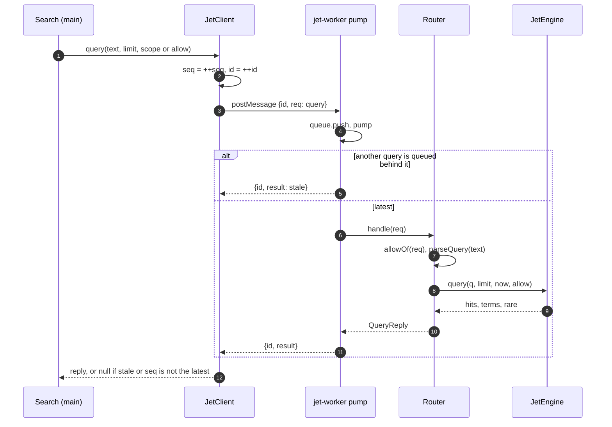

The diagram follows one query from the main thread to the painted result; the stale branch is the cheap exit.

1. `Search` first awaits `feeder.ensure()` (a no-op once live), then calls `JetClient.query(text, { limit, scope, allow })`. With a quoted phrase the limit is 500.
2. `JetClient.query` takes the next `seq` and calls `call`, which starts the Worker if it is not running, takes the next `id`, remembers the promise in `pending` and posts `{ id, req }`.
3. `scope.onmessage` in `jet-worker.ts` pushes the envelope on `queue` and calls `pump`. `pump` runs if it is idle.
4. For each request, `pump` first applies the stale rule (6.3). A skipped query is answered at once with `stale: true`.
5. Otherwise `router.handle(req)` calls `query`, which wraps `queryOnce` in a `try`.
6. `queryOnce` takes the time, builds the allowed set with `allowOf` (a scope id gives that scope's path set, an array of ids gives their union, `allow` gives a path set, nothing gives every note; an unknown scope allows nothing) and calls `parseQuery(req.text)`.
7. `JetEngine.query` does the work of 6.1: `parts()` lists the frozen segments and the delta; `expand` per word and part; `liveNotes` and the `rare` check; the scoring loop over meta and body postings; exclusions; the `allow` filter; the all-words decision; boosts; `TopK`.
8. The router returns `{ seq, hits, terms, rare, ms }`. If `query` throws (a damaged posting), the router resets the engine, deletes the saved index in the background (`store.clear()`) and returns `broken: true` with no hits.
9. `pump` posts `{ id, result }`. `JetClient`'s `onmessage` finds the pending promise and resolves it.
10. `query()` returns `null` for a stale answer or one whose `seq` is no longer the latest. Otherwise `Search` reads `reply.broken` (calls `feeder.recover()`), filters phrases, composes the list (using `rare`), and asks for excerpts.

### 7.4 A note changes

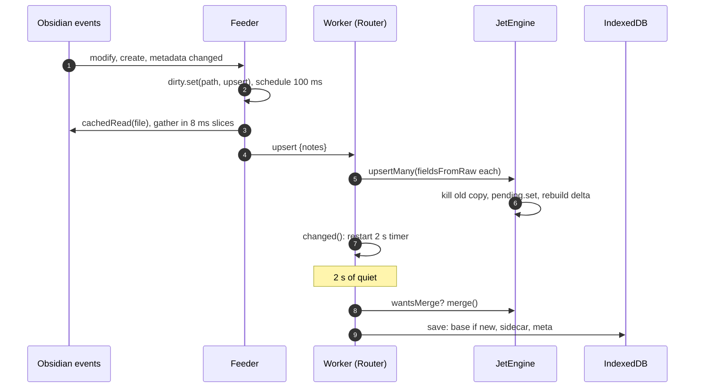

The diagram follows an edit from Obsidian's event to the saved index; delete and rename use the same path with other messages.

**An edit or a new note**

1. `vault` `modify`, `create` and the metadata cache's `changed` event all call `Feeder.touch(file, "upsert")` (non-markdown files are ignored). The `dirty` map holds one entry per path.
2. `schedule(100)` starts a timer if none is waiting. When it fires, `flush` runs.
3. `flush` skips work while the index is not live (the catch-up will find it) and defers while a build or catch-up runs. Otherwise it resolves the paths to files, reads their text and gathers each (`read`), in batches of 100.
4. Notes marked `delete` since, or whose file is gone, are dropped from the batch. The rest go in one `upsert` request.
5. The router maps each `RawNote` through `fieldsFromRaw` (the tokenizing), calls `engine.upsertMany`, gives the note a vector when meaning is on, and calls `changed()`.
6. `upsertMany` kills the old copy of each path, puts the new `NoteInput` in `pending`, and rebuilds the delta once (below 256 pending), or freezes the pending notes into a segment (at 256 or more).
7. `changed()` clears and restarts the `IDLE_MS` = 2 s timer. After 2 quiet seconds: `merge()` if `wantsMerge`, then `save()`. A merge makes a new base, which is written in full; otherwise only the sidecar and meta are written.
8. `onChanged` on the feeder re-runs the open search, so a result list updates as notes change.

**The note being typed in.** `editor-change` calls `feeder.typing()`, which only resets a timer. After 300 ms without keys, `sendOpenNote` gathers the note from the editor's text and sends `upsert` directly, with `mtime` set to now so that the file event that follows is not skipped by an mtime comparison. A worker that went to sleep since the key is not restarted for this: the next start's catch-up reads the file.

**A delete.** `delete` event, `touch(file, "delete")`, flush within 100 ms, `delete {paths}` before any upsert of the same flush. The router calls `engine.delete` (tombstone, or removal from `pending`), drops the note's vector, removes it from every scope set, and calls `changed()`. A note deleted while its change was still being read stays deleted: `flush` checks `dirty` again after the read.

**A rename** (`Feeder.rename`):

1. Renamed to a non-markdown extension: the old path is a delete.
2. Not live yet, or moved into an excluded folder: the old path is a delete and the new path a `touch` upsert (if not live and not busy, nothing: the start catches up).
3. Live: if a delete is waiting for the destination path (a sync's "delete B, rename A to B"), `delete [to]` goes first. Then `rename {from, to}`: the engine moves the path (`ids` map and `renamed`, or `pending`), the router also moves the vector and every scope set's entry. Both pending entries are removed from `dirty`.
4. A `touch(file, "upsert")` follows, because the note's name terms changed with its path: the full note is sent and `upsertMany` replaces the renamed copy.
5. `engine.rename` also kills a note already at the destination, so a reused path never keeps its old text. The message `rename` is posted when the delete's reply arrives, and the upsert by a 100 ms timer; if the delete took longer than the timer, the upsert could reach the worker first and `rename` would then tombstone it. No test covers this order.

**At load.** If the worker was asleep or Obsidian was closed, none of this ran; the catch-up compares every note's mtime with the index's and sends the difference.

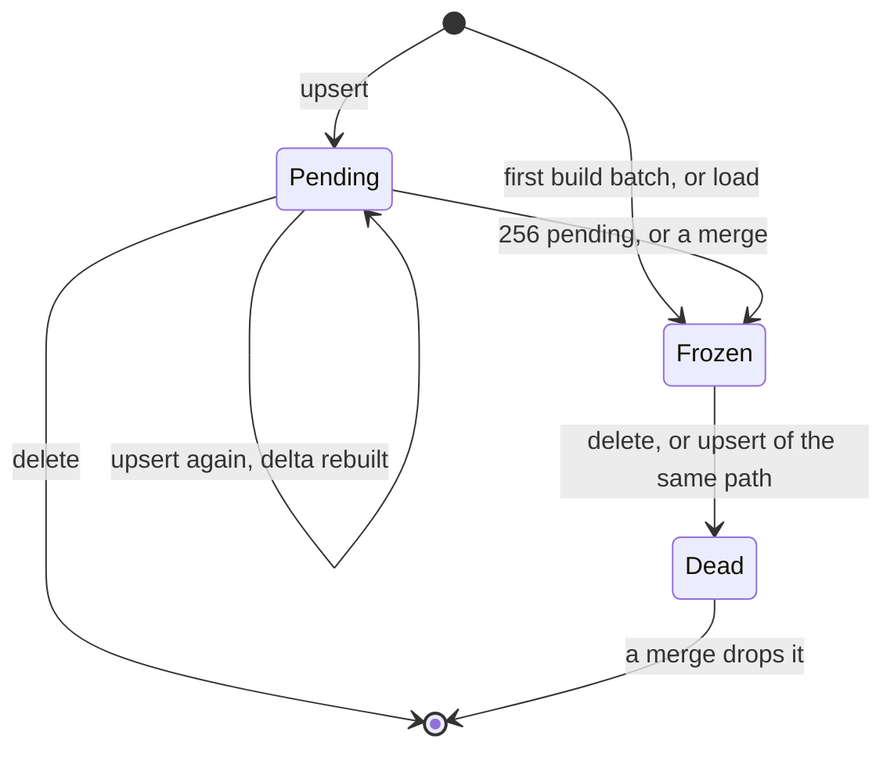

The diagram follows one note through the engine: a changed note waits in the delta, is frozen into a segment of its own, and a later change or delete leaves a tombstone until a merge writes the segment again without it.

### 7.5 A question

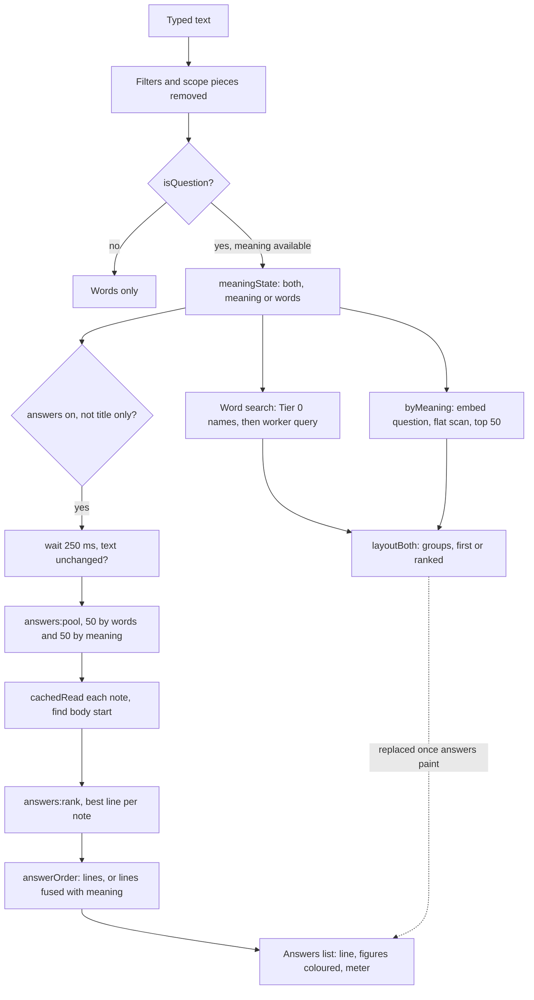

The flowchart shows a question from the box to the shown line. Words and meaning are painted first; the answers list replaces them only if it finishes for the text still in the box.

1. **Read the text.** `JetModal.refresh` pulls filter pieces out (chips) and applies scope pieces. The rest is the search text.
2. **Decide the mode.** `meaningState` calls `isQuestion` and `isLongSearch`, reads `questionShows` and the `⌘J` pick, and returns `{on, mode, offered}`. With no model, meaning is off and the question is searched as words.
3. **Show something at once.** `Search.list` paints Tier 0 names in the same frame. In "both" it also paints a "By meaning" header ("Searching by meaning...").
4. **Words.** `feeder.ensure()`, then `client.query` with the scope or the `allow` set. Each query has a `seq`; a newer query makes an older one answer as stale.
5. **Meaning.** `feeder.ensureMeaning()` loads the model on the first question of the session. `client.nearest` embeds the question (64 pieces) and scans the vectors. It has its own sequence number (`nearSeq`), so a question does not cancel the words typed for the same search.
6. **Join.** Rows from the two lists are laid out by `layoutBoth`. Excerpts are cut from Obsidian's cached text.
7. **Answers.** If the answers conditions hold (section 6.11 step 1), `Search.answers` starts in parallel. After 250 ms of rest it pools, reads, re-ranks in the worker, and orders. Every await checks `this.current?.text === text`; a changed box ends it.
8. **Replace.** When the answers reply is the latest (`answerSeq`) and non-empty, `done()` stops the earlier lists from painting and the "Answers" list is painted. The first row is selected unless you moved the selection meanwhile.
9. **Stale or empty.** If a newer search is queued, `rankAnswers` returns `null` and the reply is `stale`; the words and meaning lists stay.

### 7.6 Failure paths

What can go wrong, what the user sees, and what the code does. Most of these are held by a test (section 14 names them); a few are by design only.

| What fails | What the user sees | What happens | Where |
|---|---|---|---|
| IndexedDB is not available | Search works; the index is rebuilt at each start | The worker uses an in-memory store | `jet-worker.ts` (`memoryStore`) |
| The saved index is another version, or cannot be read | A rebuild, with the usual "Indexing" status | `open` replies `loaded: false`; a half-loaded engine is reset to empty first | `Router` `open` |
| A query hits a damaged posting | One empty result, then a rebuild | The router resets the engine, deletes the saved index and replies `broken: true`; the feeder's `recover()` builds again | `Router.query`, `Feeder.recover` |
| The worker throws or stops | The next search starts a fresh worker | `JetClient.onCrash` rejects pending calls; the feeder bumps its generation so an old run cannot refill the index | `jet-client.ts`, `Feeder.reset` |
| The worker is asleep | The first search after ten idle minutes takes a few ms longer | `ensure()` starts it, opens the saved index and runs the catch-up | `main.ts` `wake`, `Feeder.ensure` |
| An answer arrives for text you have already changed | Nothing: the list stays as it is | Dropped in four places: the worker (`stale`), the client (`seq`), `Search` (the text check) and the modal (`listSeq`) | 6.6 |
| A note is deleted while its change is being read | The note stays gone | `flush` checks the dirty map again after the read | `Feeder.flush` |
| "Delete B, rename A to B" from a sync tool | B shows A's text, not B's old text | The feeder sends the waiting delete first; the engine kills a note already at the destination | `Feeder.rename`, `JetEngine.rename` |
| Rebuild is pressed during a build | One build, not two | The older run throws `Cancelled` at its next step | `Feeder.gen` |
| The Obsidian window is hidden | Jet does no embedding work | `whenVisible` holds the meaning batches | `Feeder.embedMissing` |
| The meaning model file is missing or truncated | Word search carries on; meaning switches off with a notice | `onMeaningBroken` removes the file and sets `meaning` to false | `main.ts`, `Feeder.loadMeaning` |
| The model download is wrong (checksum, HTTP error) | A message in the confirm; nothing is installed | `install` throws before packing | `meaning/install.ts` |
| `data.json` is hand edited, synced from a newer version, or has a wrong type | The plugin starts; a bad value becomes its default | `normalizeData` reads field by field; unknown keys are dropped | `data.ts` |
| A private Obsidian API is missing | The feature falls back (a dialog instead of a settings page, no stand-in commands) | Every access is optional-chained and returns a neutral value | `internals.ts` |
| Jet is turned off while `onload` waits for data | No leftover timers or listeners | `unloaded` and `built` flags; every timer is registered for cleanup | `main.ts` |
| A quoted phrase search reads many notes | The list appears when the reads are done | After the awaits, `list()` checks the box still holds the same text | `Search.list` |
| A very large note or heading | It is indexed up to a limit | The body is cut at `MAX_BODY_CHARS`, a heading at `MAX_HEADING_CHARS` | `fields.ts` |

Two failures are visible by design: a word the index has no match for shows the recovery screen (a spelling suggestion, widening the scope, creating the note), and a broken saved index shows the build status again.

## 8. Invariants, and where they are enforced

A rule is only a rule if something fails when it is broken. Each row names the code or the test that holds it. Where the only enforcement is a comment, the row says so.

### 8.1 The engine, the index and the worker

| Rule | Why | Enforced by |
|---|---|---|
| Notes and queries go through the one `tokenize`; only the `parts` option differs | A word typed must match the word stored | `src/engine/analyzer.ts`; `test/analyzer.test.ts` ("adds compound parts for notes, not for queries"), `test/qa2-text.test.ts` |
| Nothing is stemmed at build time; word forms are found at query time by root group | Changing languages in settings must not need a rebuild, and start-up must not grow | `buildSegment` never calls `STEMMERS`; `rootGroup` in `expand`; `test/jet-engine.test.ts` ("finds other forms of a word below the exact word, in the chosen languages only") |
| Terms are sorted by UTF-16 code unit and searched with `lowerBound` | A different sort order than the comparison makes every lookup miss | `writeSegment` (`.sort()`), `src/engine/typos.ts`; `test/typos.test.ts` ("prefix range") |
| Typos and fuzzy prefixes are added only for a word whose own matches are in fewer than `TYPOS_BELOW` live notes | `world` must not bring `would` and `words` | `liveNotes`; `test/jet-engine.test.ts` ("leaves typos out for a word the vault has") |
| The typo gate counts live notes, not postings | A dead copy or three word forms in one note must not turn typos off | `liveNotes`; `test/qa-search.test.ts` ("the typo gate (TYPOS_BELOW) counts notes, not postings") |
| Results rank by words matched, then score | A note with a literal typo must not beat the note meant; a note with more of the words must come first | `byScore`; `test/jet-engine.test.ts` ("needs every word when some note has them all, else any"), `test/qa-search.test.ts` (33 words) |
| A rare exact word ranks above its forms and near spellings | One mention of `trips` must not sit under every note named `Trip` | `RARE_FLOOR`, `RARE_OTHERS`; `test/jet-engine.test.ts` ("a word the vault has in only a few notes") |
| A delta or later batch is scored with the first segment's averages, and idf counts every part | Notes from different segments must compare fairly | `addBatch`, `rebuildDelta`, `otherDf`; `test/jet-engine.test.ts` ("merges batches into the same results as one build") |
| A tombstoned note is never returned, counted or listed | A deleted note must not reappear, and `mtimes()` must not hide it from the catch-up | `dead` checks in `query`, `mentions`, `docFreq`, `load`; `test/qa-search.test.ts` ("a note deleted before a sidecar save is not listed as indexed after load") |
| A saved index of another version, or one that cannot be read, is rebuilt, never fatal | A crash loop at start is worse than a rebuild | `Router.handle` `open`; `test/router.test.ts` ("rebuilds an index of another version or one that cannot be read"), `test/qa2-index.test.ts` (sidecar, damaged posting) |
| Base, sidecar and meta are written in one transaction | A crash must leave the old index or the new one, never a mix | `idbStore.save` in `src/worker/store.ts` (no test uses real IndexedDB; the in-memory store is used) |
| Tokenizing never runs on the main thread | A phone gathering 15,000 notes must keep typing smooth | `RawNote` is text and cache data only (`gather.ts`); `fieldsFromRaw` runs in the router; `test/router.test.ts` ("reads fields from what Obsidian gathered") |
| A body is cut at `MAX_BODY_CHARS` and a heading at `MAX_HEADING_CHARS` | A huge note or a pasted blob as a heading must not stall or fail a build | `fieldsFromRaw`; `test/qa2-index.test.ts` ("one note with a huge heading line") |
| The worker starts on the first call, never at Obsidian start, and the first build waits 3 s | Obsidian's start must pay for nothing | `JetClient.start` (called from `call`); `FIRST_BUILD_DELAY_MS` in `src/main.ts`; `test/qa2-index.test.ts` ("a first build longer than the worker's 10-minute sleep") |
| An older run of a build or catch-up stops when the index is reset | A cleared index must not be refilled by the run that started before | `Feeder.gen`, `alive`, `Cancelled`; `test/qa2-index.test.ts` ("Rebuild while the worker is asleep") |
| A note deleted while its change is being read stays deleted | A late read must not bring it back | `Feeder.flush` re-checks `dirty`; `test/qa2-index.test.ts` ("a note deleted while its change is being read") |
| A client answer older than the latest query is dropped | A slow answer must never overwrite a newer list | `JetClient.query` (`r.seq !== this.seq`); `test/qa-search.test.ts` |

### 8.2 The keystroke and the screen

| Rule | Why | Enforced by |
|---|---|---|
| A keystroke paints Tier 0 before it asks the worker | Names must appear in the frame of the key; the worker is a round trip away | `Search.list` calls `out(...)` with the Tier 0 compose before `feeder.ensure()` and `client.query`; `test/search.test.ts` ("finds notes by heading, tag and property in the same frame") |
| The name index is built when the modal opens, not in the first keystroke | Building 10,000 notes of names inside a keystroke blocks the page (29.5 ms measured for the first letter) | `JetHost.list` calls `Search.warm()` after the recents; `test/search.test.ts` ("builds Tier 0 just after the modal's first paint") |
| Everything that depends only on a note is folded when the note is added | Re-folding all names per keystroke would cost more than the match | `NameIndex.text()` and `build()`; performance tests in `test/names.test.ts` (1 ms p95 for 2,000 items, 8 ms for 20,000) |
| Highlight ranges are always into the text as written | A highlight in folded text would mark the wrong characters for accented, ligature or composed text | `Folded.start`/`end`, `toRanges`; `test/names.test.ts` ("is case and accent insensitive, with ranges on the text as written") |
| A note appears once in a list | Two rows for one note break selection by key and look like a bug | `shown` set in `composeHits`; `layoutBoth` dedupes by path; `test/search.test.ts` ("shows a note once, under its name when the name matches") |
| A name equal to the typed text is never pushed below text hits | An exact title is what the user typed | `NameHit.exact`, tested in the rare-word branch of `composeHits`; `test/search.test.ts` rare-word tests |
| Only the newest query's reply is painted | An older, slower answer must not replace a newer one | Worker `pump`, `JetClient.query` (`seq`), `Search` text checks, `JetModal.listSeq`, `JetModal.shown` |
| A side count never cancels a query, and a question never cancels the words | A shared counter made them cancel each other | `seq: 0` in `JetClient.count`, separate `nearSeq`; `test/qa-search.test.ts` |
| The selection follows the note, not the row number | Results arrive in several paints; the user's note must not change under their key | `selectedKey` and `keyOf` in `JetModal.paint`; `test/modal.test.ts` ("keeps the selected note selected when results update") |
| A paint after the modal closed draws nothing and loads no preview | A late reply must not render into a dead window or load a `Component` | `if (!this.shown) return` in `paint`; `test/qa2-modal.test.ts` ("results that arrive after Jet closed render no preview") |
| The preview renders off the page and lays out once | Style reads on the live page force a layout each | `fresh` element and `replaceWith` in `Preview.show`; read-all-then-write in `Preview.mark`; `test/preview-ticks.test.ts` |
| A preview render that lost the race shows nothing | Two notes rendering at once must not leave the first one on screen | `token` in `Preview.show`; `test/preview-ticks.test.ts` ("shows nothing of an older note when a newer one has been chosen") |
| Every hint in the window comes from the key map | A hint that disagrees with the binding is worse than none | `lab()` in `JetModal`/`JetHost`, `KEY_ACTIONS`; `test/keys.test.ts` ("the window follows your keys") |
| No two actions share a key, and reserved keys cannot be taken | A shared key runs one action silently; Enter or Tab alone are used by the lists | `refusal`, `clashes`; `test/keys.test.ts` |
| Hit loops step over whole characters | A step of one code unit inside a surrogate pair matched the same character again for ever | `nextChar` in `excerpt.ts`; `test/qa2-text.test.ts` |
| A match is never cut inside a character | An emoji cut in half shows as a replacement character | `clusterStart`, `clusterEnd`; `test/excerpt.test.ts` ("never split a surrogate pair..."), `test/qa-search.test.ts` (in-note rows) |
| The double tap needs two clean taps of one key | Typing a capital must not open the window | `DoubleTap`; `test/shift.test.ts` |

### 8.3 Features, saved data and the plugin's life

| Rule | Why | Enforced by |
|---|---|---|
| Nothing at Obsidian start: `onload` reads no note, starts no worker, adds no vault listener (on the very first run it also looks for another plugin's saved settings to import) | Plugin load time is paid by every user, every launch | `main.test.ts` ("reads no files, starts no worker..."); `listen()` waits for `onLayoutReady`; the worker starts on the first `JetClient.call` |
| The first build is delayed and happens once | A burst of work at the first frame slows the start | `FIRST_BUILD_DELAY_MS`, the `indexedAt === null` check; `qa-lifecycle.test.ts` ("the first build's timer goes with the plugin") |
| No network except the model download, and only after you confirm | Notes stay on the device; trust | `MeaningConfirm` before `install`; only `install.ts` calls `requestUrl`; the model URL is built from `MODEL.revision` |
| A downloaded model is the pinned one | A changed or substituted file would feed wrong vectors or unknown bytes into a parser | SHA-256 in `install.checks` before `packModel`; pinned revision in `fileUrl` (no test covers the rejection path) |
| The index and vectors stay outside the vault | Never synced, never in a backup of notes | `idbStore` in `worker/store.ts`; the model is in the plugin folder, not the vault |
| Settings migrations never lose data: a bad or old value falls back, it does not throw or erase | A hand-edited or synced `data.json` must not break start | `normalizeData` field by field; `test/data.test.ts`, `qa-data.test.ts`, `keys.test.ts` |
| Install, removal and the meaning switch are saved at once | A debounced save lost the record when Obsidian quit right after | `Meaning`'s `save` callback; `meaning.test.ts`, `qa-meaning.test.ts` |
| A model file that cannot be used turns meaning off and never stops word search | One optional feature must not take the core down | `loadMeaning` catch and `onMeaningBroken`; `qa-data.test.ts`, `qa-meaning.test.ts` |
| The scope generator is pure and deterministic | The same vault must give the same proposals, or a rerun surprises you and tests cannot pin it | no Obsidian imports in `scopes/generate.ts`; `scopes-generate.test.ts` against `expected.json` |
| Generating again never undoes your edits or puts back a rule you removed | Your choices outrank a heuristic | `generated`, `origins`, `offered` on `Scope`; `scopes-review.test.ts` |
| An unknown scope matches nothing, never everything | A stale id must not widen a search | `Router.allowOf` |
| Filters are worked out on the main thread and sent as `allow` paths | The index format has no field per property | `FilterSets.notes`; `Search.list` |
| A saved filter this version cannot draw is dropped at load | A synced filter from a newer version would break the modal | `validFilter`; `qa-data.test.ts` |
| A search never paints a result for text no longer in the box | Stale results mislead | `current?.text === text` checks in `Search`; separate `seq`, `nearSeq`, `answerSeq` in `JetClient` |
| Hidden app, no embedding work | A backgrounded window or phone should do nothing | `whenVisible` in `Feeder.embedMissing`; `qa-meaning.test.ts` |
| Unload releases everything it made, even when turned off mid-load | A dead plugin's timers and key listeners answer later | `unloaded` and `built` flags, `register()` cleanups; `qa-lifecycle.test.ts` |
| Private Obsidian APIs are optional and guarded | Obsidian may rename or remove them | `internals.ts` (every member `?.`); fallbacks to the dialog |
| Timed tests run serially | Parallel files make a time bound fail at random | `test` / `test:timed` scripts |

## 9. Lifecycle and teardown

What is made when, and what releases it. The plugin never keeps a timer, a listener or a worker that its own unload cannot reach.

### 9.1 The plugin

**`onload`** (async, `main.ts`), in order:

1. `loadData()`; if the plugin was already unloaded while it waited, return and make nothing.
2. `normalizeData`; `setMac(Platform.isMacOS)` for key hints.
3. Make `Feeder`, `ScopeKeeper`, `Search`, `ScopeWatcher`, `JetHost`, `Meaning` and wire their callbacks (`onReady`, `client.onCrash`, `feeder.onChanged`, `host.meaning`). The `JetClient` exists but has no worker yet.
4. `addCommand` twice, `addSettingTab`, the throttled settings-progress callback (its timer is cleared by a `register`).
5. `built = true`, then `onLayoutReady(listen)`.

**`listen`** (after the layout is ready; returns at once if `unloaded`):

| What | Registered how | Released by |
|---|---|---|
| Stand-in command ids timer (0 ms) | `register(clearTimeout)` | Obsidian cleanup |
| Double-tap key listeners (`keydown`, `keyup`, `mousedown` in capture, window `blur`), one set per window | a `watched` map; one `register` removes all | Obsidian cleanup; a closed popout is let go at the next `layout-change` |
| 9 events: `layout-change`, `css-change`, `file-open`, vault `create`, `modify`, `rename`, `delete`, metadata `changed`, `editor-change` | `registerEvent` | Obsidian cleanup |
| First-build timer (only when `indexedAt` is null) | `register(clearTimeout)` | Obsidian cleanup |

**`onunload`**, in order (`unloaded = true` first; a half-built plugin returns after that):

1. `save.run()`: a pending debounced save is written now.
2. Remove the stand-in commands, but only those that still hold Jet's own command object (another plugin turned on since keeps its own).
3. Close the modal.
4. `feeder.stop()`: clears the flush and typing timers.
5. `watcher.stop()`: clears the scope watcher's timer.
6. Clear `sleepTimer`.
7. `client.stop()`: terminate the worker, revoke the blob URL, reject every pending call with "the worker stopped".

Obsidian then runs the `register` and `registerEvent` cleanups and removes the commands and the settings tab. The test mock runs cleanups first, then `onunload`; Jet's `onunload` reads nothing those cleanups release.

**What lives where when the plugin is on:**

| Resource | Made | Released |
|---|---|---|
| Worker and its blob URL | first `client.call` | `client.stop()` at unload, at the 10-minute sleep, after a worker error (then `feeder.reset()`), on Clear |
| IndexedDB database `jet-search/<vaultId>` | opened lazily inside the worker | the code never calls `close()` on it; ending the worker ends it. The registry database used by the 90-day cleanup is closed after use |
| Router idle timer (2 s merge and save) | inside the worker | dies with the worker. A change in the last 2 seconds before a terminate is not saved; the next start finds it by modified time (`catchUp`) |
| Meaning model and vectors in memory | `meaning:load` | worker end or `meaning:off`. Vectors persist in IndexedDB; the model file stays in the plugin folder |
| Scope sets (main thread and worker) | first `ensure()` | `reset()`; the worker's copy is rebuilt by `resend()` when it reopens |
| Sleep timer | every search (`wake`) | rearmed by the next search; cleared at unload |

### 9.2 The worker and the index

| Thing | Created when | Torn down when |
|---|---|---|
| Worker, Blob URL | the first `JetClient.call` (never at Obsidian start) | `client.stop()`: sleep after `SLEEP_AFTER_MS`, worker error, Clear index, plugin unload |
| `Router`, `JetEngine` | the worker script runs | with the worker; `clear` and a damaged index reset the engine in place (`build([])`) |
| IndexedDB connection for the vault | first store call in the worker (`get()`, memoized) | with the worker (never closed explicitly) |
| Saved index | first successful `save` (end of the first build, or every 20 s during it) | `store.clear()` (Clear, Rebuild, damaged index); 90 days unused, deleted by another vault's save |
| Frozen segment, its `dead`, `renamed`, `Scratch` | `addPart`: a build, a batch, a frozen delta, a load or a merge | replaced by `merge()`; all dropped by `reset()` |
| Delta segment | `rebuildDelta` after each change below 256 pending | rebuilt on the next change; null when `pending` empties |
| Root-group cache, reversed terms | first query that needs them (`warm()` when idle after `open`, `configure` and the last batch) | with the segment (a `WeakMap`); the group cache is cleared past 2,000 entries |
| Idle timer (2 s) | each `changed()` | fires once, or is cleared by the next change; lost if the worker stops first |
| Sleep timer (10 min) | each `wake()` | fires; cleared on unload |
| Feeder `flushTimer`, `typingTimer`; generation `gen` | `touch`, `typing`; `gen` starts at 0 | timers fire once and are cleared by `feeder.stop()` on unload; `gen` is bumped by `reset()` on sleep, crash, Rebuild and Clear |
| First-build timer (3 s) | layout ready, only when `data.indexedAt` is null | fires once; cleared if the plugin unloads first |

On unload, `main.ts` writes pending settings, stops the feeder's timers and terminates the worker without a `save`: edits inside the last 2 seconds are found by the catch-up at the next start. On sleep, the worker is asked to `save` first, since its own idle timer dies with it.

### 9.3 The window

**Open.** `Plugin.open()` makes one `JetModal` per opening and keeps it in `this.modal`. Opening again closes the old one first, except that a window already open with typed text is left alone (and with a scope on, it widens). The constructor builds the DOM and registers the keys; `onOpen` sets the mark colours, restores pinned filters, runs `refresh(true)`, focuses the input and starts the `ResizeObserver`.

**While open.**

| Resource | Owner | Released by |
|---|---|---|
| DOM listeners on the input, the list, the chips, the bar, the footer | The elements themselves | `contentEl.empty()` in `onClose`; no `document` or `window` listener is added by the modal |
| Key bindings | The modal's `Scope` (`this.scope.register`) | Obsidian drops the scope with the modal. The modal removes Obsidian's own Escape handler on construction |
| `ResizeObserver` on `modalEl` (the modal's own window, so pop-outs work) | `onOpen` | `resize.disconnect()` in `onClose` |
| `previewTimer` (80 ms rest) | `schedulePreview` | `clearTimeout` in `onClose`; each new selection replaces it |
| `cardTimer` (hover card) | `cardSoon` | `clearTimeout` in `onClose` |
| The preview and its `Component` | `Preview` | `preview.destroy()`: `clear()` increments `token` (so a render in flight is dropped), calls `unload()` on the component, empties the pane and removes the element |
| The row pool, entries, view state | The modal | Garbage collected with the modal. After 300 opens, Jet's own allocations still alive were 0 KB (commit 4e876b7) |

**What is unloaded when the selection changes.** `Preview.show` calls `unload()` before it renders the next note: the previous `Component` is unloaded, the mark list and the current index are reset, and the old pane body is emptied at once; the new note is rendered into a detached element and swapped in when the render is done. `Preview.clear()` (selection on a row that is not a note) also empties the title, path and properties.

**Close.** `onClose` sets `shown = false`, stops the observer and timers, destroys the preview, calls `host.closed(text, opened, scope, filters, also)` and empties the content. `JetHost.closed` clears the per-open rule-count cache, bumps scope usage when a note was opened, stores the last scope and filters (if Persist filters is on), remembers the search, calls `Search.idle()` (which sets `current = null`, so the live refresh stops) and saves.

**Work in flight at close.** Nothing is cancelled. The worker finishes its query; `Search` finishes its awaits; the paint it calls is the modal's guarded closure, which returns at `!this.shown` (and at `listSeq` for older lists). Side paths (`byMeaning`, `answers`, `recovery`) check `this.current?.text !== text` and stop, because `idle()` cleared `current`. The worker is not stopped: it sleeps on its own timer (`SLEEP_AFTER_MS`, ten minutes without a search).

**Plugin unload.** `onunload` calls `this.modal?.close()` (so the sequence above runs), then stops the feeder, the watcher and the client. The document listeners for the double tap are registered with `this.register` and removed with the plugin; a pop-out that closes loses its listeners at the next `layout-change`. The first-build timer, the stand-in timer and the settings progress timer are cleared too.

## 10. How to change it

Recipes for the changes people make most. Each says which files to touch, which test to write first, and the trap that is not obvious.

**Changing the ranking safely** is the one change that needs a method, not a recipe:

1. Write the failing test first in `test/jet-engine.test.ts` (a small vault of invented notes and one query).
2. Change one constant or one rule. Every number is in the appendix (17.1) with its file.
3. Run the groups that guard ranking: "Jet engine ranking", "a word the vault has in only a few notes", "a word typed with a typo, still being typed", and the typo gate.
4. Run the generated-search check on a seed you did not use to find the bug (`docs/benchmarks.md` explains why).
5. A change to how a field is scored, to the analyzer or to the layout needs a version bump (10.5).

### 10.1 Add a stemmer language

- Files: a new `src/engine/stem/<lang>.ts`; `StemLanguage`, `STEMMERS` and `STEM_LANGUAGES` in `src/engine/stem/index.ts`; `LANGUAGE_NAMES` in `src/settings-tab.ts`; `stemmable` if the script is not Latin or Arabic; `COMPOUND_LANGS` in `jet-engine.ts` if the language compounds.
- Test first: a list of word and stem pairs in `test/stem.test.ts` (the "Snowball sample vocabularies" group), plus the totality and speed test (every word stems to a non-empty stem; 50,000 words in under 0.5 s).
- Trap: words arrive with accents already removed, so rules that need an accented letter must be rewritten for the plain letter. A code missing from `STEM_LANGUAGES` is silently dropped by `Router.configure`. No index rebuild is needed.

### 10.2 Add an indexed field

- Files: `FIELDS`, `WEIGHTS`, `NoteFields` and `fieldsFromRaw`, `fieldsFromMarkdown` in `src/engine/fields.ts`; `RawNote` and `gather` in `src/index/gather.ts`; `INDEX_VERSION` in `router.ts`; `VERSION` in `segment.ts`.
- Test first: a ranking test in `test/jet-engine.test.ts` using `fieldsFromMarkdown`, then an extension of "reads fields from what Obsidian gathered" in `test/router.test.ts` and `test/gather.test.ts`.
- Trap: the averages section is `FIELDS.length + 1` long and the body is the last entry, so adding a field moves the layout: bump both versions. `metaInName` is set only for the `name` field. A new weight interacts with `RARE_FLOOR` (6, set against H1) and the name boosts.

### 10.3 Change a field weight

- Files: `WEIGHTS` in `src/engine/fields.ts`; `INDEX_VERSION` in `router.ts`.
- Test first: the query that ranks wrongly, as a failing test in `test/jet-engine.test.ts`; then the quality set in `docs/benchmarks.md`.
- Trap: weights are baked into saved indexes (`metaScore`). Without a version bump, old indexes keep the old weights while new notes in the delta get the new ones. Never judge a weight change on the seed that suggested it.

### 10.4 Add a worker message

- Files: the `Request` union and the `Reply<R>` chain in `src/worker/protocol.ts`; a `case` in `Router.handle`; a typed wrapper in `JetClient` only if it needs a sequence number; the stale rules in `jet-worker.ts` only if the newest request should replace older ones.
- Test first: a `Router.handle` call in `test/router.test.ts` with `memoryStore()`.
- Trap: `handle` has no `default` branch, so a missing `case` returns `undefined` and the caller sees a successful empty reply. A reply shape not named in `Reply<R>` is typed `{ notes: number }`. If the message is latest-wins, give it its own counter in `JetClient`, as `nearSeq` and `answerSeq` do; sharing `seq` makes one search cancel another.

### 10.5 Bump the index version

- Files: `INDEX_VERSION` in `src/worker/router.ts` (analyzer, fields, weights, scoring baked into postings) and `VERSION` in `src/engine/segment.ts` (byte layout).
- Test first: the pattern of "rebuilds an index of another version or one that cannot be read" in `test/router.test.ts`.
- Trap: forgetting to bump after an analyzer change leaves old terms in saved indexes next to new terms from the delta, which is wrong silently. There is no migration; the rebuild is the plan. Add a line to `CHANGELOG.md` since every user rebuilds once.

### 10.6 Add a result badge

- Files: `src/search.ts` (set `badge` in the `this.item(file, now, { badge })` call you want), `src/modal/jet-modal.ts` (`fillRow` renders `badge` as `span.jet-bdg` and adds a class for a few known values), `styles.css` (`.jet-bdg.is-...`).
- Test first: in `test/search.test.ts`, drive `Search.list` with a fake client and assert the `badge` on the row; in `test/modal-meaning.test.ts` style, assert the class on the rendered row.
- Trap: the badge is a string, and the colour class is chosen by comparing the string (`"both"`, `"also by meaning"`, `"by words"`, or `e.meaning`). A new badge with a new colour needs a new branch there. `layoutBoth` rewrites `badge` for rows in the both-ways modes, so a badge you set on a words row is overwritten there. An alias hit uses the alias text itself as its badge, so a badge value is not a closed set.

### 10.7 Add a filter key to the UI

- Files: the filter type and its text form in `src/filters/filter.ts`; the UI part is the filters bar `drawBar` in `src/modal/jet-modal.ts` (a `button(...)` with a `menu`), the `filters` getter in `src/host.ts` (`values`, `tags`, `complete`), and `Search.coreRow` (how the chip is written when a query is handed to Obsidian's Search).
- Test first: `test/modal-filters.test.ts` for the chip and the bar button; `test/search.test.ts` ("searching with filters") for the notes the filter keeps.
- Trap: `Search.list` treats a `title` filter specially and asks `FilterNotes.notes(f)` for every other kind, so a new kind needs an implementation there. `coreRow` writes known kinds in Obsidian syntax and names the rest as "without ..."; a kind it does not know would be named, never silently searched wrong, but you still need to decide. A filter that narrows the set also narrows Tier 0 (`allow`) and the worker (`allow: [...narrowed]`), so check both sides.

### 10.8 Add a key binding

- Files: `src/keys/keymap.ts` (add the id to `KeyAction` and an entry to `KEY_ACTIONS` with a default), `src/modal/jet-modal.ts` (`reg("id", fn)` in `keys()`, and `this.lab("id")` wherever it is shown), `src/host.ts` (`hints`, if it belongs in the footer). The settings page lists `KEY_ACTIONS` by itself, and `validKeys` accepts the new id by itself.
- Test first: `test/keys.test.ts`, as "an action moved to another key runs there and no longer on its default".
- Trap: check the default against `refusal` and `clashes` (a default that equals another action's default). On macOS, Option with a letter does not reach the window. Return `false` from the handler when the key is handled, so Obsidian does not also act on it. Return nothing when it is not handled, so the key falls through (in the in-note window an action the host does not provide must fall through). Do not use Enter or Tab alone.

### 10.9 Change the Titles block rules

- Files: `composeHits` and `MAX_TITLES` in `src/search.ts`; `limit: 40` in `Search.list`; the ranking itself is in `src/tier0/names.ts`.
- Test first: copy the shape of the rare-word tests in `test/search.test.ts`: a fake `client.query` that returns a fixed reply (with `rare` or not), a few files in the mock vault, and an assertion on the order of the rows.
- Trap: the first paint has no reply. A rule that reads the reply makes rows move when the reply arrives, so the Titles block of paint one and paint two can differ. Keep the `shown` set in step with every new loop, or a note appears twice. Titles disappear into `Results` when the block is empty. `sortEntries` renames "Titles" to "Results".

### 10.10 Add a preview feature

- Files: `src/preview/preview.ts` (the `Preview` class), `src/preview/section.ts` (what is rendered), the key in `schedulePreview` in `src/modal/jet-modal.ts`, `styles.css`.
- Test first: `test/preview-ticks.test.ts` shows how to mock `MarkdownRenderer.render` and check whether the element is connected; `test/section.test.ts` for what is rendered.
- Trap: never read layout (`offsetTop`, `scrollHeight`) after writing the DOM in a loop: read first, write after. Check `token` after every `await`. Anything that should make the pane redraw must be part of `previewKey`, or the early return will skip it. Render into the detached element, not `bodyEl`. Create the feature's resources against `this.comp`, so `unload()` releases them. The in-note window has no preview: `previewOn()` is false.

### 10.11 Add a setting with a migration
- Files: `src/data.ts` (`JetSettings`, `DEFAULT_SETTINGS`, `normalizeData`), `src/settings-tab.ts` (`getControlValue`, `setControlValue`, a row on a page), `src/main.ts` if code reads it.
- Test first: in `test/data.test.ts` or `test/keys-scopes-settings.test.ts`, pass `normalizeData` an empty object, a wrong type, and the old shape; assert the default, the fallback and the migrated value.
- The trap: a field not added to `normalizeData` is silently never loaded, because unknown keys are dropped. Use `=== true` for default-off booleans and `!== false` for default-on ones. Read the old field only when the new one is absent. In `setControlValue` call `owner.save()`; add `redraw()` if other rows depend on it.

### 10.12 Add a scope rule type
- Files: `scopes/model.ts` (the `Rule` union and `rule()` normaliser), `scopes/members.ts` (`matches`), `scopes/generate.ts` (`ruleIndex`, which must give the same sets as `matches`), `scopes/create.ts` (`createTarget`, `coreQuery`), `settings/scopes-page.ts` (`ruleText`, `ruleDesc`, `ruleMenu`), `settings/rule-pickers.ts`.
- Test first: `test/scopes-model.test.ts` (it survives `normalizeScopes`), `test/scopes-members.test.ts` (it matches), `test/scopes-keeper.test.ts` (it moves on change).
- The trap: `normalizeScopes` skips a rule kind it does not know, so a rule saved before the model change is lost on the next save. `scopeId` hashes the first rule's JSON, and `review.ts` compares rules by JSON, so field order matters.

### 10.13 Add a filter
- Files: `filters/filter.ts` (the `Filter` union, `validFilter`, `filterOf`, the `PIECE` pattern, `passes`, `filterText`, `filterLabel`), `filters/sets.ts` (`facts` gathers only what the filter needs; `reason` for the row badge), `filters/complete.ts` (`wantOf`).
- Test first: `test/filters.test.ts` for parsing and `passes`; `test/filters-complete.test.ts`; `test/qa-filters.test.ts` for chips in the modal.
- The trap: `filterText(filter)` must parse back to the same filter (a chip's backspace puts that text back, and remembered searches store it). `validFilter` must accept the new kind, or a saved one is dropped at load. A new built-in key must be added to `BUILT_IN`, or it only works for vaults whose notes happen to use that key.

### 10.14 Swap the meaning model
- Files: `meaning/model.ts` (`MODEL`: id, repo, revision, both checksums, `downloadMB`, `dims`), `meaning/tokenizer.ts` if the tokenizer is not BERT uncased WordPiece, `test/fixtures/potion-base-8M.json` (reference vectors).
- Test first: the reference-vector test in `test/meaning.test.ts` against the new files; the pinned-shape test.
- The trap: `Feeder.loadMeaning` sends the literal id `"potion-base-8M"` in `meaning:load`; change it to `MODEL.id`. The packed file name carries the id, so an old install looks missing and its record is dropped (the user must install again), but the old `.bin` stays in the plugin folder, because `removeModel` deletes only the current id. Saved vectors with another id or dimension are ignored by the worker, so they are made again. The settings text uses `MODEL.downloadMB`; check the size test (8.5 MB) still fits.

### 10.15 Add a CI check
- Files: add the command to `package.json` as a script and to `check` (CI and contributors both run `check`); or add a step to `.github/workflows/ci.yml`.
- Test first: run the new command on a tree where it should fail, and see it fail.
- The trap: `release.yml` does not run `check`, so a check that matters for a release must be a step there too. Keep CI on Node 22 (the supported minimum in `CONTRIBUTING.md`).

## 11. Build pipeline

<picture>
  <source media="(prefers-color-scheme: dark)" srcset="assets/arch-build-dark.png">
  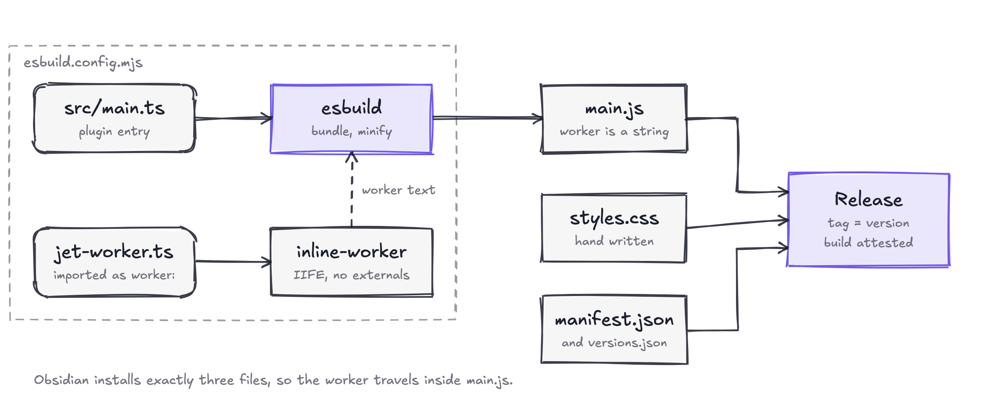
</picture>

### 11.1 npm scripts

| Script | What it runs |
|---|---|
| `dev` | `node esbuild.config.mjs`: watch mode, inline source maps, no minify |
| `build` | `tsc -noEmit -skipLibCheck` (TypeScript 7) then `esbuild.config.mjs production` |
| `typecheck` | TypeScript 7 on `src`, then on `bench` (`-p bench`) |
| `lint` | `oxlint src test bench vitest.config.mts`, then `eslint src package.json` |
| `lint:fix` | the same with `--fix` |
| `format`, `format:check` | `oxfmt` over `src test bench vitest.config.mts` |
| `test` | `vitest run`, excluding six timed files, then `test:timed` |
| `test:timed` | the six timed files with `--no-file-parallelism` |
| `test:watch` | `vitest` |
| `check` | `format:check`, `lint`, `typecheck`, `test`, in that order |
| `bench:engine`, `bench:mem` | `scripts/bench.mjs run` or `mem`: bundles `bench/run.ts` or `bench/mem.ts` to `bench/.out` (untracked) and runs it with `--expose-gc` |

### 11.2 esbuild and the inline worker

`esbuild.config.mjs` bundles `src/main.ts` to one CommonJS file, `main.js`, targeting ES2020. Obsidian, Electron, CodeMirror and Node builtins are external (Obsidian provides them). `production` minifies and writes no source map; `dev` writes inline source maps and watches; a `profile` argument builds like production without minifying, so a CPU profile names functions.

The search worker is not a separate file. `src/worker/jet-client.ts` has `import code from "worker:./jet-worker"`. The `inline-worker` plugin in the config resolves that specifier to `src/worker/jet-worker.ts`, bundles it on its own (nested `esbuild.build`, `write: false`, format IIFE, ES2020, **no externals**, because a worker has no Obsidian), and returns the result as `export default "<the worker's source text>"`. It also passes the worker's input files to `watchFiles`, so `dev` rebuilds when a worker file changes. At run time `JetClient.start` wraps the string in a `Blob`, makes an object URL, and starts `new Worker(url, {name: "jet-search"})`. `stop` terminates the worker and revokes the URL.

Why inline: Obsidian installs exactly `main.js`, `manifest.json` and `styles.css`. A fourth file would need a release asset, a path lookup in the plugin folder and a read at start. Inlined, the worker needs no extra I/O and cannot go missing or get out of step with `main.js`. A production build run for this document gave a `main.js` of about 326 KB, of which the minified worker is about 66 KB. Types are in `src/types/worker.d.ts` (`declare module "worker:*"`); tests alias `worker:*` to `test/worker-stub.ts`, an empty string.

Other details: `BUILD_ID` (`jetbuild-<time in base 36>`) is injected with `define` and shown in the Advanced tab, so a running build can be told from an older one. The prefix is `jetbuild-` because the bundle also contains the plugin id `jet-search`. Output files: `main.js` (ignored by git), `manifest.json`, `styles.css` (hand-written, tracked).

### 11.3 Type check with the native TypeScript 7

`typescript-7` is installed under that alias (`npm:typescript@^7.0.2`) and run through its `bin/tsc`. `typescript` 6 stays installed because `typescript-eslint` needs its JavaScript API. Measured while writing: `tsc -noEmit` on `src` took 0.17 s with TypeScript 7 and 0.99 s with 6. `tsconfig.json` is strict with `noUncheckedIndexedAccess`; `bench/tsconfig.json` extends it for Node.

### 11.4 Lint stack

| Tool | Scope | Why |
|---|---|---|
| `oxlint` | `src test bench vitest.config.mts` | Fast; `correctness` category as errors plus arrow-function style, `prefer-const`, `eqeqeq`, `type` over `interface` (`.oxlintrc.json`) |
| `eslint` with `eslint-plugin-obsidianmd` (recommended) and `typescript-eslint` | `src` and `package.json` | The community-plugin review rules (deprecated API, DOM safety, settings API). Type-aware via `projectService`. `test/` is ignored; `package.json` has the type-aware rules switched off |
| `oxfmt` | `src test bench vitest.config.mts` | Tabs, width 4, 120 columns (`.oxfmtrc.json`) |

Lint currently ends with two accepted warnings: the settings tab does not implement `getSettingDefinitions()` (Obsidian's own settings search does not list Jet's settings; the tab has its own search box), and `display` is deprecated since 1.13. `.npmrc` sets `legacy-peer-deps=true` (it lets `npm ci` ignore peer-range conflicts; the original reason is not recorded).

### 11.5 CI (`.github/workflows/ci.yml`)

On every push to `main` and every pull request: Node 22, `npm ci`, `npm run check`, `npm run build`. Read-only permissions.

### 11.6 Release (`.github/workflows/release.yml`)

A pushed tag matching `[0-9]+.[0-9]+.[0-9]+` (no `v`) runs:

1. **Tag equals manifest.** `manifest.json`'s `version` must equal the tag, and `versions.json` must have an entry for it (`versions.json` maps a plugin version to its minimum Obsidian version; the current entry is `0.6.0` to `1.8.0`). Obsidian reads these files to decide what to offer.
2. `npm ci`, `npm run build`.
3. **Attest the build** with `actions/attest-build-provenance` over `main.js`, `manifest.json` and `styles.css` (`id-token` and `attestations` write permissions).
4. `gh release create` with the three files and generated notes.

The release job does not run `npm run check`: it builds, which type-checks, but runs no lint and no tests. It relies on CI having passed for that commit.

## 12. Testing strategy

Counts from one run of `npm test` while writing this document: 73 test files and 741 tests. The default pass ran 67 files and 560 tests in about 4 s. The serial timed pass ran 6 files and 181 tests in about 6 s. All passed.

| Kind | Files (examples) | How it runs |
|---|---|---|
| Pure unit | `analyzer`, `stem`, `typos`, `engine`, `jet-engine`, `names`, `meta`, `rank`, `shift`, `slice`, `data`, `answers`, `meaning`, `meaning-tokenizer`, `scopes-*`, `filters*`, `excerpt` | No Obsidian. Plain values in, plain values out |
| Router-driven worker | `router`, `answers-router`, `meaning-router` | The `Router` class is used directly with `memoryStore()` and manual timers, so the worker's logic runs without a Worker |
| UI against a mock | `main`, `modal*`, `search*`, `host-scopes`, `scopes-page`, `generate-page`, `keys-scopes-settings`, `preview-*`, `innote` | `vitest.config.mts` aliases `obsidian` to `test/obsidian-mock.ts` (App, Vault with read counters, Workspace, MetadataCache, Plugin, Modal, Setting, SettingPage, and the DOM helpers) and runs in happy-dom |
| Regression suites | `qa-*.test.ts`, `qa2-*.test.ts` | One test per found bug, written to fail on the code as it was. They use fake workers (`FakeWorker` in `qa-lifecycle` and `qa-search`) and fake timers |
| Fixture vaults | `fixture-vaults`, `scopes-generate` | `bench/fixtures/make-vaults.mjs` builds eight vault shapes (para, flat, deep, tags-only, properties-only, johnny-decimal, zettelkasten, non-english) with an `expected.json`, in a temp folder, seeded so two builds are byte-identical. `non-english` has French, German, Japanese and Arabic names. `scopes-generate` compares the generator's ticked proposals with `expected.json`. `fixture-vaults` guards the helper |
| Timed | `names`, `qa2-generate`, `excerpt`, `qa-search`, `stem`, `fixture-vaults` | Assert a time bound. Serial |
| Model reference | `meaning`, `meaning-tokenizer` | Compare vectors and tokens with Hugging Face's own on `test/fixtures/potion-base-8M.json`. **They return early and pass when the model files are not on the machine** (`JET_MODEL`, `JET_TOKENIZER`, or the default models folder) |

**Why the timed tests run serially.** A time bound measured while 60 other files share the CPU fails at random. The six files with bounds run in a second pass with `--no-file-parallelism`. The excerpt tests also use the fastest quarter (p25), not the median, for the same reason, and the fixture build bound has room for a loaded machine (3 s against 0.3 s alone).

**The generated-search accuracy check** is not a unit test. `bench/compare/run.mjs --modes quality-auto` makes 175 searches from the vault (25 each of seven groups) with a seeded generator (`autoQuality` in `bench/compare/queries.mjs`; seed 7 is the first set, seed 11 the second) and counts those that find the right note in the top 3. It needs Obsidian and the other tools; see `docs/benchmarks.md`. `bench/multilingual.ts` holds 35 queries over 56 notes in seven languages (`bench/fixtures/multilingual`); no script or test in the repo runs it.

**Run one test.** `npx vitest run test/answers.test.ts`, or `npx vitest run test/answers.test.ts -t "money"`. A timed file: `npx vitest run --no-file-parallelism test/names.test.ts`.

**Add a test first for a ranking bug.**

1. Find the layer: engine order is `test/jet-engine.test.ts` (`note(path, text)`, `paths(engine, query)`); answers are `test/answers.test.ts` (`note(...)`, `rare({word: df})` for rarity); worker behaviour is `test/router.test.ts`; what the user sees is `test/search.test.ts` or a `qa` file.
2. Write the smallest vault that shows the wrong order, with invented words. Assert the order you want. Run it and read the failure: it must fail for the right reason.
3. Fix the code. Run the file, then `npm run check`.
4. If the fix could change speed, run the timed pass and a bench (`npm run bench:engine -- demo-vault`).

**Gaps worth knowing.** `meaning/install.ts` (`checks`, `install`, `download`) has no unit test: the checksum rejection and the HTTP error path are covered only by reading. The listener budget in `listen()` (9 workspace and vault events) is a comment, not an assertion.

## 13. Performance budget

Numbers marked "bench" come from `docs/benchmarks.md` (Apple M3 Pro, Obsidian 1.15.1, one machine, a synthetic vault; Windows and Linux were not measured). "test" rows are bounds a test asserts, so a regression fails `npm run check`.

| Measure | Budget or bound | Measured | Source |
|---|---|---|---|
| Names per keystroke (Tier 0) | p95 at most 1 ms at about 2,000 items; at most 8 ms at about 20,000 | 0.03 ms typical at 1,000 notes, 0.26 ms at 10,000, 1.8 ms at 50,000 | test: `names.test.ts`; bench |
| Engine per keystroke | none asserted | 0.056 / 0.16 / 0.77 ms typical at 1,000 / 10,000 / 50,000 notes; slowest of 1,122 keystrokes at 50,000: 13 ms | bench: `npm run bench:engine` |
| First results (names in the same keystroke) | none asserted | 3.4 ms at 1,000 notes, 4.0 ms at 10,000, in Obsidian | bench: in-Obsidian run |
| Settled (names, text, excerpts on rows) | none asserted | median 13 ms at 1,000 and 15 ms at 10,000; slowest 22 and 21 ms | bench |
| Worst freeze while typing | no task over 50 ms | Jet showed none (Omnisearch 406 ms, Obsidian Search 193 ms at 10,000) | bench: Long Tasks report |
| Main-thread slice while indexing | 8 ms per slice | `sliced` default `budget = 8` | test: `slice.test.ts` |
| Excerpts for 20 rows | p25 at most 1 ms; a 750 KB note gives up in at most 2 ms | the test group is titled "performance (20 rows ≤ 2 ms in Obsidian)" | test: `excerpt.test.ts` |
| Index build | none asserted | 0.8 s at 1,000 notes, 6.4 s at 10,000 in Obsidian; engine alone 0.36 / 3.6 / 21 s | bench |
| Load a saved index | none asserted | 0.3 ms / 2.3 ms / 9.9 ms at 1,000 / 10,000 / 50,000 notes | bench |
| First search after launch | none asserted | 20 ms at 1,000 notes, 34 ms at 10,000 | bench |
| Edit to searchable | one 3,000-note upsert under 5 s | 1.9 / 0.7 / 2.5 ms per edit at 1,000 / 10,000 / 50,000 notes | test: `qa-search.test.ts`; bench |
| Changes merged and saved | after `IDLE_MS` (2 s) of quiet | | `router.ts` constant |
| Scope generation | under 1 s for a 15,000-note vault with many nested tags (it runs on the main thread) | was 5.4 s before the rule index | test: `qa2-generate.test.ts` |
| Stemmers | 50,000 words under 0.5 s per language | | test: `stem.test.ts` |
| Meaning: vector scan | none asserted | median 0.37 ms (p95 0.84 ms) at 1,500 notes; 3.9 ms at 15,000 | `bench/meaning-memory.ts`, run while writing this |
| Meaning: embed a note | none asserted | 0.29 ms per note | same |
| Meaning memory | packed model under 8.5 MB | model 9.6 MB in memory; vectors 1.2 MB at 1,500 notes, 8.7 MB at 15,000 | test: `meaning.test.ts`; same bench |
| Answers wait | text rests 250 ms; 8 notes per slice | no time bound asserted | `ANSWER_PAUSE_MS`, `SLICE` |
| Memory, engine | none asserted | 10 MB at 1,000 notes, 23 MB at 10,000, about 89 MB at 50,000 (an upper bound) | bench: `npm run bench:mem` |
| Memory, page heap | none asserted | 29 MB at 1,000 notes, 157 MB at 10,000 (the worker's heap could not be read) | bench |
| Cost at Obsidian start | no vault read, no worker, no vault listener at `onload` | | test: `main.test.ts` |
| Worker idle | stops after 10 minutes without a search | | `SLEEP_AFTER_MS`; test: `qa-lifecycle.test.ts` |

## 14. Defect register

Real bugs, with the cause and the test that now holds the fix. It is here for two reasons: the next change near the same code should read what went wrong last time, and every row is a test someone can read to see the exact case. A new bug is a new row.

### 14.1 The engine, the index and the worker

| What went wrong | Cause | Fix | Test that holds it |
|---|---|---|---|
| A single mention of a rare word was buried under notes named for its other forms (`trips` under every `Trip`; `waist` under `wait` and `waste`) | Exact word and its forms and near spellings scored from the same weights, and a body mention is worth about 2 | `RARE_FLOOR` raises the exact word of a word held by one or two notes; `RARE_OTHERS` lowers its prefixes, forms and compounds | `test/jet-engine.test.ts`, "a word the vault has in only a few notes" (three tests) |
| While typing, `comand` ranked `commands` in headings above the word `command` | The fuzzy prefix (longer words starting like the corrected spelling) was always added | Fuzzy prefixes are used only when no whole term within a typo exists (`corrected`) | `test/jet-engine.test.ts`, "a word typed with a typo, still being typed" |
| Typos on common words: `world` in a small scope listed `would`, `words`, `workday` | Typo and fuzzy-prefix expansions were added for every word | Only when the word's own matches are in fewer than `TYPOS_BELOW` = 3 notes | `test/jet-engine.test.ts`, "leaves typos out for a word the vault has" |
| The typo gate turned off after saving a note again | It counted postings, so a dead copy plus the live one counted twice; word forms in one note counted several times | `liveNotes` counts distinct live notes | `test/qa-search.test.ts`, "the typo gate (TYPOS_BELOW) counts notes, not postings" |
| A note containing a typo beat the note meant, one edit away | Results ranked by fewest edits before score | Rank by words matched then score; typos weigh through 0.55 and 0.35; the old order kept as `editsFirst` | `test/jet-engine.test.ts`, "lets a strong name match one typo away beat a weak exact match" |
| The worker answered nothing for minutes after a fresh 15,000-note vault's metadata arrived | Each upsert rebuilt a delta of every pending note: quadratic | `upsertMany` builds the delta once per call, freezes it into a segment at `FREEZE` = 256; the feeder sends batches of 100 | `test/qa-search.test.ts`, "many changes at once keep the worker answering" |
| A pasted paragraph of 33 words lost the all-words rule | One bit per query word in a 32-bit mask | `matched` is a counter | `test/qa-search.test.ts`, "queries of more than 32 words keep AND semantics" |
| `JavaScript` ranked below `JavaScript tips` for `javascript` | The exact-name boost compared against a name split into compound parts | The docs table stores the name tokenized without parts | `test/qa-search.test.ts`, "the exact-name boost applies to camelCase names" |
| "Delete B, rename A to B" kept B's old text | The rename left the note at the destination live and unknown to `ids` | `engine.rename` kills the note at `to` first; the feeder sends the waiting delete before the rename | `test/qa2-index.test.ts`, "a note deleted, then another renamed to its path" |
| A huge pasted heading overflowed the stack and failed the whole first build | A heading's terms were pushed with a spread (`push(...terms)`) | One term at a time, heading capped at `MAX_HEADING_CHARS` | `test/qa2-index.test.ts`, "one note with a huge heading line" |
| A first build longer than ten minutes was stopped by the sleep | The sleep timer ignored a running build | `wake()` again while `feeder.busy` | `test/qa2-index.test.ts`, "a first build longer than the worker's 10-minute sleep" |
| An interrupted first build restarted at note 1 | The index was saved only at the end | The router saves what it has every `BUILD_SAVE_MS` = 20 s | `test/qa2-index.test.ts`, "a first build interrupted" |
| A half-loaded base kept notes deleted since | A sidecar that could not be read left the base loaded | A failed load resets the engine and rebuilds | `test/qa2-index.test.ts`, "a saved index whose sidecar cannot be read" |
| `e-mail`, `Node.js`, soft hyphens and `œ æ ø` were missed by plain typing | The analyzer split or kept them differently from what was typed | Joined forms, more folds, invisible joiners ignored; `INDEX_VERSION` raised to 2 | `test/qa2-text.test.ts` |
| Notes matched only by folder filled the Titles block above the note that held a rare exact word | The name matches were listed first whatever the word's rarity | The engine reports `rare`; the list puts non-exact name matches after | `test/search.test.ts`, "titles and a rare exact word in the text" |

### 14.2 The keystroke and the screen

| What went wrong | Cause | Fix | Test that holds it |
|---|---|---|---|
| Notes matching only by their folder name filled the Titles block above the one note that held a rare word (fa74b16) | Tier 0 hits were always placed first, and a path match is as strong as any for a word that names a folder | The engine marks a reply `rare`; `composeHits` defers path hits behind the text rows | `test/search.test.ts` "lists notes that match only by their folder after the note that holds the exact word", and "keeps folder matches first when the word is not rare" |
| Names holding another form of a rare word (`Trip budget` for `trips`) were shown above the note that spelled the word exactly (d70ecc4) | The first fix covered only the path field | The deferral covers every name hit that is not `exact`, with its title ranges and badge kept | `test/search.test.ts` "shows the note that holds the exact word before names that hold only its other form" |
| Stepping through results with the preview on dropped 4 to 8 frames per run (33b0d07) | The hit rail read each hit's position while drawing its tick (a layout per hit, up to 300), and Obsidian's style reads during rendering forced a layout each on the live page | Read all positions, then draw; render in a detached element and swap it in | `test/preview-ticks.test.ts` (two tests) |
| The first letter of a session took about 30 ms during a first build (6961405) | The modal opens on its recents without asking `Search`, so the name index (and the metadata index) was built inside the first keystroke | `Search.warm()` builds them one tick after the recents are painted | `test/search.test.ts` "builds Tier 0 just after the modal's first paint, so the first letter only matches" |
| The main thread froze on a quoted phrase that started with a character outside the Basic Plane (ea0555b) | The hit loop stepped one code unit; inside a surrogate pair a `u` pattern matched the same character again, for ever | `nextChar` steps over whole characters in every hit loop | `test/qa2-text.test.ts` "a quoted phrase that starts with a character outside the Basic Plane loops forever" |
| Highlights were unreadable in a dark theme with an opaque highlight and dark text (af87ef6) | Themes style `mark` only inside rendered notes; Jet's marks used the normal text colour on the theme's pale background | `themeMark` measures a note's mark once per theme and sets `--jet-mark-bg` and `--jet-mark-fg` | `test/theme-mark.test.ts` |
| A note found by its title showed an empty preview body (61f7819) | With no hit in the text, the "section around the hit" ran from the body start to the first heading, often right after the properties | With no hit, render the note from the top, capped | `test/section.test.ts` "shows the note from the top when there is no hit in the text" |
| A late reply drew a preview after Jet closed, the preview kept the last note when nothing was selected, and a new search started scrolled down (91f4429) | `paint` and `schedulePreview` did not check that the window was still open or that a note was selected | `if (!this.shown) return`; `clear()` on a non-note row; `scrollTop = 0` on a new list | `test/qa2-modal.test.ts` "results that arrive after Jet closed render no preview", "with no note selected ... no longer shows the previous note", "a new search shows its first row" |
| An answers list left the selection on the old first row, and the preview showed a note from below (6f72840) | The selection was kept by key even when the list was replaced by one the user had not touched | `moved` records a user move; without one, the first row of the new list is selected | `test/modal-answers.test.ts` "goes to the first answer, unless you moved it meanwhile" |
| Asking a question beside the words query cancelled the words results (d0c6991) | One sequence counter served both, so the second request made the first stale | `nearSeq` counts questions apart | `test/qa-search.test.ts` "neither cancels the other; a newer question still drops the older one" |
| The count shown on the "search everywhere" recovery row cancelled the next keystroke's results (c09e722) | It used the query sequence, so the count made the newer query stale, or the other way round | `JetClient.count` sends `seq: 0`, which is neither stale nor makes others stale | `test/qa-search.test.ts` "the next keystroke's results are painted even if the previous one's recovery asks its count" |
| A note named `Meeting draft` showed under Titles for `meeting -draft` (c09e722) | Tier 0 matched the raw text, with the exclusion in it | `namesQuery` removes exclusions and the `named` filter drops names holding an excluded word | `test/qa-search.test.ts` "'meeting -draft' does not list the note named Meeting draft under Titles" |
| After Esc or Backspace, typed scope names stopped working until Jet was closed (9fbd34c) | An undone Auto scope stayed suppressed for the life of the window; with a chip on, `@name` was ignored; removing an Auto chip put its name back with a space, which applied it again | `suppressAuto` lasts until the box is cleared; `@name` and Auto switch the scope; the name returns as text | `test/modal-scopes-review.test.ts` |
| Shift-click to select a range, or a pop-out already open, broke or triggered the double tap (7978979) | The detector saw only keys, and listeners were attached to the main document only | `DoubleTap.cancel()` on `mousedown`; every window with a leaf is watched and closed ones released | `test/qa-lifecycle.test.ts` "Shift-click twice ... does not open Jet", "works in a popout that was already open" |
| Choosing a line in Reading view moved nothing (4e876b7) | Only the hidden editor's selection was set | `setEphemeralState({ line })` when the view is in preview mode | `test/qa2-innote.test.ts` "in Reading view, Enter on a line moves the view to that line" |
| Choosing the best excerpt line was slow on notes with many hits (d0561df) | It compared every pair of up to 100 hits | Try the first `ANCHORS` (30) hits as the centre, neighbours only | `test/excerpt.test.ts` "cuts 20 excerpts from 5–20 KB notes in ≤ 1 ms p25, a new query each round" (a budget, not a check of the choice) |

### 14.3 Features, settings, build and tests

| What went wrong | Cause | Fix | Test |
|---|---|---|---|
| After removing the model and quitting, meaning stayed "installed" with no file, and questions went to a model that was not there | The record was saved by the 1 s debounce | Install, removal and the switch save at once; a record whose file is gone is dropped when the worker asks for the model | `meaning.test.ts` ("a record whose file went...") |
| Turning meaning on and off quickly, or on during the first build, ended in the wrong state | No ordering between the model load, the embed batches and the setting | `meaningGen` generation check, `forgetOnOpen`, `meaningPending` held until the build ends | `qa-meaning.test.ts` ("on then off quickly...", "meaning turned on during the first build...") |
| An unreadable model file stopped the word index from opening | The load error propagated | `loadMeaning` catches it, `onMeaningBroken` turns meaning off and forgets the file | `qa-data.test.ts`, `qa-meaning.test.ts` ("an unreadable model file...") |
| A saved filter from another version broke the modal | Loaded unchecked | `validFilter` at load | `qa-data.test.ts` ("persisted filters from data.json cannot break the modal") |
| The frecency boost became NaN or unbounded | A negative score or a time ahead of now was trusted | `normalizeData` rejects them; `recordOpen` and `frecency` clamp | `qa-data.test.ts` ("frecency from a bad 'opened' entry") |
| A renamed scope was not found by its new name | `withModes` cached by list identity while the settings edit scopes in place | The cache was removed | `qa-data.test.ts` ("a scope renamed on its settings page...") |
| Generating scopes on 15,000 notes took 5.4 s on the main thread | A pass over the vault per rule and per folder | `ruleIndex`, `underIndex` and set lookups built once | `qa2-generate.test.ts` (15k notes under 1 s) |
| A scope was marked "gone" when its container only shrank, and a renamed folder looked like one removal plus one addition | Gone meant "no longer proposed" | Gone means "no note in it"; `renames()` joins a gone and a new from one pattern | `scopes-review.test.ts`, `qa2-generate.test.ts` |
| Turned-down scopes were offered ticked again | Nothing remembered the siblings offered | `Scope.offered`; `review` treats offered-and-absent as declined | `qa2-generate.test.ts` ("a generated scope you deleted is not offered again, ticked, the next time you generate") |
| Settings tab on Obsidian 1.13 and later redrew forever | The Index card changed its text after it was drawn | `statusNow` draws what is known at once and refreshes in the background for next time | `main.test.ts` ("draws the index status at once and never changes the tab afterwards") |
| Turned off while `onload` waited for data: errors, or listeners and a build timer left behind | No guard after the awaits | `unloaded` and `built` flags, timers registered for cleanup | `qa-lifecycle.test.ts` ("turned off while onload still awaits its data...") |
| The start budget of 9 listeners was exceeded by two lifecycle fixes | A listener per window event | One `layout-change` listener follows every window and rechecks the stand-in ids | none (comment in `listen`) |
| Answers showed a bare link line above the real price | A price had no currency in the answer test; a links-only line scored as the answer | `MONEY` is an answer shape; `LINK_ONLY` lines score half | `answers.test.ts` ("money, and lines that only point elsewhere") |
| Reading a line's joined words in parts ranked answers lower and cost about 100 ms a question | A Unicode replace on every line | Reverted | `answers.test.ts` |
| The tokenizer disagreed with Hugging Face on some characters | JavaScript lower-casing and whitespace rules differ from the Rust normalizer | Per-character lower case, `Cc/Cf/Co/Cn/Cs` dropped, U+2028/2029 as space | `qa-meaning.test.ts` ("the tokenizer normalizes as Hugging Face's BertNormalizer (Rust) does") |
| Timed tests failed at random when run with the rest | Shared CPU | A second serial pass for six files; p25 instead of the median | `npm run test:timed` |

## 15. Limitations

What Jet does not do, and what is not yet verified. Where a number is known, it is given.

### 15.1 The engine, the index and the worker

| Limit | Detail |
|---|---|
| No text from PDFs, images or other attachments | Only markdown notes are gathered (`getMarkdownFiles`). `docs/benchmarks.md` says Omnisearch can read these and Jet cannot. |
| Other frontmatter properties are not words | Only aliases and tags are indexed from the frontmatter; the body starts after it. |
| A typo in the first letter is never corrected in the full-text index | The typo walk requires the same first letter. `bitchen` does not find `kitchen` there. |
| Words of three letters or fewer take no typos | `typoBudget` gives 0 under 4 letters. |
| A word read as a stem plus a suffix | `docs/benchmarks.md`: `planly` (meant `plainly`) lists the `plan` notes because `-ly` reads as an ending, while Omnisearch goes to the note with the word. A fix that handled it broke two other searches, so it is not in. |
| Neighbours as close as the typo | `seeting` (meant `setting`) and `gramar` (meant `grammar`) are as near to other terms (`meeting`, names about languages); Jet misses both, as Omnisearch does. |
| The typo budget cannot join or split words | `note book` does not find `notebook` by typo; compound parts exist only for notes and for the three compounding languages. |
| Typos are off for CJK and segmented scripts | `noTypos`; Chinese and Japanese are two-character pairs and a lone character only finds pairs that hold it. |
| Word forms stop at the stemmer's idea of a form | Irregular forms (`went`, `go`) are not joined, and Arabic is a light stemmer. A stem that is not a prefix of its words (rare) may not be found by the prefix scan. |
| `STEM_LIMIT` and `PREFIX_LIMIT` cut very large groups | At most 32 forms per language and 64 prefix terms (the most frequent) per word. |
| Field length averages come from the first batch | After a first build in batches the averages stay those of the first 100 newest notes, because merges carry the parts' averages (by reading the code; no test asserts it). A rebuild recomputes them from a different first batch only if the newest notes changed. |
| Inbound links are as old as the note | `inLinks` is stored when a note is indexed; a new link to a note does not re-index it. |
| Tombstones stay until a merge | `wantsMerge` ignores them; df includes dead notes until then, so idf and `rare` can be slightly off after many deletes. |
| No explicit tie-break | Equal scores keep heap order, which is stable for a given vault but not defined. |
| The comment on `RARE_OTHERS` is wider than the code | Typo expansions are not scaled by it (6.1). |
| The stale-skip in `jet-worker.ts` has no test | The client rule is tested; the pump's skip is by reading only (6.3). |
| The rename and upsert order is not tested | The message order depends on a delete's reply arriving within 100 ms (7.4). |
| Thin evidence in two places | `idbStore` is exercised only in the browser (tests use `memoryStore()`), and the quality sets are 175 generated and 16 hand-written searches on a 239-note invented vault (`docs/benchmarks.md`). |

### 15.2 The keystroke and the screen

- **Tier 0 is a linear scan.** Every keystroke visits every entry that survives the letter masks; nothing narrows between keystrokes. It is 1.8 ms at 50,000 notes (`docs/benchmarks.md`), but it grows with the vault, and it runs on the page.
- **Names past the eighth are dropped.** `MAX_TITLES` stops the Titles loop. Name hits beyond it are not appended to "In text" unless the worker returns the same note. Tier 0 itself returns at most 40.
- **Frecency does not touch Titles.** Only text hits are multiplied by it. A note opened daily does not rise among name matches.
- **The sequence boost is not wired.** `applySequenceBoost` and `boostSequences` are exported and tested but never called from `src/`, so notes with the words in order get no lift. Either wire them into `Search.list` after the query, or delete them.
- **Rows can move after the first paint.** A `rare` reply defers non-exact names. Nothing animates the move.
- **Fuzzy limits.** Only the first 256 folded units of a name are aligned, queries over 32 letters get no fuzzy match, and a text is folded to 4096 characters (`MAX_N`, `MAX_Q`, `MAX_TEXT`). Typo matching applies to typed words of four or more letters (matched against name words of three or more) and never to CJK.
- **`MetaIndex` is approximate on purpose.** Scans stop at 400 matching or 4000 visited fields. It exists only for the first build and is dropped after.
- **Excerpts and the preview read Obsidian's cached read**, not the editor's buffer. A note edited a moment ago may show its saved text. Only search in this note reads the editor's text.
- **Excerpts are for 24 rows.** Rows below that have none. The scan stops at 256 KB, and the preview renders 8000 characters, marks 50 hits per text node and 300 in all.
- **Search in this note** has no phrase check, no fuzzy matching and shows 100 lines.
- **Accessibility is partial.** The roles and `aria-activedescendant` are in place, but there is no live region to announce results, `aria-expanded` is always `true`, and the code has no reduced-motion handling for the sliding scopes row. Not tested with a screen reader.
- **The modal is one 2,300-line class** with its state in separate booleans. A change to scopes, filters or meaning touches several handlers. There is no state machine and no test of the combinations beyond the named scenarios.
- **Fixed size.** The window is 800 by 572 px (CSS), with a narrow mode below 760 px that hides the preview. It is not designed for a phone, and mobile is untested.
- **Marks follow the theme only after a `css-change`.** A snippet that changes the highlight without that event is measured at the next theme change.
- **Some source comments name an older default.** The comment on `ModalHost.copyLink` and one in `main.ts` say Command-L; the default is Command-C (`KEY_ACTIONS`).

### 15.3 Features, platforms and the build

- **Desktop only.** `manifest.json` has `isDesktopOnly: true`. The code is written to run on mobile (the 8 ms slices, the pause while hidden) but that is untested, and the README says mobile is not supported yet.
- **macOS only measured.** Windows and Linux run the same code and are untested. Key labels follow `Platform.isMacOS`; the benchmarks are one Apple machine.
- **The question rule and the answers are English.** `isQuestion` uses English question words (a question in another language needs a `?`), `answerKind` and `answerShapes` read English words, and the answers' stemmer is English only (`englishStem`). Search by meaning itself works on the model's word pieces; how well potion-base-8M embeds non-English text was not checked for this document.
- **Meaning is a bag of words.** The model averages word pieces, so it has no word order, no negation ("recipes without dairy" is near "recipes with dairy" in principle), and no reading beyond 512 pieces. Each note is represented by its title, aliases, summary, headings and the first 2,000 characters of its body, so a fact deep in a long note is not found by meaning (words still find it).
- **Answers pick a line; they do not read.** They cannot combine two lines or compute. They need a model and a question (the answers setting is "experiment" in the tab). The kinds of answer asked are a fixed list of regular expressions.
- **The flat scan is linear.** It is cheap now (3.9 ms at 15,000 notes) and grows with the vault. There is no approximate index.
- **The model download path is untested** by a unit test (checksum rejection, HTTP failure).
- **A downgrade loses newer fields.** `normalizeData` drops keys it does not know, so a file saved by a newer Jet loses them at the next save by an older one. A newer filter kind is dropped at load.
- **Sync.** `data.json` syncs between devices but the model file and the index do not: a synced "installed" record without a file is dropped, and the index is built again on each device.
- **Vault size.** Measured to 50,000 notes in the engine alone (89 MB, 21 s build). In Obsidian only 1,000 and 10,000 were measured. The scope generator is bounded by a test at 15,000 notes and runs on the main thread.
- **Settings search.** Jet draws its own tab, so Obsidian's settings search does not list Jet's settings (two accepted lint warnings). The tab uses `display`, deprecated since 1.13.
- **Private APIs.** Settings pages, stand-in command ids, opening tabs and the Hotkeys filter depend on Obsidian internals that can change; each falls back, but the fallback is a dialog or nothing.
- **The release job runs no tests.** It builds (and type-checks) only.

## 16. Contributing

The rules are in [CONTRIBUTING.md](../CONTRIBUTING.md). This section is the part that depends on how the code is built.

### 16.1 Getting set up

Node 22 or newer. `npm ci`, then `npm run dev` rebuilds `main.js` on every change. To try it, copy `main.js`, `manifest.json` and `styles.css` into `<vault>/.obsidian/plugins/jet-search/`, or open `demo-vault/` as a vault.

### 16.2 The loop

1. Write the test that fails for the right reason (section 12 says where it goes).
2. Make it pass with the smallest change.
3. `npm run check` (format, lint, type check, every test). It must pass.
4. If the change can slow a keystroke, the first build, memory or startup, measure it: `npm run bench:engine -- demo-vault`, and for the real window `bench/compare/` (see [benchmarks](benchmarks.md)).
5. One idea per commit, with a conventional message: `type(scope): Subject`.

### 16.3 Standards

* **Pure first.** If the logic can be a function from plain values to plain values, put it under `engine/` or next to it, and test it with no Obsidian.
* **One place for each thing.** Keys are in `keymap.ts`, saved data is read in `normalizeData`, private Obsidian members are in `internals.ts`, every worker message is in `protocol.ts`.
* **Guard what Obsidian may change.** A private member is optional-chained; a newer public API is read from the module object at call time.
* **Say why.** Comments explain a decision or a trap, not what the next line does. A constant that is tuned says what it was tuned against.
* **Test data is invented.** Never paste a real note, name or company.

### 16.4 Pull request checklist

* The test came first, and fails without the change.
* `npm run check` passes.
* A ranking change was judged on a set of searches it was not tuned on (6.1).
* A change to how a field is scored, to the analyzer or to the segment layout bumps the index version.
* A user-visible change has a line in `CHANGELOG.md`.
* A new defect is a row in section 14.

### 16.5 Commit messages

`type(scope): Subject`, with the types `feat`, `fix`, `perf`, `refactor`, `test`, `docs`, `chore`, `ci`. The subject is a sentence that starts with a capital letter and says what the code does now. The body says why.

### 16.6 Releasing

Set the version in `manifest.json` and `package.json`, add the entry to `versions.json` (the minimum Obsidian version), write the changelog, and push a tag that is exactly the version. The release workflow checks the tag against the manifest, builds, attests the build and publishes `main.js`, `manifest.json` and `styles.css`.

### 16.7 Diagrams

The component pictures are drawn with rough.js and committed as PNG files. `npm run diagrams` regenerates them (it needs Google Chrome); the how-to is in `docs/diagrams/README.md`. Flows and sequences in this file are Mermaid, which GitHub draws itself.

## 17. Appendix

### 17.1 The engine's tunable numbers

Every tunable number of the engine, the worker and the feeder.

| Name | Value | File | Meaning |
|---|---|---|---|
| `EXACT` | 1 | `src/engine/jet-engine.ts` | weight of the word as typed |
| Arabic bare form | 0.95 x `EXACT` | same (literal) | a word without its article |
| `PREFIX` | 0.7 | same | prefix weight, times sqrt(typed length / term length) |
| `PREFIX_LIMIT` | 64 | same | prefix terms kept, most frequent first; also the CJK pair limit per side |
| `TYPO1` | 0.55 | same | whole term one edit away |
| `TYPO2` | 0.35 | same | whole term two edits away |
| `FUZZY_PREFIX` | 0.4 | same | longer term starting within one edit of the last word |
| `FUZZY_LIMIT` | 200 | same | fuzzy prefixes kept |
| typo walk `limit` | 500 | same, `src/engine/typos.ts` | matches the walk stops at |
| fuzzy prefix budget | 1 edit, last word, 4 letters or more | same | `prefixBudget` and `fuzzy` in `expand` |
| `TYPOS_BELOW` | 3 | same | notes below which typos are tried |
| `RARE_FLOOR` | 6 | same | minimum field score of a rare exact word |
| `RARE_OTHERS` | 0.25 | same | share of weight for a rare word's prefixes, forms and compounds |
| rare weight threshold | 0.9 | same (literal) | weights at or above count as "the word itself" |
| `STEM` | 0.8 | same | weight of a word form |
| `STEM_LIMIT` | 32 | same | forms per language |
| `rootGroup` scan cap | 5,000 terms | same | terms stemmed per prefix range |
| group cache size | 2,000 | same | entries before the per-segment cache is cleared |
| `COMPOUND` | 0.6 | same | weight of a compound |
| `COMPOUND_LIMIT` | 32 (64 with the ending side) | same | compounds kept |
| compound scan cap | 2,000 terms | same | terms examined in the prefix range |
| `COMPOUND_LANGS` | `de`, `nl`, `sv` | same | languages that turn compounds on |
| `LINKS` | none, s, es, n, en, e | same | linking letters inside a compound |
| title equals | x2 | same (literal) | name equals the typed words |
| title starts with | x1.5 | same | name starts with them |
| all words in name | x1.4 | same | every word hit the name |
| recency | 0.2, 45 days | same | `1 + 0.2 * exp(-days / 45)` |
| inbound links | 0.08 | same | `1 + 0.08 * log2(1 + inLinks)` |
| partial match | `(matched / n)^2` | same | when no note has every word |
| default `limit` | 50 | same, `src/worker/jet-client.ts` | hits returned |
| `FREEZE` | 256 | `src/engine/jet-engine.ts` | pending notes before they become a segment |
| `MAX_SEGMENTS` | 24 | same | segments before an immediate merge |
| `wantsMerge` | more than 1 segment, or pending over max(20, 5 percent of size) | same | when to merge on idle |
| `K1` | 1.2 | `src/engine/segment.ts` | BM25 term-frequency saturation |
| `B_BODY` | 0.75 | same | body length normalization |
| `B_META` | 0.5 | same | short-field length normalization |
| `MAGIC`, `VERSION` | `JET4`, 1 | same | segment header |
| `WEIGHTS` | name 10, aliases 9, h1 6, h2 5, h3 4, tags 4, folder 3, links 1.5 | `src/engine/fields.ts` | field weights; the body is BM25 at weight 1 |
| `MAX_BODY_CHARS` | 2,000,000 | same | body characters indexed |
| `MAX_HEADING_CHARS` | 2,000 | same | heading characters indexed |
| `typoBudget` | 0 under 4, 1 for 4 to 8, 2 for 9 or more | `src/engine/typos.ts` | edits allowed |
| `INDEX_VERSION` | 2 | `src/worker/router.ts` | saved index compatibility |
| `IDLE_MS` | 2,000 ms | same | quiet time before merge and save |
| `BUILD_SAVE_MS` | 20,000 ms | same | save interval during a first build |
| `SLEEP_AFTER_MS` | 600,000 ms (10 min) | `src/main.ts` | idle time before the worker stops |
| `FIRST_BUILD_DELAY_MS` | 3,000 ms | same | first build starts this long after layout ready |
| `BATCH` | 100 | `src/index/feeder.ts` | notes per batch, read and send |
| `COALESCE_MS` | 100 | same | change coalescing window |
| `TYPING_PAUSE_MS` | 300 | same | pause before the open note is sent |
| slice `budget` | 8 ms | `src/index/slice.ts` | main-thread slice before yielding |
| `STALE_MS` | 90 days | `src/worker/store.ts` | unused vault indexes are dropped |
| `PHRASE_CHECK_LIMIT`, `PHRASE_CONFIRM_LIMIT` | 500, 50 | `src/rank.ts` | notes checked for a quoted phrase, and confirmed at most |

### 17.2 Keys and styles

#### The keymap

Defaults in `KEY_ACTIONS` (`Mod` is Command on macOS, Ctrl elsewhere). The settings list them in this order.

| Action id | What it does | Default (macOS) | Default (elsewhere) |
|---|---|---|---|
| `open` | Open the selected note | Enter | Enter |
| `openOther` | Open in a new tab (or the same, by the setting) | Cmd+Enter | Ctrl+Enter |
| `split` | Open to the right | Cmd+Alt+Enter | Ctrl+Alt+Enter |
| `create` | Create a note named after the text | Shift+Enter | Shift+Enter |
| `insertLink` | Insert a link to the note | Alt+Enter | Alt+Enter |
| `copyLink` | Copy a link to the note | Cmd+C | Ctrl+C |
| `copyUrl` | Copy the note's `obsidian://` URL | Cmd+Shift+C | Ctrl+Shift+C |
| `copyPath` | Copy the note's full path on disk | Cmd+Ctrl+C | Ctrl+Alt+C |
| `preview` | Show or hide the preview | Cmd+. | Ctrl+. |
| `actions` | The note's actions | Cmd+K | Ctrl+K |
| `meaning` | Words, meaning, both | Cmd+J | Ctrl+J |
| `filters` | The filters bar | Cmd+F | Ctrl+F |
| `sort` | Next sort order | Cmd+Shift+S | Ctrl+Shift+S |
| `nextHit` | Next hit in the preview | Cmd+G | Ctrl+G |
| `prevHit` | Previous hit in the preview | Cmd+Shift+G | Ctrl+Shift+G |
| `accept` | Take the suggestion (scope, value, fix), or the next scope | Tab | Tab |
| `back` | The other choice for a suggested scope, or the previous scope | Shift+Tab | Shift+Tab |

Keys kept by Jet (`FIXED`, not remappable): Escape (clear, then close), Up and Down, Left (the chip's card), Backspace (remove a chip), Page Up, Page Down, Ctrl+N, Ctrl+P, Alt+Up and Alt+Down (scroll the preview).

The double tap: `tapKey` Shift, Control, Alt, Meta or off (default Shift), `shiftInterval` 350 ms by default, 150 to 1000 allowed.

#### CSS variables

Defined by Jet, on the modal element, by `themeMark()` at each opening (CSS fallbacks in parentheses):

| Variable | Value | Used by |
|---|---|---|
| `--jet-mark-bg` | The computed `background-color` of a `mark` in `.markdown-rendered` (falls back to `--text-highlight-bg`) | `.jet-l3 mark.jet-mark`, `.jet-pin mark.jet-pmark` |
| `--jet-mark-fg` | The computed `color` of that `mark` (falls back to `--text-normal`) | The same two rules |

Read from Obsidian and the theme (`styles.css` has a few colour literals outside these: black and white `rgba` borders and shadows on the settings popover and one fixed dark text colour on the index badge; the rest comes from the variables below or from hsla tints built from `--interactive-accent-hsl`):

| Group | Variables |
|---|---|
| Text | `--text-normal`, `--text-muted`, `--text-faint`, `--text-accent`, `--text-error`, `--text-on-accent`, `--text-highlight-bg` |
| Surfaces | `--background-primary`, `--background-secondary`, `--background-modifier-border`, `--background-modifier-border-hover`, `--background-modifier-hover` |
| Accent | `--interactive-accent`, `--interactive-accent-hsl`, `--color-accent` |
| Status colours | `--color-red`, `--color-orange`, `--color-green` |
| Type | `--font-interface`, `--font-ui-small`, `--font-ui-smaller`, `--font-semibold` |
| Headings | `--h1-color`, `--h3-color` |
| Effects | `--shadow-s`, `--shadow-l`, `--cursor` |

Class prefixes: everything Jet draws starts with `jet-`. Modal state classes on `modalEl`: `jet-modal`, `is-narrow` (under 760 px), `is-preview-off`, `has-fbar` (the filters bar is open).

### 17.3 Saved data and storage

#### Saved data reference (`data.json`)

What `normalizeData` accepts, and the value used when it does not.

| Key | Accepted | Default |
|---|---|---|
| `settings.tapKey` | `Shift`, `Control`, `Alt`, `Meta`, `off`; else from `doubleShift` | `Shift` |
| `settings.shiftInterval` | number from 150 to 1000 | 350 |
| `settings.keys` | action ids Jet knows, each `{mods: Mod, Ctrl, Meta, Shift, Alt; key: non-empty string}` | `{}` |
| `settings.newTab`, `preview`, `excerpts`, `persistFilters` | boolean | false, true, true, false |
| `settings.exclude`, `stemming` | array of strings | `[]`, `["en"]` |
| `settings.scopesWhenNew` | `add`, `nothing`, else `tell` | `tell` |
| `settings.scopeMode` | `auto`, `in-only`, else `suggest` | `suggest` |
| `settings.scopeAnother` | `switch`, else `add` | `add` |
| `settings.meaning`, `meaningLong` | `=== true` | false |
| `settings.questionShows` | `both`, `meaning`, `words`; else from `meaningQuestions` | `both` |
| `settings.bothLayout` | `first`, `ranked`, else `groups` | `groups` |
| `settings.answers`, `fixKeys` | `!== false` | true |
| `opened` | path to `[score >= 0, finite time]` | `{}` |
| `searches` | array of strings, first 10 | `[]` |
| `indexedAt` | number | null |
| `scopes` | see `normalizeScopes` | `[]` |
| `scopeUses` | id to number > 0 | `{}` |
| `last` | `{scope?: string, also?: string[], filters}`; filters pass `validFilter`; `also` only with a `scope` | null |
| `imported` | array of strings | `[]` |
| `meaningModel` | `{id: string, bytes: number}` | null |

Nested shapes: `Scope {id, name, aliases, kind, rules, combine, mode, source, origins?, generated?, offered?}`; `Rule` is `folder {path}`, `property {key, target}`, `property {key, value}` or `tag {tag}`; `Origin {signal, at, key, v}`; `Filter` kinds are `prop`, `tag`, `path`, `edited`, `created`, `date`, `links`, `haslink`, `title`.

#### Stored outside `data.json`

| Where | What |
|---|---|
| IndexedDB `jet-search/<vaultId>`, store `index` | keys `base`, `sidecar`, `meta` (index) and `vectors` (note vectors) |
| IndexedDB `jet-search`, store `vaults` | when each vault's index was last used; indexes unused for 90 days are deleted |
| Plugin folder | `meaning-potion-base-8M.bin` (the packed model) |

#### Timing constants

`FIRST_BUILD_DELAY_MS` 3000; `SLEEP_AFTER_MS` 10 minutes; `TYPING_PAUSE_MS` 300; `COALESCE_MS` 100; `BATCH` 100; `IDLE_MS` 2000; `BUILD_SAVE_MS` 20000; `ANSWER_PAUSE_MS` 250; `ANSWER_POOL` 50; watcher `QUIET_MS` 5000 and `GAP_MS` 60000; save debounce 1000.

#### Private Obsidian members touched (`src/internals.ts`)

`app.commands.commands`, `app.commands.addCommand`, `app.commands.removeCommand`; `app.plugins.plugins`, `app.plugins.enabledPlugins`; `app.appId`; `app.setting.openPage`, `closePage`, `open`, `openTabById`, `modalEl`, `activeTab`; `app.hotkeyManager.printHotkeyForCommand`. Public but newer than the minimum version: `SettingPage` (Obsidian 1.13), read from the module object at call time. The manifest's minimum is 1.8.0.

### 17.4 Where to find more

| For | Read |
|---|---|
| Using Jet | [guide.md](guide.md) |
| Every setting, key and syntax | [reference.md](reference.md) |
| How the numbers were measured | [benchmarks.md](benchmarks.md) |
| The messages between the main thread and the worker | 6.3 |
| Changes, version by version | [CHANGELOG.md](../CHANGELOG.md) |
