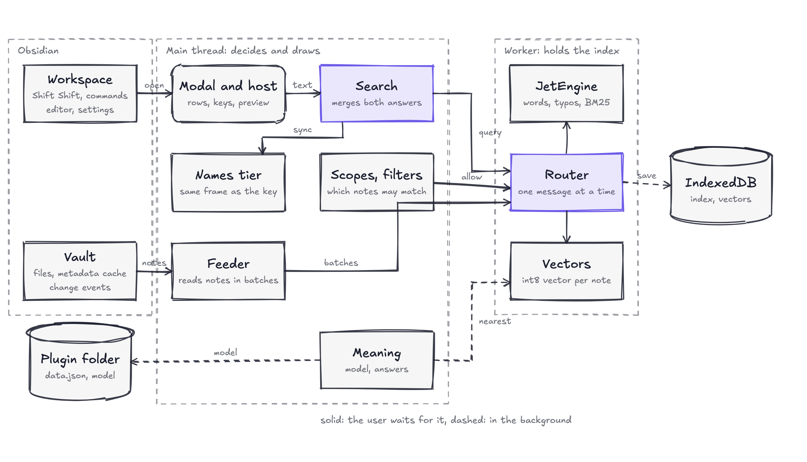
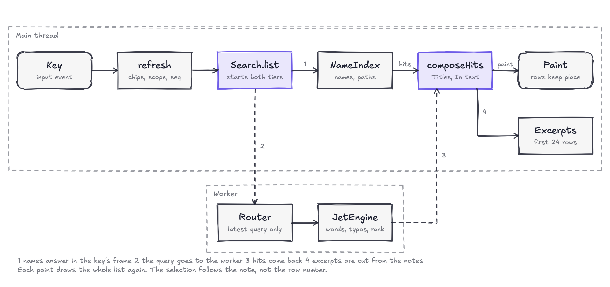
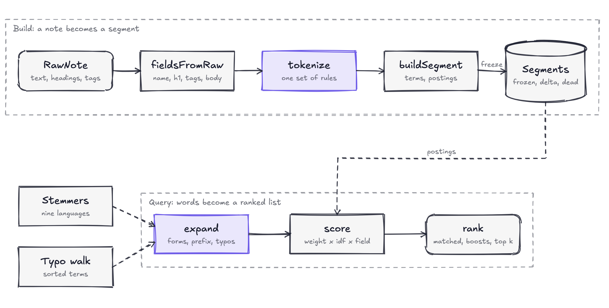
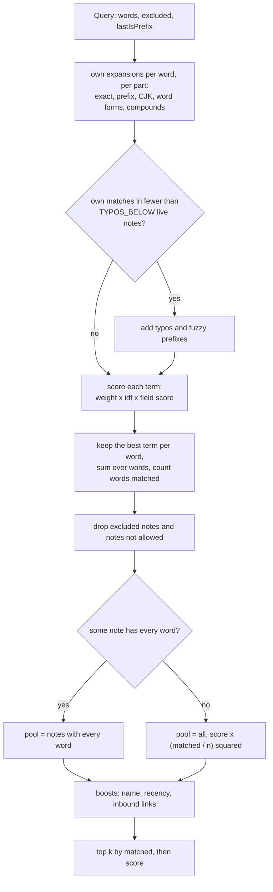
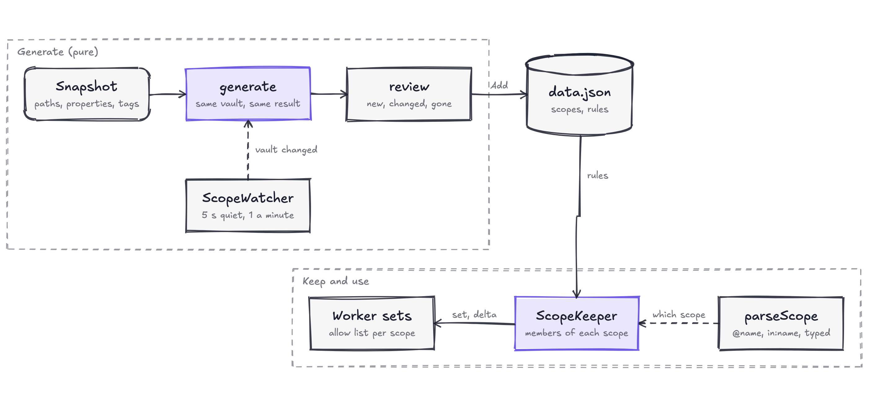
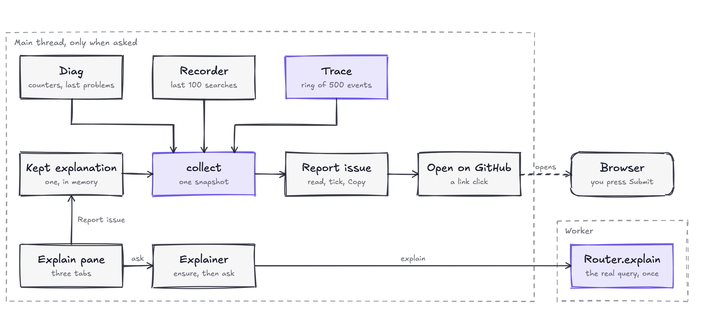

# Architecture

How Jet Search is put together, in one sitting. It covers the parts, how a keystroke becomes a list, how a note gets into the index, and the rules that keep the plugin fast and honest. It takes 20 to 30 minutes to read.

**Two documents.** This one is the map. Each section ends with a line that points into the [architecture reference](architecture-reference.md), the long version: every component in detail, every message, every tunable number, the failure paths, the defect register and the recipes for changing things. Read this first; open the reference when you need the detail behind a box in a picture.

**Audience.** Anyone who will work on the plugin, review a change, or decide whether to trust it. It assumes you can read TypeScript and have seen an Obsidian plugin. It does not assume you know what an inverted index, BM25 or a Web Worker is; they are explained as they come up.

**Contents**

1. [What Jet does](#1-what-jet-does)
2. [The six rules](#2-the-six-rules)
3. [The system on one page](#3-the-system-on-one-page)
4. [One keystroke](#4-one-keystroke)
5. [The engine](#5-the-engine)
6. [The index on disk and in memory](#6-the-index-on-disk-and-in-memory)
7. [Getting notes in](#7-getting-notes-in)
8. [Putting the answers together](#8-putting-the-answers-together)
9. [The window](#9-the-window)
10. [The optional layers: meaning and scopes](#10-the-optional-layers-meaning-and-scopes)
11. [Support: the report, Explain and the trace](#11-support-the-report-explain-and-the-trace)
12. [Build, tests and speed](#12-build-tests-and-speed)
13. [Rules that must not break](#13-rules-that-must-not-break)
14. [Where it is weak](#14-where-it-is-weak)
15. [Where to go next](#15-where-to-go-next)

---

## 1. What Jet does

Jet Search does four things:

1. **Finds a note by its name, alias or path in the same frame as the key press.** This is the names tier ("Tier 0"). It runs on the main thread over a small, pre-folded index.
2. **Finds a note by any word in it, a few milliseconds later.** This is the full-text index. It lives in a Web Worker, forgives typos, matches other forms of a word, and ranks by where a word sits (a name beats a heading beats the body).
3. **Narrows a search** to a scope (a named set of notes defined by rules) or by filters (a tag, a property, a date).
4. **Optionally understands a question.** A small on-device model finds notes that say the same thing in other words, and an answer step shows the line that answers.

It does not edit notes, sync anything, read PDFs or images, call a server (apart from one opt-in model download). When something looks wrong it can explain a search and make a report that you send yourself (section 11). It runs on mobile, but mobile is not officially supported yet.

Four words you will see everywhere:

| Term | Meaning |
|---|---|
| **Main thread** | The one thread that runs Obsidian's interface. If it is busy for more than a few milliseconds, typing stutters. |
| **Web Worker** | A second thread with no access to the page or to Obsidian. It talks to the main thread only by messages. Jet's index lives in one. |
| **Hit** | One result from the engine: a note path, a score, and how many of the query's words the note has. |
| **Field** | A part of a note that is scored on its own: name, aliases, three levels of headings, tags, folder, links, and the body. |

The reference has a full [terminology table](architecture-reference.md#2-terminology).

## 2. The six rules

These hold everywhere in the code. A change that breaks one needs a very good reason. Section 13 says where each is enforced.

| # | Rule | Why |
|---|---|---|
| 1 | **Nothing runs at Obsidian start.** | Every user pays for plugin load time on every launch. The first index build begins a few seconds after the workspace is ready, in small batches, newest notes first. |
| 2 | **The main thread only draws.** | A search over thousands of notes on the page would stutter typing. The index lives in the worker; the page sends a query and paints the answer. |
| 3 | **Results are never stale.** | A slow answer for text you have already changed would replace the right list. Every query carries a sequence number, and an answer that is not the latest is ignored. |
| 4 | **The index stays outside the vault.** | It is kept in IndexedDB, so it is never synced, never shows in a file list, and never ends up in a backup of your notes. |
| 5 | **No network.** | Notes stay on the device. The one exception is the optional meaning model, downloaded only after you confirm, from a pinned revision, and checked against a pinned SHA-256. Reporting a problem opens a page in your browser when you click a link; Jet makes no request and posts nothing. |
| 6 | **Pure where possible.** | Analysis, ranking, filters, scopes and the double-tap detector take plain values and return plain values. They run in tests with no Obsidian. |

Rule 6 shapes the folders. Anything that can be pure lives under `engine/`, `scopes/generate.ts`, `filters/`, `keys/` or `excerpt/` and imports nothing from Obsidian. Anything that touches Obsidian is in a small file next to it (`gather.ts`, `host.ts`, `snapshot-obsidian.ts`). That is why most of the test suite runs without Obsidian.

Deeper: [the six rules](architecture-reference.md#31-the-six-rules), [invariants and their tests](architecture-reference.md#8-invariants-and-where-they-are-enforced).

## 3. The system on one page

Three places, and the boundary between them is the thing to hold onto: **Obsidian owns the files and the page; the main thread decides and draws; the worker holds the index.** Nothing crosses from the worker to the page except a reply to a request, and nothing in the worker can see Obsidian.

<picture>
  <source media="(prefers-color-scheme: dark)" srcset="assets/arch-system-dark.png">
  
</picture>

Reading the picture from the top:

* The **modal** (the window) asks **Search** for a list. Search asks the **names tier** synchronously and the **worker** asynchronously, and merges the two answers in one function. The names always paint first.
* The **feeder** is the only part that reads notes. It turns Obsidian's events and metadata cache into batches of plain data and sends them to the worker. The worker tokenizes; the main thread never does.
* The **router** is the worker's logic without the Worker itself, so tests drive it directly. It owns the engine, the saved index and the note vectors.
* **Meaning** and **scopes** live on the main thread but act through the worker: the model goes in once, vectors are scanned in the worker, and a scope reaches the worker as a list of allowed paths.
* **Storage** is outside the vault. The index and vectors are in IndexedDB, one database per vault. Settings and the optional model file are in the plugin's own folder.

The source tree follows the picture:

| Folder | What lives there |
|---|---|
| `src/engine/` | The index and the ranking. Pure. Analyzer, fields, typo walk, nine stemmers, the segment byte layout. |
| `src/worker/` | The thread boundary: the Worker's queue, the `Router`, the message types, the client, the IndexedDB store. |
| `src/index/` | Getting notes in: `gather`, the `Feeder`, work in 8 ms slices. |
| `src/tier0/` | The names tier: `NameIndex`, folding, and a stopgap index of headings and tags used while the first build runs. |
| `src/search.ts` | `Search`: asks both tiers, merges with `composeHits`. |
| `src/modal/`, `src/host.ts` | The window and the one type it talks through. |
| `src/excerpt/`, `src/preview/` | The line under a hit, and the preview pane. |
| `src/filters/`, `src/scopes/` | Typed pieces and chips; named sets of notes and the generator that proposes them. |
| `src/meaning/`, `src/answers/` | The on-device model, note vectors, and the best line for a question. |
| `src/diag/`, `src/explain/` | The report window, the counters, the flight recorder and the trace; the explanation of a search and its view models. |
| `src/main.ts`, `src/data.ts`, `src/settings*` | The plugin, saved data, the settings tab. |

Deeper: [system overview](architecture-reference.md#3-system-overview), [repository layout](architecture-reference.md#4-repository-layout), [the contracts between the parts](architecture-reference.md#5-the-contracts-between-the-parts).

## 4. One keystroke

This is the path that matters most. Two answers are produced for every key, and the list is painted twice, then a third time when excerpts are ready.

<picture>
  <source media="(prefers-color-scheme: dark)" srcset="assets/arch-keystroke-dark.png">
  
</picture>

1. **The key.** The input's `input` event calls `JetModal.refresh()` directly. There is no debounce: the worker's "latest wins" rule does that job. `refresh` turns finished filter pieces into chips, parses a typed scope name, and calls the host.
2. **Names, in the same call.** `Search.list` strips the operators and calls `NameIndex.match` (at most 40 hits). It is a scan over pre-folded names, aliases and paths. Typical cost: 0.26 ms at 10,000 notes.
3. **First paint, synchronous.** `composeHits` builds the Titles block from the name hits and the modal paints it inside the same event handler. In the in-Obsidian comparison, the first change of the list lands a median 4.0 ms after the last key at 10,000 notes.
4. **The worker.** The same call sends the query with a new sequence number. If another query is already queued behind it, the worker answers the older one as stale without running it. The engine alone takes a typical 0.16 ms at 10,000 notes.
5. **Second paint.** The reply comes back. If it is not the latest sequence number, the client returns `null` and nothing is painted. Otherwise `composeHits` runs again and the text hits appear below the titles. Rows already on screen do not move.
6. **Excerpts.** Search reads the first 24 rows' text with Obsidian's `cachedRead`, cuts one line each around the match, and paints the same rows with a second line.
7. **The preview.** After the selection rests for 80 ms, the preview pane renders the note around the hit, off the page, in one layout.

The whole thing settles in a median 15 ms at 10,000 notes, with no main-thread task over 50 ms while typing. The figures are from [benchmarks](benchmarks.md) (one Apple machine, a synthetic vault).

Deeper: [a keystroke, step by step](architecture-reference.md#72-a-keystroke), [a text query in the worker](architecture-reference.md#73-a-text-query-in-the-worker), [merging the two answers](architecture-reference.md#66-merging-the-two-answers).

## 5. The engine

`JetEngine` (`src/engine/jet-engine.ts`) turns notes into terms and a query into a ranked list. It is pure: plain values in, plain values out, with the clock read only through a `now` option. The worker owns one instance.

<picture>
  <source media="(prefers-color-scheme: dark)" srcset="assets/arch-engine-dark.png">
  
</picture>

### 5.1 From a note to terms

The worker receives a `RawNote` (the text plus what Obsidian's cache already knew: aliases, headings, tags, links) and builds one list of terms per field. A **term** is one normalized word: lower case, accents removed. An **inverted index** maps each term to the notes that hold it, with a count, so a search looks words up instead of reading notes.

Each field has a weight, and a match in a high-weight field counts for more:

| Field | Weight |
|---|---:|
| name | 10 |
| aliases | 9 |
| H1, H2, H3 and below | 6, 5, 4 |
| tags | 4 |
| folder | 3 |
| links | 1.5 |
| body | 1 (BM25) |

One `tokenize` function serves notes and queries alike, so a typed word always matches the stored word. It folds accents and Arabic letter variants, keeps `Node.js` and `e-mail` whole as well as in parts, splits `NebulaSDK` into `nebula` and `sdk` (notes only), cuts Chinese, Japanese and Korean into overlapping two-character pairs, and uses `Intl.Segmenter` for Thai, Lao, Khmer and Burmese.

Nothing is stemmed when an index is built. Word forms are found at query time, in the languages you choose (English, French, German, Spanish, Italian, Portuguese, Swedish, Dutch, Arabic), so changing the languages needs no rebuild.

### 5.2 From a query to a list

In words:

1. **Expand.** Each typed word may mean several index terms. The word itself weighs 1, another form of it 0.8, a compound 0.6, a word that starts with it up to 0.7 (only for the word still being typed), and a spelling within a typo 0.55 (one edit) or 0.35 (two). The best term wins per word; expansions are never added together, so forty words that start with `exp` cannot swamp the rest.
2. **Typos, gated.** A word is allowed a typo only when none or few notes have it as typed: its own matches must be in fewer than 3 live notes (`TYPOS_BELOW`). A vault that has the word does not need it corrected; without the gate, `world` brought `would` and `words`. The budget is 0 letters off under 4 letters, 1 for 4 to 8, 2 above. The walk is an edit-distance computed down the sorted term list that skips whole prefixes once they are too far off, so it needs no extra index. The first letter must match.
3. **Score.** BM25 (a word counts for more when few notes have it, and repeating it in one note helps less and less) for the body; for the short fields, a score computed once at build time and stored. A note named exactly `Cobalt` scores about 12 for `cobalt` from its name alone; a body mention adds at most about 2.2 however often it repeats. A note named for the words beats a note that mentions them often.
4. **Rare words.** A word spelled exactly in only one or two notes is almost certainly what you mean. It is given a floor score (about what a heading gives), and its forms and prefixes count a quarter. That is why `trips`, held once in a gear guide, is not buried under every note named `Trip`.
5. **Every word, then any word.** If some note has all the words, only those are ranked. Otherwise all notes with any word are ranked, with the score multiplied by (matched / n) squared. The final order is words matched first, then score.
6. **Boosts.** Name equals the typed words x2, starts with them x1.5, has all of them x1.4 (only one applies). Recency up to x1.2. Inbound links about x1.16 for three links.

Quoted phrases are not the engine's business. It scores the words, and the caller reads the candidate notes and keeps those whose text holds the phrase (section 8).

Deeper: [the engine in full](architecture-reference.md#61-the-engine-how-a-note-becomes-terms-and-how-a-query-is-scored) (the analyzer, expansions, the exact formula, why each rule exists), [every tunable number](architecture-reference.md#171-the-engines-tunable-numbers).

## 6. The index on disk and in memory

An index is a few frozen **segments**, a small **delta** and a list of **tombstones**.

* A **segment** is one immutable `ArrayBuffer` in a layout designed for load time: the buffer goes into IndexedDB and back as is, and queries read typed-array views onto it. Nothing is parsed on load. Loading 10,000 notes takes about 2.3 ms; 50,000 about 9.9 ms.
* The **delta** holds notes changed since the last freeze, and is rebuilt on each change. At 256 pending notes they are frozen into a segment of their own.
* A **tombstone** marks a note in a frozen segment as replaced or deleted. It stays until a merge writes the segment again without it.
* A **merge** writes the live notes of several segments into one. It happens after 2 seconds of quiet, when there are more than 24 segments, and at the end of a first build.

A first build adds one segment per batch of 100 notes, newest first, so a note is searchable the moment its batch lands, and an interrupted build still holds the notes you use most. Every 20 seconds it merges and saves, so an interrupted build resumes by modified time.

**Saving.** The index is written to IndexedDB (one database per vault) in a single transaction: the base segment (only if it changed), a small JSON **sidecar** with the tombstones and pending notes, and a record with the version and time. A crash leaves the old index or the new one, never a mix. A quiet edit rewrites kilobytes, not the whole index.

**Versions.** Two numbers guard a saved index: the byte-layout version in the segment header, and `INDEX_VERSION` for the analyzer, fields and weights. A mismatch, a bad header or a throw while loading is never fatal: the router resets to an empty engine and the feeder builds again. There is no migration; an old index is rebuilt from the vault. This is why any change to how a field is scored must bump `INDEX_VERSION`.

Deeper: [the index file layout](architecture-reference.md#62-the-index-file), [base, delta, tombstones](architecture-reference.md#base-delta-tombstones), [the merge policy](architecture-reference.md#merge-policy), [what is stored where](architecture-reference.md#56-what-is-stored-where).

## 7. Getting notes in

<picture>
  <source media="(prefers-color-scheme: dark)" srcset="assets/arch-indexing-dark.png">
  
</picture>

Two small parts on the main thread do the reading; the worker does the tokenizing.

* **`gather`** builds a `RawNote` from what Obsidian already knows: the text, the end of the frontmatter, aliases, headings, tags, links (resolved to the target's name) and the count of inbound links. It parses no Markdown. Headings, tags and links are Obsidian's own, so Jet agrees with Obsidian on what a heading or a link is.
* **The `Feeder`** decides when to read and what to send. It works in slices of at most 8 ms and yields with `scheduler.yield` or a posted message, never a timer, because a hidden window slows timers to a second.

What the feeder does for each event:

| Event | What happens |
|---|---|
| First search after a start | Open the worker. If a saved index loaded, run the **catch-up**: ask the engine for every note's modified time, delete what is gone, upsert every note whose time differs. Otherwise run a first build. |
| First build | List the notes newest first, read 100 at a time in parallel, gather in slices, send a batch. The first time Jet is enabled the build starts 3 seconds after the layout is ready; later starts build nothing. |
| A note changes | Obsidian's `modify` and the metadata cache's `changed` both call `touch`, which records the path in a map. One flush, 100 ms after the first change, sends deletes first, then upserts in batches. Two events for one note become one update. |
| You are typing in a note | After 300 ms without keys, the open note is gathered from the editor's text (unsaved edits included) and sent directly. |
| A rename | The engine moves the path, then the full note is sent again, because its name terms changed. |
| A sleep, crash or Rebuild | `reset()` bumps a generation number; any older build or catch-up stops at its next step. |

The worker sleeps after 10 minutes without a search: the main thread saves the index, terminates the Worker and resets the feeder. The next search starts it again and catches up by modified time.

Deeper: [getting notes in](architecture-reference.md#64-getting-notes-in), [plugin start and the first index](architecture-reference.md#71-plugin-start-and-the-first-index), [a note changes](architecture-reference.md#74-a-note-changes), [lifecycle and teardown](architecture-reference.md#9-lifecycle-and-teardown).

## 8. Putting the answers together

`Search.list()` starts both tiers and `composeHits()` merges them. It is a pure function of what has arrived so far (the reply is `null` for the first paint), and every row passes through one `shown` set of paths, so a note appears once.

The order of the list:

1. **Titles block.** The name hits, at most 8, best first. A non-exact name hit can be held back (see rare words below).
2. **In text block.** The worker's hits, sorted by words matched, then by score multiplied by frecency. Frecency is `1 + 0.15 * log2(1 + decayed opens)`, with a 30-day half-life, so notes you open often rise a little among notes that matched the same words.
3. **Deferred names, then metadata rows.** Name hits held back by the rare-word rule, then (only while the first build runs) notes found by a heading, tag or property.

**The rare-word deferral.** When every query word is spelled exactly in only one or two notes, the reply is marked `rare`, and name hits that are not exact are shown after the text rows. A name equal to what you typed stays first. This is the one place where rows move after the first paint; everything else only appends.

**Quoted phrases.** When the text has a quoted phrase, the query asks the worker for 500 candidates instead of 50. `filterPhrases` then reads each note in rank order (the note's name, a newline, then `cachedRead`) and keeps those where every phrase appears as consecutive whole words, ignoring case, accents and punctuation. It stops at 50 confirmed.

**Words in the order you typed them.** Several words without quotes ("garden plan") usually mean the notes where they sit together. After the reply, `boostSequences` reads the text of the first 20 hits and multiplies the score of those that contain the words in that order by 1.5. It never lifts a note above one that matched more words, and it ignores single words and exclusions. The scan reads at most 64,000 characters per note. On the demo vault, unquoted three-word searches reached the top 3 in 79% of 500 generated searches without it and in 89% with it, and no other group of searches moved. See [the measurement](benchmarks.md#words-typed-in-order).

**Keeping the list calm.** Three things stop rows jumping under your hand:

* Rows already on screen are the same rows in the same order in the next paint; new rows go below. Excerpts arrive as a second paint of the same rows.
* The selection is a key (the note's path), not a row number, so the same note is selected again after a paint.
* If you moved the selection, a later paint does not take it back to the first row.

**Stale answers are dropped at four layers.** The worker skips a query when a newer one is queued. The client returns `null` unless the reply is for the latest sequence number. `Search` checks that the box still holds the same text after any slow side path (phrase reads, meaning, answers). And the modal ignores a paint from an older `list()` call, or after it closed. Each guards a different timing; none is the only one.

Deeper: [merging the two answers](architecture-reference.md#66-merging-the-two-answers), [the worker and its protocol](architecture-reference.md#63-the-worker-and-its-protocol) (all 24 messages), [failure paths](architecture-reference.md#76-failure-paths).

## 9. The window

`JetModal` extends Obsidian's `Modal` but draws its own list: rows are pooled and refilled in place, results are never stale, and the selection stays put, none of which a `SuggestModal` gives. It is one large class (about 2,300 lines) with its state in separate fields rather than a state machine, which is its main cost to change.

The modal never touches the vault, the metadata cache or the worker. It talks to its surroundings only through the `ModalHost` type, and it turns a feature off when the matching member is missing. `JetHost` is the real implementation; `InNoteHost` ("search in this note") is a second one; tests use a small fake. That one boundary is why the view can be tested with no Obsidian.

Around it:

* **Excerpts and preview** (`src/excerpt/`, `src/preview/`): the line around a match, with the words marked, cut from Obsidian's cached text; and the preview pane, rendered off the page so it lays out once.
* **Keys** (`src/keys/keymap.ts`): every binding in one table. Every hint in the window comes from it, and no two actions may share a key.
* **The double tap** (`src/shift.ts`): a pure detector that opens Jet on two clean taps of one key. A capital letter does not count.
* **Highlight colours**: some themes style `mark` only inside rendered notes, so Jet measures the theme's highlight once from a hidden element and uses those two colours.

Deeper: [the modal and the host](architecture-reference.md#67-the-modal-and-the-host), [excerpts, preview, in-note search](architecture-reference.md#68-excerpts-preview-and-in-note-search), [keys and the double tap](architecture-reference.md#69-keys-and-the-double-tap), [settings and saved data](architecture-reference.md#614-settings-and-saved-data).

## 10. The optional layers: meaning and scopes

### 10.1 Search by meaning

Opt-in. It finds notes that say the same thing in other words ("how do I stop my basil dying" finds a note about watering and cold nights). There is no neural network at run time and no WASM: the model is a table of vectors, and a text's vector is the average of the rows for its word pieces.

<picture>
  <source media="(prefers-color-scheme: dark)" srcset="assets/arch-meaning-dark.png">
  
</picture>

* **The model** is `potion-base-8M` (Model2Vec, MIT licence), 256 numbers per word piece. The download is about 31 MB, from a pinned revision, and each of the two files is checked against a pinned SHA-256 before anything is packed. Jet keeps it as one packed file of about 8 MB (int8 with a scale per row) in its own plugin folder. "Use files" installs from files you pick, with the same check and no network.
* **Nothing is fetched before you confirm**, and a model that cannot be used turns meaning off without touching word search.
* **A note's vector** is made from its title, aliases, `summary` property, headings and the first 2,000 characters of the body. Vectors are stored with the index, as int8.
* **A question** is searched by a flat scan over the vectors in the worker: a median 0.37 ms at 1,500 notes, 3.9 ms at 15,000. A search counts as a question when it has at least three words and either ends in `?` or opens with a question word.
* **Answers** (an experiment, behind a setting) re-rank a pool of notes by their best line and show that line.

Meaning is a bag of words: no word order, no negation, nothing beyond 512 pieces per note. Words still find a fact deep in a long note; meaning may not.

Deeper: [search by meaning](architecture-reference.md#610-search-by-meaning), [answers](architecture-reference.md#611-answers), [asking a question end to end](architecture-reference.md#75-a-question).

### 10.2 Scopes

A scope is a named set of notes defined by rules (a folder, a tag, a property value, or a property that links to a note). Typing its name searches inside it.

<picture>
  <source media="(prefers-color-scheme: dark)" srcset="assets/arch-scopes-dark.png">
  
</picture>

* **The generator** (`scopes/generate.ts`) is pure and deterministic. From a snapshot of paths, properties, links and tags it proposes scopes by looking for the structure the vault already has: Johnny.Decimal areas, folders that contain many topic folders, link properties that point at a few notes, tag hierarchies. It masks attachments and templates, looks through period folders (`2026/Q3`) and numbered sequences, and merges a folder, a link and a tag that agree. Its output is compared with eight generated vault shapes in the tests.
* **The review** shows what is new, changed or gone, and nothing is saved until you press Add. Generating again never undoes your edits or puts back a rule you removed.
* **The keeper** holds each scope's member paths on the main thread and keeps them current with one-note rechecks. It sends them to the worker as `allow` lists; a scope id the worker does not know allows nothing, never everything.
* **Typing a scope** is a pure parse: names match folded, longest first. Per scope, the mode is Suggest (a suggestion, Tab applies), Auto (applies after a space) or "in only" (only `in:name` or `@name`).

Filters work the same way at the boundary: they are worked out on the main thread and sent to the worker as a list of allowed paths, because the index format has no field per property.

Deeper: [scopes](architecture-reference.md#612-scopes), [query syntax and filters](architecture-reference.md#613-query-syntax-and-filters).

## 11. Support: the report, Explain and the trace

When someone says "it is slow" or "my note is missing", the plugin has to be able to say why, without a debugger and without sending anything anywhere. Three tools do that. Each runs only when asked, keeps what it knows in memory, and is held out of the search path by tests that read the source.

| Tool | What it gives | When it runs |
|---|---|---|
| **The report** (`src/diag/`) | One text: versions, device, vault size, the index, the worker, the last 100 searches as numbers, settings and the last problems. A window to read it, copy it, or open as a GitHub issue | While the window is open |
| **Explain** (`src/explain/`, `src/engine/explain.ts`) | Why a search lists what it does, how each word was read, and where one note stands | While the pane is open |
| **The trace** (`src/diag/trace.ts`) | A timeline of what Jet did over a few minutes, to the millisecond | From Record until Stop or the end |

<picture>
  <source media="(prefers-color-scheme: dark)" srcset="assets/arch-support-dark.png">
  
</picture>

* **The report is one snapshot.** `collect` reads the counters (`diag`), the flight recorder (`recorder`), the trace and the kept explanation into a `Snapshot`, and `report.ts` turns it into lines. The window draws those lines and Copy puts the same text on the clipboard, so what you read is what you send. It holds counts, times and codes. A note title, a path, a scope name, a search word or the text of an error appears only when the person ticks a box, and then only in the part the box names. An explanation is written with tags (`word#1`, `note#1`) until its box is ticked.
* **Open on GitHub is a link click.** `issue.ts` builds the address of a new bug report with the form's fields as query parameters (`what`, `support`, `versions`, `size`) and keeps it within 6,000 characters, because GitHub refuses a longer one. The sentence goes in first and then the report, each only while the link fits; what does not fit is copied for the person to paste. The window clicks an `<a>` element to open it, because `window.open` does nothing on desktop Obsidian. Jet makes no request and posts nothing: the browser opens a page and the person presses Submit. Rule 5 holds.
* **The trace is a ring of numbers.** `trace.start()` makes typed arrays for 500 events. Every later `trace.add(` sits behind one boolean, `trace.on`, so a call site costs one test while no trace runs. An event is a kind, a time and four numbers: there is no string in it, so no word of a search or a note name can get in. The ring drops the oldest event when it is full. Its one timer is made in `start()`. "Also record the next start" starts a trace once at the next Obsidian start, then turns itself off. The report sums the trace up and lists a timeline in which searches less than 2 seconds apart count as one query.
* **Explain asks the question again.** The pane waits 120 ms after the last change, then `Explainer.run` opens the index and sends the worker an `explain` message. The router runs the real query once, uncut, and looks up each word as an exact word, a prefix, another form and a typo, so the explanation reads the index the way a search does. In meaning mode it scores the notes against the question's vector instead. `view.ts` turns the answer into sentences and tables and the pane draws them. **Report issue** in the pane keeps the explanation (`keepExplained`) and opens the report with it marked.
* **What it costs.** Nothing runs at Obsidian start, and nothing asks the worker for an explanation until the pane opens. Paired A/B runs in a real Obsidian showed no measurable change in search time with the trace off or on. The off test is about 0.9 ns, an event is about 30 ns, and the code adds about 0.08 MB of heap.

Deeper: [the report, Explain and the trace in full](architecture-reference.md#615-support-the-report-explain-and-the-trace), [a report and a trace, step by step](architecture-reference.md#77-a-report-and-a-trace), [Explain a search, step by step](architecture-reference.md#78-explain-a-search), [add a trace event](architecture-reference.md#1016-add-a-trace-event), [add a line to the report](architecture-reference.md#1017-add-a-line-to-the-report).

## 12. Build, tests and speed

**Build.** `esbuild` bundles `src/main.ts` into one CommonJS `main.js` (about 390 KB). The worker is not a separate file: it is bundled on its own by a small plugin in `esbuild.config.mjs` and inlined into `main.js` as a string. At run time `JetClient` wraps that string in a Blob URL and starts the Worker. Obsidian installs exactly `main.js`, `manifest.json` and `styles.css`; inlining means the worker needs no extra read and cannot go missing or fall out of step.

<picture>
  <source media="(prefers-color-scheme: dark)" srcset="assets/arch-build-dark.png">
  
</picture>

`npm run check` runs formatting (oxfmt), lint (oxlint, then ESLint with the Obsidian community-plugin rules), the type check (native TypeScript 7) and every test. CI runs it on each push and pull request. A pushed tag that equals the manifest version builds `main.js`, attests the build and publishes the three files. The release job runs no tests of its own; it relies on CI having passed.

**Tests.** About 1,060, in five kinds:

| Kind | How it runs |
|---|---|
| Pure unit (analyzer, stemmers, engine, names, rank, filters, scopes) | No Obsidian. Plain values in, plain values out. |
| Router-driven | The `Router` class with an in-memory store and hand-fired timers, so the worker's logic runs without a Worker or IndexedDB. |
| UI against a mock | `obsidian` is aliased to a mock (App, Vault, Workspace, MetadataCache, Modal, Setting and the DOM helpers) and runs in happy-dom. |
| Regression | One test per bug, written to fail on the code as it was. |
| Fixture vaults | Eight generated vault shapes with an `expected.json`, compared with the scope generator's output. |

Tests that assert a time bound run serially, because a bound measured while 60 other files share the CPU fails at random. A ranking change is judged on a set of searches it was not tuned on: seed 7 of the generated set was used to tune, seed 11 to judge.

**Speed.** On one Apple machine, with real key events in a real Obsidian:

| Measure | 1,000 notes | 10,000 notes |
|---|---:|---:|
| Names, first change on screen (median) | 3.4 ms | 4.0 ms |
| Settled, names + text + excerpts (median) | 13 ms | 15 ms |
| Engine per keystroke (typical) | 0.056 ms | 0.16 ms |
| Longest main-thread task while typing | none over 50 ms | none over 50 ms |
| Index build | 0.8 s | 6.4 s |
| First search after launch | 20 ms | 34 ms |

Windows and Linux were not measured. See [benchmarks](benchmarks.md) for the method and the comparison with other plugins.

Deeper: [build pipeline](architecture-reference.md#11-build-pipeline), [testing strategy](architecture-reference.md#12-testing-strategy), [performance budget](architecture-reference.md#13-performance-budget), [contributing](architecture-reference.md#16-contributing).

## 13. Rules that must not break

A rule is only a rule if something fails when it breaks. The ones that matter most, with what holds them:

| Rule | Held by |
|---|---|
| Notes and queries go through the one `tokenize` | `analyzer.ts`; analyzer tests |
| Nothing is stemmed at build time | No call to the stemmers in `buildSegment`; a jet-engine test |
| Terms are sorted by UTF-16 code unit and searched with the same comparison | `writeSegment`; typo walk tests |
| Typos only for a word with fewer than 3 live notes | `liveNotes`; two engine tests |
| Rank by words matched, then score | `byScore`; engine tests |
| A rare exact word ranks above its forms | `RARE_FLOOR`, `RARE_OTHERS`; the "only a few notes" tests |
| An index of another version or one that cannot be read is rebuilt, never fatal | `Router.open`; router tests |
| Base, sidecar and meta are saved in one transaction | `idbStore.save` (no test uses real IndexedDB) |
| Tokenizing never runs on the main thread | `RawNote` carries text only; a router test |
| A keystroke paints the names before it asks the worker | `Search.list`; a same-frame search test |
| A note appears once in a list | the `shown` set; a search test |
| Only the newest query's reply is painted | `seq` in the worker, client, `Search` and modal |
| The selection follows the note, not the row | `selectedKey`; a modal test |
| Nothing at Obsidian start: no read, no worker, no listener | `main.test.ts` |
| No network except the model download, and only after you confirm | `MeaningConfirm` before `install`; only `install.ts` calls `requestUrl` |
| The index and vectors stay outside the vault | `idbStore`; the model lives in the plugin folder |
| Settings never lose data on load: a bad value falls back | `normalizeData`, field by field |
| Private Obsidian APIs are optional and guarded | `internals.ts`, every member optional-chained |
| A trace that is off costs one boolean, and a trace never holds text | `trace.on` before every `trace.add(`; `trace-feed` and `trace-proof` tests |
| The report holds no note name, scope name or search word unless a box is ticked | `collect`, behind `ReportOptions`; `diag-collect` and `explain-view` tests |
| Opening a bug report posts nothing, and its link stays within 6,000 characters | `openLink`, `issueLink`; `issue-link` and `diag-collect` tests |
| Nothing asks the worker for an explanation until the pane opens, and search, rank and names never name it | `explain-cost` test |

Deeper: [all invariants](architecture-reference.md#8-invariants-and-where-they-are-enforced) (each with the code and test that hold it), [the defect register](architecture-reference.md#14-defect-register) (what went wrong, how it was found, the fix).

## 14. Where it is weak

The honest short list. The reference has [the full one](architecture-reference.md#15-limitations).

* **Typos.** A typo in the first letter is never corrected in the full-text index. Words of three letters or fewer take no typos. A word that reads as a stem plus a suffix (`planly`, meant `plainly`) can list the stem's notes. Two of the three misses in the benchmark are words as close to other terms as to the right one.
* **Evidence is thin in places.** The accuracy sets are generated from a 239-note invented vault. Only macOS was measured. IndexedDB is exercised only in the browser. The model download path (checksum rejection, HTTP failure) has no unit test.
* **Text only.** Notes are Markdown; there is no text from PDFs or images, and other frontmatter properties are not indexed as words (they are reachable through filters).
* **Meaning is English-biased.** The question rule and the answers read English words; the model itself works on word pieces and how well it embeds other languages was not checked.
* **Mobile is not officially supported yet.** `isDesktopOnly` is off. The code is written for mobile (8 ms slices, pause while hidden, a phone layout under `body.is-mobile` and `body.is-phone`, a start-up check in `src/compat.ts` for iOS 15.4 or Android WebView 98) and was checked on an emulated phone and in WebKit, not on a real phone.
* **The modal is one large class** with state in separate booleans. A change to scopes, filters or meaning touches several handlers.
* **Accessibility is partial.** Roles and `aria-activedescendant` are in place, but there is no live region to announce results, and it was not tried with a screen reader.
* **The support tools are young.** The trace keeps the last 500 events, so a long recording keeps the end of it and not the start. The GitHub link has a budget of 6,000 characters, so a long report is pasted by hand, and the form reads the report's field only from the default branch. Explain re-runs the real query each time it asks.
* **Release job** builds but runs no lint or tests.

## 15. Where to go next

| You want to | Read |
|---|---|
| Understand ranking well enough to change it | [The engine](architecture-reference.md#61-the-engine-how-a-note-becomes-terms-and-how-a-query-is-scored), then [changing the ranking safely](architecture-reference.md#changing-the-ranking-safely) |
| Add a stemmer language, an indexed field, a field weight or a worker message | [How to change it](architecture-reference.md#10-how-to-change-it) |
| Bump the index version | [Version bump and rebuild](architecture-reference.md#version-bump-and-rebuild) and [bump the index version](architecture-reference.md#105-bump-the-index-version) |
| Follow a bug through the keystroke | [Control flow](architecture-reference.md#7-control-flow) |
| Know whether a bug is already known | [The defect register](architecture-reference.md#14-defect-register) |
| Change the window, a key or a setting | [The modal](architecture-reference.md#67-the-modal-and-the-host), [keys](architecture-reference.md#69-keys-and-the-double-tap), [settings and saved data](architecture-reference.md#614-settings-and-saved-data) |
| Look up a constant | [The engine's tunable numbers](architecture-reference.md#171-the-engines-tunable-numbers) |
| Set up, run the checks and send a change | [CONTRIBUTING.md](../CONTRIBUTING.md) and [contributing](architecture-reference.md#16-contributing) |
| Follow a bug report, a trace or an explanation | [The report, Explain and the trace](architecture-reference.md#615-support-the-report-explain-and-the-trace), then [a report and a trace](architecture-reference.md#77-a-report-and-a-trace) |
| Redraw a picture | [docs/diagrams/README.md](diagrams/README.md) |
| See how it was measured | [benchmarks](benchmarks.md) |
