# Jet Search: usage guide

Jet is a fast search for Obsidian: names as you type, the full text of every note in any language,
filters, scopes, and search by meaning that can answer a question with the line that holds the answer.
Everything below was recorded in the [demo vault](../demo-vault) (an invented person's notes:
projects, areas, recipes in eight languages, a journal). The keys pressed show under each window.

**Reference.** Every part of the window and every setting, numbered and explained: [the reference](reference.md).

**Keys.** "Ctrl / ⌘" means Ctrl on Windows and Linux, ⌘ on a Mac; "Alt / ⌥" likewise. Every key inside
Jet's window can be changed (see [Your keys](#your-keys)).

**Contents**: [Open and close](#open-and-close) · [Find by name](#find-by-name) · [Find by content](#find-by-content) ·
[Every language](#every-language) · [Filters and properties](#filters-and-properties) · [Scopes](#scopes) ·
[Search by meaning](#search-by-meaning) · [Answers](#answers) · [Results](#results) · [Preview](#preview) ·
[Keys and actions](#keys-and-actions) · [In-note search](#in-note-search) · [When nothing matches](#when-nothing-matches) ·
[Explain a search](#explain-a-search) · [Index and settings](#index-and-settings) · [Report an issue](#report-an-issue) · [Themes](#themes) · [Mobile](#mobile)

---

## Open and close

### Open with Shift Shift
Tap **Shift** twice. Jet opens on your recent searches and the scopes you use most; ↑ ↓ pick one, **Enter**
runs it. The command *Jet Search: Search notes* opens it too, so any hotkey works. The double-tap key
(Shift, Ctrl, Alt or off) and its timing are settings.

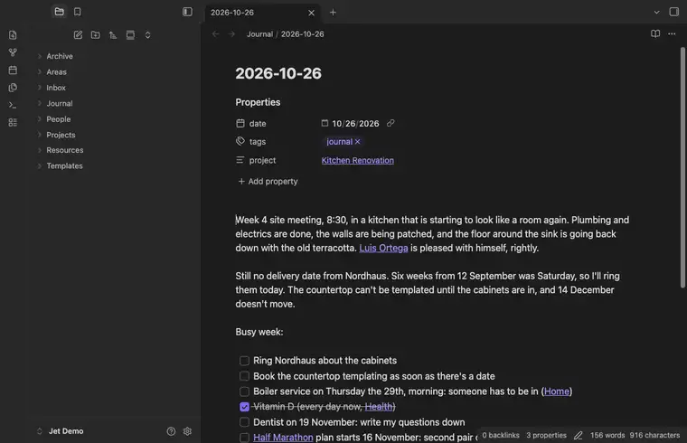

### Open with the selected text
Select text in a note, then Shift Shift: Jet opens searching for it.

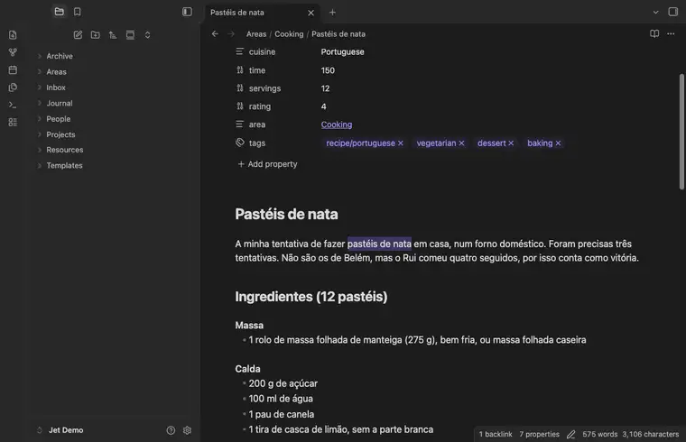

### Esc, step by step
**Esc** clears the text, then removes the scope or filters, then closes Jet.

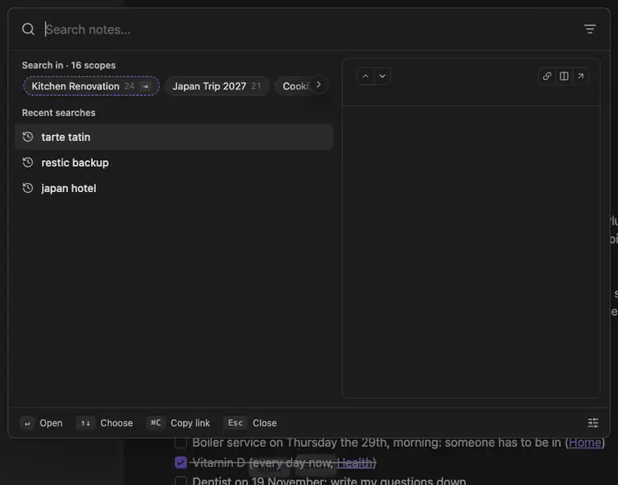

### Everywhere for a moment
Inside a scope, **Shift Shift** searches the whole vault with the same text; Shift Shift again goes back.

### If you used Omnisearch
While Omnisearch is off, Jet answers its two commands, so a hotkey or a double-tap binding made for Omnisearch opens Jet instead. In the command palette and on the Hotkeys page they are named *Search notes (Omnisearch's shortcut)* and *Search in this note (Omnisearch's shortcut)*. When Omnisearch is turned on, Jet steps aside and Omnisearch keeps its own commands. Jet changes nothing in Omnisearch's settings.

## Find by name

### Names as you type, typos forgiven
Names match in the same keystroke, before the full text arrives. Typos are forgiven: one in a word of 4–8
letters, two in longer words.

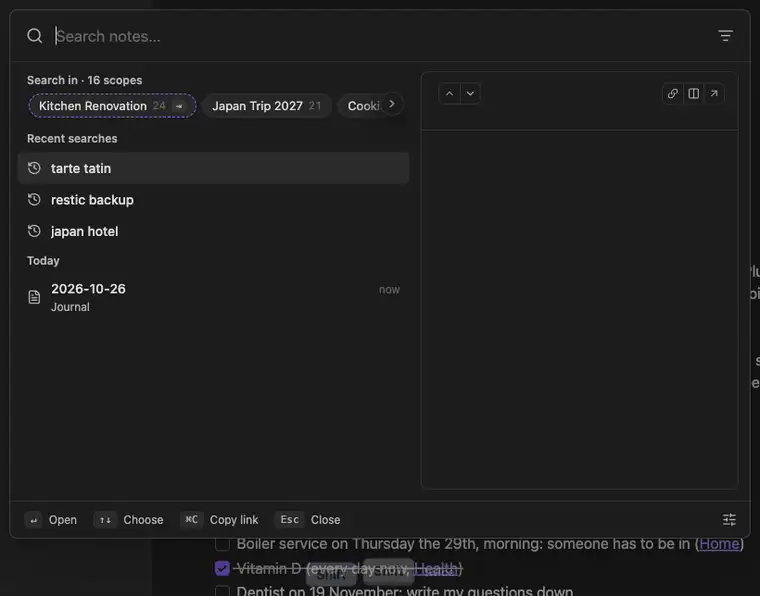

### Initials and parts of words
The letters of a name in order find it: `jtrip` finds *Japan Trip 2027*.

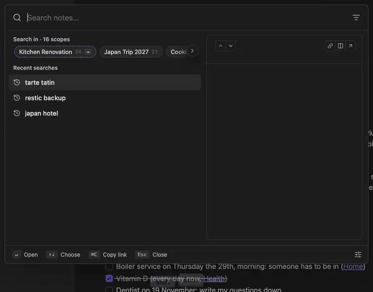

### Aliases
A note's aliases find it as its name does: `TLK` finds *The Lighthouse Keeper*.

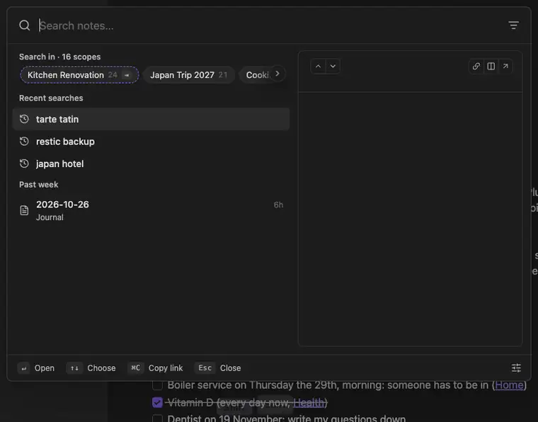

### The exact name first
A note named exactly as you typed comes first, then notes that mention it.

## Find by content

### Ranked full text, with excerpts
Every word of every note is searched in the background; results come ranked, each with the line that
matched and its words marked. The preview shows the note at that line.

### Typos in the text
`restik backup` finds the notes about *restic*.

### Word forms
`planted` finds *planting* and *plants*: words meet their other forms, in every language Jet stems
(Settings → Advanced → Word forms).

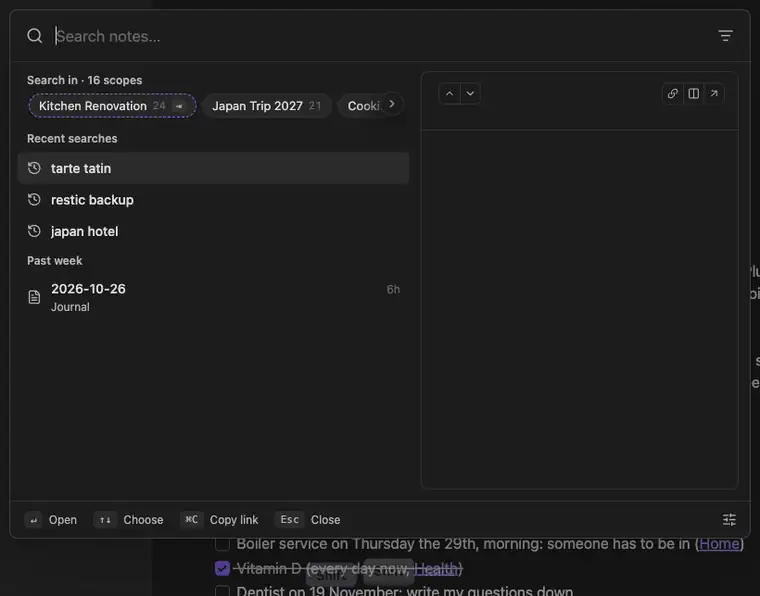

### Phrases
Words in quotes must stand together: `"first thursday"`.

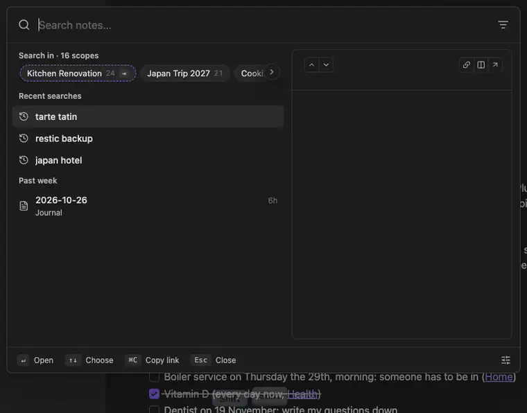

### Leave words out
A minus leaves notes with that word out: `tomatoes -cherokee`.

### Headings and tags count more
A word in a note's name, headings or tags weighs more than the same word in its text.

## Every language

### Languages written with spaces
French, Spanish, Portuguese, German, Italian…: accents and case do not matter.

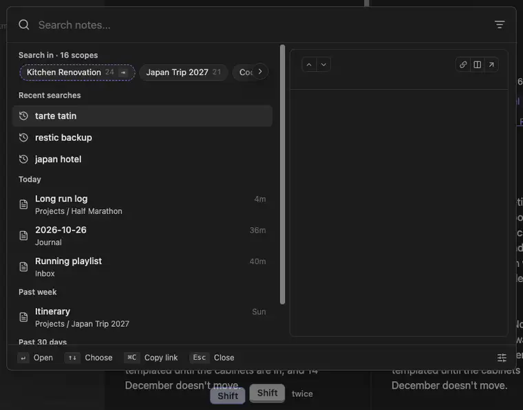

### Chinese and Japanese
No spaces needed: `味噌汁`, `番茄`.

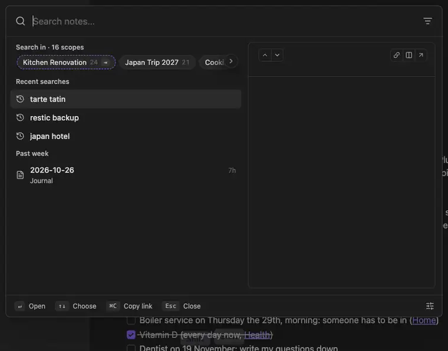

### Right to left
Arabic and Hebrew show right to left: `شوربة`.

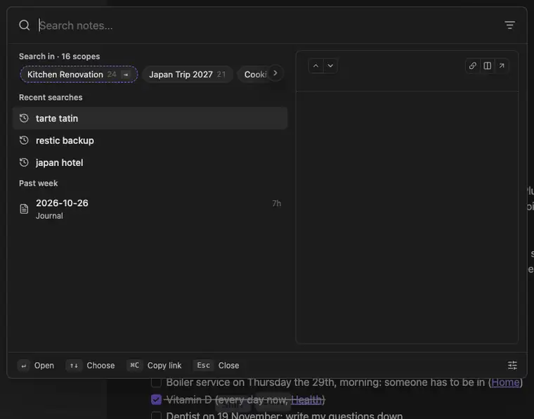

## Filters and properties

Type a filter and a space: it becomes a chip. Chips combine with each other and with text.

| Filter | Keeps |
|---|---|
| `#tag`, `#parent/child` | notes with the tag (a parent tag keeps its children) |
| `key:value` | a property: `type:book`, `status:active`, `rating:5` |
| `path:Folder` | notes in a folder |
| `edited:7d`, `created:30d` | notes changed or made in that time (`d`, `w`, `m`, `y`) |
| `links:[[Note]]`, `has:links` | notes that link to a note, or have links |
| Title only (Ctrl / ⌘ + F) | names only, not the text |

### Tags
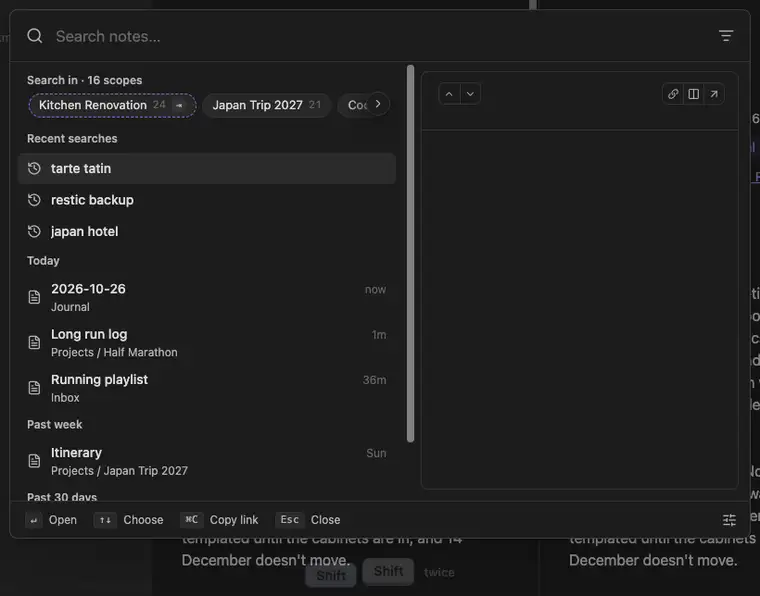

### Properties

### Paths
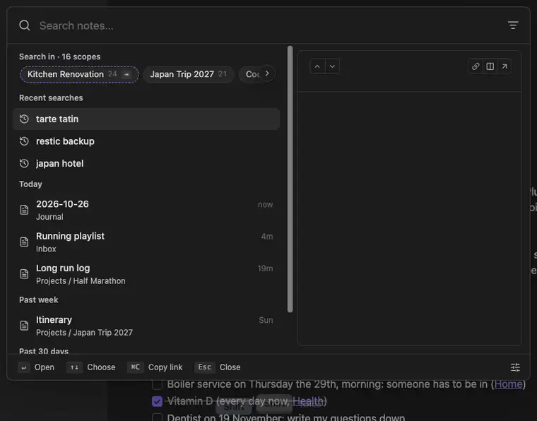

### Links

### Autocomplete keys and values
Type a key and a colon: Jet lists its values, with how many notes have each. ↓ and **Tab** take one.

### Fix-it for a misspelt key
`stauts:done` asks "Did you mean status:?" and shows what the fix would find; **Tab** fixes it.

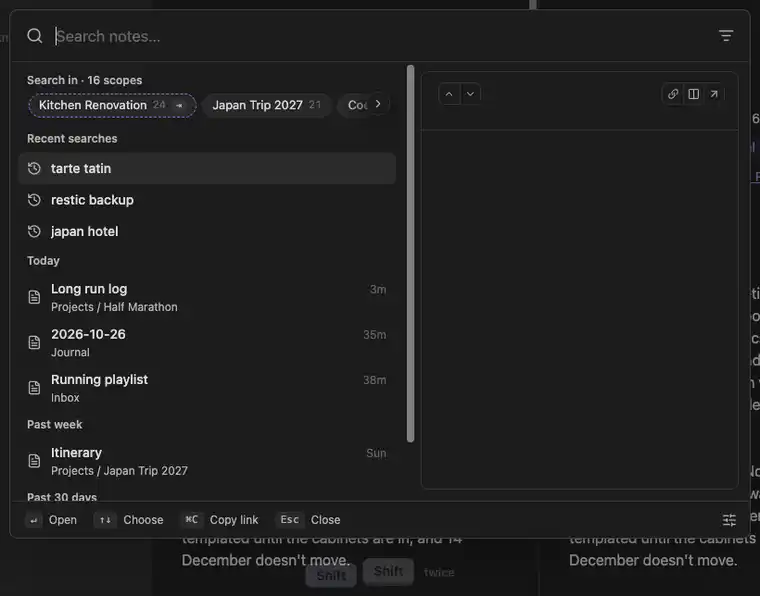

### Title only
**Ctrl / ⌘ + F** opens the filters bar; *Title only* searches names alone.

## Scopes

A scope is a group of notes: a project, an area, any folder, tag or property. Jet makes them from your
vault's own structure, and you can add your own.

### Scopes made from your vault
Settings → Jet → Scopes → *Generate…* proposes scopes from your folders, links and tags; tick and add.

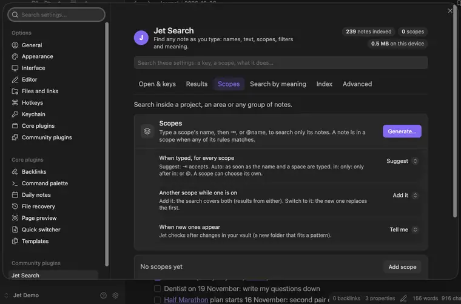

### Name a scope while you search
Type a scope's name with other words: Jet offers to search inside it. **Tab** accepts; the rest of the text
searches there.

### `in:` and `@`
`in:cooking garlic` (or `@cooking`) searches inside the scope straight away.

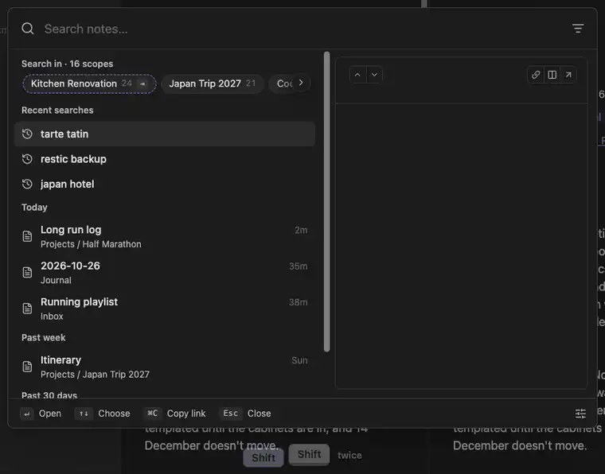

### Two scopes of one name
When two scopes share a name, Jet shows both; **Tab** moves between them.

### Several scopes in one search
With a scope on, name another: **Tab** adds it (Shift + Tab searches only the new one). A setting chooses
whether another scope is added or switched to.

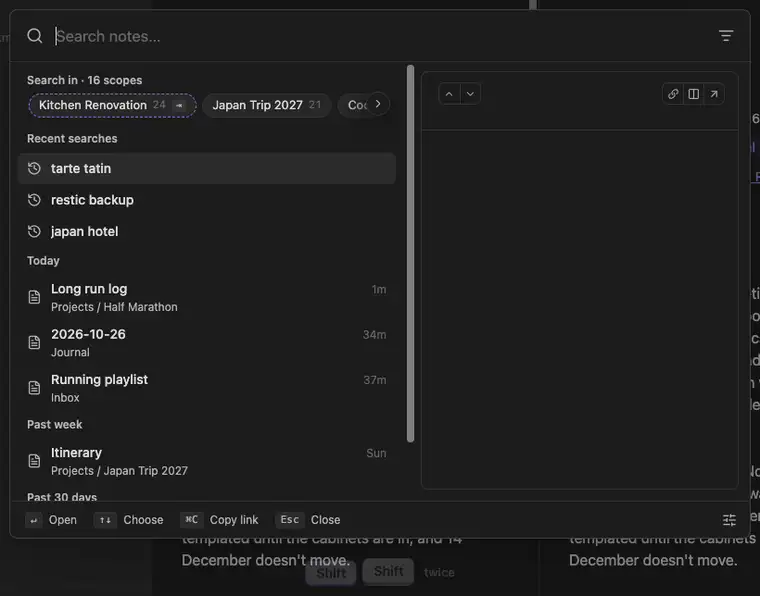

### Auto
A scope set to *Auto* applies itself as soon as its name is typed; **Backspace** undoes it.

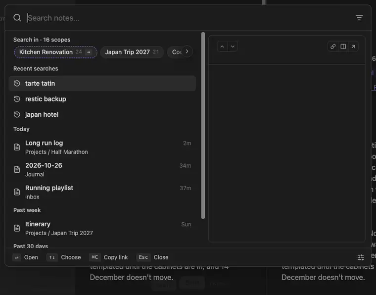

### Why a note is in the scope
A note in a scope by a property (`project: [[Half Marathon]]`), not by its folder, says so: *via project*.

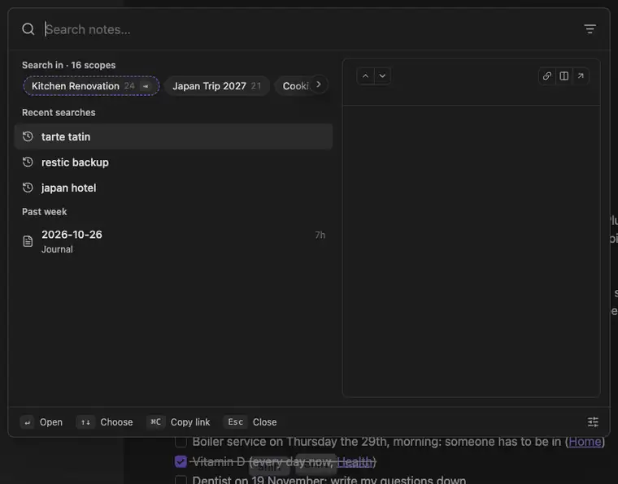

### A scope as a switcher
A scope's name alone and **Tab**: the scope's notes, newest first.

## Search by meaning

An option: a small model (about 8 MB on disk, downloaded once) gives each note a meaning, on your
device. Questions then find notes that say the same thing in other words.

### Turn it on
Settings → Jet → Search by meaning: turn it on, confirm the download, and notes get their meaning in the
background.

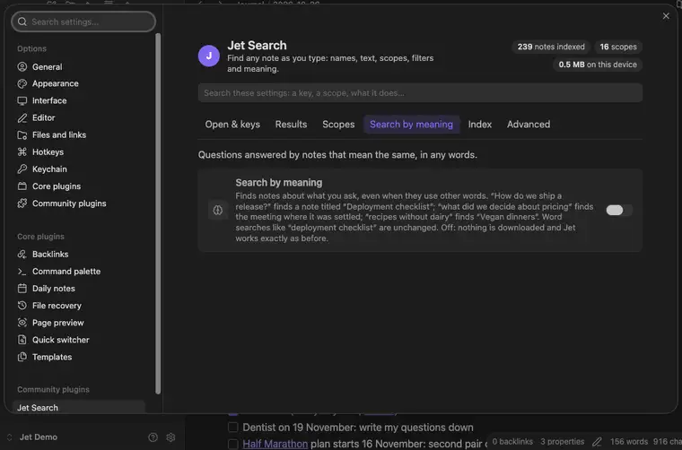

### A question by meaning
A question (it starts with *how, what, why…* or ends with *?*) goes by meaning: `how do I stop my basil
dying` finds the note about watering and cold nights.

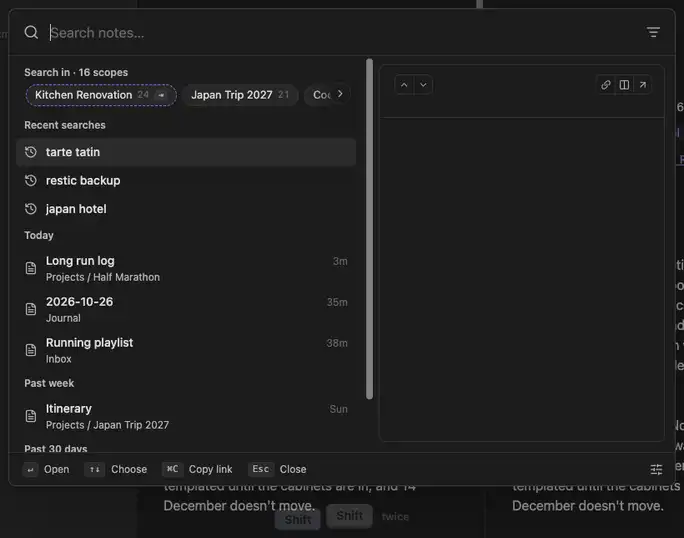

### Words, meaning, or both
**Ctrl / ⌘ + J** switches between words, meaning and both; the switch is on the list's header too. Both can
show as two groups, found-both-ways first, or one list (Settings → Search by meaning → *Both, shown as*).

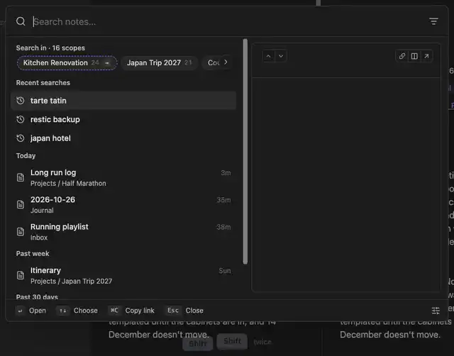

### Long searches by meaning
An opt-in: searches of six words or more go by meaning too.

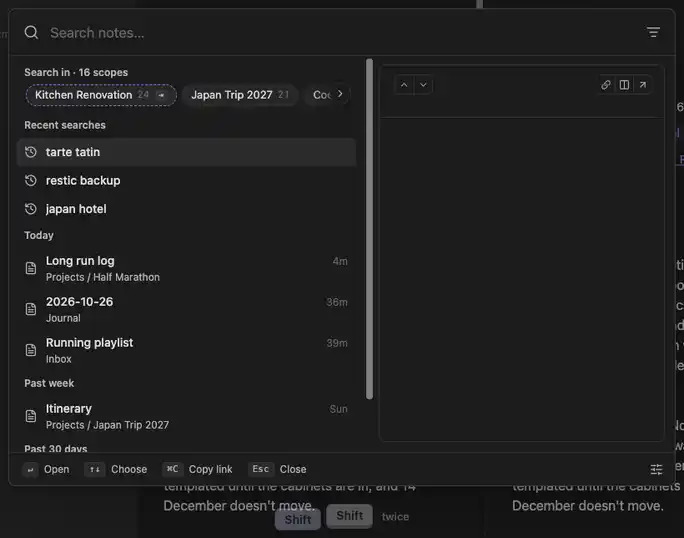

## Answers

### A question with a fact for an answer
Ask for a number, a price, a name, a date or a reason: Jet lists the notes by the line that answers, shows
that line with its figures coloured and a meter of how close it is, and outlines it in the preview.
(Setting: *Find answers*, under Search by meaning.)

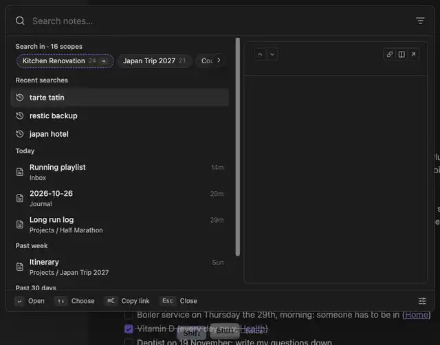

### Who
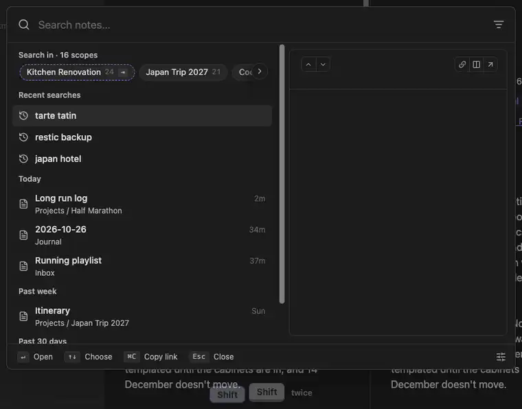

### When

## Results

### Titles first
For a name-like search, notes named so come first (*Titles*), then the notes that mention it (*In text*).
The list stays put as more results arrive: the selected row does not jump.

### Sort
**Ctrl / ⌘ + Shift + S** goes through the orders: best match, last edited, created, title. The order is also on
the list's header.

### What you open comes first
Notes you open often, and lately, rise a little in the results by text (names keep their own order).

## Preview

### Walk the hits
The preview shows the note around its hit, every hit marked and ticked on the scroll bar. **Ctrl / ⌘ + G**
goes to the next, **Ctrl / ⌘ + Shift + G** to the previous.

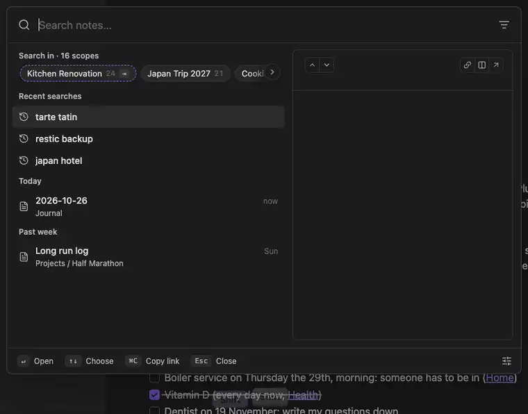

### Show or hide it
**Ctrl / ⌘ + .** shows or hides the preview; a narrow window hides it by itself.

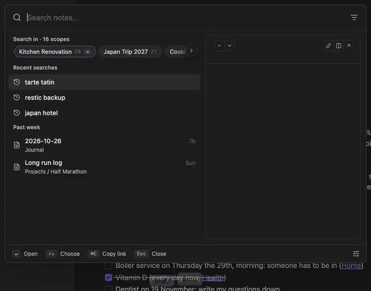

## Keys and actions

| Key | Does |
|---|---|
| Enter | open |
| Ctrl / ⌘ + Enter | open in a new tab |
| Ctrl / ⌘ + Alt / ⌥ + Enter | open to the right |
| Alt / ⌥ + Enter | insert a link to the note where you are writing |
| Shift + Enter | create a note named after the text (inside the scope's folder) |
| Ctrl / ⌘ + C | copy a link to the note |
| Ctrl / ⌘ + Shift + C | copy the note's `obsidian://` URL |
| Ctrl / ⌘ + Ctrl (Mac) or Ctrl + Alt + C | copy the note's file path |
| Ctrl / ⌘ + K | the note's actions |

### Open to the right
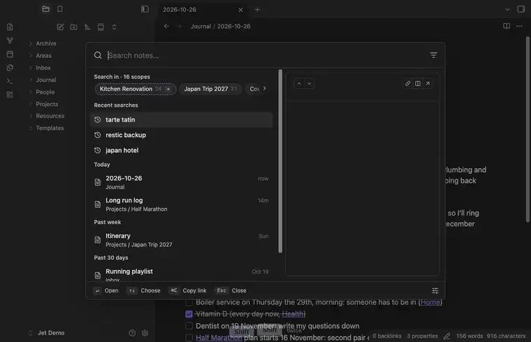

### Insert a link
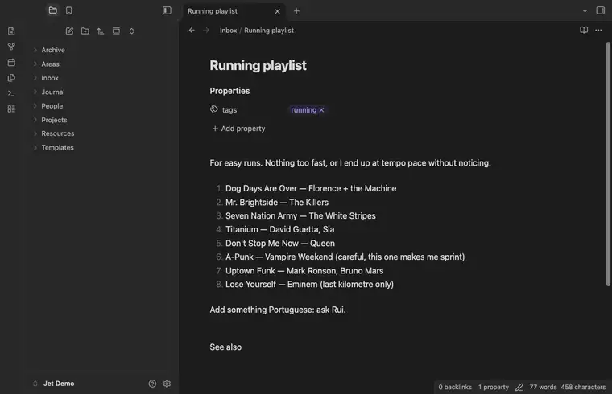

### Copy a link, a URL, a path
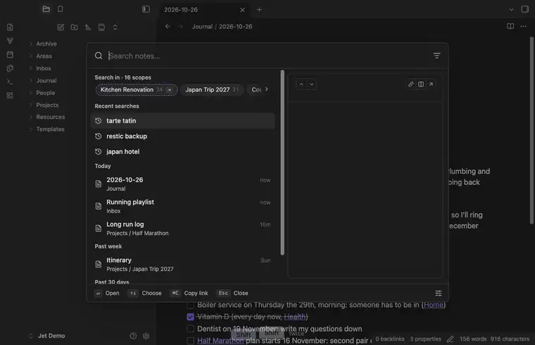

### Create a note from the search

### The note's actions
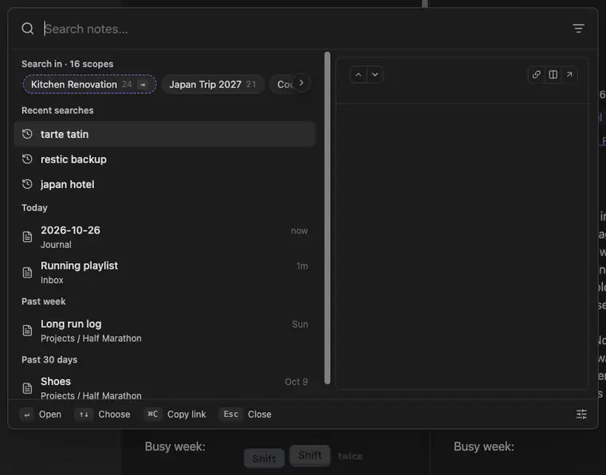

### Your keys
Settings → Jet → Open & keys → *Keys in Jet*: click a key and press the new one. A key already used is
refused, with which action has it; the hints in the window follow.

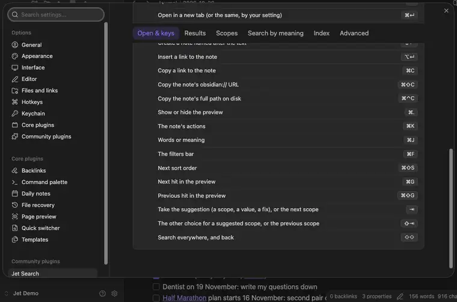

## In-note search

The command *Jet Search: Search in this note* lists every hit in the open note; **Enter** jumps to it.

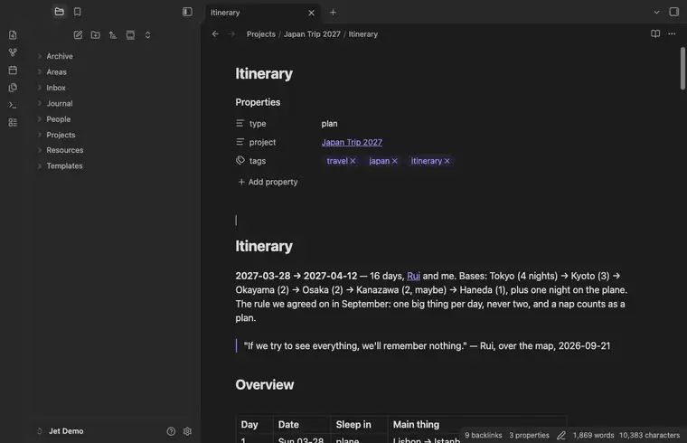

## When nothing matches

### Did you mean…?
When nothing matches, Jet offers the spelling your notes use, and to create a note.

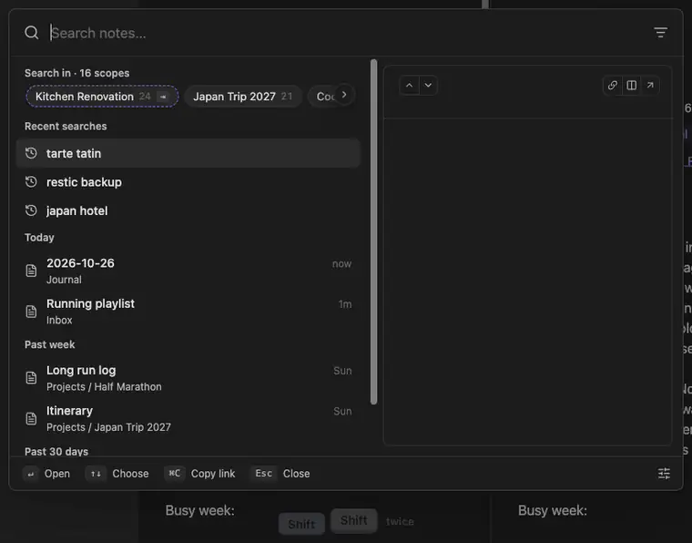

### Obsidian's search for its own operators
`line:`, `section:`, `block:`, `task:` and `/regex/` are Obsidian's: Jet offers to run them there.

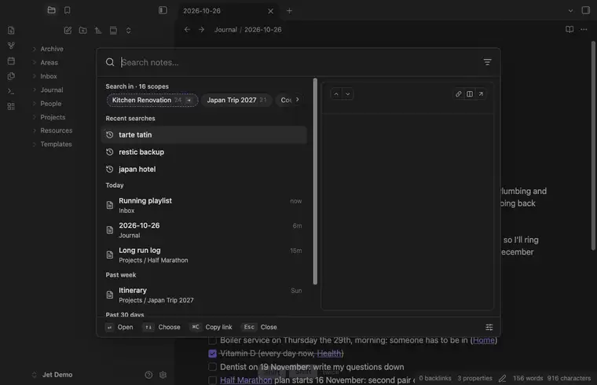

## Explain a search

Jet can say why a search lists what it does, and why a note you expected is missing. It asks nothing until you open it.

### Open it
In Jet's window press **Ctrl / ⌘ + Shift + E**: the preview turns into the explanation. **Esc** or **Ctrl / ⌘ + E** goes back. When nothing matches, **Why?** in the red notice opens it. Outside the window, run the command *Explain why a note is found*, or go to Settings → Advanced → *Why is a note not found?* → *Explain a search*: Jet opens on your last search with the explanation showing.

The explanation has three tabs, and **Tab** moves between them.

### This note
Pick a note with ↑ ↓. Jet says where it ranks, which of your words it holds and where (its name, its headings, other fields or the body, and as which form), and what moved it: how recently it changed and how many notes link to it.

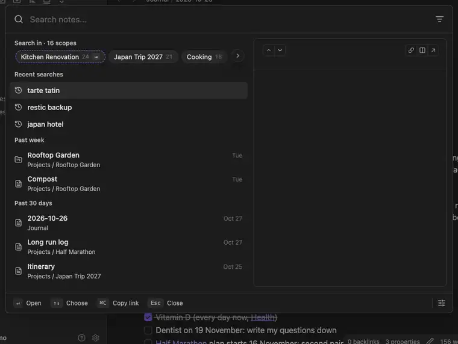

### The search
How each word was read: as typed, as the start of a longer word, as another form of the word, or as a typo, and how many notes each way found. It also says why the list is what it is, for example that 13 notes hold every word, so only those are listed.

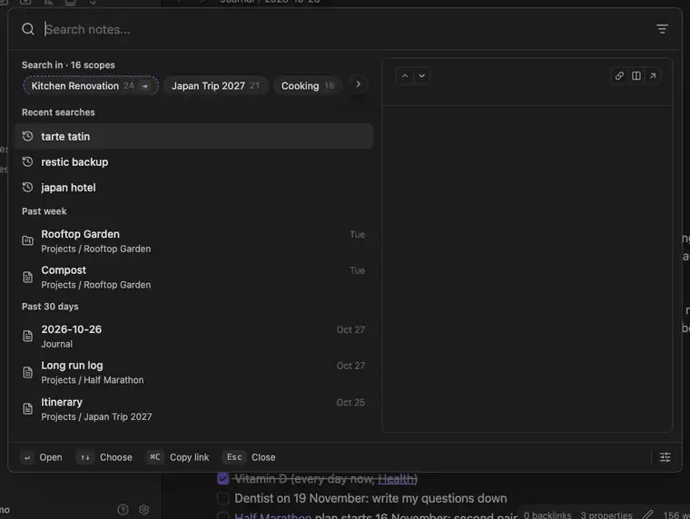

### A note I expected
Type the name of a note that is missing, and pick it. Jet says why it is not listed: here, that it has *half* and *marathon* but not *shoes*.

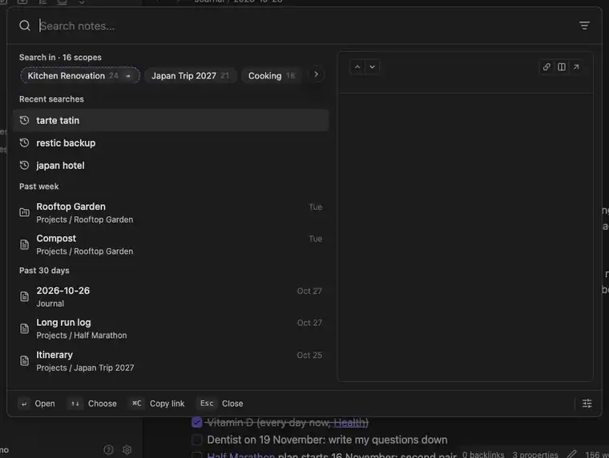

### By words or by meaning
With search by meaning on, the explanation has a switch at the right. *By words* explains how the words were read. *By meaning* says how close the note is to the question, and where the last note listed stands.

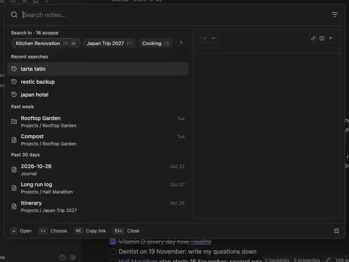

### When nothing is found
The red notice says *Why?*, with its key. The explanation then says that no note holds the words, even as a longer word, another form or a typo.

### Put it in a report
**Report issue**, at the bottom of the explanation, adds it to the report and opens the [Report issue](#report-an-issue) window, with the explanation's lines marked. Note names, words and filter values show only when *Search text and note names* is ticked; otherwise they show as tags such as `word#1`.

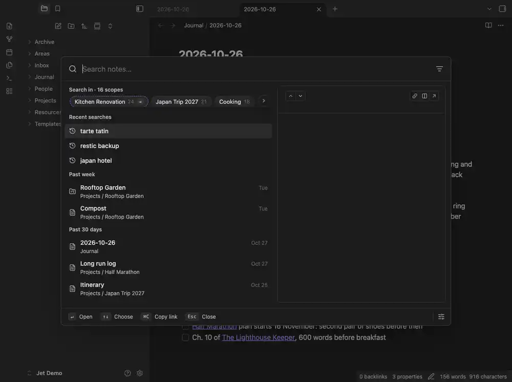

## Index and settings

### The index
Jet builds its index in the background when it is turned on (seconds for a few hundred notes), keeps it on
your device, and is useful before it is done (names first). Settings → Index shows it and rebuilds it.

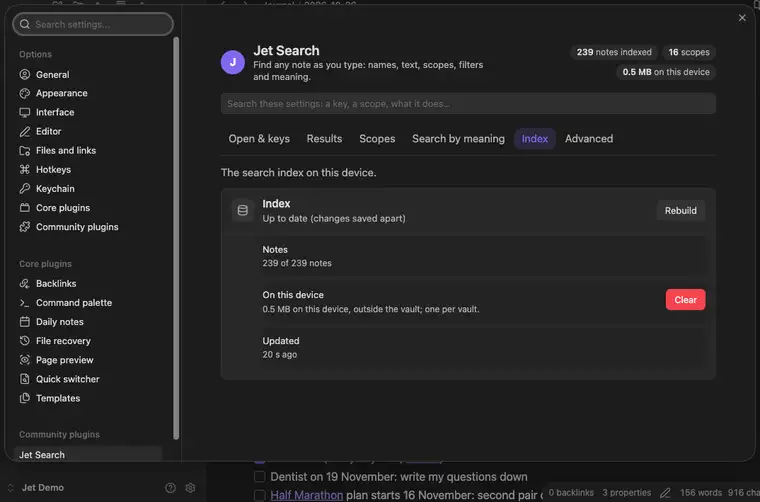

### Always fresh
A note is searchable as you write it.

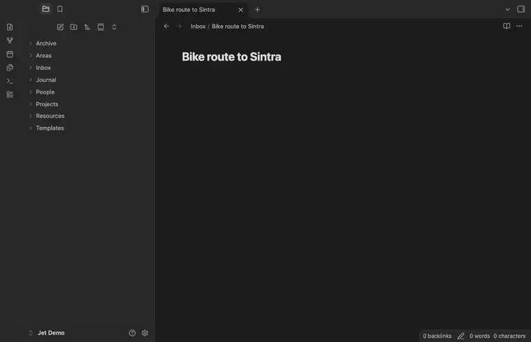

### Folders to leave out
Settings → Advanced → *Folders to leave out*.

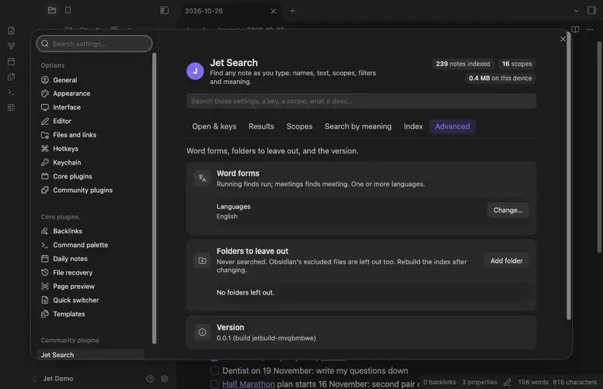

### Search the settings
Jet's settings have their own search box.

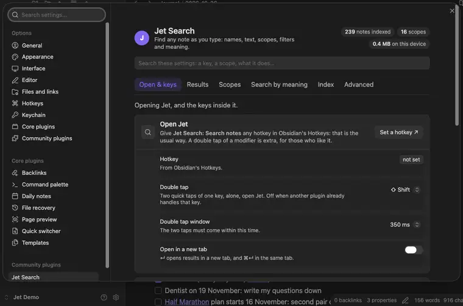

## Report an issue

When something does not work as it should, Jet makes a report you can read, copy, or send as a GitHub issue. Jet sends nothing itself: you read the report, and you press Submit.

### Open the report
Run the command *Report issue*, or go to Settings → Advanced → *Report issue* → *Open*. A window shows exactly the text a copy puts on the clipboard: the versions of Jet and Obsidian and your device, the size of the vault, what the index and the background worker are doing, how fast the last searches were and of what kind, the settings that shape a search, and the errors Jet caught.

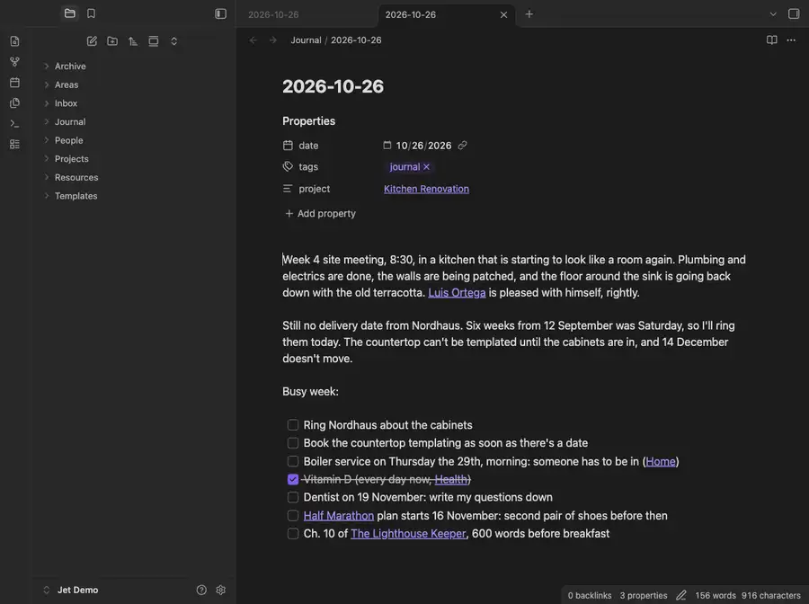

### What it holds, and what it never does
Counts, times and codes. By default it holds no note titles or paths, no folder or scope names, no search text, no plugin names and no text from an error message. Three boxes add names, one at a time, and a ticked item shows in the text before you use it: *Scope names*, *Names of enabled plugins*, and *Search text and note names (in the explanation)*.

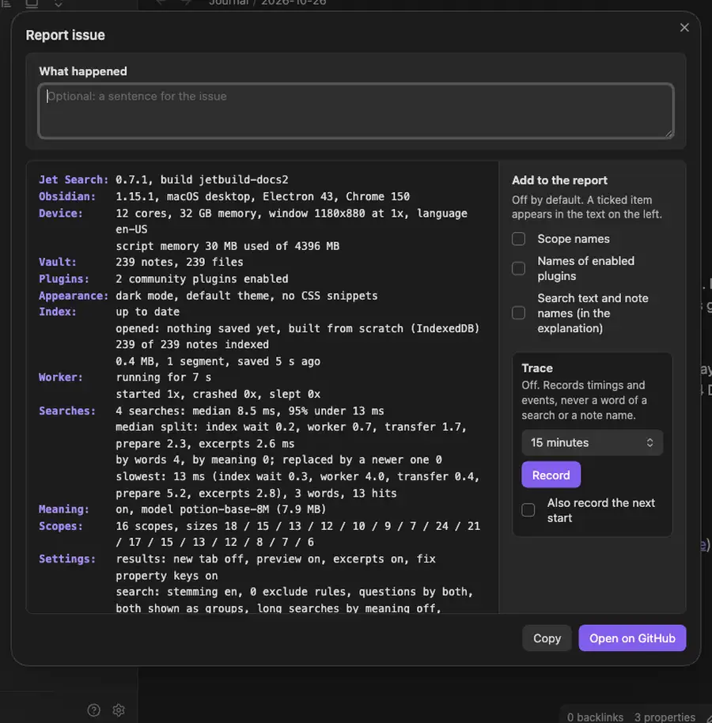

### Open on GitHub
Type a sentence in *What happened*, then press **Open on GitHub**. Your browser opens a new bug report on GitHub with the form filled in: your sentence, the versions, the size of the vault and the report. Read it, and press Submit there. Jet posts nothing and makes no request: it only opens the page.

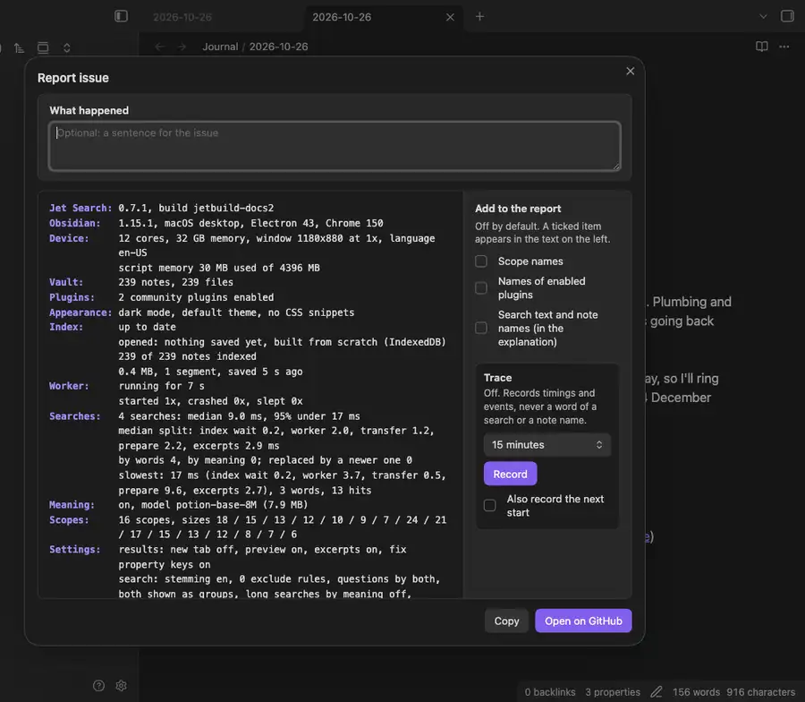

A link can only be so long. When the report does not fit in it, the page opens with what fits, and the report is copied: paste it into the *Support info* box of the form. A notice says so.

### Copy
**Copy** puts the report on the clipboard as plain text, to paste into an issue, an email or a chat.

### Record a trace
For a problem that comes and goes, such as a search that is sometimes slow or a slow start, a report of the moment is not enough. A trace records what Jet does over a few minutes, and goes into the report.

Start it from Settings → Advanced → *Trace*: choose 5, 10, 15, 30 or 60 minutes, then *Record*.

A red light blinks in the status bar, with a *Jet trace* item, while it records, and the trace stops by itself. Click the item to open the report.

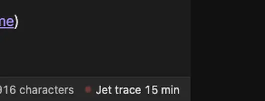

You can also start it from the settings button at the bottom right of Jet's window, from the *Trace* box in the Report issue window, or with the commands *Start recording a trace* and *Stop recording a trace*.

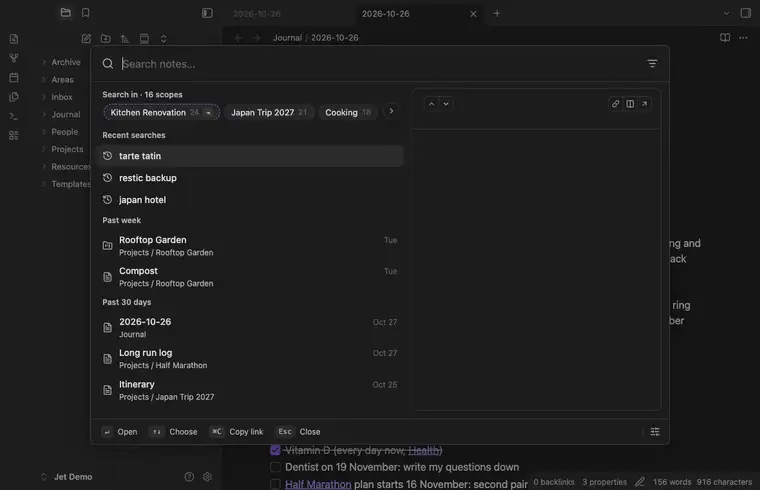

A trace records timings and events: the worker starting and sleeping, the index opening and building, changes sent to the index, each search's time and where it went, and the errors Jet caught. It never records a word of a search or a note name. It lives in memory only: nothing is written to disk, and it is gone when Obsidian closes. *Also record the next start* catches a problem that happens while Obsidian starts; it records once and then turns itself off.

In the report, *Trace* sums it up (how many searches, the median and the slowest, the worker, the index), and *Timeline* lists every event to the millisecond. Jet searches as you type, so one query makes a search per keystroke: each search says which query it belongs to, for example `query 3 (2 of 5)`. Searches less than 2 seconds apart count as one query. *Include the full timeline* is ticked, and can be unticked to leave the list out.

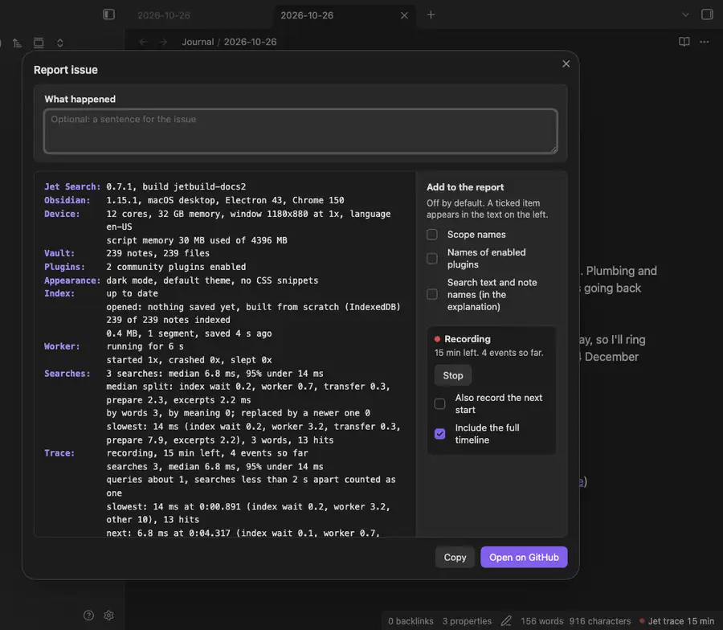

## Themes

Jet's window follows your theme, dark or light.

| | Dark | Light |
|---|---|---|
| Obsidian's default |  |  |
| Minimal |  |  |
| Things |  |  |
| AnuPpuccin |  |  |
| Catppuccin |  |  |

## Mobile

Jet works on Obsidian mobile, with the same search, but mobile is not officially supported yet: it has been tested on an emulated phone and in WebKit, not yet on real devices. Reports from phones and tablets are welcome.

What is ready:

- **A phone layout.** On a phone the window drops the line of key hints, the small buttons (clear, filter, sort, scope chips) have a touch area of 44 px, and the options in the settings are drawn as plain rows.
- **A warning before the download.** On a phone or tablet, the confirmation for Search by meaning adds "Use Wi-Fi: it counts against mobile data".
- **A floor.** Jet needs iOS 15.4 or Android WebView 98. On anything older it shows a notice and stays off instead of failing halfway.
- **No work in the background.** The first build reads notes in slices of at most 8 ms, and Jet pauses while the app is hidden.
- **Checked so far:** an emulated phone with a slowed processor, and the search engine in WebKit (the engine iOS uses), where 435 searches in several languages gave the same results as on desktop.
- **Not checked yet:** real phones. Very large vaults (tens of thousands of notes) are the likeliest to be slow on a phone.
