# Jet Search: reference

Every part of Jet's window, every setting, the ways it can be set up, and how it is used: each numbered on the picture and explained in the table under it. Recorded in the [demo vault](../demo-vault), dark theme. Keys: *Ctrl / ⌘* is Ctrl on Windows and Linux, ⌘ on a Mac; the pictures show a Mac's keys. For each feature in motion, see the [usage guide](guide.md).

**Contents**: [Jet's window](#jets-window) · [Settings](#settings) · [Configurations](#configurations) · [Usage patterns](#usage-patterns)

## Jet's window

### Jet's window, part by part

A question, `how much was the quartz countertop?`: the list on the left, the selected note on the right.

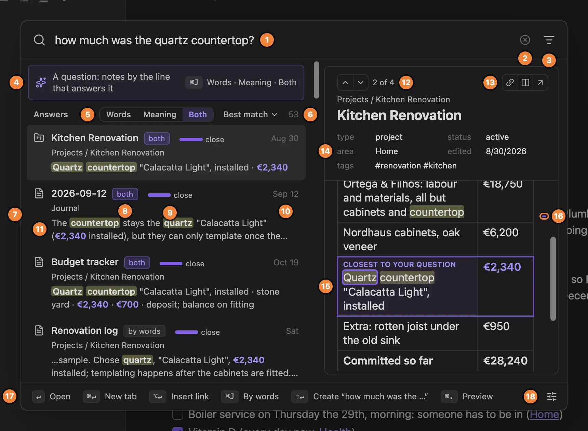

| # | Part | What it does |
|---|---|---|
| 1 | **Search box** | Names, words, filters (`#tag`, `key:value`, `path:`) and scopes (`in:`, `@`) as you type. |
| 2 | **Clear** | Empties the box, then the scope and filters. |
| 3 | **Filters** | The filters bar: title only, tags, properties, dates. Ctrl / ⌘ + F. |
| 4 | **Why this list** | What Jet made of the search: here, a question, so notes come by the line that answers it. |
| 5 | **Words · Meaning · Both** | How the search goes. Ctrl / ⌘ + J switches. |
| 6 | **Order and count** | Best match, last edited, created, title (Ctrl / ⌘ + Shift + S); then how many notes match. |
| 7 | **A result** | The note's name and folder; ↑ ↓ move, Enter opens. |
| 8 | **Found by** | By words, by meaning, or both. |
| 9 | **Closeness** | How close its line is to your question, against the first row: close, fair, loose. |
| 10 | **Edited** | When the note last changed. |
| 11 | **The line** | The line that matched: your words marked, the answer's figures coloured. |
| 12 | **Hits** | Hit 2 of 4 in this note. Ctrl / ⌘ + G next, + Shift previous. |
| 13 | **Note actions** | Copy a link, open to the right, open. |
| 14 | **Properties** | The note's properties, as Obsidian shows them. |
| 15 | **The answer** | The line closest to your question, outlined where it stands. |
| 16 | **Hit marks** | Every hit in the note, ticked on the scroll bar. |
| 17 | **Keys** | What the keys do now; they follow your own keys. |
| 18 | **Settings** | Jet's settings. |

### Before you type

Shift Shift with nothing selected: your scopes, your last searches, and the notes you opened lately.

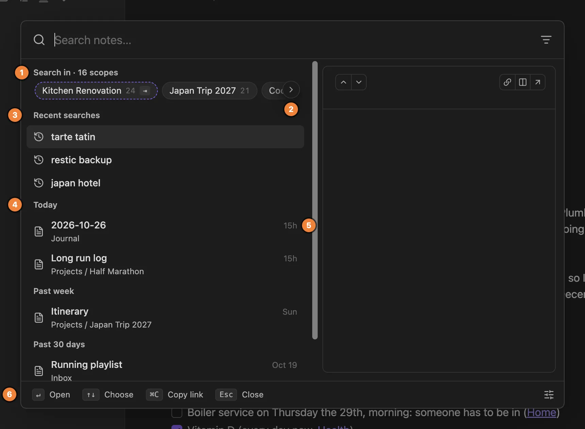

| # | Part | What it does |
|---|---|---|
| 1 | **Scopes** | Your scopes, the open note's first (here *Kitchen Renovation*, with its ⇥): click one, or Tab, to search inside it. |
| 2 | **More scopes** | Scrolls the row; at its end, *All 16* lists every scope. |
| 3 | **Recent searches** | Your last searches: ↑ ↓ and Enter run one again. |
| 4 | **Recent notes** | Notes you opened, by day (Today, Past week, Past 30 days), newest first. |
| 5 | **Opened** | How long ago you opened it. |
| 6 | **Keys** | Enter opens, ↑ ↓ choose, Ctrl / ⌘ + C copies a link, Esc closes. |

### The filters bar

`type:book ` became a chip; Ctrl / ⌘ + F opened the bar under the box.

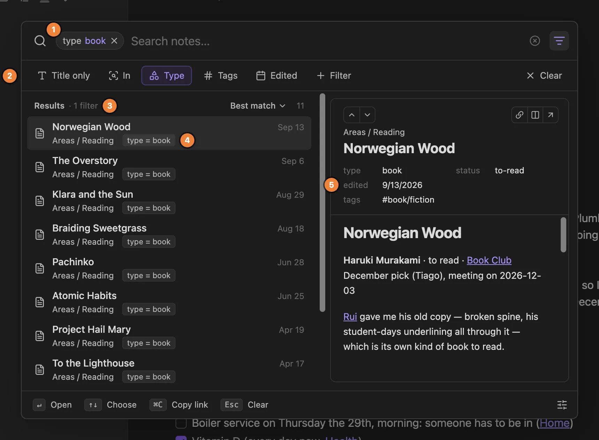

| # | Part | What it does |
|---|---|---|
| 1 | **A filter** | The chip *type* = *book*; × removes it, as Backspace in an empty box does. |
| 2 | **The bar** | *Title only* (names alone), *In* (a folder), *Type*, *Tags*, *Edited* (today, 7, 30, 90 days), *Filter* (any property), *Clear*. A lit button has a filter on. |
| 3 | **Filters on** | How many filters the list passed. |
| 4 | **Why it is here** | The filter the note matched: *type = book*. |
| 5 | **Its properties** | In the preview: the property the filter read. |

### Keys and values as you type

`status:`: Jet lists the values your notes use for the key.

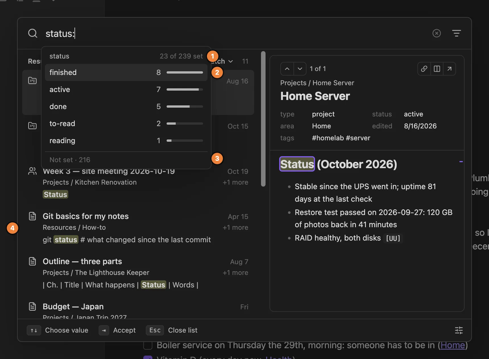

| # | Part | What it does |
|---|---|---|
| 1 | **The key** | *status*, and how many notes have it: 23 of 239. |
| 2 | **Its values** | Most used first, each with its count and a bar; ↓ and Tab take one, as a chip. |
| 3 | **Not set** | How many notes have no *status* at all. |
| 4 | **Meanwhile** | Until you pick a value, the list shows notes with the word *status*. |

### A note's actions

Ctrl / ⌘ + K on the selected note (*Shoes*). Further down the list: *Show backlinks* and *Search in this note*.

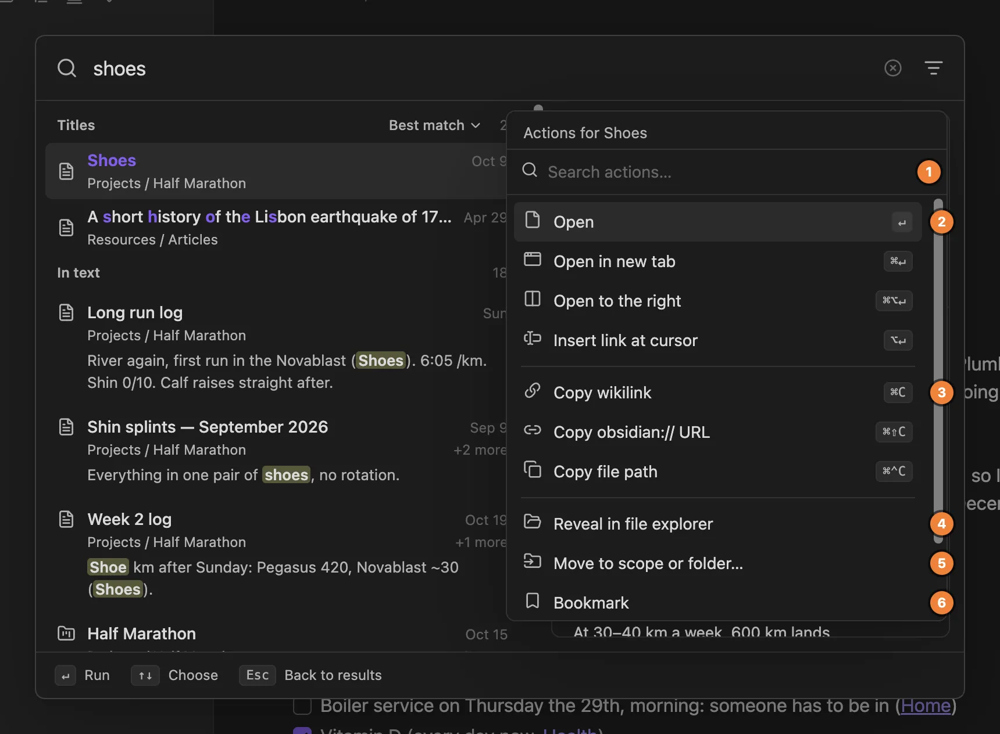

| # | Part | What it does |
|---|---|---|
| 1 | **Find an action** | Type to narrow the list; Enter runs the selected one, Esc goes back. |
| 2 | **Open** | Open, in a new tab, to the right, or insert a link where you are writing; each with its key. |
| 3 | **Copy** | A wikilink, the `obsidian://` URL, or the file path. |
| 4 | **Reveal** | Shows the note in the file list. |
| 5 | **Move** | Into a scope's folder or any folder. |
| 6 | **Bookmark** | Adds it to Obsidian's bookmarks. |

---

## Settings

### Settings → Open & keys

Settings → Jet Search. The top of every page: its status, a search over all settings, and the pages.

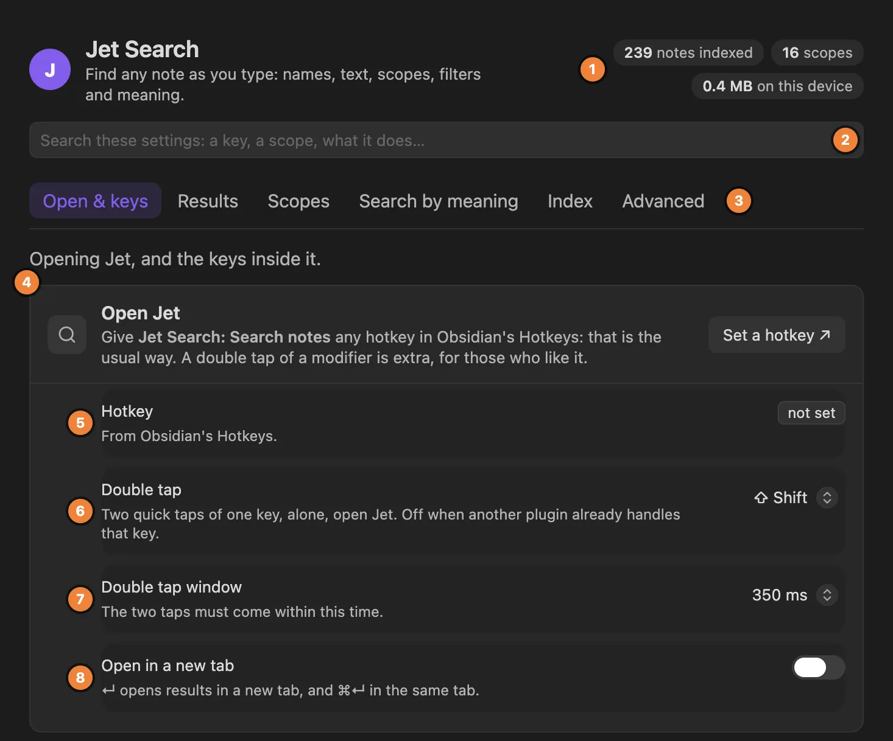

| # | Setting | What it does | Default |
|---|---|---|---|
| 1 | **Status** | Notes indexed, scopes, and the space Jet takes on this device. |  |
| 2 | **Search the settings** | Finds any setting by its name or what it does. |  |
| 3 | **Pages** | Open & keys, Results, Scopes, Search by meaning, Index, Advanced. |  |
| 4 | **Open Jet** | The usual way: give *Jet Search: Search notes* a hotkey in Obsidian's Hotkeys (*Set a hotkey* goes there). |  |
| 5 | **Hotkey** | The hotkey Obsidian has for it. | None |
| 6 | **Double tap** | Two quick taps of one key, alone, open Jet: Shift, Ctrl, Alt / Option, ⌘, or off. | Shift |
| 7 | **Double tap window** | How quickly the two taps must come. | 350 ms |
| 8 | **Open in a new tab** | Enter opens in a new tab, and Ctrl / ⌘ + Enter in the same tab. | Off |

### Settings → Open & keys → Keys in Jet

Every key inside Jet's window. Click a key and press the new one; ↺ puts its default back. A key another action already uses is refused, with which one; the hints in the window follow.

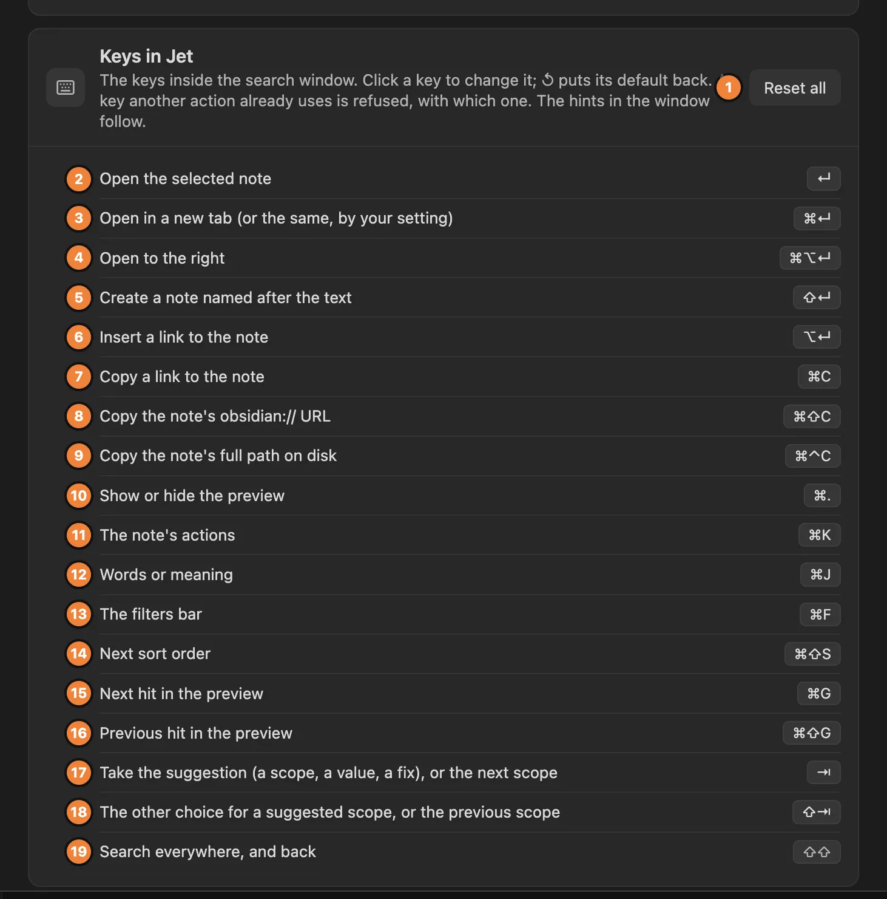

| # | Action | What it does | Default |
|---|---|---|---|
| 1 | **Reset all** | Puts every key back to its default. |  |
| 2 | **Open** | Open the selected note. | Enter |
| 3 | **Open in a new tab** | In a new tab (or the same tab, if *Open in a new tab* is on). | Ctrl / ⌘ + Enter |
| 4 | **Open to the right** | In a new pane to the right. | Ctrl / ⌘ + Alt / ⌥ + Enter |
| 5 | **Create a note** | Named after the text (in the scope's folder, if one is on). | Shift + Enter |
| 6 | **Insert a link** | A link to the note, where you are writing. | Alt / ⌥ + Enter |
| 7 | **Copy a link** | A wikilink to the note (text you selected still copies as text). | Ctrl / ⌘ + C |
| 8 | **Copy the URL** | The note's `obsidian://` URL. | Ctrl / ⌘ + Shift + C |
| 9 | **Copy the path** | The note's full path on disk. | ⌘ + Ctrl + C on a Mac, Ctrl + Alt + C elsewhere |
| 10 | **Preview** | Show or hide the preview. | Ctrl / ⌘ + . |
| 11 | **Actions** | The note's actions. | Ctrl / ⌘ + K |
| 12 | **Words or meaning** | Words, meaning or both. | Ctrl / ⌘ + J |
| 13 | **Filters bar** | Show or hide the filters bar. | Ctrl / ⌘ + F |
| 14 | **Sort** | The next sort order. | Ctrl / ⌘ + Shift + S |
| 15 | **Next hit** | The next hit in the preview. | Ctrl / ⌘ + G |
| 16 | **Previous hit** | The previous hit in the preview. | Ctrl / ⌘ + Shift + G |
| 17 | **Take the suggestion** | A scope, a value or a fix; or the next scope. | Tab |
| 18 | **The other choice** | The other scope of a name, or the previous scope. | Shift + Tab |
| 19 | **Everywhere, and back** | Inside a scope: the same text in the whole vault. Fixed: it is the double tap. | Shift Shift |

### Settings → Results

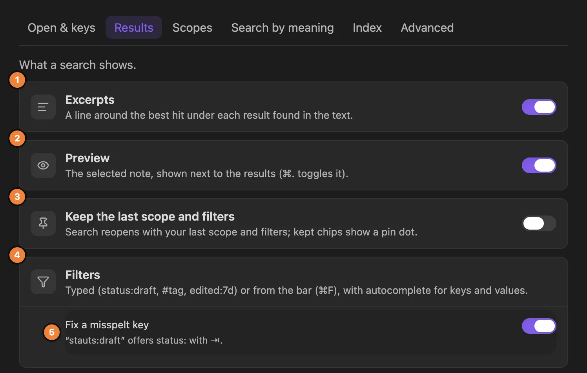

| # | Setting | What it does | Default |
|---|---|---|---|
| 1 | **Excerpts** | The line around the best hit, under each result found in the text. | On |
| 2 | **Preview** | The selected note beside the list. Ctrl / ⌘ + . shows or hides it. | On |
| 3 | **Keep the last scope and filters** | Jet reopens with them; a kept chip shows a pin dot. | Off |
| 4 | **Filters** | Typed (`status:draft`, `#tag`, `edited:7d`) or from the bar, with keys and values suggested. |  |
| 5 | **Fix a misspelt key** | `stauts:draft` offers *status:*; Tab fixes it. | On |

### Settings → Scopes

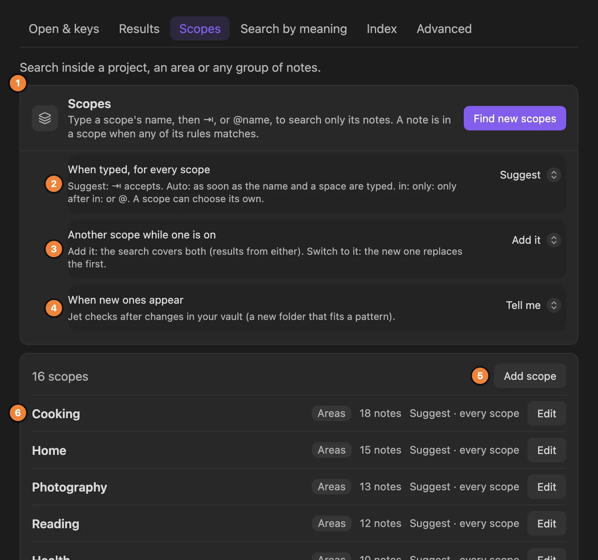

| # | Setting | What it does | Default |
|---|---|---|---|
| 1 | **Scopes** | *Find new scopes* proposes them from your folders, links and tags: tick and add. |  |
| 2 | **When typed, for every scope** | *Suggest*: Tab accepts. *Auto*: applied as soon as the name and a space are typed. *in: only*: only after `in:` or `@`. A scope can choose its own. | Suggest |
| 3 | **Another scope while one is on** | *Add it*: the search covers both. *Switch to it*: the new one replaces the first. | Add it |
| 4 | **When new ones appear** | After changes in your vault (a new folder that fits a pattern): *Tell me*, *Add them*, or *Do nothing*. | Tell me |
| 5 | **Add scope** | Make one by hand: a folder, a tag, a property or a link. |  |
| 6 | **A scope** | Its name, where it comes from, how many notes, its mode; *Edit* opens it. |  |

### Settings → Scopes → Edit

One scope, *Half Marathon*: a project with a folder, and notes elsewhere that name it in their `project:` property.

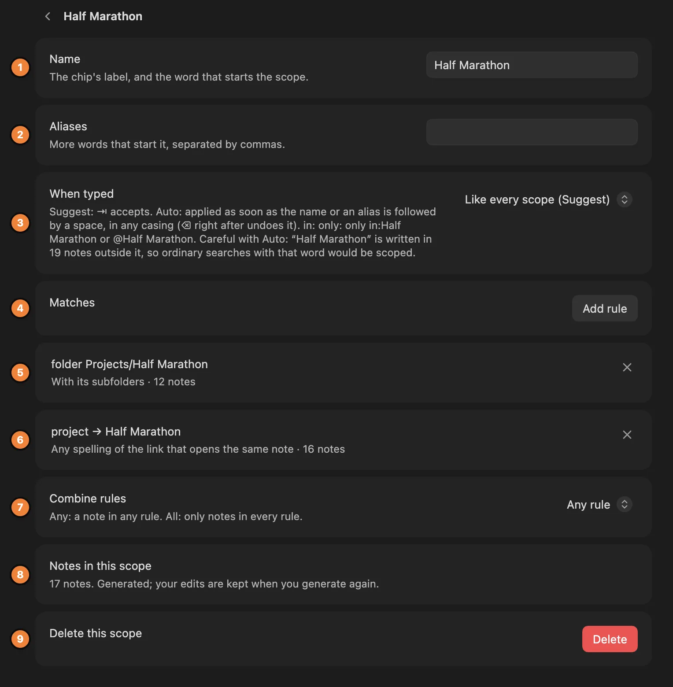

| # | Setting | What it does | Default |
|---|---|---|---|
| 1 | **Name** | The chip's label, and the word that starts the scope. | From the vault |
| 2 | **Aliases** | More words that start it, separated by commas. | None |
| 3 | **When typed** | This scope's own mode; it warns when Auto would catch the name in notes outside the scope. | Like every scope |
| 4 | **Matches** | Its rules; *Add rule* adds a folder, tag, property or link. |  |
| 5 | **A folder rule** | *Projects/Half Marathon*, with its subfolders: 12 notes. |  |
| 6 | **A property rule** | `project` → *Half Marathon*, by any link that opens the same note: 16 notes. |  |
| 7 | **Combine rules** | *Any rule*: a note in any rule. *All rules*: only notes in every rule. | Any rule |
| 8 | **Notes in this scope** | 17 here. Your edits are kept when scopes are generated again. |  |
| 9 | **Delete this scope** | Removes the scope, not its notes. |  |

### Settings → Search by meaning

The options show once the model is on.

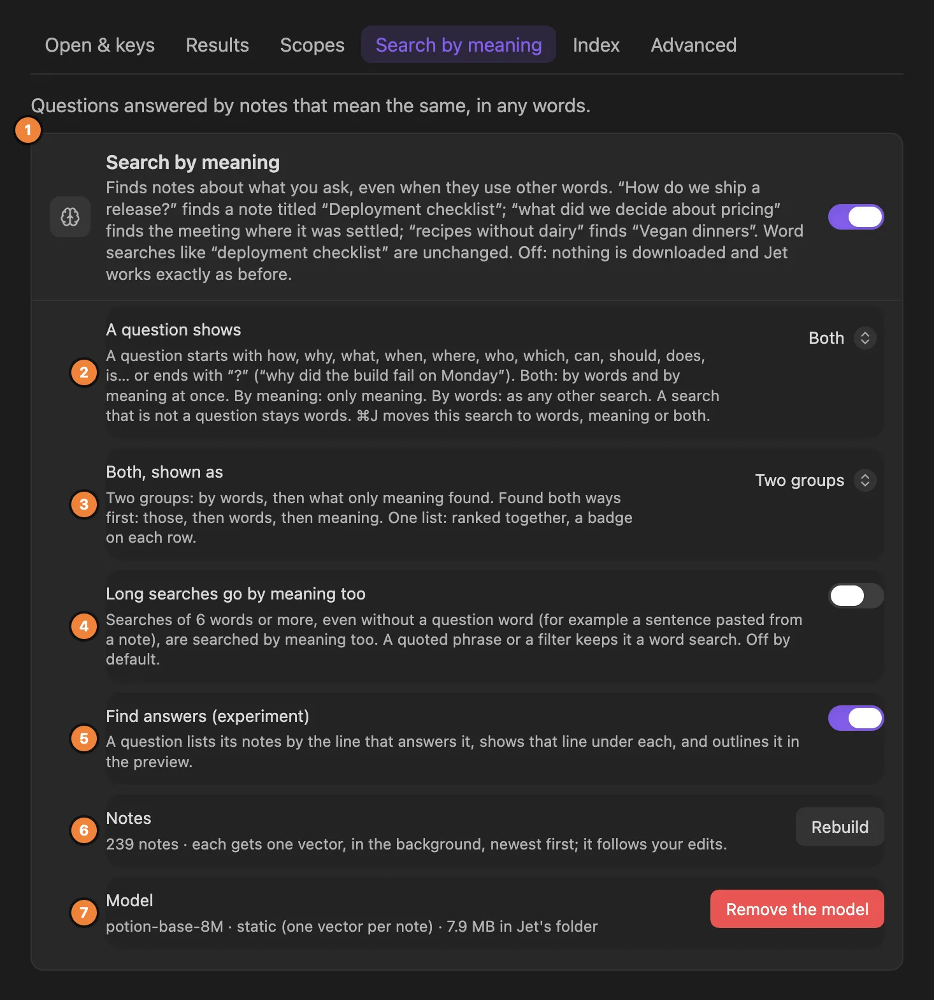

| # | Setting | What it does | Default |
|---|---|---|---|
| 1 | **Search by meaning** | Turns it on: a small model (about 8 MB, downloaded once) gives each note a meaning, on your device. | Off |
| 2 | **A question shows** | What a question (how, what, why… or ending in ?) searches by itself: both, by meaning, or by words. | Both |
| 3 | **Both, shown as** | Two groups; found both ways first; or one list with a badge on each row (see *Configurations*). | Two groups |
| 4 | **Long searches go by meaning too** | Searches of six words or more also go by meaning. | Off |
| 5 | **Find answers** | A question lists notes by the line that answers it and outlines that line in the preview. | On |
| 6 | **Notes** | How many notes have their meaning; *Rebuild* gives it again. |  |
| 7 | **Model** | The model in use and its size; *Remove the model* deletes it and turns meaning off. |  |

### Settings → Index

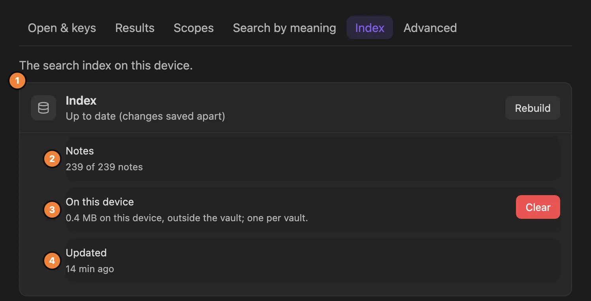

| # | Setting | What it does | Default |
|---|---|---|---|
| 1 | **Index** | Its state; *Rebuild* builds it again from the notes. |  |
| 2 | **Notes** | How many notes are in it. |  |
| 3 | **On this device** | Its size, outside the vault, one per vault; *Clear* deletes it. |  |
| 4 | **Updated** | When it last took a change. |  |

### Settings → Advanced

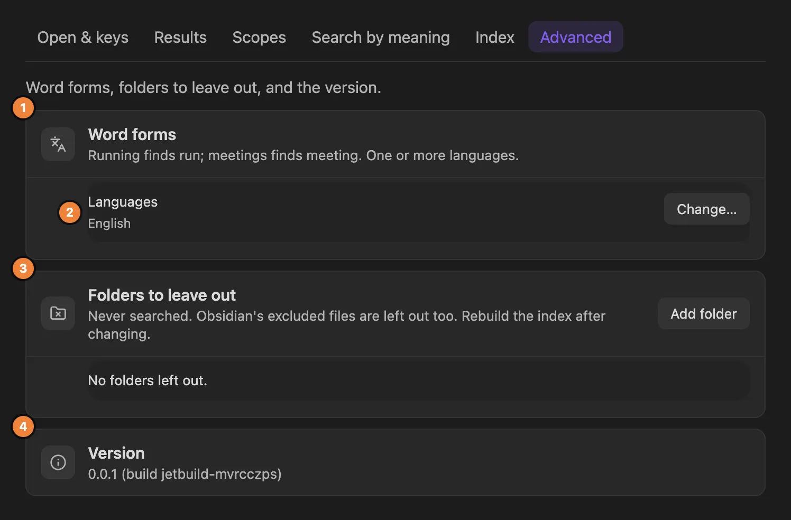

| # | Setting | What it does | Default |
|---|---|---|---|
| 1 | **Word forms** | *running* finds *run*, *meetings* finds *meeting*. |  |
| 2 | **Languages** | The languages whose word forms meet; *Change…* picks one or more. | English |
| 3 | **Folders to leave out** | Never searched (Obsidian's excluded files are left out too); rebuild the index after a change. | None |
| 4 | **Version** | Jet's version and build. |  |

---

## Configurations

### Both, shown as two groups

The default: the notes found by words, then what only meaning found. A long group folds (*43 more by meaning · Show them*).

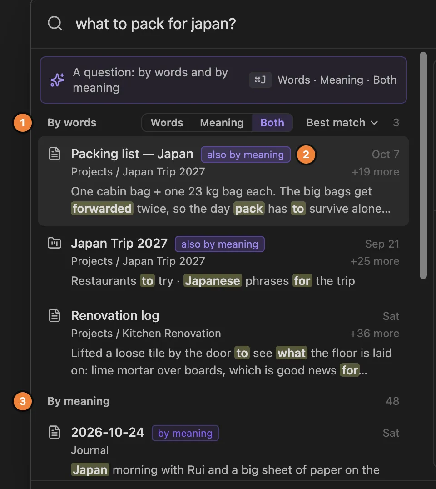

| # | Part | What it does |
|---|---|---|
| 1 | **By words** | Notes with your words, best first. |
| 2 | **Also by meaning** | Meaning found this note too. |
| 3 | **By meaning** | Notes only meaning found: other words, the same subject. |

### Both, found both ways first

Settings → Search by meaning → *Both, shown as*: *Found both ways first*.

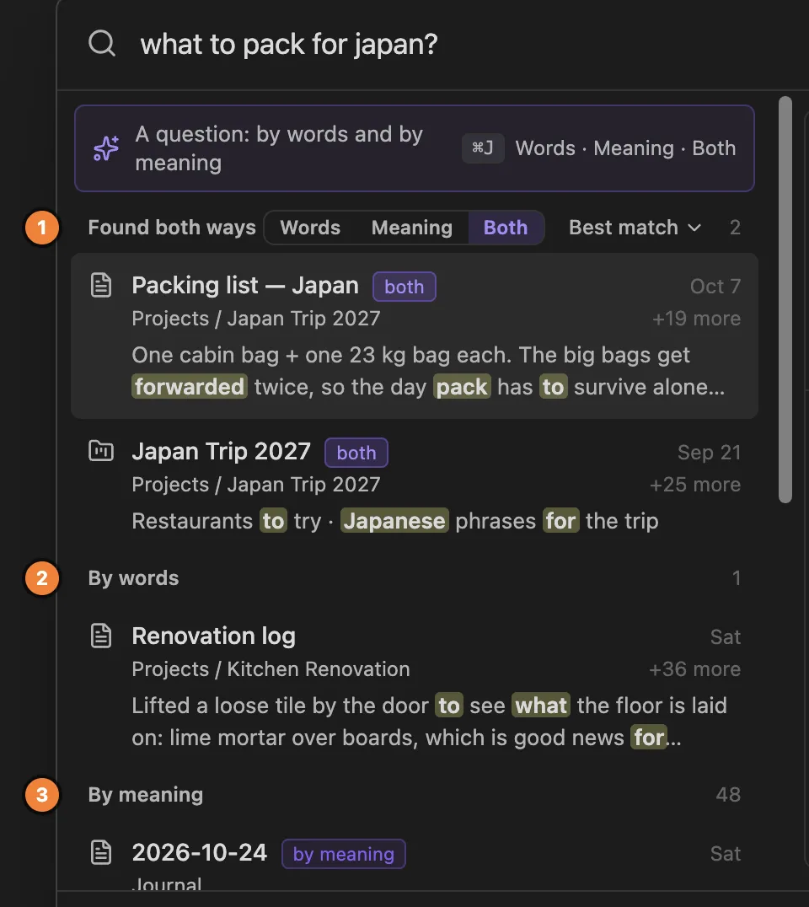

| # | Part | What it does |
|---|---|---|
| 1 | **Found both ways** | Notes words and meaning both found: the surest. |
| 2 | **By words** | Then the notes only words found. |
| 3 | **By meaning** | Then the notes only meaning found. |

### Both, as one list

*Both, shown as*: *One list*: ranked together, a badge on each row.

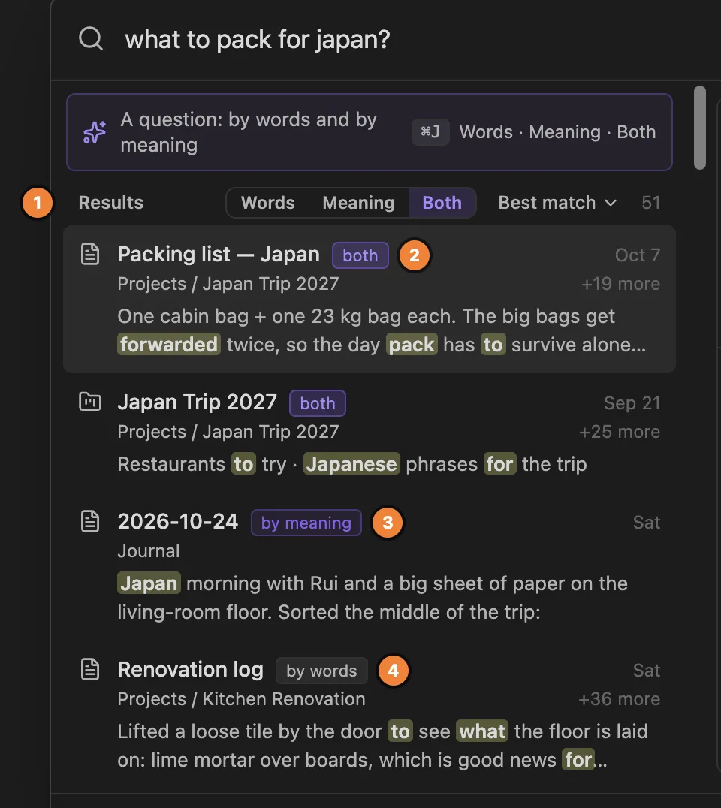

| # | Part | What it does |
|---|---|---|
| 1 | **One list** | Every note, ranked together. |
| 2 | **both** | Found by words and by meaning. |
| 3 | **by meaning** | Found by meaning only. |
| 4 | **by words** | Found by your words only. |

### A narrow window

Under 760 px wide, the preview steps aside and the list takes the width.

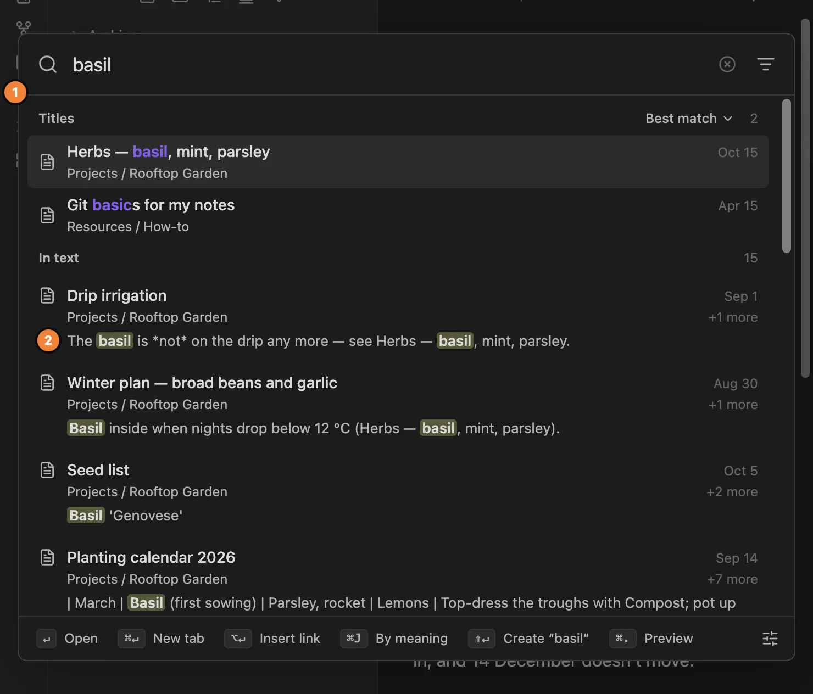

| # | Part | What it does |
|---|---|---|
| 1 | **The list, full width** | No preview, whatever the setting; widen the window and it comes back. |
| 2 | **Its line** | Each result keeps its line, so you can still tell them apart. |

### Compact: excerpts and preview off

Settings → Results: *Excerpts* off and *Preview* off. One row per note.

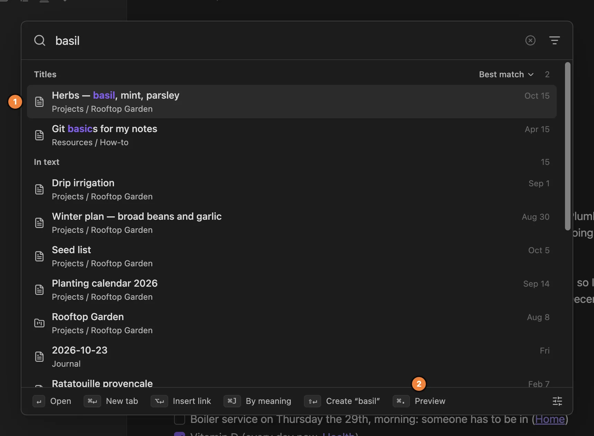

| # | Part | What it does |
|---|---|---|
| 1 | **A row** | The note's name, folder and date; no line under it. |
| 2 | **Preview key** | Ctrl / ⌘ + . shows the preview for this search. |

---

## Usage patterns

### Searching inside a scope

`half marathon ` then Tab, then `physio`: the project became the scope, and the rest of the text searches inside it.

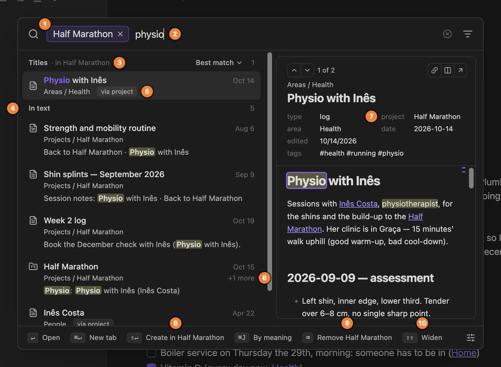

| # | Part | What it does |
|---|---|---|
| 1 | **The scope** | Tab took *Half Marathon* from the text. × or Backspace removes it. |
| 2 | **Searched inside** | The rest of the text searches the scope's notes only. |
| 3 | **Where from** | The list comes from the scope. |
| 4 | **Groups** | Notes named so first (*Titles*), then notes that mention it (*In text*). |
| 5 | **Why it is in** | In *Areas / Health*, outside the project's folder: *via project* says its `project:` property put it in. |
| 6 | **More hits** | The note has more hits than its line shows. |
| 7 | **The property** | The property that puts it in the scope, in the preview. |
| 8 | **Create here** | Shift + Enter creates a note named after the text, in the scope's folder. |
| 9 | **Leave the scope** | Backspace in an empty box removes the scope. |
| 10 | **Everywhere** | Shift Shift: the same text in the whole vault; again to come back. |

### A scope on Auto

*Home Server* is set to Auto: typing its name and a space applies it at once.

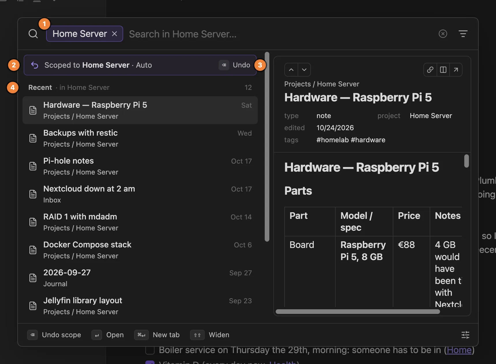

| # | Part | What it does |
|---|---|---|
| 1 | **Applied** | No Tab needed: the name became the scope. |
| 2 | **Says so** | *Scoped to Home Server · Auto*. |
| 3 | **Undo** | Backspace right away undoes it; the words come back as text. |
| 4 | **The scope's notes** | With nothing else typed: its notes, newest first. |

### Two scopes of one name

`photography exposure`: an area and a resource folder are both called *Photography*.

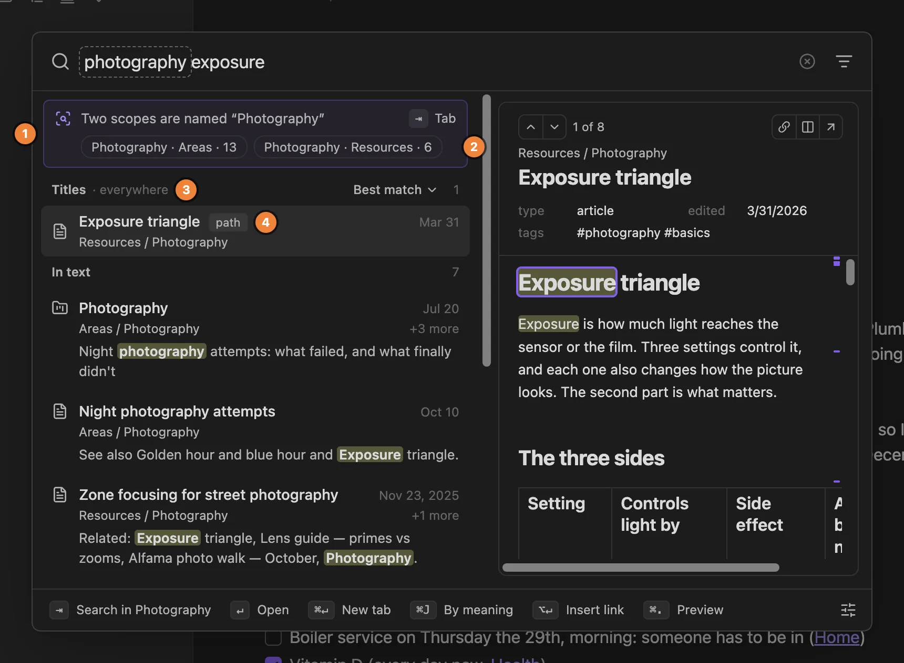

| # | Part | What it does |
|---|---|---|
| 1 | **Both offered** | Two scopes share the name: Jet shows both. |
| 2 | **Which one** | Each with its folder and size; Tab takes the first, Tab again the other. |
| 3 | **Until you pick** | The search runs everywhere. |
| 4 | **path** | Found by its folder path, not its text. |

### Filters with words

`#recipe/french ` became a chip, then `pommes` searches inside it.

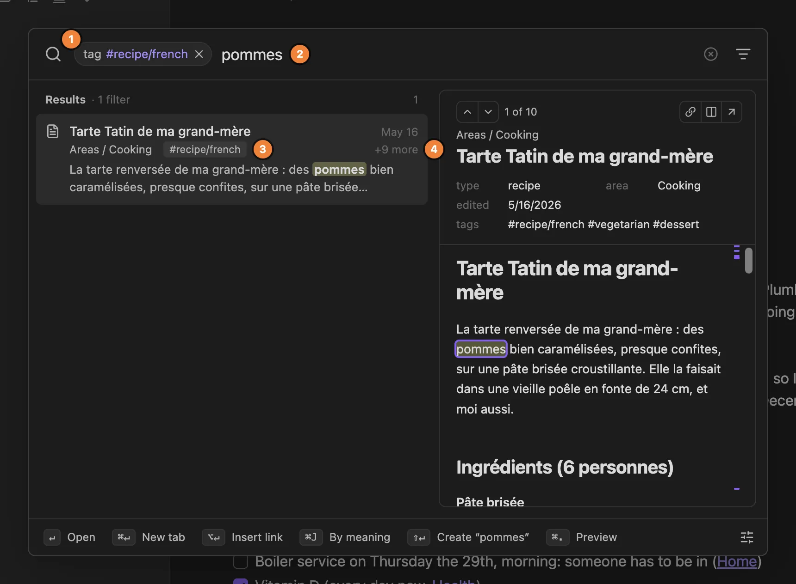

| # | Part | What it does |
|---|---|---|
| 1 | **Tag chip** | A tag as a filter; a parent tag (`#recipe`) keeps its children. |
| 2 | **Words** | Searched in the notes the chip keeps. |
| 3 | **The tag it has** | Why it passed the filter. |
| 4 | **More hits** | More hits in the note than its line shows. |

### A misspelt key

`stauts:done`: no note has a *stauts* property.

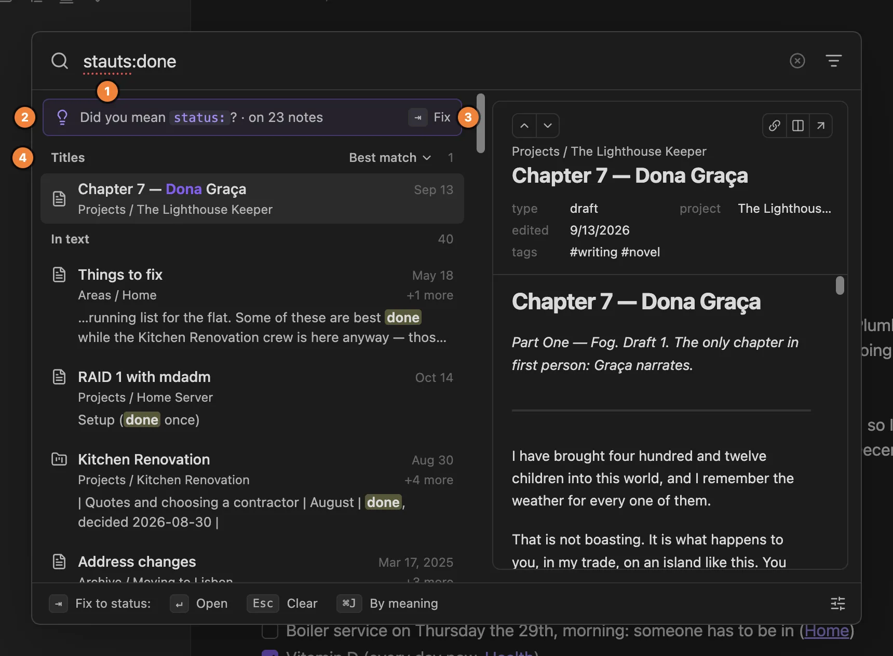

| # | Part | What it does |
|---|---|---|
| 1 | **Underlined** | The key no note has. |
| 2 | **Did you mean** | *status:*, and how many notes have it. |
| 3 | **Fix** | Tab fixes the key; the value stays. |
| 4 | **Meanwhile** | Until it is fixed, the text is searched as words. |

### When nothing matches

`ryokkann`: no note has it.

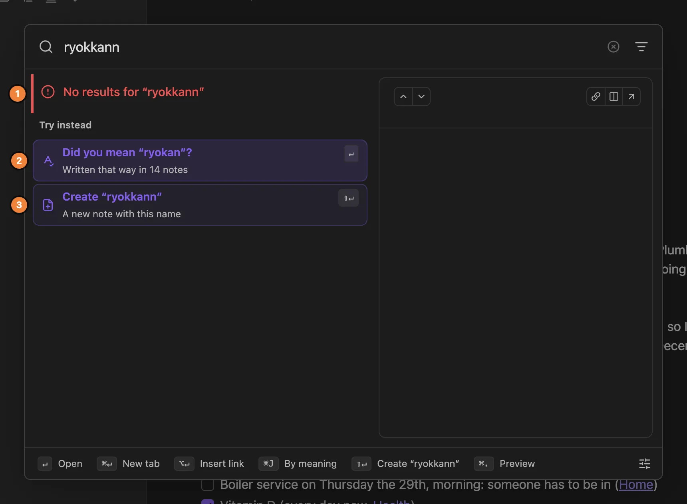

| # | Part | What it does |
|---|---|---|
| 1 | **No results** | Nothing matched, even with typos forgiven. |
| 2 | **Did you mean** | The spelling your notes use (*ryokan*, with how many notes); Enter searches it. |
| 3 | **Create** | A new note with this name: Shift + Enter. |

### Obsidian's own operators

`line:(tomatoes compost)`: `line:`, `section:`, `block:`, `task:` and `/regex/` are Obsidian's search.

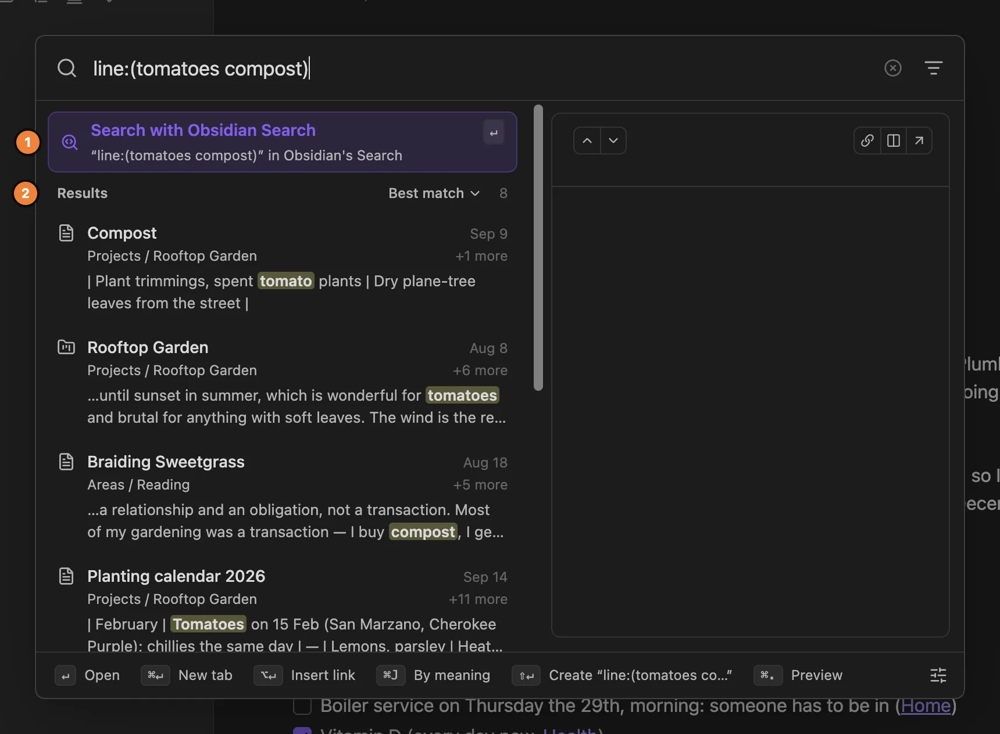

| # | Part | What it does |
|---|---|---|
| 1 | **Hand-off** | Enter runs it in Obsidian's search pane. |
| 2 | **Jet's results** | Meanwhile, Jet searches the words it can read. |

### Search in this note

The command *Jet Search: Search in this note*, in the *Itinerary*, with `train`.

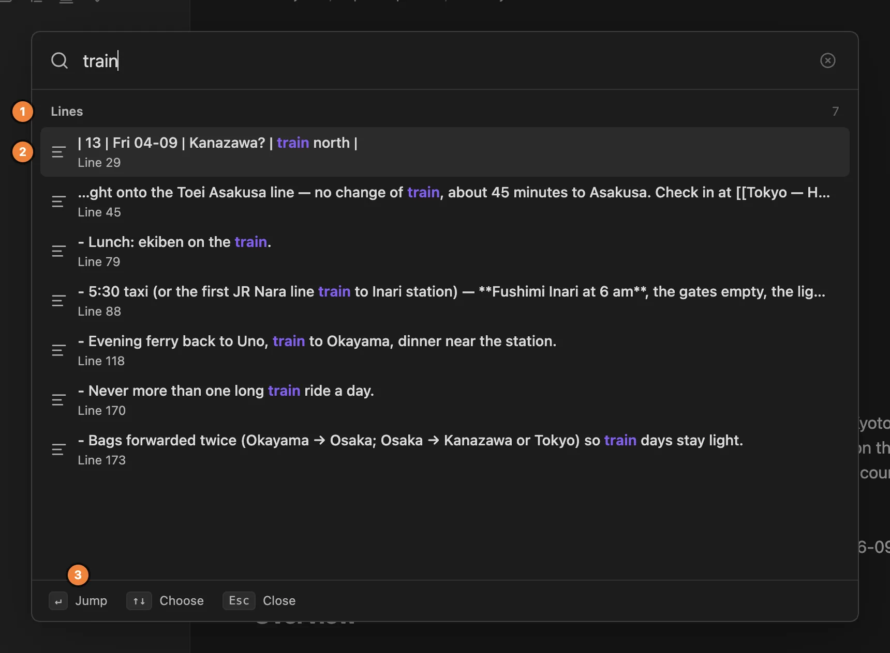

| # | Part | What it does |
|---|---|---|
| 1 | **Lines** | Every line of the note with the words, in order, and how many. |
| 2 | **A line** | The line, its words marked, and its line number. |
| 3 | **Jump** | Enter jumps to the line in the note. |
